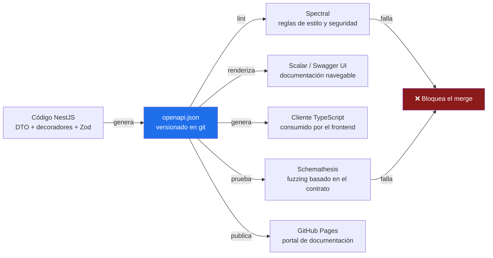

# 09 — API y Estrategia de Documentación de Endpoints

> **Proyecto:** SecurTex — Editor LaTeX Colaborativo Seguro (backend)
> **Versión:** 1.0
> **Pregunta que responde este documento:** ¿cómo se documenta el backend para que cualquiera —compañeros, el docente, o un agente de IA— vea y pruebe todos los endpoints sin leer el código?

---

## 1. Principio rector: *code-first, contract-verified*

Hay dos formas de documentar una API y ambas fallan de la misma manera si se eligen mal:

| Enfoque | Qué es | Riesgo |
|---|---|---|
| **Design-first** | Se escribe el `openapi.yaml` a mano y el código se implementa contra él | El código se desvía del contrato y nadie se entera |
| **Code-first** | El contrato se **genera** desde el código (decoradores + esquemas) | Se documenta lo que hay, pero se pierde la fase de diseño previo |

**Decisión de SecurTex (ADR-0008): code-first con verificación de contrato.**

1. El contrato **se genera** desde los decoradores de NestJS y los esquemas de Zod → imposible que la documentación mienta sobre la forma real de la petición o la respuesta.
2. El contrato generado **se versiona en el repositorio** (`contracts/openapi.json`).
3. El CI **falla** si el contrato generado difiere del versionado sin que se haya actualizado → los cambios de API son visibles y revisables en el *pull request*, como cualquier otro código.
4. El contrato se **valida** (Spectral) y se **prueba contra la implementación real** (Schemathesis) → no basta con que exista: tiene que ser correcto.



---

## 2. Comparación de herramientas evaluadas

El usuario preguntaba si "Swagger u otras más completas". Esta es la evaluación real:

### 2.1 Especificación

| Herramienta | Qué es | Veredicto |
|---|---|---|
| **OpenAPI 3.1** ✅ | Estándar de facto para APIs REST. La 3.1 es **100 % compatible con JSON Schema**, lo que permite reutilizar los mismos esquemas de validación (Zod) como documentación | **Elegida.** Es la base de todo lo demás |
| OpenAPI 3.0 | Versión anterior, JSON Schema solo parcialmente compatible | Descartada: obliga a duplicar esquemas |
| **AsyncAPI 3.0** ✅ | El equivalente a OpenAPI para APIs asíncronas: WebSockets, colas, eventos | **Elegida como complemento.** SecurTex tiene WebSockets (colaboración) y eventos (BullMQ, Redis Streams) que OpenAPI **no puede describir** |
| **Protobuf + gRPC reflection** ✅ | Contrato de la comunicación interna entre microservicios | **Elegida** para el tráfico interno (no público) |
| RAML / API Blueprint | Alternativas históricas | Descartadas: ecosistema en declive |

> **Punto clave:** Swagger/OpenAPI **por sí solo deja sin documentar la mitad del sistema**, porque la colaboración en tiempo real no es REST. Por eso se añade AsyncAPI. Esta es la respuesta a "¿hay algo más completo que Swagger?": no es *otra* herramienta, es **OpenAPI + AsyncAPI + Protobuf**, cada una para su tipo de interfaz.

### 2.2 Renderizado de la documentación

| Herramienta | Ventajas | Inconvenientes | Decisión |
|---|---|---|---|
| **Scalar** | Interfaz moderna, buscador excelente, cliente de pruebas integrado, tema oscuro, autoalojable, ligera | Proyecto joven | ✅ **Portal principal** |
| Swagger UI | Universalmente reconocida, integrada en `@nestjs/swagger` | Interfaz anticuada, mal rendimiento con APIs grandes | ✅ **Se mantiene** en `/api/docs-classic` por familiaridad |
| Redoc / Redocly | Documentación de tres columnas muy legible, ideal para publicar | El "probar ahora" solo está en la versión de pago | ✅ **Portal público estático** |
| Stoplight Elements | Buen equilibrio | Dependencia de plataforma | ❌ |
| RapiDoc | Muy configurable | Comunidad pequeña | ❌ |

**Resultado:** tres vistas del **mismo** `openapi.json`, sin duplicar esfuerzo.

| Ruta | Herramienta | Público | Disponible en |
|---|---|---|---|
| `/api/docs` | **Scalar** | Desarrolladores del equipo | Desarrollo y staging |
| `/api/docs-classic` | Swagger UI | Quien prefiera la interfaz clásica | Desarrollo y staging |
| `/api/openapi.json` | Documento crudo | Generación de clientes, herramientas | Desarrollo y staging |
| `/api/asyncapi` | AsyncAPI Studio | Documentación de WebSockets y eventos | Desarrollo y staging |
| GitHub Pages | Redocly estático | Docente, compañeros, evaluación | Siempre |

> ⚠️ **Decisión de seguridad:** en **producción** todas las rutas de documentación están **deshabilitadas** (`NODE_ENV === 'production'` ⇒ no se monta el módulo). Un esquema de API completo es un mapa para un atacante: le indica cada endpoint, cada parámetro y cada rol. La documentación pública se publica como sitio estático controlado, no desde el servidor de producción.

### 2.3 Calidad y verificación del contrato

| Herramienta | Función | Cuándo se ejecuta |
|---|---|---|
| **Spectral** | *Linter* del OpenAPI: obliga a que todo endpoint tenga descripción, respuestas de error documentadas, esquema de seguridad declarado, ejemplos, `operationId` único | Cada push |
| **Schemathesis** | Genera peticiones automáticas a partir del contrato (fuzzing basado en propiedades) y comprueba que la implementación real las cumple | Cada push contra el entorno de pruebas |
| **openapi-diff** | Detecta cambios **incompatibles** entre la versión anterior y la nueva | Cada PR |
| **openapi-typescript** / **orval** | Genera el cliente tipado que consume el frontend | Build |
| **Bruno** | Colecciones de peticiones versionadas **en el repositorio** (a diferencia de Postman, que vive en la nube de un tercero) | Manual y CI |

### 2.4 Reglas Spectral propias (extracto)

```yaml
# .spectral.yaml
extends: ["spectral:oas"]
rules:
  # Toda operación debe declarar su esquema de seguridad
  operation-security-defined:
    given: "$.paths[*][get,post,put,patch,delete]"
    then: { field: security, function: truthy }
    severity: error

  # Toda operación debe documentar 400, 401, 403 y 429
  operation-error-responses:
    given: "$.paths[*][post,put,patch,delete]"
    then:
      - { field: "responses.400", function: truthy }
      - { field: "responses.401", function: truthy }
      - { field: "responses.403", function: truthy }
      - { field: "responses.429", function: truthy }
    severity: error

  # Prohibido exponer identificadores numéricos secuenciales
  no-numeric-ids:
    given: "$.paths[*].parameters[?(@.in=='path')].schema"
    then: { field: type, function: pattern, functionOptions: { notMatch: "^integer$" } }
    severity: error

  # Ningún ejemplo puede contener datos que parezcan reales
  no-real-data-in-examples:
    given: "$..example"
    then: { function: pattern, functionOptions: { notMatch: "(?i)(password|secret|token|@gmail|@hotmail)" } }
    severity: error
```

---

## 3. Cómo se documenta un endpoint en el código

La documentación **no** es un archivo aparte que alguien debe acordarse de actualizar: es el propio código.

```ts
@ApiTags('Proyectos')
@ApiBearerAuth('sessionCookie')
@Controller({ path: 'projects', version: '1' })
export class ProjectController {

  @Post(':projectId/members')
  @Policy(ProjectPolicy.canManageAccess)          // ← autorización obligatoria
  @Throttle({ default: { limit: 10, ttl: 60_000 } })
  @ApiOperation({
    operationId: 'inviteProjectMember',
    summary: 'Invitar a un colaborador al proyecto',
    description: `
Crea una invitación con un token de un solo uso (256 bits) y caducidad de 7 días.

**Autorización:** solo el propietario del proyecto.
**Auditoría:** genera el evento \`project.invite.created\`.
**Límites:** el número de colaboradores depende del plan contratado.`,
  })
  @ApiParam({ name: 'projectId', format: 'uuid', description: 'Identificador UUIDv7 del proyecto' })
  @ApiBody({ type: InviteMemberDto })
  @ApiCreatedResponse({ type: InvitationResponseDto, description: 'Invitación creada y correo enviado' })
  @ApiBadRequestResponse({ type: ProblemDetailsDto, description: 'Correo con formato inválido' })
  @ApiUnauthorizedResponse({ type: ProblemDetailsDto, description: 'Sesión ausente o expirada' })
  @ApiForbiddenResponse({ type: ProblemDetailsDto, description: 'El actor no es propietario' })
  @ApiNotFoundResponse({ type: ProblemDetailsDto, description: 'Proyecto inexistente o sin acceso (respuesta uniforme)' })
  @ApiPaymentRequiredResponse({ type: ProblemDetailsDto, description: 'Límite de colaboradores del plan alcanzado' })
  @ApiTooManyRequestsResponse({ type: ProblemDetailsDto, description: 'Límite de invitaciones por minuto superado' })
  async inviteMember(
    @Param('projectId', ParseUuidPipe) projectId: ProjectId,
    @Body() dto: InviteMemberDto,
    @CurrentUser() actor: AuthenticatedUser,
  ): Promise<InvitationResponseDto> {
    return this.inviteMemberUseCase.execute({ projectId, actor, ...dto });
  }
}
```

Y el DTO define a la vez la validación **y** la documentación:

```ts
export class InviteMemberDto {
  @ApiProperty({ format: 'email', maxLength: 254, example: 'colaborador@universidad.edu' })
  @IsEmail({}, { message: 'Formato de correo inválido' })
  @MaxLength(254)
  readonly email!: string;

  @ApiProperty({ enum: ['editor', 'reviewer', 'viewer'], example: 'editor' })
  @IsIn(['editor', 'reviewer', 'viewer'])   // 'owner' NO es asignable por invitación
  readonly role!: InvitableRole;
}
```

> **Nota de seguridad:** `ValidationPipe` se configura globalmente con `whitelist: true` y `forbidNonWhitelisted: true`. Cualquier propiedad que no esté en el DTO provoca un `400`. Esto convierte la documentación en la definición **exhaustiva** de lo aceptado: no hay campos ocultos.

---

## 4. Convenciones de la API

| Aspecto | Convención |
|---|---|
| Base | `https://api.securtex.app/api/v1` |
| Versionado | Por URI (`/v1`); las versiones conviven al menos 6 meses |
| Formato | JSON (`application/json`); UTF-8 |
| Nomenclatura | Recursos en plural y `kebab-case` en la ruta; propiedades en `camelCase` |
| Identificadores | UUIDv7 en toda ruta y respuesta; **nunca enteros secuenciales** |
| Fechas | ISO 8601 en UTC (`2026-08-14T10:32:11.482Z`) |
| Paginación | Basada en cursor: `?limit=50&cursor=…`; respuesta con `nextCursor` |
| Ordenación | `?sort=-lastModified,name` |
| Filtrado | Parámetros explícitos y declarados; **sin** filtros dinámicos que se traduzcan a SQL |
| Idempotencia | Cabecera `Idempotency-Key` obligatoria en `POST` que crean recursos facturables o costosos |
| Errores | **RFC 9457 · Problem Details** |
| Concurrencia | `ETag` + `If-Match` en actualizaciones de recursos con estado |
| Límite de tasa | Cabeceras `RateLimit-Limit`, `RateLimit-Remaining`, `RateLimit-Reset` (RFC 9331) |
| Correlación | `X-Request-Id` de entrada y salida, ligado al `traceId` |

### 4.1 Formato de error (RFC 9457)

```json
{
  "type": "https://securtex.app/errors/insufficient-role",
  "title": "Permisos insuficientes",
  "status": 403,
  "detail": "Tu rol en este proyecto no permite modificar archivos.",
  "instance": "/api/v1/projects/01J9X.../files/01J9Y...",
  "traceId": "4bf92f3577b34da6a3ce929d0e0e4736"
}
```

**Reglas de los mensajes de error** (RNF-031):

- Nunca contienen rutas del sistema, trazas de pila, versiones de software ni SQL.
- "No existe" y "no autorizado" devuelven **el mismo 404** en recursos privados, para no permitir enumeración.
- El `traceId` permite al usuario reportar el problema y al equipo encontrarlo en los logs, sin exponer nada.

---

## 5. Catálogo de endpoints

> Este catálogo es el **resumen legible**; el contrato ejecutable y exhaustivo es `contracts/openapi.json`.

### 5.1 Autenticación y cuenta — `/api/v1/auth`, `/api/v1/me`

| Método | Ruta | Descripción | Autorización | Límite |
|---|---|---|---|---|
| `POST` | `/auth/register` | Registro con correo y contraseña | Público | 5/h por IP |
| `POST` | `/auth/verify-email` | Verificar el correo con el token | Público | 10/h |
| `POST` | `/auth/login` | Inicio de sesión local | Público | 10/15 min por cuenta |
| `GET` | `/auth/oidc/:provider` | Iniciar flujo con Google, Microsoft u ORCID | Público | 20/h |
| `GET` | `/auth/oidc/:provider/callback` | Retorno del proveedor | Público | — |
| `POST` | `/auth/saml/:institutionId` | Iniciar SSO institucional | Público | — |
| `POST` | `/auth/refresh` | Rotar el refresh token | Cookie | 60/h |
| `POST` | `/auth/logout` | Cerrar la sesión actual | Sesión | — |
| `POST` | `/auth/logout-all` | Cerrar todas las sesiones | Sesión + reautenticación | 5/h |
| `POST` | `/auth/password/forgot` | Solicitar recuperación | Público | 3/h por correo |
| `POST` | `/auth/password/reset` | Restablecer con el token | Público | 5/h |
| `POST` | `/auth/mfa/totp/setup` | Iniciar alta de TOTP | Sesión + reautenticación | 10/h |
| `POST` | `/auth/mfa/totp/confirm` | Confirmar TOTP | Sesión | 10/h |
| `POST` | `/auth/mfa/webauthn/register` | Registrar passkey | Sesión + reautenticación | 10/h |
| `POST` | `/auth/mfa/verify` | Verificar segundo factor | Sesión parcial | 5/10 min |
| `DELETE` | `/auth/mfa/:methodId` | Eliminar un método MFA | Sesión + reautenticación | 5/h |
| `GET` | `/me` | Perfil del usuario actual | Sesión | — |
| `PATCH` | `/me` | Actualizar perfil | Sesión | 30/h |
| `GET` | `/me/sessions` | Listar sesiones activas | Sesión | — |
| `DELETE` | `/me/sessions/:id` | Revocar una sesión | Sesión | 20/h |
| `GET` | `/me/identities` | Proveedores vinculados | Sesión | — |
| `DELETE` | `/me/identities/:provider` | Desvincular proveedor | Sesión + reautenticación | 5/h |
| `GET` | `/me/emails` | Correos secundarios | Sesión | — |
| `POST` | `/me/emails` | Añadir correo secundario | Sesión | 5/h |
| `POST` | `/me/export` | Solicitar exportación de datos (RGPD) | Sesión + reautenticación | 1/día |
| `DELETE` | `/me` | Eliminar la cuenta | Sesión + reautenticación | 1/día |
| `GET` | `/me/audit` | Mi registro de actividad | Sesión | — |
| `GET`/`POST`/`DELETE` | `/me/tokens` | Tokens de aplicación y del puente Git | Sesión + reautenticación | 10/h |
| `GET`/`PUT` | `/me/preferences` | Preferencias del editor | Sesión | — |

### 5.2 Proyectos — `/api/v1/projects`

| Método | Ruta | Descripción | Rol mínimo |
|---|---|---|---|
| `GET` | `/projects` | Listar con búsqueda, filtros, etiquetas y paginación | Usuario |
| `POST` | `/projects` | Crear en blanco | Usuario |
| `POST` | `/projects/from-template/:templateId` | Crear desde plantilla | Usuario |
| `POST` | `/projects/import/zip` | Importar `.zip` | Usuario |
| `POST` | `/projects/import/github` | Importar de GitHub | Usuario |
| `GET` | `/projects/:id` | Detalle y metadatos | Lector |
| `PATCH` | `/projects/:id` | Renombrar, compilador, versión de TeX Live, archivo principal | Editor |
| `POST` | `/projects/:id/clone` | Clonar | Lector |
| `POST` | `/projects/:id/archive` · `/unarchive` | Archivar | Propietario |
| `POST` | `/projects/:id/trash` · `/restore` | Papelera | Propietario |
| `DELETE` | `/projects/:id` | Eliminar definitivamente | Propietario |
| `POST` | `/projects/:id/leave` | Abandonar proyecto compartido | Colaborador |
| `POST` | `/projects/:id/transfer` | Transferir propiedad | Propietario |
| `GET` | `/projects/:id/download` | Descargar `.zip` | Lector |
| `GET` | `/projects/:id/word-count` | Contador de palabras | Lector |
| `GET`/`POST`/`DELETE` | `/projects/:id/members` | Gestión de colaboradores | Propietario |
| `PATCH` | `/projects/:id/members/:userId` | Cambiar rol | Propietario |
| `GET`/`POST`/`DELETE` | `/projects/:id/share-links` | Enlaces de compartición | Propietario |
| `POST` | `/projects/:id/publish-pdf` | Publicar enlace público del PDF | Propietario |
| `GET`/`POST`/`DELETE` | `/tags` y `/projects/:id/tags` | Etiquetas | Usuario |
| `POST` | `/invitations/:token/accept` · `/decline` | Responder a una invitación | Usuario |

### 5.3 Archivos — `/api/v1/projects/:id/files`

| Método | Ruta | Descripción | Rol mínimo |
|---|---|---|---|
| `GET` | `/files` | Árbol completo | Lector |
| `POST` | `/files` | Crear archivo vacío | Editor |
| `POST` | `/files/upload` | Subir (multipart, hasta 50 MB) | Editor |
| `POST` | `/files/from-url` | Crear desde URL (pasa por `url-fetcher`) | Editor |
| `POST` | `/files/from-project` | Copiar desde otro proyecto propio | Editor |
| `GET` | `/files/:fileId` | Contenido o URL prefirmada | Lector |
| `PATCH` | `/files/:fileId` | Renombrar o mover | Editor |
| `DELETE` | `/files/:fileId` | Eliminar | Editor |
| `GET` | `/files/:fileId/download` | Descargar (URL prefirmada, 5 min) | Lector |
| `POST`/`PATCH`/`DELETE` | `/folders` | Carpetas | Editor |

### 5.4 Compilación — `/api/v1/projects/:id/compile`

| Método | Ruta | Descripción | Rol mínimo |
|---|---|---|---|
| `POST` | `/compile` | Solicitar compilación | Lector |
| `GET` | `/compile/:compilationId` | Estado y resultado | Lector |
| `DELETE` | `/compile/:compilationId` | Cancelar | Quien la solicitó |
| `GET` | `/compile/:compilationId/artifacts/:type` | PDF, log, synctex, aux… | Lector |
| `GET` | `/compile/:compilationId/logs` | Errores estructurados | Lector |
| `POST` | `/compile/cache/clear` | Vaciar la caché del proyecto | Editor |
| `POST` | `/synctex/forward` · `/inverse` | SyncTeX código↔PDF | Lector |

### 5.5 Revisión, historial y bibliografía

| Método | Ruta | Descripción | Rol mínimo |
|---|---|---|---|
| `GET`/`POST` | `/files/:fileId/comments` | Comentarios anclados | Revisor |
| `POST` | `/comments/:id/replies` | Responder | Revisor |
| `POST` | `/comments/:id/resolve` | Resolver | Revisor |
| `GET` | `/files/:fileId/changes` | Cambios rastreados | Lector |
| `POST` | `/changes/:id/accept` · `/reject` | Aceptar o rechazar | Editor |
| `GET` | `/projects/:id/history` | Línea de tiempo | Lector |
| `GET` | `/projects/:id/history/diff` | Diferencias entre dos versiones | Lector |
| `POST` | `/projects/:id/history/:versionId/restore` | Restaurar | Editor |
| `GET`/`POST`/`DELETE` | `/projects/:id/history/labels` | Etiquetas de versión | Editor |
| `GET` | `/projects/:id/bibliography` | Entradas para el autocompletado de `\cite` | Lector |
| `POST` | `/projects/:id/bibliography/import` | Importar de Zotero o Mendeley | Editor |
| `GET`/`POST` | `/projects/:id/chat` | Chat del proyecto | Lector |

### 5.6 Plantillas, integraciones y administración

| Método | Ruta | Descripción | Autorización |
|---|---|---|---|
| `GET` | `/templates` | Galería con búsqueda y filtros | Público |
| `GET` | `/templates/:id` | Ficha con vista previa | Público |
| `POST` | `/templates` | Publicar plantilla | Propietario |
| `PATCH`/`DELETE` | `/templates/:id` | Actualizar o despublicar | Autor |
| `POST` | `/templates/:id/moderate` | Aprobar o rechazar | Administrador |
| `GET`/`POST`/`DELETE` | `/integrations/:provider` | GitHub, Zotero, Mendeley, Dropbox | Usuario |
| `POST` | `/projects/:id/github/push` · `/pull` | Sincronizar | Editor |
| `GET` | `/notifications` · `POST /notifications/:id/read` | Centro de notificaciones | Usuario |
| `GET` | `/admin/users` · `POST /admin/users/:id/suspend` | Gestión de usuarios | Administrador |
| `GET` | `/admin/metrics` · `POST /admin/maintenance` | Operación | Administrador |
| `GET` | `/admin/audit` | Registro de auditoría global | Administrador / Auditor |
| `GET` | `/health` · `/health/ready` · `/metrics` | Sondas y métricas | Interno |

---

## 6. Documentación de la API asíncrona (AsyncAPI)

Lo que OpenAPI no puede describir se documenta en `contracts/asyncapi.yaml`:

```yaml
asyncapi: 3.0.0
info:
  title: SecurTex Realtime API
  version: 1.0.0
  description: |
    Canal WebSocket de edición colaborativa basado en Yjs (CRDT).
    La autenticación se realiza mediante un token Ed25519 de vida corta,
    con alcance limitado a un único documento, enviado en el subprotocolo.
servers:
  production:
    host: collab.securtex.app
    protocol: wss
    security:
      - $ref: '#/components/securitySchemes/collabToken'
channels:
  document:
    address: /collab/{documentId}
    parameters:
      documentId: { description: UUIDv7 del archivo }
    messages:
      syncStep1:    { $ref: '#/components/messages/SyncStep1' }
      syncStep2:    { $ref: '#/components/messages/SyncStep2' }
      update:       { $ref: '#/components/messages/Update' }
      awareness:    { $ref: '#/components/messages/Awareness' }
      accessRevoked:{ $ref: '#/components/messages/AccessRevoked' }
operations:
  sendUpdate:
    action: send
    channel: { $ref: '#/channels/document' }
    description: |
      Envía una actualización CRDT. El servidor la descarta si el rol es
      `viewer` o `reviewer`. Límite: 100 mensajes/s y 256 KB por mensaje.
```

### 6.1 Códigos de cierre del WebSocket documentados

| Código | Significado | Acción del cliente |
|---|---|---|
| `1000` | Cierre normal | — |
| `4400` | Mensaje mal formado | No reintentar |
| `4401` | Token ausente, inválido o caducado | Pedir un token nuevo y reconectar |
| `4403` | Acceso revocado durante la sesión | Mostrar aviso; no reintentar |
| `4429` | Límite de tasa superado | Reintentar con retroceso exponencial |
| `4500` | Error del servidor | Reintentar con retroceso |

---

## 7. Documentación de la comunicación interna (gRPC)

Los servicios internos se comunican por gRPC sobre mTLS. El contrato son los `.proto` versionados en `contracts/proto/`, con documentación generada por `protoc-gen-doc`.

```protobuf
// contracts/proto/compile/v1/compile.proto
syntax = "proto3";
package securtex.compile.v1;

// Servicio de compilación. Solo accesible desde la red interna con mTLS.
service CompileService {
  // Encola una compilación. Verifica permisos, cuota y análisis estático
  // de seguridad antes de ejecutar nada en el sandbox.
  rpc Compile(CompileRequest) returns (CompileResponse);

  // Cancela una compilación en curso. Termina el contenedor en < 2 s.
  rpc Cancel(CancelRequest) returns (CancelResponse);
}

message CompileRequest {
  string project_id = 1;              // UUIDv7
  string requested_by_user_id = 2;    // UUIDv7 — se revalida el permiso
  Engine engine = 3;
  string texlive_version = 4;
  bool draft_mode = 5;
  bool stop_on_first_error = 6;
}
```

> **Regla:** los `.proto` **no** se exponen públicamente. Describen la superficie interna, que no debe ser alcanzable desde Internet.

---

## 8. Documentación operativa complementaria

| Artefacto | Ubicación | Contenido |
|---|---|---|
| Colecciones Bruno | `contracts/bruno/` | Peticiones listas para ejecutar, por módulo, con entornos `local` / `staging`. Versionadas en git; **sin secretos**, que se leen de variables de entorno |
| Ejemplos ejecutables | `Docs/ejemplos/` | Scripts `curl` comentados para los flujos principales |
| Diagramas de secuencia | [`securtex-docs` · 08-Diagramas-UML](https://github.com/SecurTex-Devs/securtex-docs/blob/main/docs/08-Diagramas-UML.md) | Cómo se encadenan las llamadas |
| Guía de errores | `Docs/errores.md` | Catálogo de `type` de Problem Details con causa y solución |
| Changelog de la API | `contracts/CHANGELOG.md` | Cambios por versión, marcando los incompatibles |
| Portal público | GitHub Pages | Redocly + AsyncAPI, generado en cada release |

---

## 9. Reglas de seguridad de la documentación

| Regla | Motivo |
|---|---|
| La documentación **no se sirve en producción** | Un esquema completo facilita el reconocimiento del atacante |
| Los ejemplos **jamás** contienen datos reales, tokens ni correos verdaderos | Filtración accidental; Spectral lo verifica |
| Los endpoints de administración se documentan en un **documento OpenAPI separado**, no publicado | Reducción de superficie conocida |
| Toda operación declara su `security` y sus respuestas `401`, `403`, `429` | Obliga a pensar la autorización al escribir el endpoint |
| Los `.proto` internos no se publican | La API interna no es superficie pública |
| El contrato generado se compara con el versionado en cada PR | Un endpoint nuevo **no puede** colarse sin revisión |

---

## 10. Flujo de trabajo para añadir un endpoint

```mermaid
flowchart LR
    A[1· Escribir el caso de uso<br/>en el dominio] --> B[2· Definir el DTO<br/>validación + @ApiProperty]
    B --> C[3· Escribir el controlador<br/>con @Policy obligatorio]
    C --> D[4· pnpm contracts:generate]
    D --> E[5· Revisar el diff<br/>de openapi.json]
    E --> F[6· Spectral lint]
    F --> G[7· Prueba de contrato<br/>Schemathesis]
    G --> H[8· Prueba de autorización<br/>obligatoria: acceso cruzado]
    H --> I[9· Colección Bruno]
    I --> J[10· Pull request]

    style C fill:#8b1a1a,color:#fff
    style H fill:#8b1a1a,color:#fff
```



**El PR se rechaza automáticamente si:** falta `@Policy`, el `openapi.json` no está regenerado, Spectral encuentra errores, no hay prueba de autorización cruzada, o el endpoint devuelve un identificador numérico.

---

## 11. Comandos

```bash
pnpm contracts:generate    # Genera openapi.json y asyncapi.yaml desde el código
pnpm contracts:lint        # Spectral sobre ambos contratos
pnpm contracts:diff        # Compara con la versión anterior y marca roturas
pnpm contracts:test        # Schemathesis contra el entorno de pruebas
pnpm contracts:client      # Genera el cliente TypeScript para el frontend
pnpm docs:serve            # Levanta Scalar en http://localhost:3000/api/docs
pnpm docs:build            # Sitio estático Redocly + AsyncAPI para publicar
```

---

## 12. Documentos relacionados

**En este repositorio**

- [02-Arquitectura-del-Backend.md](02-Arquitectura-del-Backend.md) — estructura interna de los servicios
- [03-Estandares-de-Codigo.md](03-Estandares-de-Codigo.md) — reglas de escritura de controladores y casos de uso
- [`../AGENTS.md`](../AGENTS.md) — instrucciones para agentes de IA que modifiquen la API

**En `securtex-docs`**

- [02-Requisitos](https://github.com/SecurTex-Devs/securtex-docs/blob/main/docs/02-Requisitos.md) — requisitos que cada endpoint implementa
- [05-Seguridad](https://github.com/SecurTex-Devs/securtex-docs/blob/main/docs/05-Seguridad.md) — controles aplicados en la capa de API
- [07-Casos-de-Uso](https://github.com/SecurTex-Devs/securtex-docs/blob/main/docs/07-Casos-de-Uso.md) — flujos que estos endpoints componen
