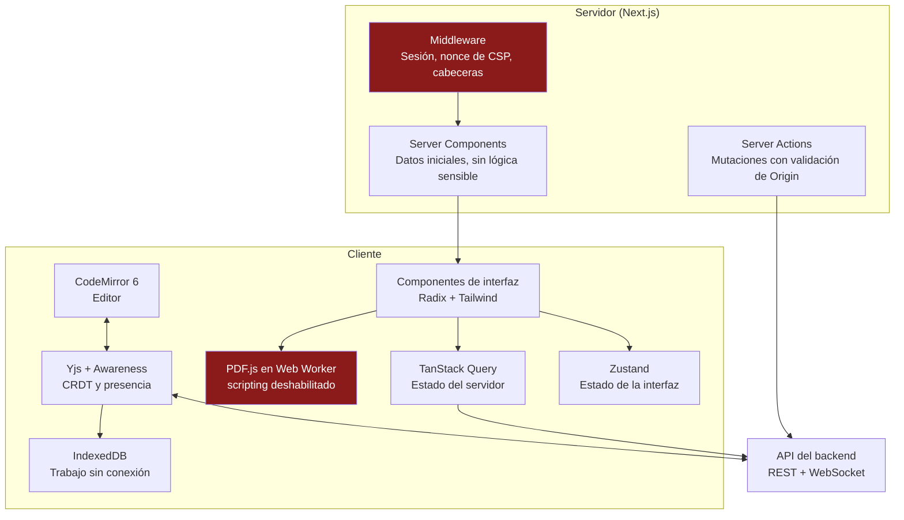
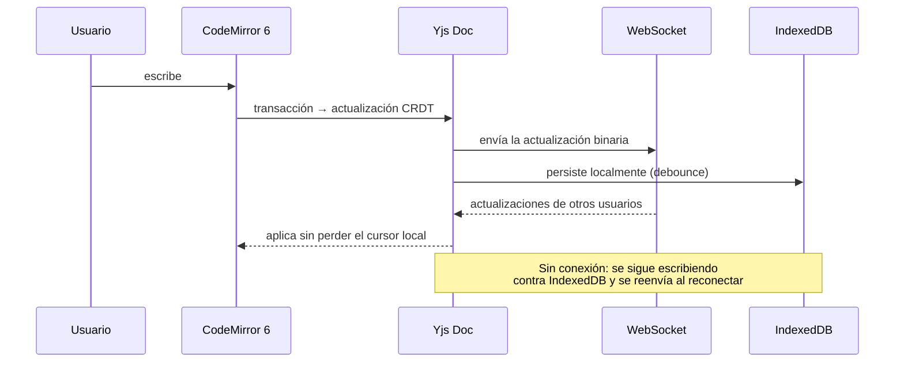

# 01 — Arquitectura del Frontend

> **Repositorio:** `texguard-frontend`
> **Stack:** Next.js 15 · React 19 · TypeScript strict · CodeMirror 6 · Yjs · PDF.js · Tailwind 4 · Radix UI
> **Versión:** 1.0

---

## 1. Principios

| # | Principio | Consecuencia práctica |
|---|---|---|
| 1 | **El cliente nunca es la frontera de seguridad** | Ocultar un botón no es autorizar. Toda restricción se aplica también en el servidor |
| 2 | **Tipos como contrato** | El cliente de la API se genera desde el OpenAPI del backend; no se escriben tipos a mano |
| 3 | **Estado del servidor ≠ estado de la interfaz** | Se separan explícitamente y se gestionan con herramientas distintas |
| 4 | **Fallo visible y accionable** | Ningún error se traga en silencio; ninguno expone detalles internos |
| 5 | **Accesible desde el principio** | La accesibilidad no se «añade después»: las primitivas ya son accesibles |
| 6 | **Rendimiento presupuestado** | Los límites de tamaño y latencia se verifican en el CI, no se estiman |

---

## 2. Estructura del repositorio

```
texguard-frontend/
├── app/                          Rutas de Next.js (App Router)
│   ├── (public)/                 Portada, plantillas, enlaces públicos
│   ├── (auth)/                   Registro, login, MFA, recuperación
│   ├── (app)/                    Panel, ajustes de cuenta
│   ├── proyecto/[id]/            Editor
│   └── admin/                    Panel de administración
├── src/
│   ├── features/                 Módulos verticales por dominio
│   │   ├── auth/
│   │   ├── projects/
│   │   ├── files/
│   │   ├── editor/
│   │   ├── compile/
│   │   ├── collaboration/
│   │   ├── review/
│   │   ├── history/
│   │   └── templates/
│   ├── shared/
│   │   ├── ui/                   Componentes del sistema de diseño
│   │   ├── api/                  Cliente generado + interceptores
│   │   ├── hooks/
│   │   ├── lib/                  Utilidades puras
│   │   └── security/             Sanitizado, CSP, validación de esquemas
│   └── styles/
├── Docs/
│   └── mockups/                  Prototipo navegable de las 47 pantallas
├── e2e/                          Playwright
└── public/
```

**Regla de dependencias:** una `feature` puede importar de `shared`, nunca de otra `feature`. Si dos features necesitan lo mismo, ese código sube a `shared`. Se verifica en CI con `dependency-cruiser`.

---

## 3. Composición de la aplicación



### 3.1 Reparto entre servidor y cliente

| Va en Server Component | Va en Client Component |
|---|---|
| Carga inicial del panel de proyectos | Editor y todo lo interactivo |
| Galería de plantillas | Colaboración en tiempo real |
| Página pública de un PDF | Visor PDF |
| Layouts y navegación estática | Formularios con validación en vivo |

**Nunca en el cliente:** claves, secretos, lógica de autorización que decida algo, ni ningún dato que el usuario no deba ver. Si llega al cliente, el usuario puede leerlo.

---

## 4. Gestión del estado

Cuatro tipos de estado, cuatro herramientas. Mezclarlos es el origen habitual de la complejidad accidental en un frontend.

| Tipo de estado | Ejemplo | Herramienta |
|---|---|---|
| **Del servidor** | Lista de proyectos, perfil, plantillas | **TanStack Query** — caché, revalidación, reintentos |
| **Colaborativo** | Contenido del documento, cursores, comentarios | **Yjs** — CRDT, fuente de verdad compartida |
| **De la interfaz** | Panel abierto, modo visual, zoom del PDF | **Zustand** — almacén ligero por feature |
| **De la URL** | Filtros, archivo abierto, página del PDF | **Parámetros de búsqueda** — compartible y recargable |

**Regla:** nada que viva en Yjs se duplica en Zustand. El documento tiene una única fuente de verdad.

---

## 5. Editor: integración de CodeMirror 6 y Yjs



**Extensiones de CodeMirror utilizadas:** gramática Lezer propia para LaTeX y BibTeX, autocompletado con fuentes múltiples (comandos, entornos, etiquetas, citas, rutas), búsqueda con regex, plegado, corrección ortográfica, atajos Vim y Emacs, `y-codemirror.next` para la colaboración, y decoraciones propias para comentarios y cambios rastreados.

**Rendimiento:** el editor se carga en diferido (`next/dynamic`) y no entra en el bundle inicial. La gramática y los diccionarios se cargan bajo demanda.

---

## 6. Comunicación con el backend

### 6.1 Cliente REST generado

```
backend/contracts/openapi.json → openapi-typescript → src/shared/api/generated.ts
```

Nunca se escriben tipos de la API a mano. Si el backend cambia el contrato y el frontend no regenera, **la compilación falla**: la desincronización entre repositorios se detecta en el CI, no en producción.

### 6.2 Interceptores obligatorios

| Interceptor | Función |
|---|---|
| Sesión | Envía la cookie; ante 401 intenta refrescar una vez y, si falla, redirige a login |
| CSRF | Añade el token sincronizador en toda petición que cambia estado |
| Correlación | Genera y propaga `X-Request-Id` |
| Errores | Convierte Problem Details (RFC 9457) en errores tipados de la aplicación |
| Reintentos | Solo en peticiones idempotentes, con retroceso exponencial |

### 6.3 WebSocket de colaboración

1. Se solicita al backend un **token de colaboración** de 5 minutos, con alcance limitado a un documento.
2. Se abre la conexión enviando el token en el **subprotocolo**, no en la URL (para que no acabe en registros ni en el historial del navegador).
3. Se renueva el token antes de que caduque.
4. Ante el código de cierre `4403` (acceso revocado) **no se reintenta**: se muestra el aviso correspondiente.

---

## 7. Rendimiento

| Presupuesto | Límite | Verificación |
|---|---|---|
| Bundle inicial (sin editor) | < 250 KB comprimido | `size-limit` en CI |
| LCP en 4G simulada | < 2,5 s | Lighthouse CI |
| INP | < 200 ms | Lighthouse CI |
| CLS | < 0,1 | Lighthouse CI |
| Carga del editor | < 1,5 s tras la interacción | Métrica propia |

**Técnicas aplicadas:** carga diferida de editor, visor PDF y paneles de revisión; virtualización del árbol de archivos y de listas largas; imágenes servidas por `next/image`; fuentes autoalojadas con `font-display: swap`; precarga de la ruta del editor al pasar el cursor sobre un proyecto.

---

## 8. Errores y límites

- **Error boundaries** por ruta y por panel: un fallo en el visor PDF no derriba el editor.
- Los errores se registran con el `traceId` de la respuesta; al usuario se le muestra ese identificador y nada más (RNF-031).
- Toda operación asíncrona tiene estado de carga, de error **y de vacío** definidos. Un componente sin los tres no está terminado.

---

## 9. Documentos relacionados

- [02-Seguridad-en-el-Cliente.md](02-Seguridad-en-el-Cliente.md)
- [03-Sistema-de-Diseno.md](03-Sistema-de-Diseno.md)
- [04-Interfaces-y-Mockups.md](04-Interfaces-y-Mockups.md)
- [`texguard-docs` · 03-Arquitectura](https://github.com/texguard/texguard-docs/blob/main/docs/03-Arquitectura.md)
