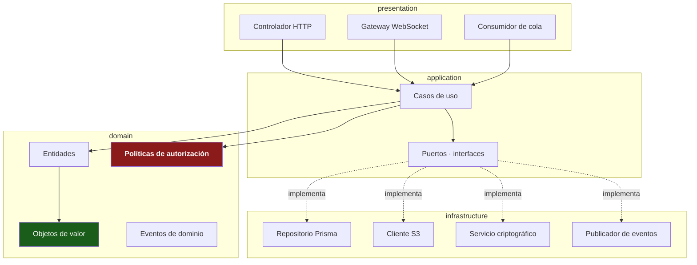
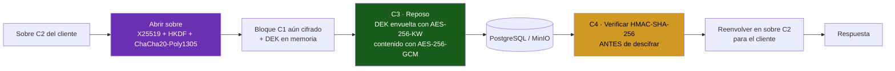

# 02 — Arquitectura Interna del Backend

> **Repositorio:** `securtex-backend`
> **Arquitectura general del sistema:** [`securtex-docs` · 03-Arquitectura](https://github.com/SecurTex-Devs/securtex-docs/blob/main/docs/03-Arquitectura.md)
> Este documento describe **cómo está organizado el código dentro de este repositorio**.

---

## 1. Estructura del monorepo

```
securtex-backend/
├── apps/
│   ├── gateway/                 NestJS · punto único de entrada
│   ├── auth-service/            NestJS · sesiones, MFA, tokens
│   ├── project-service/         NestJS · proyectos, permisos, invitaciones
│   ├── file-service/            NestJS · árbol de archivos, cifrado, cuotas
│   ├── collab-service/          Node + Hocuspocus · Yjs, presencia, chat
│   ├── review-service/          NestJS · comentarios, control de cambios
│   ├── history-service/         NestJS · versiones y diffs
│   ├── bib-service/             NestJS · .bib, Zotero, Mendeley
│   ├── template-service/        NestJS · galería y moderación
│   ├── integration-service/     NestJS · GitHub, puente Git, webhooks
│   ├── notification-service/    NestJS · correo y notificaciones
│   ├── admin-service/           NestJS · panel y métricas
│   ├── audit-service/           NestJS · registro encadenado por hash
│   ├── compile-orchestrator/    🦀 Rust · cola, límites, sandbox
│   └── url-fetcher/             🦀 Rust · descargas con protección anti-SSRF
├── packages/
│   ├── domain/                  Entidades, objetos de valor, políticas
│   ├── contracts/               DTO, esquemas Zod, tipos generados
│   ├── security/                Criptografía, hashing, tokens, sanitizado
│   ├── db/                      Prisma, migraciones, políticas RLS
│   ├── latex/                   Parser, analizador estático, índice de comandos
│   ├── observability/           OpenTelemetry, logger sin PII
│   └── testkit/                 Fixtures, Testcontainers, utilidades de abuso
├── contracts/                   openapi.json · asyncapi.yaml · proto/ · bruno/
├── infra/                       docker-compose, Dockerfiles, seccomp, keycloak
└── Docs/
```

**Regla de dependencias verificada en CI:** `apps/*` puede depender de `packages/*`; `packages/*` **nunca** depende de `apps/*`; `packages/domain` no depende de nada externo.

---

## 2. Arquitectura hexagonal dentro de cada servicio

```
apps/<servicio>/src/
├── domain/            Entidades, agregados, objetos de valor, políticas, eventos
├── application/       Casos de uso, puertos (interfaces)
├── infrastructure/    Adaptadores: Prisma, S3, Redis, Vault, HTTP externo
└── presentation/      Controladores HTTP, gateways WebSocket, consumidores de cola
```



### 2.1 Por qué la autorización vive en el dominio

El mismo caso de uso se invoca desde **tres entradas distintas**: HTTP, WebSocket y cola de trabajos. Si la comprobación de permisos estuviera en el controlador, las otras dos entradas quedarían desprotegidas. Al vivir en el caso de uso, es imposible saltársela cambiando de transporte.

### 2.2 Objetos de valor: hacer inconstruible lo inválido

```ts
// packages/domain/src/values/safe-file-name.ts
const RESERVADOS = new Set(['CON','PRN','AUX','NUL','COM1','LPT1']);

export class SafeFileName {
  private constructor(private readonly value: string) {}

  static of(raw: string): SafeFileName {
    const n = raw.normalize('NFC').trim();
    if (n.length === 0 || n.length > 255)          throw new InvalidFileNameError('longitud');
    if (n.includes('/') || n.includes('\\'))       throw new InvalidFileNameError('separador');
    if (n.includes('..'))                          throw new InvalidFileNameError('traversal');
    if (/[\x00-\x1f\x7f]/.test(n))           throw new InvalidFileNameError('control');
    if (RESERVADOS.has(n.split('.')[0]!.toUpperCase())) throw new InvalidFileNameError('reservado');
    return new SafeFileName(n);
  }

  toString(): string { return this.value; }
}
```

Si una función recibe `SafeFileName`, **ya está validado**. No hay forma de olvidarse.

Objetos de valor obligatorios: `Email`, `UserId`, `ProjectId`, `FileId`, `SafeFileName`, `SafeFilePath`, `ProjectRole`, `PasswordHash`, `ShareToken`, `CompilerEngine`.

---

## 3. Anatomía de un caso de uso

El orden es **obligatorio** y no se altera:

```ts
export class RevokeMemberUseCase {
  constructor(
    private readonly projects: ProjectRepository,
    private readonly policy: ProjectAuthorizationPolicy,
    private readonly audit: AuditSink,
    private readonly events: EventPublisher,
  ) {}

  async execute(cmd: RevokeMemberCommand): Promise<void> {
    // 1· Cargar
    const project = await this.projects.byId(cmd.projectId);
    if (!project) throw new NotFoundError();          // 404 uniforme, nunca 403 aquí

    // 2· Autorizar
    const decision = this.policy.canManageAccess(cmd.actor, project);
    if (decision.denied) {
      await this.audit.record('authz.denied', { actor: cmd.actor.id, target: cmd.projectId });
      throw new ForbiddenError();
    }

    // 3· Reglas de dominio
    project.revokeMember(cmd.targetUserId, cmd.actor);

    // 4· Persistir
    await this.projects.save(project);

    // 5· Auditar
    await this.audit.record('project.member.revoked', { /* … */ });

    // 6· Publicar el efecto lateral
    await this.events.publish(new MemberRevokedEvent(cmd.projectId, cmd.targetUserId));
  }
}
```

El paso 6 es el que hace que `collab-service` cierre el WebSocket del usuario revocado en menos de 5 segundos (T-P04).

---

## 4. Capa de presentación

### 4.1 Guard global de denegación por defecto

```ts
// Registrado globalmente: un endpoint sin @Policy(...) declarado devuelve 403
@Injectable()
export class PolicyGuard implements CanActivate {
  canActivate(ctx: ExecutionContext): boolean {
    const policy = this.reflector.get<PolicyDescriptor>(POLICY_KEY, ctx.getHandler());
    if (!policy) {
      this.logger.error('Endpoint sin política declarada', { handler: ctx.getHandler().name });
      return false;                                   // fail closed
    }
    return this.evaluator.evaluate(policy, ctx);
  }
}
```

Olvidarse de la autorización no produce un agujero: produce un 403 y un error en el registro.

### 4.2 Validación global

```ts
app.useGlobalPipes(new ValidationPipe({
  whitelist: true,              // elimina propiedades no declaradas
  forbidNonWhitelisted: true,   // …y rechaza la petición si las hay
  transform: true,
  forbidUnknownValues: true,
  validateCustomDecorators: true,
}));
```

Esto elimina la **asignación masiva** (T-A11): enviar `"role":"owner"` en el cuerpo produce un 400, no una escalada.

### 4.3 Serialización de salida

Los campos sensibles se marcan con `@Exclude()` en el DTO de respuesta. El interceptor de serialización se registra globalmente: un campo nuevo no se filtra por descuido salvo que se marque explícitamente como expuesto.

---

## 5. Acceso a datos y RLS

Todo acceso pasa por un middleware de Prisma que abre la transacción estableciendo el usuario efectivo:

```ts
export async function withUserContext<T>(userId: UserId, fn: (tx: Tx) => Promise<T>): Promise<T> {
  return prisma.$transaction(async (tx) => {
    await tx.$executeRaw`SELECT set_config('app.user_id', ${userId.toString()}, true)`;
    return fn(tx);
  });
}
```

Un servicio que olvide el contexto **no ve ninguna fila**. El fallo es seguro.

Al crear una tabla con datos de usuario, en la **misma migración**: `ENABLE` + `FORCE ROW LEVEL SECURITY` y sus políticas. En el **mismo pull request**: la prueba de acceso cruzado.

---

## 6. Los dos servicios en Rust

### 6.1 `compile-orchestrator`

```
compile-orchestrator/src/
├── api/            Axum · HTTP y gRPC
├── quota/          Cuotas por usuario y plan
├── cache/          Caché por hash del árbol de fuentes
├── analyzer/       Análisis estático de LaTeX (usa packages/latex como referencia)
├── materialize/    Descifra las fuentes en un volumen tmpfs efímero
├── sandbox/        Trait SandboxRunner + implementación gVisor
├── limits/         rlimits, cgroups, timeouts
├── validate/       Validación de la salida (MIME, tamaño, estructura del PDF)
└── logs/           Saneado y parseo del registro de compilación
```

**Por qué Rust aquí:** este servicio manipula rutas derivadas de entrada del usuario, lanza procesos hostiles y parsea la salida de un programa que el atacante controla. La seguridad de memoria elimina por construcción clases enteras de vulnerabilidad en el punto de mayor exposición. RAII garantiza que el contenedor y el volumen se destruyen **también en la ruta de error**.

**Invocación del compilador — nunca a través de un shell:**

```rust
let salida = Command::new("runsc")
    .args(["run", "--network=none", "--rootfs-overlay", …])
    .arg("latexmk")
    .args(["-pdf", "-interaction=nonstopmode", "-halt-on-error",
           "-no-shell-escape", "-file-line-error"])
    .arg(format!("-output-directory={}", salida_dir.display()))
    .arg(&ruta_principal)          // argv separado: sin interpolación de shell
    .output()
    .await?;
```

### 6.2 `url-fetcher`

Descarga contenido desde URLs suministradas por el usuario (RF-032). Controla la resolución DNS y conecta a la **IP ya resuelta**, lo que cierra la ventana de DNS-rebinding entre la validación y la conexión:

| Control | Detalle |
|---|---|
| Esquemas | Solo `http` y `https` |
| Rangos bloqueados | Loopback, privados, link-local, `169.254.169.254`, IPv6 mapeadas, multicast |
| Resolución | Se resuelve, se valida la IP y se conecta a esa IP concreta |
| Redirecciones | Máximo 3, revalidando cada destino |
| Límites | 50 MB, 10 s de tiempo total |
| Salida | El contenido pasa por ClamAV antes de entrar al proyecto |

---

## 6bis. Criptografía multicapa en el servidor

El backend implementa **tres de las cinco capas** del diseño criptográfico ([`securtex-docs` · 14](https://github.com/SecurTex-Devs/securtex-docs/blob/main/docs/14-Criptografia-Multicapa.md)). C1 y C5 son responsabilidad del navegador.



| Capa | Módulo | Regla que no se negocia |
|---|---|---|
| C2 | `packages/security/envelope` | La clave derivada se zeroiza tras cada uso |
| C3 | `packages/security/storage` | **AES-KW** para claves, **AES-GCM** para datos. Nunca al revés |
| C4 | `packages/security/integrity` | **Verificar antes de descifrar**, siempre |

**Modo confidencial:** cuando `project.confidentialMode` es verdadero, el servidor **no recibe ninguna DEK**. Todo caso de uso que necesite el texto plano (compilar, buscar, generar vista previa) debe fallar de forma explícita con `ConfidentialModeError`, nunca degradarse en silencio.

---

## 7. Comunicación entre servicios

| Patrón | Uso | Tecnología |
|---|---|---|
| Síncrono | Gateway → servicios | gRPC sobre mTLS, contratos en `contracts/proto/` |
| Trabajos | Compilación, correo, antivirus, indexación | BullMQ sobre Redis, con reintentos y cola de fallos |
| Eventos | Auditoría, notificaciones, revocación en caliente | Redis Streams |
| Público | Cliente → sistema | REST sobre HTTP/3 |

**Regla:** ningún servicio accede a la base de datos de otro. La única vía es su contrato público.

---

## 8. Observabilidad

- **Trazas:** OpenTelemetry con `traceId` propagado, incluidos los trabajos de la cola y la compilación.
- **Logs:** Pino en JSON, con redacción automática de campos sensibles. Prohibido registrar contraseñas, tokens, cookies o contenido de documentos (RS-052).
- **Métricas:** por servicio, más métricas de seguridad (compilaciones bloqueadas, 403 por usuario, intentos de login fallidos).
- **Auditoría:** `audit-service`, cadena de hashes append-only.

---

## 9. Documentos relacionados

- [01-API-y-Documentacion-de-Endpoints.md](01-API-y-Documentacion-de-Endpoints.md)
- [03-Estandares-de-Codigo.md](03-Estandares-de-Codigo.md)
- [`../AGENTS.md`](../AGENTS.md)
- [`securtex-docs` · 06-Modelo-de-Datos](https://github.com/SecurTex-Devs/securtex-docs/blob/main/docs/06-Modelo-de-Datos.md)
