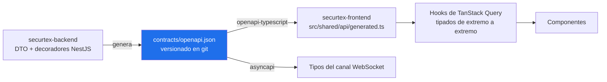
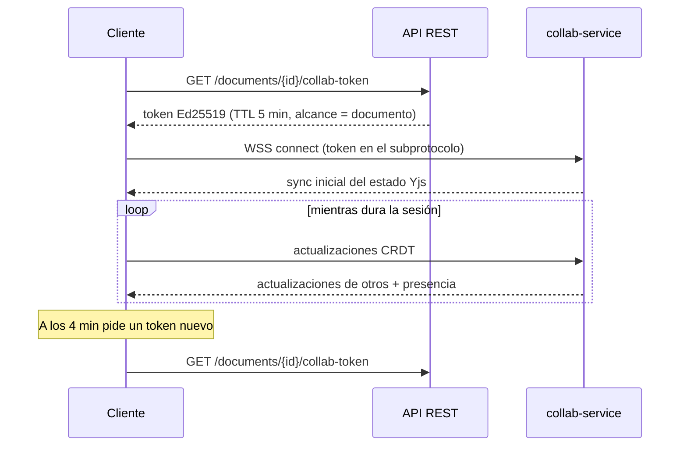

# 05 — Integración con la API

> **Repositorio:** `securtex-frontend`
> **Contrato:** generado por `securtex-backend`; este repositorio lo **consume**, nunca lo define
> **Versión:** 1.0

---

## 1. Flujo del contrato entre repositorios



**Regla:** los tipos de la API **nunca** se escriben a mano. Si el backend cambia el contrato y este repositorio no regenera, la compilación de TypeScript falla. La desincronización entre repositorios se detecta en el CI, no en producción.

```bash
pnpm api:sync        # descarga el openapi.json del backend y regenera los tipos
pnpm api:check       # falla si los tipos generados están desactualizados
```

`pnpm api:check` forma parte de las comprobaciones obligatorias del pull request.

---

## 2. Capas del cliente

```
src/shared/api/
├── generated.ts        Tipos y rutas generados — NO editar a mano
├── client.ts           fetch envuelto con los interceptores
├── errors.ts           Problem Details (RFC 9457) → errores tipados
├── queryClient.ts      Configuración de TanStack Query
└── collab.ts           Cliente del WebSocket de colaboración
```

### 2.1 Interceptores

| Orden | Interceptor | Función |
|---|---|---|
| 1 | Correlación | Genera `X-Request-Id` y lo propaga al registro del cliente |
| 2 | CSRF | Añade el token sincronizador en `POST`, `PUT`, `PATCH` y `DELETE` |
| 3 | Sesión | Envía las credenciales; ante `401` intenta refrescar **una sola vez** |
| 4 | Errores | Convierte la respuesta en un error tipado del dominio |
| 5 | Reintentos | Solo en métodos idempotentes, con retroceso exponencial y jitter |

### 2.2 Manejo de errores

El backend responde con Problem Details (RFC 9457). El cliente los traduce a errores tipados:

```ts
export type ApiError =
  | { kind: 'validation';   fields: Record<string, string>; traceId: string }
  | { kind: 'unauthorized'; traceId: string }
  | { kind: 'forbidden';    reason: string; traceId: string }
  | { kind: 'not_found';    traceId: string }
  | { kind: 'conflict';     traceId: string }
  | { kind: 'rate_limited'; retryAfterSeconds: number; traceId: string }
  | { kind: 'blocked';      findings: SecurityFinding[]; traceId: string }
  | { kind: 'server';       traceId: string };
```

| `kind` | Qué muestra la interfaz |
|---|---|
| `validation` | Errores junto a cada campo; el foco va al primero |
| `unauthorized` | Redirección a login conservando la ruta de destino |
| `forbidden` | Pantalla P-44, con el mismo texto que `not_found` |
| `not_found` | Pantalla P-44 |
| `rate_limited` | Aviso con el tiempo de reintento en lenguaje natural |
| `blocked` | **Pantalla P-47**: hallazgos concretos, línea y alternativa |
| `server` | Pantalla P-43 con el `traceId` visible |

> El `traceId` se muestra al usuario y se envía al registro del cliente. Es el único dato interno que sale a la interfaz (RNF-031).

---

## 3. Convenciones de TanStack Query

| Aspecto | Convención |
|---|---|
| Claves | `['projects']`, `['projects', id]`, `['projects', id, 'files']` — jerárquicas, para invalidar por prefijo |
| `staleTime` | 30 s para listados, 0 para datos que cambian en colaboración |
| Invalidación | Tras cada mutación, por prefijo; nunca `invalidateQueries()` sin argumentos |
| Actualización optimista | Solo en operaciones reversibles y de baja latencia (renombrar, etiquetar) |
| Reintentos | 2 en `GET`, 0 en mutaciones |
| Al cerrar sesión | `queryClient.clear()` obligatorio, para no filtrar datos entre usuarios |

---

## 4. WebSocket de colaboración



### 4.1 Códigos de cierre y respuesta del cliente

| Código | Significado | Qué hace el cliente |
|---|---|---|
| `1000` | Cierre normal | Nada |
| `1006` | Corte anómalo | Reconecta con retroceso exponencial (1 s → 30 s) |
| `4400` | Mensaje mal formado | **No reintenta**; registra el error |
| `4401` | Token ausente o caducado | Pide un token nuevo y reconecta una vez |
| `4403` | **Acceso revocado** | **No reintenta**; muestra el aviso y pasa a solo lectura |
| `4429` | Límite de tasa | Reconecta tras el tiempo indicado |
| `4500` | Error del servidor | Reconecta con retroceso |

### 4.2 Reglas

- El token **nunca** va en la URL: quedaría en registros, en el historial del navegador y en la cabecera `Referer`.
- El token vive **solo en memoria**; no se persiste.
- Al perder la conexión, la interfaz muestra el estado (P-45) y **sigue permitiendo escribir** contra IndexedDB, salvo en modo confidencial.
- La presencia se limpia al desconectar; no se dejan avatares fantasma.

---

## 5. Subida de archivos

1. `POST /projects/{id}/files/upload` con `multipart/form-data` y barra de progreso.
2. La respuesta devuelve el archivo con `avStatus: "pending"`.
3. El cliente **no habilita** el archivo hasta recibir `avStatus: "clean"` (por consulta o por evento).
4. Si es `infected`, se muestra el aviso y el archivo queda inaccesible de forma permanente.

> El cliente valida extensión y tamaño **por comodidad**, para dar un mensaje inmediato. La validación real —tipo por *magic bytes*, cuota, nombre seguro y antimalware— es del servidor.

---

## 6. Descargas

Todas las descargas usan **URL prefirmadas de vida corta (≤ 5 min)** servidas desde el origen de contenido, no desde el origen de la aplicación:

```
https://contenido.securtex.app/o/{objeto}?X-Amz-Signature=...
```

El cliente pide la URL al backend en el momento de la descarga; **nunca** guarda ni cachea la URL firmada.

---

## 7. Lista de verificación al integrar un endpoint nuevo

- [ ] `pnpm api:sync` ejecutado y tipos regenerados
- [ ] Hook de consulta o mutación en la `feature` correspondiente
- [ ] Clave de consulta jerárquica y coherente
- [ ] Invalidación correcta tras la mutación
- [ ] Estados de carga, error y vacío implementados
- [ ] Cada `kind` de error posible tiene tratamiento en la interfaz
- [ ] Prueba E2E del camino feliz y de al menos un error
- [ ] Ninguna cadena escrita fuera del sistema de i18n

---

## 8. Documentos relacionados

- [01-Arquitectura-Frontend.md](01-Arquitectura-Frontend.md)
- [02-Seguridad-en-el-Cliente.md](02-Seguridad-en-el-Cliente.md)
- [`securtex-backend` · API y endpoints](https://github.com/SecurTex-Devs/securtex-backend/blob/main/Docs/01-API-y-Documentacion-de-Endpoints.md)
