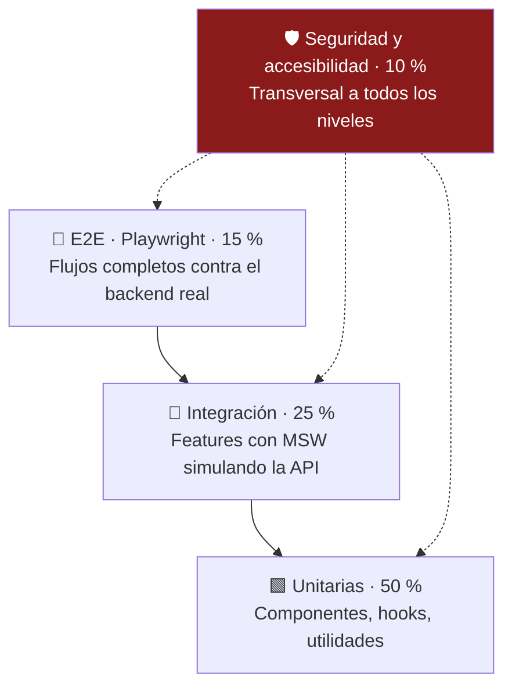

# 07 — Estrategia de Pruebas del Frontend

> **Repositorio:** `texguard-frontend`
> **Herramientas:** Vitest · Testing Library · Playwright · axe-core · Lighthouse CI · MSW
> **Versión:** 1.0

---

## 1. Qué se prueba y qué no

| Se prueba | No se prueba |
|---|---|
| Comportamiento visible para el usuario | Detalles de implementación (estado interno, nombres de clase) |
| Estados de carga, error y vacío | Que un componente «renderice sin fallar» |
| Accesibilidad de cada componente | Estilos píxel a píxel |
| Flujos completos de extremo a extremo | Lógica que pertenece al backend |
| Que la interfaz no exponga tokens ni permita XSS | La autorización (es del servidor; aquí se prueba que la interfaz **no confía** en el cliente) |

**Regla de Testing Library que se aplica sin excepción:** las consultas van por rol y nombre accesible (`getByRole('button', { name: 'Compartir' })`), no por `data-testid`. Un test que no encuentra el elemento por su rol suele estar señalando un problema real de accesibilidad.

---

## 2. Niveles



| Nivel | Herramienta | Qué cubre |
|---|---|---|
| Unitario | Vitest + Testing Library | Componentes del sistema de diseño, hooks, utilidades puras |
| Integración | Vitest + MSW | Una `feature` completa con la API simulada, incluidos sus errores |
| E2E | Playwright | Registro, login federado, crear proyecto, subir archivo, compilar, colaborar entre dos navegadores |
| Visual | Playwright snapshots | Solo en los componentes del sistema de diseño, en ambos temas |
| Accesibilidad | axe-core | Cada componente y cada página |
| Rendimiento | Lighthouse CI + size-limit | Presupuestos del documento de arquitectura |

---

## 3. Cobertura exigida

| Área | Mínimo |
|---|---|
| Global | 80 % |
| `src/shared/security/` | **100 %** |
| `src/shared/api/errors.ts` | **100 %** |
| Componentes del sistema de diseño | 90 % |
| Features | 80 % |

La cobertura es un suelo, no un objetivo: un 100 % con pruebas que no comprueban comportamiento no vale nada.

---

## 4. Pruebas obligatorias por tipo de cambio

### 4.1 Componente nuevo

- [ ] Renderiza en sus estados: normal, cargando, error, vacío, deshabilitado
- [ ] Usable solo con teclado
- [ ] Cero violaciones de `axe-core`
- [ ] Contraste correcto en tema claro y oscuro
- [ ] Historia de Storybook con todos los estados

### 4.2 Feature nueva

- [ ] Camino feliz con MSW
- [ ] **Cada `kind` de error** de la API tiene su prueba y su tratamiento visible
- [ ] Estado vacío
- [ ] Estado sin conexión, si aplica
- [ ] Todas las cadenas pasan por i18n (prueba automática que detecta texto en español escrito directamente)

### 4.3 Cambio que toca sesión, tokens o renderizado de contenido de usuario

⚠️ Requiere revisión adicional y pruebas de la suite de seguridad.

---

## 5. Pruebas E2E principales

```
e2e/
├── auth/
│   ├── register.spec.ts            Registro, verificación y primer acceso
│   ├── oauth-login.spec.ts         Google y Microsoft (IdP simulado en staging)
│   ├── mfa.spec.ts                 TOTP y passkey (WebAuthn virtual de Playwright)
│   └── session.spec.ts             Cerrar otras sesiones, caducidad, refresco
├── projects/
│   ├── crud.spec.ts                Crear, renombrar, archivar, papelera, restaurar
│   ├── import-zip.spec.ts          Importación válida y rechazo de zip-slip
│   └── sharing.spec.ts             Invitar, cambiar rol, revocar, enlace de compartición
├── editor/
│   ├── edit-and-compile.spec.ts    Escribir, compilar, ver el PDF
│   ├── compile-errors.spec.ts      Error de LaTeX → panel con enlace a la línea
│   ├── compile-blocked.spec.ts     \write18 → pantalla P-47 con hallazgos
│   ├── synctex.spec.ts             Salto bidireccional código ↔ PDF
│   └── autocomplete.spec.ts        Comandos, \ref y \cite
├── collaboration/
│   ├── two-users.spec.ts           Dos contextos de navegador editando a la vez
│   ├── cursors.spec.ts             Cursores y presencia
│   ├── offline.spec.ts             Corte de red de 60 s sin pérdida de trabajo
│   └── revoked.spec.ts             Revocación en caliente → cierre en < 5 s
├── review/
│   ├── comments.spec.ts            Comentario anclado que sobrevive a la edición
│   └── track-changes.spec.ts       Sugerir, aceptar y rechazar
└── security/                       Ver §6
```

### 5.1 Colaboración entre dos usuarios

```ts
test('dos usuarios editan el mismo documento sin perder cambios', async ({ browser }) => {
  const ana = await (await browser.newContext({ storageState: 'e2e/.auth/ana.json' })).newPage();
  const maria = await (await browser.newContext({ storageState: 'e2e/.auth/maria.json' })).newPage();

  await ana.goto('/proyecto/e2e-demo/editor');
  await maria.goto('/proyecto/e2e-demo/editor');

  await ana.getByRole('textbox', { name: 'main.tex' }).click();
  await ana.keyboard.type('Escrito por Ana. ');
  await maria.getByRole('textbox', { name: 'main.tex' }).click();
  await maria.keyboard.type('Escrito por María. ');

  // Ambos convergen al mismo estado, independientemente del orden
  await expect(ana.getByRole('textbox')).toContainText('Escrito por Ana.');
  await expect(ana.getByRole('textbox')).toContainText('Escrito por María.');
  await expect(maria.getByRole('textbox')).toContainText('Escrito por Ana.');
  await expect(maria.getByRole('textbox')).toContainText('Escrito por María.');

  // La presencia del otro usuario es visible y tiene nombre, no solo color
  await expect(ana.getByLabel('Colaboradores conectados')).toContainText('María');
});
```

---

## 6. Suite de seguridad del frontend

```
e2e/security/
├── csp.spec.ts                  Cabeceras completas; sin scripts en línea sin nonce
├── xss-stored.spec.ts           Payloads en nombre de proyecto, archivo, chat y comentario
├── xss-url.spec.ts              javascript:, data:, vbscript: en enlaces del usuario
├── token-leakage.spec.ts        Ningún token en localStorage, sessionStorage, URL ni DOM
├── pdf-js-injection.spec.ts     PDF con JavaScript embebido → no se ejecuta
├── session-cleanup.spec.ts      Cerrar sesión limpia IndexedDB y la caché de consultas
├── role-ui-enforcement.spec.ts  Un lector que fuerza el DOM sigue recibiendo 403 del servidor
├── offline-confidential.spec.ts Modo confidencial no persiste nada en IndexedDB
└── ws-close-codes.spec.ts       4403 no reintenta; 4401 renueva el token una vez
```

Ejemplo representativo:

```ts
test('ningún token queda accesible desde JavaScript', async ({ page }) => {
  await login(page);
  await page.goto('/proyecto/e2e-demo/editor');
  await page.waitForSelector('[data-collab="connected"]');

  const almacenamiento = await page.evaluate(() => ({
    local: JSON.stringify(localStorage),
    session: JSON.stringify(sessionStorage),
    html: document.documentElement.outerHTML,
  }));

  for (const contenido of Object.values(almacenamiento)) {
    expect(contenido).not.toMatch(/eyJ[A-Za-z0-9_-]{10,}/);  // JWT
    expect(contenido).not.toMatch(/tgd_[A-Za-z0-9]{16,}/);   // token de aplicación
  }
  expect(page.url()).not.toContain('token');
});
```

---

## 7. Datos de prueba

| Regla | Detalle |
|---|---|
| Sintéticos y deterministas | `faker` con semilla fija |
| Escenario canónico compartido | 4 usuarios con los 4 roles, 3 proyectos, documentos de ejemplo |
| Sesiones preautenticadas | `storageState` generado una vez por ejecución, no login en cada test |
| **Nunca datos reales** | Ni correos, ni nombres, ni contenido de personas reales |
| Corpus de LaTeX malicioso | Compartido con el backend; crece con cada vector nuevo |

---

## 8. En el pipeline

| Trabajo | Cuándo | Bloquea |
|---|---|---|
| Lint, tipos, unitarias e integración | Cada push | ✅ |
| Comprobación de sincronía del contrato (`api:check`) | Cada push | ✅ |
| E2E (Chromium) | Cada PR | ✅ |
| E2E (Firefox y WebKit) | En `main` y antes de release | ✅ |
| Suite de seguridad | Cada push | ✅ cualquier fallo |
| axe-core | Cada push | ✅ crítico o serio |
| Lighthouse CI | Cada PR | ✅ por debajo del presupuesto |
| `size-limit` | Cada push | ✅ bundle > 250 KB |
| Snapshots visuales | Cada PR | ⚠️ requiere aprobación explícita del cambio |

---

## 9. Documentos relacionados

- [01-Arquitectura-Frontend.md](01-Arquitectura-Frontend.md)
- [02-Seguridad-en-el-Cliente.md](02-Seguridad-en-el-Cliente.md)
- [06-Accesibilidad-e-i18n.md](06-Accesibilidad-e-i18n.md)
- [`texguard-docs` · 12-DevSecOps-y-Testing](https://github.com/texguard/texguard-docs/blob/main/docs/12-DevSecOps-y-Testing.md)
