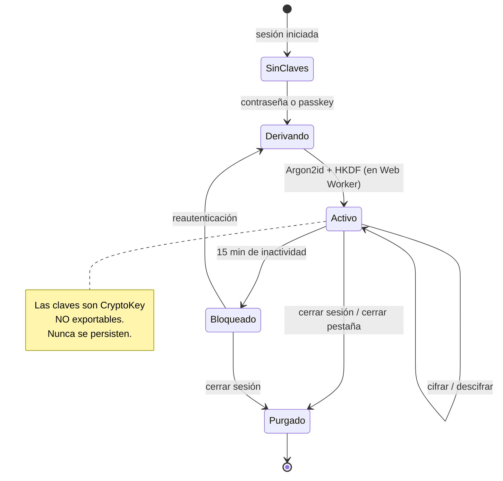

# 08 — Criptografía en el Cliente

> **Repositorio:** `texguard-frontend`
> **Diseño completo de las cinco capas:** [`texguard-docs` · 14-Criptografia-Multicapa](https://github.com/SecurTex-Devs/securtex-docs/blob/main/docs/14-Criptografia-Multicapa.md)
> Este documento describe **lo que implementa el navegador**: las capas C1, C2 y C5.
> **Versión:** 1.0

---

## 1. Qué hace el cliente

El navegador es el **único punto donde el documento existe en claro** (en modo Confidencial, el único de todo el sistema). Por tanto es responsable de:

| Capa | Responsabilidad | Algoritmo |
|---|---|---|
| **C1** | Cifrar el contenido antes de que salga del navegador, al pulsar `Ctrl+S`, al compilar y al autoguardar | **AES-256-GCM** |
| **C2** | Envolver la clave del documento y sellar la carga para el envío | **X25519 + HKDF-SHA-256 + ChaCha20-Poly1305** |
| **C5** | Verificar y descifrar lo que vuelve del servidor antes de mostrarlo | **AES-256-GCM** + verificación de etiqueta, AAD y firma **Ed25519** |
| Claves | Derivar la identidad criptográfica del usuario sin almacenarla | **Argon2id** (WASM) + **HKDF-SHA-256** |

---

## 2. Estructura del módulo

```
src/shared/crypto/
├── index.ts            API pública — es lo ÚNICO que importan las features
├── keyring.ts          Llavero en memoria: claves no exportables, purga automática
├── kdf.ts              Argon2id (WASM) + HKDF-SHA-256
├── layer1.ts           C1 · AES-256-GCM
├── layer2.ts           C2 · X25519 + HKDF + ChaCha20-Poly1305
├── layer5.ts           C5 · verificación y descifrado
├── nonce.ts            Generador de nonces con garantía de unicidad
├── signature.ts        Verificación Ed25519 de los artefactos
├── envelope.ts         Formato binario del sobre y su serialización
└── errors.ts           Errores criptográficos tipados
```

**Regla:** ninguna `feature` llama a `crypto.subtle` directamente. Todo pasa por `shared/crypto`. Regla de ESLint que falla el build:

```js
'no-restricted-globals': ['error', {
  name: 'crypto',
  message: 'Usa src/shared/crypto. El acceso directo a WebCrypto está prohibido fuera de ese módulo.',
}]
```

Cobertura exigida en este módulo: **100 %**. Revisión obligatoria de **dos personas**.

---

## 3. Capa C1 · Cifrado al guardar

### 3.1 Cuándo se dispara

| Disparador | Qué se cifra |
|---|---|
| `Ctrl+S` / `Cmd+S` | Estado completo del documento |
| Compilar (botón o autocompilación) | Todas las fuentes del proyecto |
| Autoguardado (2 s de inactividad) | Solo la actualización CRDT incremental |
| `beforeunload` | Lo pendiente, mediante `sendBeacon` |

### 3.2 Implementación

```ts
// src/shared/crypto/layer1.ts
import { nextNonce } from './nonce';
import { encodeAad, type DocumentAad } from './envelope';

export async function encryptDocument(
  dek: CryptoKey,                    // no exportable
  plaintext: Uint8Array,
  aad: DocumentAad,                  // { projectId, fileId, version }
): Promise<CipherBlock> {
  const nonce = nextNonce(dek);      // garantiza unicidad por clave

  const sealed = await crypto.subtle.encrypt(
    { name: 'AES-GCM', iv: nonce, additionalData: encodeAad(aad), tagLength: 128 },
    dek,
    plaintext,
  );

  return { v: 1, alg: 'AES-256-GCM', nonce, sealed: new Uint8Array(sealed), aad };
}
```

### 3.3 El nonce es el punto crítico

Reutilizar un nonce en GCM con la misma clave **rompe el cifrado por completo**: permite recuperar el texto plano de ambos mensajes y falsificar etiquetas. Es el fallo más común y más grave de este algoritmo.

```ts
// src/shared/crypto/nonce.ts
// 96 bits = 32 bits de prefijo aleatorio por sesión + 64 bits de contador monotónico.
// El prefijo aleatorio evita colisiones entre pestañas o tras restaurar la sesión;
// el contador garantiza unicidad dentro de la pestaña.
const counters = new WeakMap<CryptoKey, bigint>();
const prefixes = new WeakMap<CryptoKey, Uint8Array>();

export function nextNonce(key: CryptoKey): Uint8Array {
  if (!prefixes.has(key)) {
    prefixes.set(key, crypto.getRandomValues(new Uint8Array(4)));
    counters.set(key, 0n);
  }
  const n = counters.get(key)! + 1n;
  if (n > 2n ** 48n) throw new NonceExhaustedError();   // fuerza rotación de la DEK
  counters.set(key, n);

  const nonce = new Uint8Array(12);
  nonce.set(prefixes.get(key)!, 0);
  new DataView(nonce.buffer).setBigUint64(4, n);
  return nonce;
}
```

> Al superar 2⁴⁸ operaciones con la misma clave, el sistema **rota la DEK** en lugar de arriesgarse a una colisión. Prueba de propiedades sobre 10⁶ operaciones verifica que no hay repeticiones (RS-071).

---

## 4. Capa C2 · Sobre híbrido para el envío

```ts
// src/shared/crypto/layer2.ts
export async function sealEnvelope(
  dek: Uint8Array,                   // material de la DEK, envuelto aquí
  block: CipherBlock,                // salida de C1
  serverPublicKey: Uint8Array,       // X25519, 32 bytes
  context: EnvelopeContext,
): Promise<Envelope> {
  // 1· Par efímero: uno por mensaje
  const eph = await x25519.generateKeyPair();

  // 2· Secreto compartido
  const shared = x25519.getSharedSecret(eph.privateKey, serverPublicKey);

  // 3· Clave de envoltura con contexto
  const wrapKey = await hkdfSha256(shared, {
    salt: concat(eph.publicKey, serverPublicKey),
    info: `texguard:c2:v1:${context.projectId}`,
    length: 32,
  });

  // 4· y 5· Sellado con ChaCha20-Poly1305 (familia distinta de AES, a propósito)
  const wrappedDek = chacha20poly1305.seal(wrapKey, randomNonce(), dek, encodeCtx(context));
  const payload    = chacha20poly1305.seal(wrapKey, randomNonce(), serialize(block), encodeCtx(context));

  // 6· Secreto hacia adelante: la clave privada efímera se destruye
  zeroize(eph.privateKey);
  zeroize(shared);
  zeroize(wrapKey);

  return { v: 1, epk: eph.publicKey, wrappedDek, payload };
}
```

**Por qué existe si ya hay TLS:** TLS protege el canal, y el canal termina en el CDN, en el WAF o en el balanceador. A partir de ahí la petición viaja en claro por la memoria de esos intermediarios. C2 protege la carga hasta el servicio final.

**Por qué ChaCha20 y no AES otra vez:** diseño matemáticamente independiente (ARX frente a red de sustitución-permutación) y constante en tiempo sin AES-NI. Si apareciera una debilidad estructural en AES, la capa C2 seguiría en pie.

---

## 5. Capa C5 · Verificar y descifrar

**Tres verificaciones independientes antes de mostrar un solo carácter.** Cualquiera que falle detiene el proceso.

```ts
// src/shared/crypto/layer5.ts
export async function openAndDecrypt(
  envelope: Envelope,
  userPrivateKey: Uint8Array,
  artifactSignature: Signature | null,
): Promise<Uint8Array> {
  // ① Firma Ed25519 del artefacto (si lo lleva)
  if (artifactSignature && !(await verifyEd25519(artifactSignature))) {
    throw new ArtifactSignatureError();      // no se renderiza nada
  }

  // ② Abrir el sobre C2 — la etiqueta Poly1305 debe validar
  const { dek, block } = await openEnvelope(envelope, userPrivateKey);

  // ③ Descifrar C1 — la etiqueta GCM y el AAD deben validar
  const key = await importNonExtractable(dek);
  zeroize(dek);

  try {
    const plain = await crypto.subtle.decrypt(
      { name: 'AES-GCM', iv: block.nonce, additionalData: encodeAad(block.aad), tagLength: 128 },
      key,
      block.sealed,
    );
    return new Uint8Array(plain);
  } catch {
    // WebCrypto lanza si la etiqueta no valida. Nunca hay texto plano parcial.
    throw new TamperedContentError(block.aad);
  }
}
```

Todo fallo de esta función:

1. **No devuelve contenido**, ni siquiera parcial.
2. Muestra la pantalla de contenido no verificable.
3. Envía un evento a `audit` con el `traceId` y el identificador del bloque, **nunca** con el contenido.

---

## 6. Llavero y ciclo de vida de las claves



| Regla | Implementación |
|---|---|
| Claves no exportables | `crypto.subtle.importKey(..., extractable: false, ...)` — el material nunca es accesible desde JavaScript, ni siquiera con un XSS |
| Ninguna clave se persiste | Ni `localStorage`, ni `sessionStorage`, ni IndexedDB, ni cookies |
| Argon2id en un Web Worker | ~250 ms; no bloquea la interfaz |
| Purga a los 15 min de inactividad | Se pide de nuevo la contraseña o la passkey |
| Purga al cerrar sesión | Y `indexedDB.deleteDatabase()` sobre todas las bases del origen |
| Buffers intermedios sobrescritos | `zeroize()` tras cada uso; no elimina la incertidumbre del recolector de basura, pero reduce la ventana |

> **Limitación honesta:** JavaScript no permite garantizar el borrado de memoria. `zeroize()` sobrescribe el `Uint8Array`, pero el motor puede haber copiado el valor. Por eso el material de clave se convierte a `CryptoKey` no exportable **cuanto antes** y se manipula lo mínimo posible en forma de bytes.

---

## 7. Modo Confidencial: compilación en el navegador

Cuando un proyecto activa el modo Confidencial, la DEK **nunca** se envuelve para el servidor. Para que el producto siga funcionando, la compilación ocurre localmente:

```
src/features/compile-wasm/
├── engine.ts           Carga perezosa del motor TeX en WebAssembly
├── worker.ts           Ejecuta la compilación fuera del hilo principal
├── filesystem.ts       Sistema de ficheros virtual en memoria
└── packages.ts         Subconjunto de TeX Live servido bajo demanda
```

| Aspecto | Detalle |
|---|---|
| Motor | pdfTeX y XeTeX portados a WebAssembly |
| Ejecución | En un **Web Worker** dedicado; nunca en el hilo principal |
| Sistema de ficheros | Virtual, en memoria; se destruye al terminar |
| Paquetes | Subconjunto de TeX Live (~30 MB) descargado bajo demanda y cacheado |
| Aislamiento | El propio *sandbox* del navegador; el WASM no tiene acceso a red ni a disco |
| Limitaciones | Menos paquetes que TeX Live completo, compilación más lenta, sin `biber` completo |

```ts
// La feature de compilación elige la ruta según el modo del proyecto
export async function compile(project: Project): Promise<CompileResult> {
  return project.confidentialMode
    ? compileInBrowser(project)        // el servidor no ve nada
    : compileOnServer(project);        // sandbox gVisor, más rápido y completo
}
```

---

## 8. Interfaz: qué ve el usuario

| Pantalla | Qué muestra |
|---|---|
| **P-48 · Guardado cifrado** | Indicador del estado de cifrado en la barra al pulsar `Ctrl+S`, con el detalle de las capas aplicadas |
| **P-49 · Modo confidencial y claves** | Activación del E2EE, códigos de recuperación y la advertencia de pérdida irreversible |
| **P-50 · Contenido no verificable** | Qué ocurre cuando una etiqueta de autenticación falla |

Los tres mockups están en [`mockups/08-cifrado.html`](mockups/08-cifrado.html).

**Regla de diseño:** el cifrado **no debe pedir permiso ni interrumpir**. Ocurre siempre, en silencio, y solo se hace visible mediante un indicador discreto. La única excepción es la activación del modo Confidencial, que sí exige confirmación explícita porque es irreversible.

---

## 9. Pruebas obligatorias

```
src/shared/crypto/__tests__/
├── layer1-encrypt.spec.ts            Cifrado y descifrado de ida y vuelta
├── nonce-uniqueness.spec.ts          Propiedades: 10⁶ operaciones sin repetición
├── layer2-forward-secrecy.spec.ts    La clave efímera se destruye tras el envío
├── layer5-tamper.spec.ts             Alterar 1 bit de cifrado, nonce, etiqueta o AAD → rechazo
├── aad-binding.spec.ts               Un bloque de otro documento no descifra
├── keyring-lifecycle.spec.ts         Purga por inactividad y por cierre de sesión
└── artifact-signature.spec.ts        PDF con firma inválida → no se renderiza

e2e/security/
├── key-leakage.spec.ts               Ninguna clave en localStorage, DOM ni URL
├── e2ee-mode.spec.ts                 En modo Confidencial el servidor recibe solo bytes opacos
└── offline-confidential.spec.ts      Modo Confidencial no persiste nada en IndexedDB
```

### 9.1 La prueba que no puede faltar

```ts
test.each(['sealed', 'nonce', 'tag', 'aad'])(
  'alterar un bit de %s hace que el descifrado falle sin devolver contenido',
  async (campo) => {
    const bloque = await encryptDocument(dek, textoPlano, aad);
    const alterado = flipOneBit(bloque, campo);

    await expect(openAndDecrypt(alterado, clavePrivada, null))
      .rejects.toThrow(TamperedContentError);

    // Y, sobre todo: no se ha devuelto nada parcial
    expect(capturarSalida()).toEqual([]);
  },
);
```

Un descifrado que «funciona» con un bit alterado es un **fallo crítico**, no un aviso.

---

## 10. Prohibiciones

| Prohibido | Motivo |
|---|---|
| Llamar a `crypto.subtle` fuera de `shared/crypto` | Se pierde el control sobre nonces y ciclo de vida de claves |
| Implementar un algoritmo criptográfico propio | Un algoritmo sin criptoanálisis público no es seguro |
| César, Vigenère, ROT13, XOR con clave fija | No ofrecen ninguna garantía |
| `Math.random()` para cualquier material criptográfico | Predecible |
| Persistir una clave, en cualquier almacén | Un XSS la recuperaría |
| Marcar una clave como `extractable: true` | Salvo justificación escrita y revisión de dos personas |
| Registrar claves, nonces, DEK o texto plano | Fuga por observabilidad |
| Descifrar antes de verificar la etiqueta o la firma | Ejecuta el descifrado sobre entrada del atacante |
| Mostrar contenido cuya autenticación no ha validado | Es exactamente lo que el atacante busca |

---

## 11. Coste real

| Operación | Tiempo aproximado | Dónde |
|---|---|---|
| Cifrado C1 de un `.tex` de 100 KB | ~2 ms | Hilo principal (aceptable) |
| Sobre C2 | ~1 ms | Hilo principal |
| Descifrado C5 completo | ~3 ms | Hilo principal |
| Argon2id al iniciar sesión | ~250 ms | **Web Worker** |
| Carga del motor WASM (modo Confidencial) | ~30 MB, una vez | Cacheado |

El coste es despreciable frente a los segundos que tarda una compilación. **Ninguna operación criptográfica bloquea la escritura.**

---

## 12. Documentos relacionados

- [02-Seguridad-en-el-Cliente.md](02-Seguridad-en-el-Cliente.md) — XSS, CSP, tokens y almacenamiento
- [05-Integracion-con-la-API.md](05-Integracion-con-la-API.md) — dónde encaja el sobre C2 en las peticiones
- [04-Interfaces-y-Mockups.md](04-Interfaces-y-Mockups.md) — pantallas P-48 a P-50
- [`texguard-docs` · 14-Criptografia-Multicapa](https://github.com/SecurTex-Devs/securtex-docs/blob/main/docs/14-Criptografia-Multicapa.md) — diseño completo de las cinco capas
