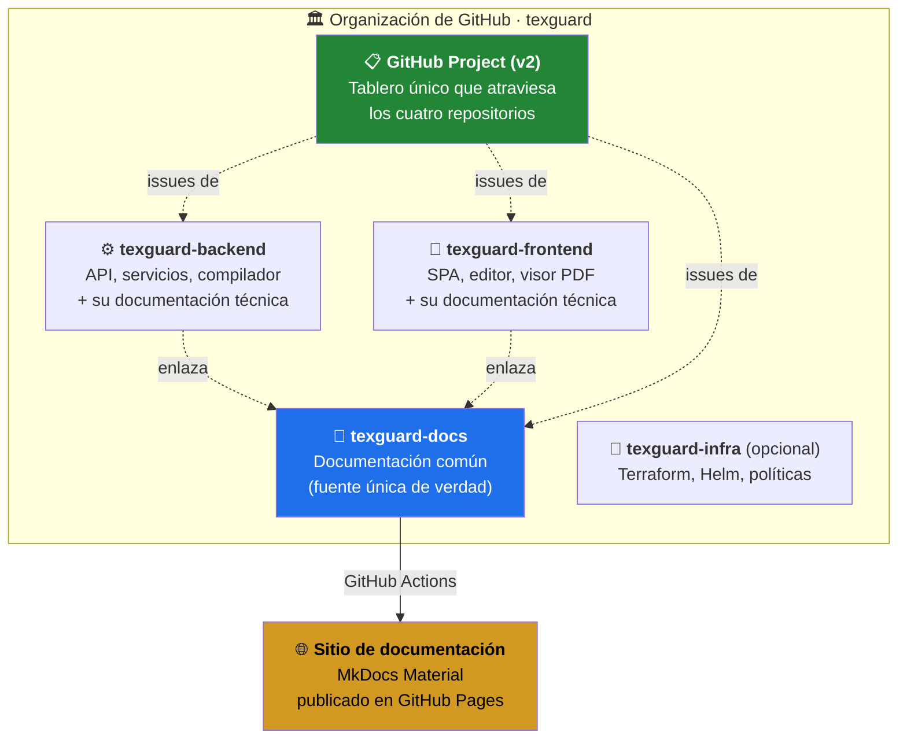
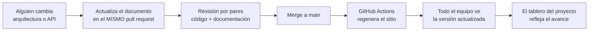

# 00 — Cómo se organiza y se publica la documentación

> **Pregunta que responde:** ¿cómo tenemos repositorios independientes para frontend y backend, y a la vez una documentación única, profesional y accesible para todo el equipo (y para el docente)?

---

## 1. La decisión

**Un "proyecto paraguas" en una organización de GitHub, con tres repositorios independientes y un sitio de documentación generado automáticamente.**



Sí existe lo que buscabas: **GitHub Projects (v2) a nivel de organización** es exactamente "un proyecto grande con subproyectos". Un único tablero puede contener *issues* y *pull requests* de todos los repositorios de la organización, con vistas por repositorio, por sprint, por responsable o por estado. Los repositorios siguen siendo **totalmente independientes** (su propio historial, sus propios permisos, su propio CI), pero el trabajo se planifica y se ve en un solo sitio.

---

## 2. Por qué esta opción y no otra

| Opción | Ventajas | Inconvenientes | Veredicto |
|---|---|---|---|
| **GitHub Org + repo de docs + Pages** ✅ | Todo en un sitio; documentación versionada junto al código; revisable por *pull request*; diagramas Mermaid nativos; gratis; el docente ve el historial y quién escribió qué | Requiere crear la organización (2 min) | **Elegida** |
| Notion | Muy cómodo para escribir, buen aspecto | La documentación **se desacopla del código**: nadie la actualiza en el PR; sin revisión por pares; sin control de versiones real; los diagramas Mermaid tienen soporte limitado; exportar es doloroso | ❌ Como fuente de verdad |
| Confluence | Estándar corporativo | Pesado, de pago, mismo problema de desacople | ❌ |
| GitBook | Bonito, sincroniza con git | Gratuito solo para proyectos públicos; capa extra innecesaria | ⚠️ Alternativa |
| Wiki de GitHub | Integrada, sencilla | Es un repositorio aparte sin *pull requests*: no se revisa, se degrada rápido | ❌ |
| Monorepo único | Documentación y código juntos por definición | Contradice el requisito de repositorios independientes; permisos y CI acoplados | ❌ |
| Backstage (Spotify) | Portal de desarrolladores completo con TechDocs | Sobredimensionado para un equipo de asignatura | ❌ |

> **El argumento decisivo:** la documentación debe vivir donde vive el código y cambiar con él, en el mismo *pull request*. Cualquier herramienta que separe ambos mundos garantiza que la documentación quede obsoleta. Notion es excelente para actas de reunión y notas rápidas; no para la especificación de un sistema.

**Uso recomendado de Notion (si el equipo ya lo usa):** actas de reunión, notas de clase, borradores y coordinación del día a día — con un enlace al sitio de documentación. Nunca como copia de la especificación.

---

## 3. Reparto de la documentación

| Documento | Repositorio | Motivo |
|---|---|---|
| Análisis funcional de Overleaf | `texguard-docs` | Común a todo el sistema |
| Especificación de requisitos | `texguard-docs` | Común |
| Arquitectura general (C4) | `texguard-docs` | Común |
| Stack tecnológico y su justificación | `texguard-docs` | Común |
| Seguridad, modelo de amenazas y controles | `texguard-docs` | Común y transversal |
| Modelo de datos | `texguard-docs` | Común (el frontend consume estas entidades) |
| Casos de uso y casos de abuso | `texguard-docs` | Común |
| Diagramas UML | `texguard-docs` | Común |
| Plan de proyecto, sprints y roles | `texguard-docs` | Común |
| DevSecOps y estrategia de pruebas | `texguard-docs` | Común, con detalles por repositorio |
| Infraestructura y despliegue | `texguard-docs` | Común |
| Glosario y ADR globales | `texguard-docs` | Común |
| **API y documentación de endpoints** | `texguard-backend` | Se genera desde el código del backend |
| Arquitectura interna de los servicios | `texguard-backend` | Específica |
| Estándares de código de backend | `texguard-backend` | Específica |
| **Interfaces, mockups y sistema de diseño** | `texguard-frontend` | Específica |
| Arquitectura de componentes y estado | `texguard-frontend` | Específica |
| Accesibilidad e internacionalización | `texguard-frontend` | Específica |
| Estándares de código de frontend | `texguard-frontend` | Específica |

**Regla de oro:** un documento vive en **un solo lugar**. Los demás repositorios lo **enlazan**, nunca lo copian. Un documento duplicado es un documento que se contradirá.

---

## 4. Cómo acceden todos a la documentación

### 4.1 Vía 1 — Leerla en GitHub (inmediata, sin configurar nada)

GitHub renderiza Markdown y **diagramas Mermaid** de forma nativa. Basta con entrar en `texguard-docs/docs/` y navegar. Funciona en repositorios privados, para cualquiera con acceso.

### 4.2 Vía 2 — Sitio web con MkDocs Material (profesional)

`mkdocs.yml` en la raíz de `texguard-docs` genera un sitio con buscador, navegación lateral, modo oscuro, permalinks y diagramas renderizados. Se publica automáticamente en cada push a `main`.

```bash
pip install mkdocs-material mkdocs-mermaid2-plugin
mkdocs serve      # http://127.0.0.1:8000 — vista previa local
mkdocs build      # genera el sitio estático en ./site
```

**Publicación:**

| Escenario | Cómo |
|---|---|
| Repositorio **público** | GitHub Pages gratis: `https://<org>.github.io/texguard-docs` |
| Repositorio **privado**, equipo pequeño | Leerla en GitHub (vía 1) o `mkdocs serve` en local |
| Repositorio **privado** con sitio privado | Cloudflare Pages o Netlify con control de acceso, o GitHub Pages privado (requiere plan Enterprise) |

> Para esta asignatura, con el repositorio privado compartido con los compañeros y el docente, la **vía 1 es suficiente y no requiere configuración**. El sitio de MkDocs se añade porque queda profesional en la entrega y cuesta un archivo de configuración.

### 4.3 Vía 3 — Perfil de la organización

El repositorio especial `.github` con un `profile/README.md` muestra una portada al entrar en la organización: descripción del proyecto, enlaces a los tres repositorios y al sitio de documentación. Es lo primero que ve quien llega.

---

## 5. Configuración de la organización

### 5.1 Repositorios

| Repositorio | Visibilidad | Contenido |
|---|---|---|
| `texguard-docs` | Privado (público al entregar, si se quiere) | Documentación común + sitio MkDocs |
| `texguard-backend` | Privado | API, servicios, orquestador de compilación |
| `texguard-frontend` | Privado | SPA, editor, visor |
| `texguard-infra` | Privado | Terraform, Helm, políticas (opcional; puede ir dentro de backend al inicio) |
| `.github` | Público | Portada de la organización y plantillas comunes |

### 5.2 Equipos y permisos (mínimo privilegio también aquí)

| Equipo | `docs` | `backend` | `frontend` | `infra` |
|---|---|---|---|---|
| `@SecurTex-Devs/core` | Admin | Admin | Admin | Admin |
| `@SecurTex-Devs/backend` | Escritura | Escritura | Lectura | Lectura |
| `@SecurTex-Devs/frontend` | Escritura | Lectura | Escritura | Lectura |
| `@SecurTex-Devs/docente` | Lectura | Lectura | Lectura | Lectura |

### 5.3 Protección de ramas (en los tres repositorios)

- `main` protegida: prohibido el *push* directo.
- Mínimo **1 aprobación** de alguien distinto al autor.
- Todos los controles del CI en verde (lint, pruebas, SAST, SCA, escaneo de secretos).
- **Commits firmados** obligatorios.
- Historial lineal (*squash merge*).
- Se descartan las aprobaciones si llegan commits nuevos.

### 5.4 GitHub Project (v2) a nivel de organización

Un único tablero llamado **TeXGuard — Plan de proyecto**:

| Campo personalizado | Valores |
|---|---|
| `Sprint` | Sprint 0 … Sprint 10 |
| `Módulo` | M1 Identidad, M2 Proyectos, … M14 Transversales |
| `Repositorio` | docs / backend / frontend / infra |
| `Prioridad` | Must / Should / Could / Must-Security |
| `Requisito` | RF-xxx, RS-xxx (trazabilidad con la ERS) |
| `Riesgo de seguridad` | Ninguno / Bajo / Medio / Alto / Crítico |

**Vistas configuradas:** Tablero por estado · Sprint actual · Por módulo · Solo seguridad · Por persona · Cronograma (roadmap).

Así se cumple lo que buscabas: **repositorios independientes, planificación unificada**.

---

## 6. Automatización

### 6.1 Publicación del sitio (`texguard-docs/.github/workflows/docs.yml`)

Cada push a `main` que toque la documentación regenera y publica el sitio. Además valida:

- que **no haya enlaces rotos** entre documentos,
- que **todos los bloques Mermaid compilen**,
- que no se hayan colado secretos (Gitleaks).

### 6.2 Coherencia entre repositorios

Un *workflow* semanal comprueba que los enlaces desde `texguard-backend` y `texguard-frontend` hacia `texguard-docs` sigan siendo válidos, y abre un *issue* automáticamente si alguno se rompe.

---

## 7. Convenciones de escritura

| Regla | Detalle |
|---|---|
| Idioma | Español para la documentación; inglés para identificadores, código y mensajes de commit |
| Formato | Markdown con diagramas **Mermaid** en bloques de código (nunca imágenes de diagramas: no se pueden revisar en un diff) |
| Nombres de archivo | `NN-Titulo-En-Kebab-Case.md`, numerados para fijar el orden de lectura |
| Enlaces | Relativos dentro del repositorio; absolutos hacia otros repositorios |
| Trazabilidad | Todo documento referencia los `RF-xxx` / `RS-xxx` / `T-xxx` que desarrolla |
| Actualización | Un cambio de arquitectura **sin** actualizar su documento es motivo de rechazo del PR |
| Decisiones | Toda decisión relevante se registra como **ADR** en `docs/adr/`, con estado (propuesta / aceptada / sustituida) |

---

## 8. Resumen operativo



**Una sola fuente de verdad, revisada como código, visible para todos, sin trabajo manual de sincronización.**

---

## 9. Documentos relacionados

- [`index.md`](index.md) — portada e índice general
- [11-Plan-de-Proyecto.md](11-Plan-de-Proyecto.md) — sprints, roles y ceremonias que alimentan el tablero
- [`../README.md`](../README.md) — instrucciones de este repositorio
