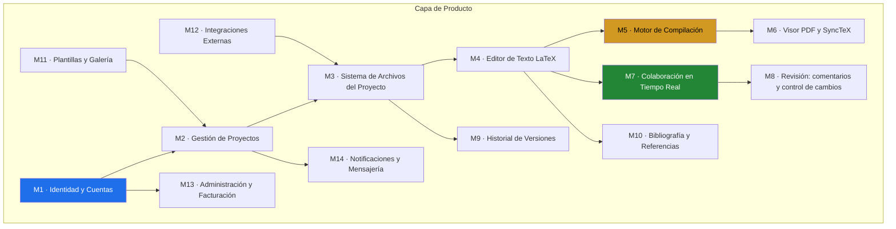

# 01 — Análisis Funcional Exhaustivo de Overleaf

> **Documento:** Inventario completo de funcionalidades de la plataforma de referencia
> **Proyecto:** SecurTex — Editor LaTeX Colaborativo Seguro
> **Versión:** 1.0
> **Estado:** Propuesta para revisión

---

## 0. Propósito de este documento

Antes de diseñar arquitectura o escribir una sola línea de código, es necesario **descomponer Overleaf en su totalidad funcional**. Este documento es el inventario canónico: cada funcionalidad recibe un identificador único (`F-XXX`) que será referenciado en el documento de requisitos ([02-Requisitos.md](02-Requisitos.md)), en los casos de uso ([07-Casos-de-Uso.md](07-Casos-de-Uso.md)) y en el backlog del plan de proyecto ([11-Plan-de-Proyecto.md](11-Plan-de-Proyecto.md)).

**Regla de trazabilidad:** ninguna funcionalidad listada aquí puede quedar sin un requisito asociado, y ningún requisito puede existir sin una funcionalidad que lo justifique.

---

## 1. Descomposición de Overleaf en módulos

Overleaf, visto desde fuera, es "un editor LaTeX en la nube". Visto desde dentro es la composición de **once subsistemas** que se comunican entre sí:

| Módulo | Nombre | Criticidad de seguridad | Justificación |
|---|---|---|---|
| M1 | Identidad y Cuentas | **Crítica** | Superficie de ataque primaria: credenciales, OAuth, sesiones |
| M2 | Gestión de Proyectos | Alta | Control de acceso horizontal (IDOR) |
| M3 | Sistema de Archivos | **Crítica** | Path traversal, subida de archivos maliciosos, zip-slip |
| M4 | Editor LaTeX | Media | XSS almacenado vía contenido del documento |
| M5 | Motor de Compilación | **Crítica** | RCE: LaTeX es Turing-completo y accede al sistema de ficheros |
| M6 | Visor PDF | Alta | PDF.js, JavaScript embebido en PDF |
| M7 | Colaboración RT | Alta | WebSockets sin autenticar, envenenamiento de operaciones |
| M8 | Revisión | Media | XSS en comentarios |
| M9 | Historial | Media | Fuga de contenido borrado |
| M10 | Bibliografía | Media | SSRF al importar `.bib` desde URL |
| M11 | Plantillas | Alta | Plantilla maliciosa = RCE en el compilador |
| M12 | Integraciones | **Crítica** | Tokens OAuth de terceros, SSRF, webhooks |
| M13 | Administración | Alta | Escalada vertical de privilegios |
| M14 | Notificaciones | Baja | Enumeración de usuarios, spam |

---

## 2. M1 · Identidad, Cuentas y Autenticación

### 2.1 Registro y acceso

| ID | Funcionalidad | Descripción observada en Overleaf |
|---|---|---|
| F-001 | Registro con email y contraseña | Formulario con validación de fortaleza de contraseña |
| F-002 | Verificación de correo electrónico | Enlace con token de un solo uso y caducidad |
| F-003 | Inicio de sesión con email/contraseña | Con "recordarme" opcional |
| F-004 | Inicio de sesión con **Google** | OAuth 2.0 / OpenID Connect |
| F-005 | Inicio de sesión con **Microsoft** | OIDC contra Microsoft Entra ID (personal + organizacional) |
| F-006 | Inicio de sesión con **ORCID** | Identificador académico |
| F-007 | SSO institucional **SAML 2.0 / Shibboleth** | Federación universitaria (InCommon, SIR2, etc.) |
| F-008 | Vinculación/desvinculación de proveedores sociales a una cuenta existente | Una cuenta, N identidades |
| F-009 | Recuperación de contraseña ("olvidé mi contraseña") | Token por email, caducidad corta |
| F-010 | Cambio de contraseña desde ajustes | Requiere contraseña actual |
| F-011 | Autenticación en dos pasos (**TOTP**) | Aplicación autenticadora + códigos de respaldo |
| F-012 | Cierre de sesión | Individual |
| F-013 | Gestión de sesiones activas | Listado de dispositivos/IP y "cerrar las demás sesiones" |
| F-014 | Bloqueo por intentos fallidos / rate limiting de login | Protección contra fuerza bruta |
| F-015 | CAPTCHA en registro y login | Anti-automatización |

### 2.2 Perfil y datos personales

| ID | Funcionalidad |
|---|---|
| F-016 | Editar nombre y apellidos |
| F-017 | Email primario + **emails secundarios** verificables |
| F-018 | Afiliación institucional (universidad, rol, departamento) |
| F-019 | País / zona horaria |
| F-020 | Preferencias de comunicaciones y newsletter |
| F-021 | Ajustes del editor persistidos por usuario (tema, fuente, keybindings, autocompletado, corrector) |
| F-022 | **Exportar mis datos** (portabilidad, RGPD art. 20) |
| F-023 | **Eliminar cuenta** con confirmación por contraseña y purga en cascada |
| F-024 | Registro de actividad de la cuenta (audit log visible al usuario) |

### 2.3 Claves y tokens

| ID | Funcionalidad |
|---|---|
| F-025 | Token de autenticación para el **puente Git** (contraseña de aplicación) |
| F-026 | Revocación de tokens |
| F-027 | Claves de API personales para la API pública |

---

## 3. M2 · Gestión de Proyectos (Dashboard)

### 3.1 Creación

| ID | Funcionalidad |
|---|---|
| F-030 | Crear proyecto **en blanco** |
| F-031 | Crear proyecto **desde plantilla** |
| F-032 | Crear proyecto **subiendo un `.zip`** |
| F-033 | Crear proyecto **importando desde GitHub** |
| F-034 | Crear proyecto ejemplo ("Example project") con contenido de demostración |

### 3.2 Organización

| ID | Funcionalidad |
|---|---|
| F-035 | Listado de proyectos con columnas: título, propietario, última modificación, colaboradores |
| F-036 | Búsqueda por título |
| F-037 | Ordenación por cualquier columna |
| F-038 | **Etiquetas/carpetas** de usuario (tags), creación, renombrado, borrado, asignación múltiple |
| F-039 | Filtros del panel lateral: Todos, Tus proyectos, Compartidos contigo, Archivados, Papelera |
| F-040 | Selección múltiple y acciones en lote |
| F-041 | Renombrar proyecto |
| F-042 | **Copiar / clonar** proyecto |
| F-043 | **Archivar** y desarchivar |
| F-044 | **Enviar a papelera** y restaurar |
| F-045 | **Eliminar permanentemente** (solo propietario) |
| F-046 | **Abandonar** un proyecto compartido (colaborador) |
| F-047 | **Descargar proyecto como `.zip`** |
| F-048 | **Transferir propiedad** a otro colaborador |
| F-049 | Contador de palabras del proyecto |

### 3.3 Compartición y permisos

| ID | Funcionalidad |
|---|---|
| F-050 | Invitar colaborador por correo electrónico |
| F-051 | Roles: **Propietario**, **Editor**, **Revisor** (comenta y sugiere, no edita), **Lector** (solo lectura) |
| F-052 | Cambiar el rol de un colaborador ya invitado |
| F-053 | Revocar acceso de un colaborador |
| F-054 | **Enlace de compartición** (token) con nivel de acceso: edición / solo lectura |
| F-055 | Activar/desactivar y **regenerar** los enlaces de compartición |
| F-056 | Aceptar/rechazar invitación desde notificaciones o email |
| F-057 | **Publicación de enlace público de solo lectura** del PDF |
| F-058 | Límite de colaboradores según plan |

---

## 4. M3 · Sistema de Archivos del Proyecto

| ID | Funcionalidad |
|---|---|
| F-060 | Árbol de archivos y carpetas jerárquico |
| F-061 | Crear archivo nuevo (`.tex`, `.bib`, `.cls`, `.sty`, `.txt`, cualquiera) |
| F-062 | Crear carpeta |
| F-063 | Subir archivos (drag & drop y selector) |
| F-064 | Subir **carpeta completa** |
| F-065 | Crear archivo **desde URL** (descarga remota) |
| F-066 | Insertar imagen/archivo **desde otro proyecto** del usuario |
| F-067 | Renombrar archivo/carpeta |
| F-068 | Mover mediante arrastrar y soltar |
| F-069 | Eliminar archivo/carpeta |
| F-070 | Descargar un archivo individual |
| F-071 | Previsualización de imágenes (`png`, `jpg`, `pdf`, `eps`, `svg`) en el panel |
| F-072 | Marcar **documento principal** de compilación |
| F-073 | Detección de archivos binarios vs texto |
| F-074 | Límite de tamaño por archivo y cuota total del proyecto |
| F-075 | Refrescar/recargar archivo modificado externamente (Dropbox/Git) |

---

## 5. M4 · Editor de Texto LaTeX

### 5.1 Núcleo del editor

| ID | Funcionalidad |
|---|---|
| F-080 | Resaltado de sintaxis LaTeX completo (comandos, entornos, matemáticas, comentarios, verbatim) |
| F-081 | Resaltado de sintaxis para BibTeX/BibLaTeX |
| F-082 | Numeración de líneas |
| F-083 | Plegado de código (secciones, entornos) |
| F-084 | Autocierre de llaves, corchetes, `$…$`, entornos |
| F-085 | Autocompletado de **comandos LaTeX** (base + paquetes cargados) |
| F-086 | Autocompletado de **entornos** (`\begin{…}` → `\end{…}` automático) |
| F-087 | Autocompletado de **`\ref`, `\eqref`, `\pageref`, `\autoref`** con las etiquetas del proyecto |
| F-088 | Autocompletado de **`\cite`** con las entradas de los `.bib` |
| F-089 | Autocompletado de **rutas de archivo** en `\input`, `\include`, `\includegraphics` |
| F-090 | Buscar y reemplazar, con expresiones regulares, sensible a mayúsculas, "en todo el proyecto" |
| F-091 | Deshacer / rehacer con historial local |
| F-092 | Comentar/descomentar selección (`Ctrl+/`) |
| F-093 | Indentación automática y reindentado de la selección |
| F-094 | Ir a línea |
| F-095 | Selección múltiple / cursores múltiples |
| F-096 | Atajos de teclado documentados y hoja de referencia |
| F-097 | Keybindings alternativos: **Vim** y **Emacs** |
| F-098 | Corrector ortográfico multiidioma (>40 idiomas) con subrayado y sugerencias |
| F-099 | **Diccionario personal** ("añadir a mi diccionario") |
| F-100 | Ajuste de línea (word wrap) |
| F-101 | Temas del editor (claro/oscuro y variantes) |
| F-102 | Tamaño de fuente, familia tipográfica, altura de línea configurables |
| F-103 | Modo pantalla completa / distribución de paneles ajustable (editor / PDF / dividido) |

### 5.2 Modo visual (Rich Text)

| ID | Funcionalidad |
|---|---|
| F-105 | Alternar entre **Código fuente** y **Modo visual** |
| F-106 | Renderizado en línea de matemáticas (MathJax/KaTeX) en modo visual |
| F-107 | Barra de herramientas de formato: negrita, cursiva, encabezados, listas ordenadas/no ordenadas |
| F-108 | Inserción de enlaces |
| F-109 | Renderizado de figuras e imágenes en línea |
| F-110 | Edición de tablas en modo visual |

### 5.3 Asistentes de inserción

| ID | Funcionalidad |
|---|---|
| F-112 | **Paleta de símbolos** matemáticos categorizada e insertable |
| F-113 | **Generador de tablas** visual (filas, columnas, bordes, alineación, celdas combinadas) |
| F-114 | Insertar figura: desde el ordenador, desde el proyecto, desde otro proyecto, desde URL |
| F-115 | Plantillas de fragmentos (snippets) de entornos comunes |
| F-116 | Verificador de estilo/errores LaTeX en el editor (`chktex`) con avisos en el margen |

---

## 6. M5 · Motor de Compilación

| ID | Funcionalidad |
|---|---|
| F-120 | Compilación bajo demanda (botón "Recompilar") |
| F-121 | **Autocompilación** al detenerse la escritura (configurable on/off) |
| F-122 | Selección de motor: **pdfLaTeX**, **LaTeX (dvipdf)**, **XeLaTeX**, **LuaLaTeX** |
| F-123 | Selección de **distribución TeX Live** (varias versiones anuales) |
| F-124 | Modo borrador (draft) — compilación rápida sin imágenes |
| F-125 | "Detenerse en el primer error" |
| F-126 | Detener compilación en curso |
| F-127 | Ejecución encadenada correcta: `latex → bibtex/biber → latex ×2` |
| F-128 | Soporte de `makeindex`, `glossaries`, `nomencl` |
| F-129 | Caché de compilación por proyecto y **borrado de caché** |
| F-130 | Límite de tiempo de compilación (timeout) diferenciado por plan |
| F-131 | Panel de resultados: errores, advertencias, avisos de tipografía, agrupados y con enlace a la línea |
| F-132 | Acceso a los **logs crudos** (`.log`, `.blg`) |
| F-133 | Descarga de archivos auxiliares generados (`.aux`, `.bbl`, `.synctex.gz`, `.out`) |
| F-134 | Compilación con archivos `.cls`/`.sty` personalizados del proyecto |
| F-135 | Soporte de paquetes CTAN completos preinstalados |
| F-136 | Contador de palabras basado en `texcount` |
| F-137 | Mensajes de error traducidos/explicados en lenguaje natural |

---

## 7. M6 · Visor PDF y SyncTeX

| ID | Funcionalidad |
|---|---|
| F-140 | Renderizado del PDF en el navegador |
| F-141 | Zoom (+/−, ajustar a ancho, ajustar a página, porcentaje) |
| F-142 | Navegación por páginas y número de página actual |
| F-143 | Búsqueda de texto dentro del PDF con resaltado |
| F-144 | Descarga del PDF |
| F-145 | **SyncTeX código → PDF** (saltar a la posición del PDF desde el cursor) |
| F-146 | **SyncTeX PDF → código** (doble clic en el PDF salta a la línea fuente) |
| F-147 | Conservación de la posición de scroll entre compilaciones |
| F-148 | Presentación del PDF en pestaña/ventana aparte |
| F-149 | Modo de solo PDF (ocultar editor) |

---

## 8. M7 · Colaboración en Tiempo Real

| ID | Funcionalidad |
|---|---|
| F-150 | Edición simultánea de un mismo documento por N usuarios sin pérdida de cambios |
| F-151 | Resolución de conflictos (Transformación Operacional / CRDT) |
| F-152 | **Cursores remotos** con nombre y color por usuario |
| F-153 | **Selecciones remotas** visibles |
| F-154 | Indicador de presencia: avatares de los conectados |
| F-155 | Indicador de "conectando / desconectado / reconectando" |
| F-156 | Recuperación tras desconexión sin pérdida de trabajo (buffer local) |
| F-157 | Guardado automático continuo, con indicador de estado |
| F-158 | **Chat del proyecto** persistente |
| F-159 | Notificación de mensajes nuevos en el chat |
| F-160 | Bloqueo de edición para roles de solo lectura |

---

## 9. M8 · Revisión: Comentarios y Control de Cambios

| ID | Funcionalidad |
|---|---|
| F-165 | **Comentarios anclados** a una selección de texto |
| F-166 | Hilos de respuesta dentro de un comentario |
| F-167 | Resolver / reabrir un comentario |
| F-168 | Eliminar comentario propio |
| F-169 | Panel lateral con todos los comentarios del documento |
| F-170 | **Control de cambios (Track Changes)** activable por proyecto o por usuario |
| F-171 | Visualización de inserciones y borrados con autoría y fecha |
| F-172 | **Aceptar** / **rechazar** un cambio individual |
| F-173 | Aceptar/rechazar todos los cambios |
| F-174 | Filtrar cambios por autor |
| F-175 | Rol **Revisor**: puede comentar y sugerir, no puede modificar directamente |

---

## 10. M9 · Historial de Versiones

| ID | Funcionalidad |
|---|---|
| F-180 | Línea de tiempo de versiones del proyecto |
| F-181 | Agrupación de cambios por sesión de edición y autor |
| F-182 | **Vista de diferencias** (diff) entre dos puntos del historial, con color por autor |
| F-183 | Selección de rango arbitrario de fechas |
| F-184 | **Restaurar** el proyecto o un archivo a una versión anterior |
| F-185 | **Etiquetar (label)** una versión con un nombre |
| F-186 | Listado y filtrado por etiquetas |
| F-187 | Descargar el proyecto tal como estaba en una versión concreta |
| F-188 | Historial de archivos eliminados y su restauración |
| F-189 | Retención del historial diferenciada (24 h vs completo, según plan) |

---

## 11. M10 · Bibliografía y Referencias

| ID | Funcionalidad |
|---|---|
| F-195 | Gestión de archivos `.bib` en el proyecto |
| F-196 | Parseo de entradas BibTeX para autocompletado de `\cite` |
| F-197 | Compatibilidad con `bibtex` y `biber`/BibLaTeX |
| F-198 | Importación desde **Zotero** (OAuth, selección de biblioteca/colección) |
| F-199 | Importación desde **Mendeley** (OAuth) |
| F-200 | Sincronización/refresco de la biblioteca importada |
| F-201 | Importar `.bib` desde una URL |
| F-202 | Visor formateado de entradas bibliográficas |

---

## 12. M11 · Plantillas y Galería

| ID | Funcionalidad |
|---|---|
| F-205 | Galería pública de plantillas navegable |
| F-206 | Categorías: artículos de revista, tesis, CV, presentaciones, pósteres, cartas, tareas, informes de laboratorio, libros, formales |
| F-207 | Búsqueda de plantillas por texto y filtrado por categoría |
| F-208 | Ficha de plantilla con descripción, licencia, autor y **vista previa en PDF** |
| F-209 | **"Abrir como plantilla"** → crea un proyecto nuevo a partir de ella |
| F-210 | **Publicar un proyecto propio como plantilla** |
| F-211 | Actualizar/despublicar la plantilla propia |
| F-212 | Plantillas **privadas de la institución** o del grupo |
| F-213 | Portales de editorial/universidad con plantillas propias y flujo de envío |
| F-214 | Moderación/aprobación de plantillas publicadas |

---

## 13. M12 · Integraciones Externas

| ID | Funcionalidad |
|---|---|
| F-220 | **Sincronización con GitHub**: vincular repositorio, `push` y `pull` desde el editor, resolución de conflictos |
| F-221 | **Puente Git (Git Bridge)**: `git clone` del proyecto vía HTTPS con token |
| F-222 | **Sincronización con Dropbox** bidireccional |
| F-223 | **Envío a editorial** (submit to journal / publisher) |
| F-224 | Webhooks / API pública REST |
| F-225 | Corrección gramatical y de estilo asistida (Writefull / equivalente) |
| F-226 | Exportación a formatos externos (`.zip`, PDF, fuentes) |
| F-227 | Integración con gestores de referencias (ver M10) |

---

## 14. M13 · Administración, Planes y Grupos

| ID | Funcionalidad |
|---|---|
| F-230 | Planes de suscripción (gratuito / individual / grupo / institucional) |
| F-231 | Página de facturación, método de pago, historial de facturas |
| F-232 | Cupones y descuentos |
| F-233 | **Licencias de grupo**: administrador que invita y gestiona miembros |
| F-234 | Panel de administrador de institución: dominios de correo, usuarios, SSO |
| F-235 | Métricas de uso (proyectos, compilaciones, almacenamiento) |
| F-236 | Panel de administración del sistema (usuarios, proyectos, bloqueos, mantenimiento) |
| F-237 | Límites por plan: colaboradores, tiempo de compilación, historial, integraciones |
| F-238 | Estado del servicio / página de incidencias |

---

## 15. M14 · Notificaciones y Transversales

| ID | Funcionalidad |
|---|---|
| F-240 | Centro de notificaciones dentro de la aplicación (invitaciones, avisos del sistema) |
| F-241 | Notificaciones por correo electrónico configurables |
| F-242 | Interfaz multiidioma (i18n), mínimo español e inglés |
| F-243 | Accesibilidad WCAG 2.2 AA: navegación por teclado, lectores de pantalla, contraste |
| F-244 | Diseño responsive y uso funcional en tableta/móvil |
| F-245 | Ayuda contextual, documentación y enlaces a aprendizaje de LaTeX |
| F-246 | Atajo global de búsqueda / paleta de comandos |

---

## 16. Cobertura de comandos LaTeX

El requisito de "todos los comandos disponibles en LaTeX" no se implementa **comando por comando**: se satisface embarcando una **distribución TeX Live completa** dentro del contenedor de compilación. Esto se detalla en [04-Stack-Tecnologico.md](04-Stack-Tecnologico.md), pero se registra aquí como funcionalidad:

| ID | Funcionalidad |
|---|---|
| F-250 | Distribución **TeX Live completa** (esquema `full`, ~4 GB, >4 000 paquetes CTAN) en el entorno de compilación |
| F-251 | Motores `pdftex`, `xetex`, `luatex`, `tex`, `dvips`, `dvipdfmx` |
| F-252 | Procesadores auxiliares: `bibtex`, `biber`, `makeindex`, `xindy`, `texcount`, `chktex`, `latexmk`, `makeglossaries` |
| F-253 | Fuentes del sistema disponibles para XeLaTeX/LuaLaTeX (`fontspec`) |
| F-254 | Base de datos de comandos para el autocompletado, derivada de la documentación de los paquetes instalados |
| F-255 | Soporte de idiomas y codificaciones: `babel`, `polyglossia`, UTF-8, alfabetos no latinos, CJK |
| F-256 | **`\write18` (shell-escape) deshabilitado de forma permanente e inviolable** — decisión de seguridad, ver [05-Seguridad.md](05-Seguridad.md) |

---

## 17. Funcionalidades deliberadamente **añadidas** respecto a Overleaf

Como el proyecto pertenece a la asignatura de **Seguridad de Software**, se incorporan capacidades que Overleaf no ofrece y que constituyen el valor diferencial académico:

| ID | Funcionalidad añadida | Motivo |
|---|---|---|
| F-260 | **Passkeys / WebAuthn** (FIDO2) como segundo factor y como método sin contraseña | Elimina el phishing de credenciales |
| F-261 | **Cifrado en reposo por proyecto** con envelope encryption y claves gestionadas por KMS | Confidencialidad ante compromiso de la base de datos |
| F-262 | **Registro de auditoría inmutable y encadenado por hash** visible al propietario | No repudio |
| F-263 | **Análisis antimalware de todo archivo subido** (ClamAV) | Prevención de distribución de malware |
| F-264 | **Detección de LaTeX peligroso** antes de compilar (`\input{/etc/passwd}`, `\openout`, `\write18`) | Defensa en profundidad frente a RCE/LFI |
| F-265 | **Política de contraseñas contra listas de credenciales filtradas** (k-anonimato, HIBP) | Bloqueo de credential stuffing |
| F-266 | **Panel de seguridad del usuario**: sesiones, dispositivos, eventos, alertas de inicio de sesión anómalo | Transparencia |
| F-267 | **Firma de las imágenes de contenedor y SBOM verificable** | Seguridad de la cadena de suministro |
| F-268 | **Modo "proyecto confidencial"**: desactiva enlaces públicos, exige MFA a todos los colaboradores y fuerza marca de agua en el PDF | Datos sensibles |

---

## 18. Resumen cuantitativo

| Módulo | Nº de funcionalidades |
|---|---|
| M1 · Identidad y Cuentas | 27 |
| M2 · Gestión de Proyectos | 28 |
| M3 · Sistema de Archivos | 16 |
| M4 · Editor LaTeX | 33 |
| M5 · Motor de Compilación | 18 |
| M6 · Visor PDF | 10 |
| M7 · Colaboración RT | 11 |
| M8 · Revisión | 11 |
| M9 · Historial | 10 |
| M10 · Bibliografía | 8 |
| M11 · Plantillas | 10 |
| M12 · Integraciones | 8 |
| M13 · Administración | 9 |
| M14 · Transversales | 7 |
| LaTeX / TeX Live | 7 |
| Añadidos de seguridad | 9 |
| **TOTAL** | **222 funcionalidades identificadas** |

---

## 19. Priorización

⚠️ **La priorización de este documento ha sido sustituida.** El calendario real del proyecto es de **10 semanas**, en las que cabe entre el 25 % y el 30 % de este inventario.

La clasificación vigente está en **[16-Priorizacion-y-Alcance.md](16-Priorizacion-y-Alcance.md)**, donde **cada una de las 222 funcionalidades** lleva asignado uno de estos cinco niveles, con su justificación:

| Marca | Nivel | Significado |
|---|---|---|
| 🟥 | **N0 · Núcleo** | «Si no tiene esto, no es Overleaf». No se toca |
| 🟧 | **N1 · Esencial** | Paridad creíble; se construye salvo que el calendario obligue |
| 🟨 | **N2 · Deseable** | Primer sitio donde recortar |
| ⬜ | **N3 · Prescindible** | Poco usado o coste desproporcionado; recortar por defecto |
| ⛔ | **N4 · Fuera** | Recomendación explícita de sacarlo ya del backlog |
| 🛡️ | **SEC** | Exigido por la asignatura: no negociable sea cual sea su nivel |

**Este documento sigue siendo la fuente de verdad del *inventario*** —qué existe en Overleaf y qué habría que construir para igualarlo—, pero **no del alcance comprometido**.

---

## 20. Siguientes documentos

1. [02-Requisitos.md](02-Requisitos.md) — traducción a requisitos funcionales y no funcionales verificables
2. [03-Arquitectura.md](03-Arquitectura.md) — arquitectura C4 completa
3. [04-Stack-Tecnologico.md](04-Stack-Tecnologico.md) — tecnologías y su justificación de seguridad
4. [05-Seguridad.md](05-Seguridad.md) — modelo de amenazas y controles
