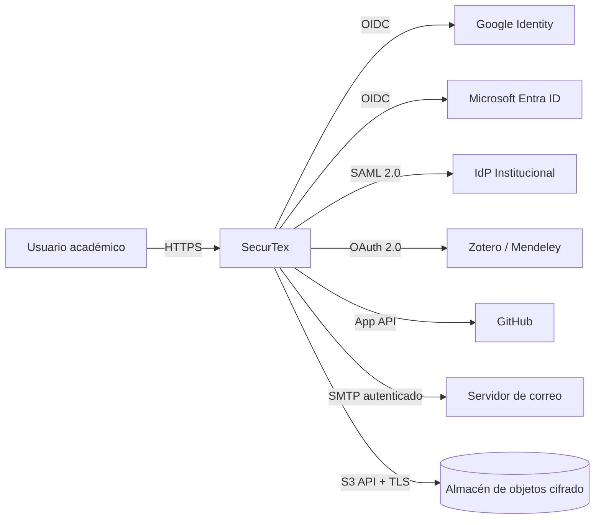

# 02 — Especificación de Requisitos de Software (ERS)

> Basado en **IEEE 830 / ISO-IEC-IEEE 29148:2018**
> **Proyecto:** SecurTex — Editor LaTeX Colaborativo Seguro
> **Versión:** 1.0

---

## 1. Introducción

### 1.1 Propósito

Especificar de forma verificable el comportamiento del sistema **SecurTex**, una plataforma web de edición colaborativa de documentos LaTeX funcionalmente equivalente a Overleaf, construida con criterios de seguridad por diseño.

### 1.2 Alcance

SecurTex cubre las 222 funcionalidades inventariadas en [01-Analisis-Funcional-Overleaf.md](01-Analisis-Funcional-Overleaf.md). Queda **fuera de alcance**:

- Pasarela de pago real (se implementa una simulación con Stripe en modo *test*).
- Acuerdos comerciales con editoriales para el envío de manuscritos (se implementa el mecanismo técnico, no los convenios).
- Aplicaciones móviles nativas (la web es responsive y es un PWA instalable).

### 1.3 Definiciones y acrónimos

| Término | Definición |
|---|---|
| **CRDT** | *Conflict-free Replicated Data Type*. Estructura de datos que converge sin coordinación central. |
| **OT** | *Operational Transformation*. Algoritmo alternativo de edición concurrente. |
| **SyncTeX** | Mecanismo de correspondencia bidireccional entre línea fuente `.tex` y coordenada del PDF. |
| **IdP** | *Identity Provider*. Proveedor de identidad (Google, Microsoft, Keycloak). |
| **RLS** | *Row Level Security*. Control de acceso a nivel de fila en PostgreSQL. |
| **DEK / KEK** | *Data / Key Encryption Key*. Claves de datos y de cifrado de claves (envelope encryption). |
| **ASVS** | *Application Security Verification Standard* de OWASP. |
| **SBOM** | *Software Bill of Materials*. |
| **RCE / LFI / SSRF** | Ejecución remota de código / Inclusión local de archivos / Falsificación de petición del lado servidor. |

### 1.4 Convenciones

- `RF-xxx`: requisito funcional. `RNF-xxx`: requisito no funcional. `RS-xxx`: requisito de seguridad.
- Verbos según RFC 2119: **DEBE** (obligatorio), **DEBERÍA** (recomendado), **PUEDE** (opcional).
- Cada requisito indica la funcionalidad `F-xxx` que lo origina y su criterio de aceptación.

---

## 2. Descripción general

### 2.1 Perspectiva del producto

### 2.2 Actores del sistema

| Actor | Descripción | Privilegios |
|---|---|---|
| **Visitante** | No autenticado | Galería pública de plantillas, registro, login, ver enlaces públicos |
| **Usuario registrado** | Cuenta verificada | Crear y gestionar sus proyectos |
| **Propietario de proyecto** | Usuario que creó o recibió el proyecto | Control total, compartir, borrar, transferir |
| **Editor** | Colaborador invitado | Leer, escribir, compilar, comentar |
| **Revisor** | Colaborador invitado | Leer, comentar, sugerir cambios; **no** modificar directamente |
| **Lector** | Colaborador invitado | Leer y compilar; sin escritura |
| **Administrador de grupo** | Gestor de una licencia colectiva | Alta/baja de miembros del grupo |
| **Administrador de institución** | Responsable de un dominio | Configurar SSO, dominios, plantillas institucionales |
| **Administrador del sistema** | Operador de la plataforma | Panel de admin, bloqueos, mantenimiento, auditoría global |
| **Auditor de seguridad** | Rol de solo lectura sobre el registro de auditoría | Consulta forense; sin acceso al contenido de los proyectos |
| **Sistema de compilación** | Actor no humano | Consume trabajos de la cola, produce PDF |
| **Servicios externos** | IdPs, GitHub, Zotero | Interacción federada |

### 2.3 Restricciones de diseño

| ID | Restricción |
|---|---|
| CO-01 | El sistema **DEBE** desplegarse íntegramente en contenedores, sin dependencias del sistema operativo anfitrión. |
| CO-02 | Todo el tráfico externo **DEBE** ser TLS 1.3 (TLS 1.2 solo con suites AEAD como fallback). |
| CO-03 | El compilador LaTeX **DEBE** ejecutarse sin acceso a red y con sistema de archivos efímero. |
| CO-04 | No se **DEBE** utilizar ninguna dependencia con vulnerabilidad conocida de severidad ≥ *High* sin mitigación documentada. |
| CO-05 | El código **DEBE** estar escrito en lenguajes con seguridad de memoria (TypeScript, Rust, Go). Prohibido C/C++ salvo dependencias del ecosistema TeX. |
| CO-06 | El sistema **DEBE** funcionar sin conexión a servicios en la nube propietarios (desplegable *on-premise*). |

---

## 3. Requisitos Funcionales

### 3.1 RF-01 · Identidad y autenticación

| ID | Requisito | Origen | Criterio de aceptación |
|---|---|---|---|
| RF-001 | El sistema DEBE permitir el registro con correo y contraseña, exigiendo verificación del correo antes del primer acceso completo. | F-001, F-002 | Una cuenta sin verificar no puede crear proyectos; el token de verificación caduca a las 24 h y es de un solo uso. |
| RF-002 | El sistema DEBE permitir autenticarse mediante **Google** usando OpenID Connect con flujo *Authorization Code + PKCE*. | F-004 | Se verifica `iss`, `aud`, `exp`, `nonce`; el `state` es de un solo uso y ligado a la sesión. |
| RF-003 | El sistema DEBE permitir autenticarse mediante **Microsoft Entra ID** (cuentas personales y organizacionales) con OIDC + PKCE. | F-005 | Ídem RF-002; se admite el descubrimiento de metadatos del *tenant*. |
| RF-004 | El sistema DEBE soportar **SAML 2.0** para federación institucional con firma de aserciones obligatoria. | F-007 | Se rechaza toda aserción sin firma válida, con `NotOnOrAfter` vencido o con `Audience` incorrecto. |
| RF-005 | El sistema DEBE permitir vincular varios proveedores de identidad a una misma cuenta y desvincularlos, impidiendo quedarse sin ningún método de acceso. | F-008 | No se puede desvincular el último método si no existe contraseña establecida. |
| RF-006 | El sistema DEBE ofrecer segundo factor **TOTP** (RFC 6238) y **WebAuthn/Passkeys** (FIDO2). | F-011, F-260 | Se generan 10 códigos de respaldo de un solo uso; el secreto TOTP se almacena cifrado. |
| RF-007 | El sistema DEBE permitir recuperación de contraseña mediante enlace de un solo uso con caducidad de 30 minutos. | F-009 | La respuesta al formulario es idéntica exista o no el correo (no enumeración). |
| RF-008 | El sistema DEBE mostrar y permitir revocar las sesiones activas, con dispositivo, IP aproximada y última actividad. | F-013, F-266 | "Cerrar las demás sesiones" invalida los refresh tokens correspondientes en < 5 s. |
| RF-009 | El sistema DEBE limitar los intentos de autenticación por cuenta y por IP con retroceso exponencial y CAPTCHA adaptativo. | F-014, F-015 | Tras 5 fallos: CAPTCHA. Tras 10: bloqueo temporal de 15 min y correo de alerta. |
| RF-010 | El sistema DEBE rechazar contraseñas presentes en corpus de filtraciones, consultadas por k-anonimato. | F-265 | Nunca se transmite la contraseña ni su hash completo al servicio externo. |
| RF-011 | El sistema DEBE permitir exportar todos los datos del usuario en formato abierto y eliminar la cuenta con purga en cascada. | F-022, F-023 | La exportación se entrega como `.zip` mediante enlace firmado de un solo uso, caducidad 1 h. |
| RF-012 | El sistema DEBE gestionar correos secundarios verificables y afiliación institucional. | F-017, F-018 | Cada correo requiere su propia verificación. |
| RF-013 | El sistema DEBE emitir tokens de aplicación revocables para el puente Git y la API. | F-025, F-026, F-027 | El token se muestra una sola vez; se almacena solo su hash Argon2id. |

### 3.2 RF-02 · Gestión de proyectos

| ID | Requisito | Origen | Criterio de aceptación |
|---|---|---|---|
| RF-020 | El sistema DEBE permitir crear proyectos en blanco, desde plantilla, desde `.zip` y desde repositorio GitHub. | F-030…F-033 | La importación de `.zip` rechaza rutas absolutas y `../` (protección *zip-slip*) y limita a 500 archivos / 100 MB. |
| RF-021 | El sistema DEBE listar los proyectos con búsqueda, ordenación y filtros por estado y etiqueta. | F-035…F-039 | Búsqueda por prefijo con respuesta < 300 ms para 1 000 proyectos. |
| RF-022 | El sistema DEBE soportar etiquetas de usuario con asignación múltiple. | F-038 | Una etiqueta es privada del usuario que la crea. |
| RF-023 | El sistema DEBE permitir renombrar, clonar, archivar, enviar a papelera, restaurar, eliminar definitivamente y descargar como `.zip`. | F-041…F-047 | El borrado definitivo elimina también objetos del almacén y claves de cifrado (*crypto-shredding*). |
| RF-024 | El sistema DEBE permitir transferir la propiedad y abandonar un proyecto compartido. | F-046, F-048 | La transferencia exige confirmación de ambas partes. |
| RF-025 | El sistema DEBE implementar cuatro roles (propietario, editor, revisor, lector) aplicados en **backend**, no solo en la interfaz. | F-051 | Toda petición de escritura de un lector devuelve 403 aunque se manipule el cliente. |
| RF-026 | El sistema DEBE permitir invitar colaboradores por correo, cambiar su rol y revocarlo. | F-050, F-052, F-053 | La revocación desconecta la sesión de colaboración en tiempo real inmediatamente. |
| RF-027 | El sistema DEBE ofrecer enlaces de compartición con token de alta entropía, nivel de acceso configurable, revocación y regeneración. | F-054, F-055 | Token ≥ 256 bits, almacenado hasheado, sin aparecer en logs. |
| RF-028 | El sistema DEBE permitir publicar un enlace público de solo lectura al PDF compilado. | F-057 | El enlace no expone las fuentes ni el historial. |

### 3.3 RF-03 · Archivos del proyecto

| ID | Requisito | Origen | Criterio de aceptación |
|---|---|---|---|
| RF-030 | El sistema DEBE ofrecer un árbol jerárquico de archivos y carpetas con crear, subir, renombrar, mover y eliminar. | F-060…F-069 | Los nombres se normalizan (NFC), se prohíben `/`, `\`, `..`, caracteres de control y nombres reservados. |
| RF-031 | El sistema DEBE permitir la subida por arrastrar y soltar, incluyendo carpetas completas. | F-063, F-064 | Se muestra progreso y se pueden cancelar subidas. |
| RF-032 | El sistema DEBE permitir crear un archivo a partir de una URL remota. | F-065 | La descarga pasa por un *proxy* con lista blanca de esquemas, bloqueo de IP privadas y límite de tamaño y redirecciones (anti-SSRF). |
| RF-033 | El sistema DEBE analizar cada archivo subido con motor antimalware antes de hacerlo accesible. | F-263 | Un archivo infectado se pone en cuarentena y se notifica al usuario. |
| RF-034 | El sistema DEBE previsualizar imágenes y PDF dentro del panel de archivos. | F-071 | La previsualización se sirve desde un origen aislado con `Content-Disposition: attachment` y CSP `sandbox`. |
| RF-035 | El sistema DEBE permitir designar el documento principal de compilación. | F-072 | Solo archivos `.tex` son designables. |
| RF-036 | El sistema DEBE aplicar cuotas por archivo (50 MB) y por proyecto (1 GB configurable). | F-074 | Superar la cuota devuelve 413 con mensaje claro. |

### 3.4 RF-04 · Editor

| ID | Requisito | Origen | Criterio de aceptación |
|---|---|---|---|
| RF-040 | El editor DEBE ofrecer resaltado de sintaxis LaTeX y BibTeX, numeración, plegado, autocierre e indentación automática. | F-080…F-084, F-093 | Verificado sobre un documento de 10 000 líneas sin degradación perceptible. |
| RF-041 | El editor DEBE autocompletar comandos, entornos, etiquetas (`\ref`), citas (`\cite`) y rutas de archivo. | F-085…F-089 | El índice de comandos se genera desde la distribución TeX Live instalada. |
| RF-042 | El editor DEBE ofrecer búsqueda y reemplazo con expresiones regulares, ámbito de archivo y de proyecto. | F-090 | El motor de regex aplica límite de tiempo para evitar ReDoS en el cliente. |
| RF-043 | El editor DEBE soportar keybindings por defecto, **Vim** y **Emacs**, y una hoja de atajos. | F-096, F-097 | — |
| RF-044 | El editor DEBE incluir corrección ortográfica en ≥ 40 idiomas y diccionario personal. | F-098, F-099 | El diccionario del usuario nunca se envía a terceros. |
| RF-045 | El editor DEBE ser configurable en tema, tipografía, tamaño, ajuste de línea y distribución de paneles. | F-100…F-103 | Las preferencias persisten por usuario. |
| RF-046 | El sistema DEBE ofrecer un **modo visual** con renderizado de matemáticas, formato enriquecido, figuras y tablas. | F-105…F-110 | La conversión visual↔fuente es idempotente: convertir ida y vuelta no altera el `.tex`. |
| RF-047 | El sistema DEBE ofrecer paleta de símbolos, generador de tablas e insertor de figuras. | F-112…F-114 | — |
| RF-048 | El sistema DEBE mostrar avisos de estilo de `chktex` en el margen del editor. | F-116 | — |

### 3.5 RF-05 · Compilación

| ID | Requisito | Origen | Criterio de aceptación |
|---|---|---|---|
| RF-050 | El sistema DEBE compilar bajo demanda y automáticamente tras inactividad configurable. | F-120, F-121 | Latencia p95 < 8 s para un documento de 20 páginas. |
| RF-051 | El sistema DEBE ofrecer los motores pdfLaTeX, LaTeX+dvipdf, XeLaTeX y LuaLaTeX, y varias versiones de TeX Live. | F-122, F-123 | Cada versión es una imagen de contenedor distinta, firmada. |
| RF-052 | El sistema DEBE orquestar las pasadas necesarias, incluyendo `biber`/`bibtex`, `makeindex` y glosarios. | F-127, F-128 | Se utiliza `latexmk` con configuración endurecida. |
| RF-053 | El sistema DEBE presentar errores y avisos estructurados con enlace a la línea de origen y acceso al log crudo. | F-131, F-132 | Cada entrada indica archivo, línea, severidad y explicación. |
| RF-054 | El sistema DEBE permitir detener una compilación, activar el modo borrador y "detenerse en el primer error". | F-124…F-126 | La cancelación termina el contenedor en < 2 s. |
| RF-055 | El sistema DEBE mantener y permitir purgar la caché de compilación por proyecto. | F-129 | — |
| RF-056 | El sistema DEBE aplicar límites estrictos de CPU, memoria, tiempo, procesos y tamaño de salida a cada compilación. | F-130, RS | Por defecto: 1 vCPU, 1 GiB, 60 s, 256 procesos, 200 MB de salida. |
| RF-057 | El sistema DEBE ofrecer un contador de palabras basado en `texcount`. | F-136 | — |
| RF-058 | El sistema DEBE permitir descargar los archivos auxiliares generados. | F-133 | — |

### 3.6 RF-06 · Visor PDF

| ID | Requisito | Origen | Criterio de aceptación |
|---|---|---|---|
| RF-060 | El visor DEBE renderizar el PDF con zoom, navegación, búsqueda de texto y descarga. | F-140…F-144 | El renderizado usa PDF.js con JavaScript embebido **deshabilitado**. |
| RF-061 | El visor DEBE implementar SyncTeX bidireccional. | F-145, F-146 | Precisión de salto: párrafo correcto en ≥ 95 % de los casos. |
| RF-062 | El visor DEBE conservar la posición de lectura entre recompilaciones. | F-147 | — |

### 3.7 RF-07 · Colaboración en tiempo real

| ID | Requisito | Origen | Criterio de aceptación |
|---|---|---|---|
| RF-070 | El sistema DEBE permitir la edición simultánea sin pérdida de cambios, con convergencia garantizada. | F-150, F-151 | Prueba: 10 clientes concurrentes, 5 000 operaciones aleatorias → todos los estados finales idénticos. |
| RF-071 | El sistema DEBE mostrar cursores, selecciones y presencia de los colaboradores. | F-152…F-154 | Latencia de propagación p95 < 150 ms en la misma región. |
| RF-072 | El sistema DEBE recuperarse de desconexiones sin pérdida de trabajo. | F-155, F-156 | Se prueba cortando la red 60 s durante la edición. |
| RF-073 | El sistema DEBE autenticar y autorizar **cada** conexión de tiempo real y revalidar los permisos periódicamente. | F-160, RS | Un token revocado cierra el socket en < 5 s. |
| RF-074 | El sistema DEBE proporcionar un chat persistente por proyecto. | F-158, F-159 | Mensajes escapados; sin HTML interpretado. |

### 3.8 RF-08 · Revisión y control de cambios

| ID | Requisito | Origen | Criterio de aceptación |
|---|---|---|---|
| RF-080 | El sistema DEBE soportar comentarios anclados a rangos de texto, con hilos, resolución y borrado. | F-165…F-169 | El ancla sobrevive a ediciones concurrentes del texto circundante. |
| RF-081 | El sistema DEBE soportar control de cambios con autoría, fecha, aceptación y rechazo individual o masivo. | F-170…F-174 | — |
| RF-082 | El rol **Revisor** DEBE poder comentar y sugerir sin modificar el documento aceptado. | F-175 | Aplicado en el servidor: toda operación directa de un revisor se convierte en sugerencia o se rechaza. |

### 3.9 RF-09 · Historial de versiones

| ID | Requisito | Origen | Criterio de aceptación |
|---|---|---|---|
| RF-090 | El sistema DEBE registrar el historial completo del proyecto agrupado por sesión y autor. | F-180, F-181 | — |
| RF-091 | El sistema DEBE mostrar diferencias entre dos puntos temporales con color por autor. | F-182, F-183 | — |
| RF-092 | El sistema DEBE permitir restaurar proyecto o archivo a cualquier versión, y restaurar archivos eliminados. | F-184, F-188 | La restauración es en sí misma una nueva versión (no destructiva). |
| RF-093 | El sistema DEBE permitir etiquetar versiones y filtrarlas por etiqueta. | F-185, F-186 | — |

### 3.10 RF-10 · Bibliografía

| ID | Requisito | Origen | Criterio de aceptación |
|---|---|---|---|
| RF-100 | El sistema DEBE parsear archivos `.bib` para alimentar el autocompletado de citas. | F-195, F-196 | Parser tolerante a errores, con límite de tiempo y tamaño. |
| RF-101 | El sistema DEBE integrarse con Zotero y Mendeley mediante OAuth 2.0 y permitir sincronizar bibliotecas. | F-198…F-200 | Los tokens de terceros se cifran con la KEK del usuario. |
| RF-102 | El sistema DEBE permitir importar un `.bib` desde URL bajo las mismas protecciones anti-SSRF de RF-032. | F-201 | — |

### 3.11 RF-11 · Plantillas

| ID | Requisito | Origen | Criterio de aceptación |
|---|---|---|---|
| RF-110 | El sistema DEBE ofrecer una galería pública navegable, buscable y categorizada, con vista previa en PDF. | F-205…F-208 | — |
| RF-111 | El sistema DEBE permitir crear un proyecto a partir de una plantilla. | F-209 | — |
| RF-112 | El sistema DEBE permitir publicar un proyecto propio como plantilla, actualizarla y despublicarla. | F-210, F-211 | Toda plantilla pasa por revisión automática de LaTeX peligroso (RS-041) y moderación manual. |
| RF-113 | El sistema DEBE soportar plantillas privadas de institución o grupo. | F-212, F-213 | — |

### 3.12 RF-12 · Integraciones

| ID | Requisito | Origen | Criterio de aceptación |
|---|---|---|---|
| RF-120 | El sistema DEBE sincronizar con GitHub (vincular, `push`, `pull`, conflictos) mediante GitHub App con permisos mínimos. | F-220 | Nunca se solicita el *scope* `repo` completo si basta con acceso a un repositorio seleccionado. |
| RF-121 | El sistema DEBE ofrecer un puente Git para `clone`/`push` por HTTPS autenticado con token de aplicación. | F-221 | — |
| RF-122 | El sistema DEBE ofrecer una API REST pública documentada con OpenAPI y autenticación por token. | F-224 | — |
| RF-123 | El sistema DEBE permitir la exportación completa del proyecto. | F-226 | — |

### 3.13 RF-13 · Administración

| ID | Requisito | Origen | Criterio de aceptación |
|---|---|---|---|
| RF-130 | El sistema DEBE gestionar planes, límites por plan y facturación simulada. | F-230…F-232, F-237 | — |
| RF-131 | El sistema DEBE ofrecer licencias de grupo con administrador que da de alta y baja miembros. | F-233 | — |
| RF-132 | El sistema DEBE ofrecer un panel de administración institucional (dominios, SSO, plantillas). | F-234 | — |
| RF-133 | El sistema DEBE ofrecer un panel de administración del sistema con métricas, bloqueo de cuentas y modo mantenimiento. | F-235, F-236, F-238 | Acceso restringido por MFA obligatorio y lista de IP permitidas. |

### 3.14 RF-14 · Transversales

| ID | Requisito | Origen | Criterio de aceptación |
|---|---|---|---|
| RF-140 | El sistema DEBE ofrecer un centro de notificaciones y notificaciones por correo configurables. | F-240, F-241 | — |
| RF-141 | La interfaz DEBE estar internacionalizada, con español e inglés completos. | F-242 | Ninguna cadena hardcodeada en los componentes. |
| RF-142 | La interfaz DEBE cumplir **WCAG 2.2 nivel AA**. | F-243 | Verificado con axe-core en CI: cero violaciones críticas. |
| RF-143 | La interfaz DEBE ser usable en pantallas desde 360 px de ancho. | F-244 | — |

---

## 4. Requisitos No Funcionales

### 4.1 Rendimiento

| ID | Requisito | Métrica |
|---|---|---|
| RNF-001 | Tiempo de carga inicial del editor | LCP < 2,5 s en conexión 4G simulada |
| RNF-002 | Latencia de propagación de una pulsación entre colaboradores | p95 < 150 ms intra-región, < 400 ms inter-región |
| RNF-003 | Latencia de compilación de un documento de referencia (artículo IEEE de 20 páginas) | p50 < 4 s, p95 < 8 s, p99 < 15 s |
| RNF-004 | Usuarios concurrentes soportados por nodo de colaboración | ≥ 500 sockets activos |
| RNF-005 | Compilaciones concurrentes por nodo de compilación | ≥ 8 con 8 vCPU |
| RNF-006 | Tamaño del bundle inicial del frontend | < 250 KB comprimido (sin el editor, cargado en diferido) |

### 4.2 Escalabilidad y disponibilidad

| ID | Requisito |
|---|---|
| RNF-010 | Todos los servicios de aplicación DEBEN ser **sin estado** y escalables horizontalmente. |
| RNF-011 | El estado de colaboración DEBE persistirse de forma que la caída de un nodo no pierda más de 2 s de trabajo. |
| RNF-012 | Objetivo de disponibilidad: **99,5 %** mensual del servicio de edición. |
| RNF-013 | RPO ≤ 5 minutos; RTO ≤ 1 hora. |
| RNF-014 | Copias de seguridad cifradas, diarias completas y continuas por WAL, con **prueba de restauración mensual documentada**. |

### 4.3 Mantenibilidad y calidad

| ID | Requisito |
|---|---|
| RNF-020 | Cobertura de pruebas unitarias ≥ 80 % en la lógica de dominio; 100 % en los módulos de autorización y criptografía. |
| RNF-021 | Todo el código en TypeScript DEBE compilar en modo `strict` sin `any` implícito ni supresiones sin justificación. |
| RNF-022 | Complejidad ciclomática por función ≤ 15; el CI falla por encima. |
| RNF-023 | Toda decisión arquitectónica relevante DEBE quedar registrada como **ADR** en `Docs/adr/`. |
| RNF-024 | La API pública DEBE estar versionada (`/api/v1`) y documentada con OpenAPI 3.1 generado desde el código. |

### 4.4 Usabilidad

| ID | Requisito |
|---|---|
| RNF-030 | Un usuario nuevo DEBE poder crear un proyecto y obtener su primer PDF en ≤ 3 acciones desde el panel. |
| RNF-031 | Ningún mensaje de error DEBE exponer detalles internos (rutas, trazas, versiones). |
| RNF-032 | Toda acción destructiva DEBE requerir confirmación explícita y ser reversible durante 30 días salvo el borrado definitivo. |

### 4.5 Cumplimiento normativo

| ID | Requisito |
|---|---|
| RNF-040 | Conformidad con **RGPD**: base legal, minimización, derecho de acceso, rectificación, supresión y portabilidad. |
| RNF-041 | Conformidad con la **Ley Orgánica de Protección de Datos Personales del Ecuador (LOPDP)**: registro de tratamientos y notificación de brechas en ≤ 72 h. |
| RNF-042 | Alineación con **OWASP ASVS 5.0 nivel 2** como línea base y **nivel 3** en los módulos de autenticación, criptografía y compilación. |
| RNF-043 | Alineación con **ISO/IEC 27001 Anexo A** en los controles aplicables a desarrollo seguro. |
| RNF-044 | Política de retención y borrado de datos documentada y aplicada automáticamente. |

---

## 5. Requisitos de Seguridad (RS)

> Desarrollados en profundidad en [05-Seguridad.md](05-Seguridad.md). Aquí se enuncian como requisitos verificables.

### 5.1 Autenticación y sesión

| ID | Requisito |
|---|---|
| RS-001 | Las contraseñas DEBEN almacenarse con **Argon2id** (m=64 MiB, t=3, p=4) y sal única por usuario. |
| RS-002 | Las sesiones DEBEN basarse en cookies `HttpOnly`, `Secure`, `SameSite=Lax`, con *refresh token* rotativo y detección de reutilización. |
| RS-003 | La detección de reutilización de un *refresh token* DEBE invalidar toda la familia de tokens y alertar al usuario. |
| RS-004 | El *access token* DEBE tener una vida ≤ 10 minutos. |
| RS-005 | El sistema DEBE aplicar *binding* de sesión a características del cliente y exigir reautenticación ante cambios de riesgo alto. |
| RS-006 | Las operaciones sensibles (cambiar correo, contraseña, MFA, transferir propiedad, borrar cuenta) DEBEN exigir **reautenticación reciente** (≤ 5 min). |

### 5.2 Autorización

| ID | Requisito |
|---|---|
| RS-010 | La autorización DEBE evaluarse en el servidor en **cada** petición, incluidos WebSockets y descargas de ficheros. |
| RS-011 | Los identificadores expuestos DEBEN ser **UUIDv7 o ULID**, nunca enteros secuenciales. |
| RS-012 | PostgreSQL DEBE tener **Row Level Security** activo en todas las tablas con datos de usuario, como segunda barrera frente a fallos de la capa de aplicación. |
| RS-013 | El sistema DEBE aplicar el principio de **denegación por defecto**: una ruta sin política de autorización declarada no es accesible. |

### 5.3 Entradas y salidas

| ID | Requisito |
|---|---|
| RS-020 | Toda entrada DEBE validarse contra un esquema declarativo (Zod) en el límite del servicio, con lista de permitidos. |
| RS-021 | El acceso a datos DEBE realizarse exclusivamente mediante consultas parametrizadas o el ORM; se prohíbe la concatenación de SQL. |
| RS-022 | La salida DEBE codificarse según el contexto; se prohíbe `dangerouslySetInnerHTML` sin saneado con DOMPurify. |
| RS-023 | El sistema DEBE aplicar una **CSP estricta basada en nonce**, sin `unsafe-inline` ni `unsafe-eval`. |
| RS-024 | Las cabeceras `HSTS` (con `preload`), `X-Content-Type-Options`, `Referrer-Policy`, `Permissions-Policy`, `Cross-Origin-Opener-Policy` y `Cross-Origin-Resource-Policy` DEBEN estar presentes en todas las respuestas. |
| RS-025 | El contenido subido por el usuario DEBE servirse desde un **origen distinto** al de la aplicación. |

### 5.4 Aislamiento del compilador

| ID | Requisito |
|---|---|
| RS-030 | La compilación DEBE ejecutarse en un contenedor **sin red** (`--network=none`). |
| RS-031 | El contenedor DEBE ejecutarse sin privilegios, con `no-new-privileges`, sistema de archivos raíz de solo lectura, todas las *capabilities* eliminadas y usuario no root. |
| RS-032 | El contenedor DEBE aislarse con **gVisor** o **Firecracker** (kernel independiente), no solo con namespaces. |
| RS-033 | El *shell escape* (`\write18`) DEBE estar deshabilitado sin posibilidad de activación por el usuario. |
| RS-034 | DEBEN aplicarse `seccomp` restrictivo, límites `rlimit` y cuotas de CPU, memoria, PIDs y E/S. |
| RS-035 | Cada compilación DEBE usar un contenedor **efímero y desechable**, destruido tras finalizar. |
| RS-036 | La salida del compilador DEBE limitarse en tamaño y sanearse antes de mostrarse (los logs contienen entradas del usuario). |
| RS-037 | El sistema DEBE limitar la profundidad de `\input`/`\include` y restringir la lectura a la raíz del proyecto (`openin_any=p`, `openout_any=p`). |

### 5.5 Criptografía y datos

| ID | Requisito |
|---|---|
| RS-040 | Los archivos del proyecto DEBEN cifrarse en reposo con **AES-256-GCM**, mediante DEK por proyecto envuelta por una KEK gestionada en Vault (envelope encryption). |
| RS-041 | El sistema DEBE analizar estáticamente el LaTeX en busca de construcciones peligrosas antes de compilar y ante toda plantilla publicada. |
| RS-042 | Los secretos DEBEN residir en un gestor de secretos; se prohíben en el repositorio, verificado por *gitleaks* en el CI y en un *pre-commit hook*. |
| RS-043 | Todo tráfico interno entre servicios DEBE ir cifrado con **mTLS**. |
| RS-044 | Los datos personales sensibles en base de datos DEBEN cifrarse a nivel de columna. |
| RS-045 | La eliminación definitiva DEBE realizarse por **destrucción de la clave** además del borrado lógico y físico. |

### 5.6 Registro, auditoría y respuesta

| ID | Requisito |
|---|---|
| RS-050 | El sistema DEBE registrar todo evento relevante de seguridad (autenticación, autorización denegada, cambio de permisos, acceso a datos, administración) en formato estructurado. |
| RS-051 | El registro de auditoría DEBE ser **append-only y encadenado por hash**, detectando manipulación. |
| RS-052 | Los registros NO DEBEN contener contraseñas, tokens, cookies ni contenido de los documentos. |
| RS-053 | El sistema DEBE generar alertas ante patrones anómalos (fuerza bruta, escalada, exfiltración masiva, compilaciones abortadas en serie). |
| RS-054 | DEBE existir un plan de respuesta a incidentes documentado y ensayado al menos una vez. |

### 5.7 Cadena de suministro

| ID | Requisito |
|---|---|
| RS-060 | Las dependencias DEBEN fijarse con *lockfile* y verificarse por integridad. |
| RS-061 | El CI DEBE ejecutar SAST, SCA, escaneo de secretos, escaneo de imágenes y análisis de IaC, bloqueando el *merge* ante hallazgos críticos o altos. |
| RS-062 | Se DEBE generar un **SBOM** (CycloneDX) por cada versión publicada. |
| RS-063 | Las imágenes de contenedor DEBEN firmarse con **Sigstore/cosign** y verificarse en el despliegue mediante política de admisión. |
| RS-064 | Las acciones de CI de terceros DEBEN fijarse por hash de *commit*, no por etiqueta. |

### 5.8 Criptografía multicapa

> Desarrollados en [14-Criptografia-Multicapa.md](14-Criptografia-Multicapa.md). Cinco capas, **cada una con un algoritmo distinto y una amenaza distinta**.

| ID | Requisito | Capa |
|---|---|---|
| RS-070 | El cliente DEBE cifrar el contenido con **AES-256-GCM** antes de que salga del navegador, al pulsar `Ctrl+S`, al compilar y al autoguardar. | C1 |
| RS-071 | Un nonce NUNCA DEBE reutilizarse con la misma clave; el sistema DEBE verificarlo antes de cada operación de cifrado. | C1, C2 |
| RS-072 | El envío al backend DEBE usar un par **X25519** efímero por mensaje, destruido tras el envío, proporcionando secreto hacia adelante a nivel de aplicación. | C2 |
| RS-073 | La capa de transporte aplicativo DEBE usar **ChaCha20-Poly1305**, algoritmo de familia distinta a la de C1, con la clave derivada por **HKDF-SHA-256**. | C2 |
| RS-074 | El cifrado en reposo DEBE envolver claves con **AES-256-KW** y cifrar datos con **AES-256-GCM**; las columnas PII con **AES-256-CBC + HMAC-SHA-256** (encrypt-then-MAC). | C3 |
| RS-075 | Al recuperar un dato, el sistema DEBE verificar el **HMAC-SHA-256 antes** de intentar descifrarlo. | C4 |
| RS-076 | Los artefactos de compilación DEBEN firmarse con **Ed25519** y el cliente DEBE verificar la firma antes de renderizarlos. | C4 |
| RS-077 | El cliente DEBE rechazar todo bloque cuya etiqueta de autenticación o AAD no valide, **sin mostrar contenido parcial**. | C5 |
| RS-078 | Las claves en el navegador DEBEN ser objetos `CryptoKey` **no exportables** y NO DEBEN persistirse en `localStorage`, `sessionStorage` ni IndexedDB. | C1, C5 |
| RS-079 | El **modo confidencial** DEBE compilar en el navegador mediante un motor TeX en WebAssembly y NO DEBE envolver la DEK para ninguna clave del servidor. | C1 |
| RS-080 | Revocar el acceso de un colaborador DEBE provocar la **rotación de la DEK** del documento y su reenvoltura solo para quienes siguen autorizados. | C1 |
| RS-081 | Se PROHÍBEN los cifrados clásicos por sustitución o transposición (César, Vigenère, ROT13), el XOR con clave fija, el modo ECB, el CBC sin MAC y el cifrado determinista para permitir búsquedas. | Todas |

**Requisito funcional asociado:**

| ID | Requisito | Origen | Criterio de aceptación |
|---|---|---|---|
| RF-150 | El sistema DEBE permitir activar el **modo confidencial** por proyecto, informando explícitamente de que la pérdida de la contraseña y de los códigos de recuperación implica pérdida irrecuperable del contenido, y de las funcionalidades que se desactivan. | F-268 | Una vez activado no se puede desactivar; la advertencia exige confirmación escrita. |

---

## 6. Matriz de trazabilidad (extracto)

| Funcionalidad | Requisito | Caso de uso | Componente | Prueba |
|---|---|---|---|---|
| F-004 | RF-002 | CU-02 | `auth-service`, Keycloak | `e2e/auth-google.spec.ts` |
| F-054 | RF-027, RS-011 | CU-14 | `project-service` | `unit/share-token.spec.ts` |
| F-120 | RF-050, RS-030…RS-037 | CU-21 | `compile-orchestrator`, `texlive-runner` | `security/compile-sandbox.spec.ts` |
| F-150 | RF-070, RF-073 | CU-25 | `collab-service` | `load/crdt-convergence.spec.ts` |
| F-170 | RF-081 | CU-30 | `review-service` | `unit/track-changes.spec.ts` |
| F-263 | RF-033 | CU-17 | `file-service`, ClamAV | `integration/eicar-upload.spec.ts` |

> La matriz completa se mantiene en `Docs/trazabilidad.csv`, generada automáticamente desde las anotaciones del código.

---

## 7. Criterios de aceptación globales del proyecto

El sistema se considera **entregable** cuando:

1. El 100 % de los requisitos `RF-*` marcados **Must** están implementados y con prueba automatizada asociada.
2. Cero hallazgos críticos o altos abiertos en el análisis SAST, SCA y en el escaneo de imágenes.
3. Se ha ejecutado una **prueba de penetración interna** documentada, con todos los hallazgos críticos y altos remediados.
4. La cobertura de pruebas cumple RNF-020.
5. Los documentos de arquitectura, seguridad, API y despliegue están actualizados respecto al código.
6. El despliegue completo se levanta desde cero con un único comando en un entorno limpio.
