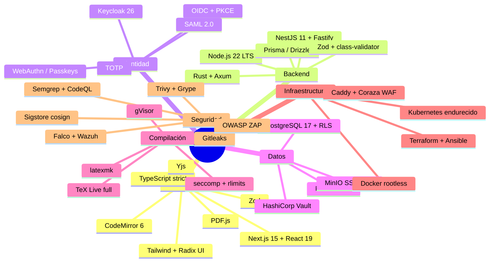

# 04 — Stack Tecnológico y Justificación de Seguridad

> **Proyecto:** SecurTex — Editor LaTeX Colaborativo Seguro
> **Criterio rector:** *ante dos tecnologías con capacidad funcional equivalente, se elige la que ofrezca más garantías de seguridad **por defecto**, sin depender de que el desarrollador recuerde configurarlas.*

---

## 1. Metodología de selección

Cada tecnología se evaluó con esta rúbrica (peso entre paréntesis):

| Criterio | Peso | Qué se valora |
|---|---|---|
| **Seguridad por defecto** | 30 % | ¿La configuración de fábrica ya es segura? ¿Hay que *desactivar* protecciones para hacer algo inseguro, o *activarlas* para estar seguro? |
| **Seguridad de memoria / tipos** | 20 % | ¿El lenguaje elimina clases enteras de vulnerabilidad por construcción? |
| **Madurez y auditoría** | 15 % | Historial de CVE, tiempo de respuesta, auditorías externas, tamaño de la comunidad |
| **Mantenimiento activo** | 10 % | Frecuencia de releases, política de soporte |
| **Adecuación funcional** | 15 % | ¿Resuelve realmente el problema? |
| **Coste de aprendizaje** | 10 % | Viabilidad para un equipo académico |

Puntuación mínima para ser aceptada: **7,5/10**.

---

## 2. Cuadro resumen del stack



---

## 3. Frontend

### 3.1 Framework: **Next.js 15 + React 19 + TypeScript (strict)**

| Alternativa | Puntuación | Comentario |
|---|---|---|
| **Next.js 15 + React 19** ✅ | 9,1 | Elegida |
| SvelteKit | 8,4 | Excelente, pero menor ecosistema de componentes accesibles auditados |
| Angular 19 | 8,6 | Muy seguro por defecto (sanitización estricta, DomSanitizer), pero pesado y con peor integración con CodeMirror/Yjs |
| Vue + Nuxt | 8,0 | Sanitización menos estricta por defecto que React |

**Garantías de seguridad que aporta React/Next por defecto:**

| Mecanismo | Efecto |
|---|---|
| Escapado automático de toda interpolación en JSX | XSS reflejado y almacenado bloqueado salvo uso explícito de `dangerouslySetInnerHTML` (prohibido por regla de ESLint personalizada) |
| Server Components y Server Actions | La lógica sensible no se envía al cliente; se reduce la superficie expuesta |
| Soporte nativo de **CSP con nonce** por petición | Permite `script-src 'nonce-…' 'strict-dynamic'` sin `unsafe-inline` |
| Cabeceras de seguridad declarativas en `next.config` | HSTS, `X-Content-Type-Options`, `Referrer-Policy`, `Permissions-Policy` centralizadas |
| Aislamiento de variables de entorno (`NEXT_PUBLIC_` explícito) | Impide filtrar secretos al bundle por descuido |
| `Origin`/`Host` validados en Server Actions | Mitigación de CSRF integrada |

**TypeScript en modo `strict`** con `noUncheckedIndexedAccess`, `exactOptionalPropertyTypes` y `noImplicitOverride`: el sistema de tipos se usa como control de seguridad, no como comodidad. Los identificadores llevan tipos nominales (`ProjectId`, `UserId`) para que sea **imposible** pasar un identificador donde va otro.

### 3.2 Editor de código: **CodeMirror 6**

| Alternativa | Decisión |
|---|---|
| **CodeMirror 6** ✅ | Arquitectura modular y de estado inmutable, tamaño reducido, accesibilidad real, sin dependencias con historial problemático. Es lo que usa el propio Overleaf moderno. |
| Monaco (VS Code) | Muy pesado (>2 MB), accesibilidad limitada, pensado para IDE de escritorio |
| Ace | En mantenimiento mínimo |

Complementos requeridos: `@codemirror/lang-latex` (o gramática Lezer propia para LaTeX/BibTeX), `@codemirror/autocomplete`, `@codemirror/search`, `@replit/codemirror-vim`, `@codemirror/legacy-modes` (Emacs), `y-codemirror.next` (integración CRDT).

### 3.3 Colaboración en el cliente: **Yjs**

Codificación binaria eficiente, `y-protocols/awareness` para cursores y presencia, `y-indexeddb` para persistencia local que permite seguir escribiendo sin conexión. Ver justificación de seguridad en [03-Arquitectura.md §5.2](03-Arquitectura.md).

### 3.4 Visor PDF: **PDF.js** endurecido

| Configuración obligatoria | Motivo |
|---|---|
| `enableScripting: false` | Un PDF puede contener JavaScript; se desactiva por completo |
| `isEvalSupported: false` | Elimina el uso de `eval` en el parseo de fuentes |
| Renderizado en **Web Worker** | Aísla el parseo del hilo principal |
| Servido desde origen separado con CSP `sandbox` | Contiene cualquier fallo del renderizador |

### 3.5 Interfaz y accesibilidad

- **Tailwind CSS 4** — sin CSS-in-JS en tiempo de ejecución, lo que facilita una CSP estricta sin `style-src 'unsafe-inline'`.
- **Radix UI** — primitivas accesibles (WAI-ARIA), gestión correcta del foco y del teclado. Cubre RF-142.
- **Zod** — validación de esquemas compartida entre cliente y servidor; el mismo esquema valida el formulario y el cuerpo de la petición, eliminando la divergencia cliente/servidor que suele generar agujeros.

---

## 4. Backend

### 4.1 Servicios de negocio: **NestJS 11 sobre Fastify**

| Alternativa | Puntuación | Comentario |
|---|---|---|
| **NestJS 11 + Fastify** ✅ | 9,0 | Elegida |
| Express puro | 6,2 | Nada seguro por defecto; todo es responsabilidad del desarrollador |
| Django + DRF | 8,8 | Extraordinariamente seguro por defecto, pero el ecosistema de tiempo real y el compartir tipos con el frontend lo penalizan |
| Spring Boot | 8,5 | Muy sólido; verbosidad y consumo elevados para el equipo |
| Go + Chi | 8,1 | Excelente rendimiento; menos barandillas estructurales |

**Por qué NestJS es una elección de seguridad, no de comodidad:**

| Mecanismo | Efecto |
|---|---|
| **Guards** declarativos | La autorización es un decorador obligatorio; existe un guard global de denegación por defecto: un endpoint sin `@Policy(...)` explícito devuelve 403 |
| **Pipes** de validación globales (`ValidationPipe` con `whitelist: true, forbidNonWhitelisted: true`) | Toda propiedad no declarada en el DTO se rechaza: *mass assignment* imposible |
| **Interceptors** | Serialización de salida con `@Exclude()`: los campos sensibles no se filtran por descuido |
| Inyección de dependencias | Facilita sustituir el proveedor criptográfico y probar el aislamiento |
| Módulos con fronteras explícitas | Refuerza la arquitectura hexagonal |
| Adaptador **Fastify** | Mejor rendimiento y validación de esquemas JSON nativa, menor superficie que Express |

Complementos obligatorios: `@fastify/helmet`, `@fastify/csrf-protection`, `@fastify/rate-limit`, `@fastify/cors` (lista blanca estricta), `@nestjs/throttler`.

### 4.2 Componentes de alto riesgo: **Rust + Axum + Tokio**

Se usa Rust exclusivamente en los dos componentes que procesan entrada hostil y manipulan recursos del sistema:

| Componente | Función | Por qué Rust |
|---|---|---|
| `compile-orchestrator` | Manipula rutas de archivo, lanza y supervisa procesos, aplica `rlimits`, valida la salida del compilador | Seguridad de memoria garantizada, ausencia de carreras de datos, gestión determinista de recursos (RAII), `tokio` para supervisar miles de procesos |
| `url-fetcher` | Descarga contenido desde URLs suministradas por el usuario (anti-SSRF) | Control fino de la resolución DNS y del socket, necesario para evitar el ataque DNS-rebinding / TOCTOU |

Bibliotecas: `axum`, `tokio`, `serde`, `rustls` (TLS **sin OpenSSL**, escrito en Rust puro), `secrecy` (zeroización de secretos en memoria), `nix` (rlimits).

> **Nota de alcance:** el uso de Rust está deliberadamente acotado. No se reescribe todo el backend en Rust; se aplica donde el retorno en seguridad es máximo.

### 4.3 Tiempo real: **Node.js 22 LTS + Hocuspocus**

Hocuspocus es el servidor de referencia de Yjs: incluye ganchos de autenticación por conexión (`onAuthenticate`), autorización por documento, persistencia con *debounce*, extensión de Redis para escalar horizontalmente y limitación de tasa. Se ejecuta con `--permission-model` de Node y sin acceso al sistema de ficheros.

### 4.4 Acceso a datos: **Prisma 6** (+ **Drizzle** en rutas críticas)

| Mecanismo | Efecto de seguridad |
|---|---|
| Consultas parametrizadas siempre | Inyección SQL imposible por la vía normal |
| `$queryRaw` con plantillas etiquetadas | Incluso el SQL crudo se parametriza; el uso de `$queryRawUnsafe` está **prohibido** por regla de lint |
| Esquema tipado generado | Divergencia entre modelo y código detectada en compilación |
| Migraciones versionadas y revisadas | Cambios de esquema auditables |
| `SET LOCAL app.user_id` por transacción | Habilita las políticas RLS de PostgreSQL |

---

## 5. Identidad: **Keycloak 26**

| Capacidad requerida | Cubierta por Keycloak |
|---|---|
| Login con Google (F-004) | Identity Provider OIDC nativo |
| Login con Microsoft (F-005) | Identity Provider OIDC nativo (Entra ID, cuentas personales y de organización) |
| Login con ORCID (F-006) | OIDC genérico |
| SSO institucional SAML 2.0 (F-007) | Broker SAML con firma y cifrado de aserciones |
| TOTP (F-011) | Nativo, con códigos de respaldo |
| WebAuthn / Passkeys (F-260) | Nativo, incluida la modalidad sin contraseña |
| Detección de fuerza bruta (F-014) | Nativa, permanente o temporal |
| Políticas de contraseña | Nativa, extensible con SPI para HIBP |
| Rotación de claves de firma | Automática, con JWKS publicado |
| Federación de usuarios y grupos | Nativa; sostiene los grupos e instituciones (F-233, F-234) |

**Endurecimiento aplicado:** realm dedicado, cuenta de administrador con MFA obligatoria y acceso restringido por IP, la consola de administración no se expone públicamente, `sslRequired=all`, tiempos de vida de token cortos, `Content-Security-Policy` reforzada, base de datos propia con credenciales exclusivas, imagen ejecutada como usuario no root.

> **Justificación central (ADR-0003):** los ataques a implementaciones propias de OAuth/OIDC (fijación de `state`, confusión de `aud`, `alg=none`, *signature wrapping* en SAML, IdP mix-up) son un campo minado. Usar una implementación madura y auditada es la decisión técnicamente más segura, y es defendible académicamente porque el trabajo se traslada a *configurarla correctamente*, que es donde está el aprendizaje real.

---

## 6. Persistencia

### 6.1 **PostgreSQL 17**

| Capacidad | Uso en SecurTex |
|---|---|
| **Row Level Security** | Segunda barrera de autorización: aunque un fallo de código omita la comprobación, la fila no es visible (RS-012) |
| **Roles diferenciados por servicio** | Cada microservicio tiene un usuario con privilegios mínimos sobre sus tablas |
| `pgcrypto` | Cifrado a nivel de columna para datos personales sensibles |
| `pgAudit` | Registro detallado de sentencias para auditoría forense |
| `scram-sha-256` | Autenticación robusta (nunca `md5` ni `trust`) |
| TLS obligatorio | `ssl=on`, `hostssl` exclusivo en `pg_hba.conf` |
| Credenciales **dinámicas** vía Vault | Contraseñas de BD de vida corta, rotadas automáticamente |
| WAL + PITR | RPO ≤ 5 min (RNF-013) |

Ejemplo real de política RLS:

```sql
ALTER TABLE project_files ENABLE ROW LEVEL SECURITY;
ALTER TABLE project_files FORCE ROW LEVEL SECURITY;

CREATE POLICY project_files_member_read ON project_files
  FOR SELECT
  USING (
    EXISTS (
      SELECT 1 FROM project_members m
      WHERE m.project_id = project_files.project_id
        AND m.user_id    = current_setting('app.user_id', true)::uuid
        AND m.revoked_at IS NULL
    )
  );

CREATE POLICY project_files_editor_write ON project_files
  FOR ALL
  USING (
    EXISTS (
      SELECT 1 FROM project_members m
      WHERE m.project_id = project_files.project_id
        AND m.user_id    = current_setting('app.user_id', true)::uuid
        AND m.role IN ('owner','editor')
        AND m.revoked_at IS NULL
    )
  );
```

### 6.2 **Redis 7**

TLS obligatorio, **ACL por servicio** (cada servicio solo puede ejecutar los comandos y tocar los prefijos de clave que necesita), `requirepass` con secreto de Vault, comandos peligrosos renombrados o deshabilitados (`FLUSHALL`, `CONFIG`, `KEYS`, `DEBUG`), persistencia AOF para las colas, sin exposición fuera de la red interna.

### 6.3 **MinIO** (compatible S3)

| Control | Configuración |
|---|---|
| Cifrado en reposo | **SSE-KMS** con claves gestionadas por Vault |
| Cifrado en tránsito | TLS obligatorio |
| Acceso | Credenciales por servicio con políticas IAM mínimas; **URLs prefirmadas de vida corta** (≤ 5 min) para el cliente |
| Inmutabilidad | **Object Lock** en el bucket de auditoría y de copias de seguridad (WORM) |
| Versionado | Activo, para recuperación ante borrado o cifrado malicioso |
| Servido al usuario | Desde un **dominio distinto** al de la aplicación, con `Content-Disposition: attachment` y `X-Content-Type-Options: nosniff` |

### 6.4 **HashiCorp Vault**

- **Transit engine** — cifrado y descifrado como servicio: la aplicación nunca ve la clave maestra.
- **Database secrets engine** — credenciales de PostgreSQL efímeras y rotadas.
- **PKI engine** — emisión y rotación de certificados para el mTLS interno.
- **AppRole / Kubernetes auth** — cada servicio se autentica con su identidad de carga de trabajo, sin secretos estáticos.
- Auditoría de todo acceso a secretos.

---

## 7. Motor de compilación LaTeX

### 7.1 Distribución

**TeX Live (esquema `full`)** en imagen de contenedor propia, congelada por versión anual y firmada con cosign. Cubre F-250…F-255: todos los paquetes de CTAN, los cuatro motores, `biber`, `makeindex`, `xindy`, `texcount`, `chktex` y `latexmk`.

Se ofrecen imágenes por año (2022, 2023, 2024, 2025) para reproducibilidad, exactamente como hace Overleaf.

### 7.2 Aislamiento: **gVisor (`runsc`)**

| Nivel | Mecanismo | Qué contiene |
|---|---|---|
| 1 | Contenedor sin privilegios, usuario no root, `no-new-privileges` | Escalada trivial |
| 2 | Todas las *capabilities* eliminadas (`--cap-drop=ALL`) | Operaciones privilegiadas |
| 3 | Sistema de ficheros raíz de **solo lectura**, `/tmp` en `tmpfs` con `noexec,nosuid,nodev` | Persistencia del atacante |
| 4 | **`--network=none`** | Exfiltración y *callback* |
| 5 | Perfil **seccomp** restrictivo | Llamadas al sistema peligrosas |
| 6 | **gVisor**: kernel de espacio de usuario en Go | Explotación de vulnerabilidades del kernel de Linux |
| 7 | `rlimits` + cgroups v2: CPU, memoria, PIDs, tamaño de fichero, tiempo | Denegación de servicio |
| 8 | Contenedor **efímero**, destruido tras cada trabajo | Persistencia entre usuarios |
| 9 | **Falco** monitorizando el namespace | Detección de comportamiento anómalo |

**Alternativa considerada:** Firecracker (microVM). Ofrece un aislamiento aún más fuerte, pero exige virtualización anidada, complica el entorno de desarrollo y aumenta el tiempo de arranque. **Decisión (ADR-0002):** gVisor por defecto, con Firecracker documentado como opción para un despliegue de producción de alto riesgo.

### 7.3 Endurecimiento específico de TeX

```ini
# texmf.cnf — aplicado en la imagen, no modificable por el usuario
shell_escape       = f      # \write18 completamente deshabilitado
openout_any        = p      # solo escritura dentro del árbol del proyecto
openin_any         = p      # solo lectura dentro del árbol del proyecto
max_print_line     = 1000
main_memory        = 12000000
```

Invocación:

```bash
latexmk -pdf -interaction=nonstopmode -halt-on-error \
        -no-shell-escape -file-line-error \
        -output-directory=/work/out /work/src/main.tex
```

**Análisis estático previo** (`latex-static-analyzer`, RS-041): se bloquea o marca todo documento que contenga `\write18`, `\immediate\write18`, `\openout` fuera del directorio, `\input`/`\include` con rutas absolutas o `..`, `\catcode` sospechoso, `\directlua`/`\latelua` con acceso a `os.*` o `io.*`, `\usepackage{shellesc}`, o profundidad de inclusión superior a 10.

---

## 8. Borde e infraestructura

### 8.1 Proxy inverso: **Caddy 2**

Elegido sobre Nginx por seguridad por defecto: HTTPS automático con ACME, TLS 1.3 preferente, configuración por defecto ya endurecida y una superficie de configuración mucho menor (menos oportunidades de error humano, que es la causa habitual de las brechas en Nginx).

Cabeceras aplicadas en todas las respuestas:

```
Strict-Transport-Security: max-age=63072000; includeSubDomains; preload
Content-Security-Policy: default-src 'none'; script-src 'nonce-{RANDOM}' 'strict-dynamic';
  style-src 'self'; img-src 'self' data: blob:; font-src 'self';
  connect-src 'self' wss://collab.securtex.app; frame-ancestors 'none';
  base-uri 'none'; form-action 'self'; object-src 'none'; upgrade-insecure-requests
X-Content-Type-Options: nosniff
Referrer-Policy: strict-origin-when-cross-origin
Permissions-Policy: geolocation=(), camera=(), microphone=(), payment=(), usb=()
Cross-Origin-Opener-Policy: same-origin
Cross-Origin-Embedder-Policy: require-corp
Cross-Origin-Resource-Policy: same-origin
```

### 8.2 WAF: **Coraza + OWASP Core Rule Set 4**

Motor WAF en Go, compatible con ModSecurity, sin la deuda de memoria de C. Se despliega en modo detección durante dos sprints y luego en bloqueo, con exclusiones afinadas (el contenido LaTeX genera falsos positivos que deben tratarse explícitamente, no desactivando reglas en bloque).

### 8.3 Contenedores y orquestación

| Elemento | Decisión |
|---|---|
| Runtime | Docker **rootless** en desarrollo; containerd en Kubernetes |
| Imágenes base | **Distroless** o Alpine con `USER` no root; `scratch` para los binarios de Rust |
| Multi-stage builds | La imagen final no contiene compiladores ni herramientas |
| Escaneo | Trivy + Grype en cada build, fallo del pipeline ante severidad alta o crítica |
| Firma | **Sigstore cosign** con verificación en el admission controller |
| Orquestación | Kubernetes con Pod Security Standards nivel **restricted**, NetworkPolicy de denegar todo, RuntimeClass `gvisor` para el namespace de compilación |
| Políticas | Kyverno o OPA Gatekeeper: prohibición de `privileged`, `hostPath`, `hostNetwork`, imágenes sin firmar y etiquetas `:latest` |

### 8.4 Infraestructura como código

**Terraform** (infraestructura) + **Ansible** (configuración) + **Helm/Kustomize** (Kubernetes). Analizados con `tfsec`, `checkov` y `kube-linter` en el CI. Estado remoto cifrado con bloqueo.

---

## 9. Herramientas de seguridad en el ciclo de vida

| Fase | Herramienta | Qué detecta | Bloquea el merge |
|---|---|---|---|
| Pre-commit | **Gitleaks** | Secretos en el código | ✅ |
| Pre-commit | ESLint + `eslint-plugin-security` + Clippy | Patrones peligrosos | ✅ |
| CI · SAST | **Semgrep** (reglas OWASP + propias) | Inyecciones, autorización ausente, criptografía débil | ✅ crítico/alto |
| CI · SAST | **CodeQL** | Flujos de datos contaminados | ✅ crítico/alto |
| CI · SCA | **OSV-Scanner** / `npm audit` / `cargo audit` | Dependencias vulnerables | ✅ crítico/alto |
| CI · Contenedores | **Trivy**, **Grype** | CVE en imágenes y capas | ✅ crítico/alto |
| CI · IaC | **Checkov**, **tfsec**, **kube-linter** | Malas configuraciones | ✅ crítico |
| CI · Licencias | **Syft** + política de licencias | Licencias incompatibles | ⚠️ aviso |
| CI · SBOM | **Syft** (CycloneDX) | Inventario firmado por versión | — |
| CI · DAST | **OWASP ZAP** (baseline en cada PR, full semanal en staging) | Vulnerabilidades en ejecución | ✅ alto |
| CI · Accesibilidad | **axe-core** + Playwright | Violaciones WCAG | ✅ crítico |
| CI · Pruebas de seguridad | Suite propia (`security/*.spec.ts`) | Escape del sandbox, IDOR, SSRF, zip-slip | ✅ cualquiera |
| Runtime | **Falco** | Comportamiento anómalo en contenedores | Alerta |
| Runtime | **Wazuh** (SIEM + HIDS) | Correlación, integridad de ficheros, detección de intrusión | Alerta |
| Runtime | **ClamAV** | Malware en subidas | ✅ cuarentena |

---

## 10. Observabilidad

| Necesidad | Tecnología |
|---|---|
| Trazas distribuidas | OpenTelemetry → Tempo |
| Métricas | OpenTelemetry → Mimir/Prometheus |
| Logs estructurados (JSON, sin PII) | Pino / `tracing` → Loki |
| Paneles y alertas | Grafana + Alertmanager |
| Eventos de seguridad | Wazuh SIEM, correlacionados con `traceId` |

Cada petición lleva un `traceId` que aparece en logs, trazas y eventos de auditoría: una investigación forense puede reconstruir una sesión completa.

---

## 11. Desarrollo y calidad

| Área | Herramienta |
|---|---|
| Monorepo | **pnpm workspaces** + **Turborepo** (instalación estricta, sin *hoisting* silencioso) |
| Pruebas unitarias | Vitest (TS), `cargo test` (Rust) |
| Pruebas de integración | Testcontainers (PostgreSQL, Redis, MinIO reales) |
| Pruebas E2E | Playwright (Chromium, Firefox, WebKit) |
| Pruebas de carga | k6 |
| Pruebas de propiedades | fast-check — usado para verificar la convergencia del CRDT y el parser de rutas |
| Formato y estilo | Biome / Prettier + ESLint, `rustfmt` + Clippy |
| Commits | Conventional Commits + commitlint, **commits firmados con GPG/SSH obligatorio** |
| Documentación de API | OpenAPI 3.1 generado desde decoradores + Redocly |
| Gestión de tareas | GitHub Projects con plantillas de issue |

---

## 12. Matriz de decisión final

| Capa | Tecnología elegida | Alternativa principal | Factor decisivo de seguridad |
|---|---|---|---|
| Frontend | Next.js 15 + React 19 + TS strict | SvelteKit | Escapado automático + CSP con nonce + tipado estricto |
| Editor | CodeMirror 6 | Monaco | Superficie menor, accesible, estado inmutable |
| Colaboración | Yjs CRDT | ShareDB (OT) | Un cliente malicioso no puede corromper el estado |
| API | NestJS 11 + Fastify | Express, Django | Guards y validación estrictos obligatorios por diseño |
| Alto riesgo | Rust + Axum | Go, C++ | Seguridad de memoria donde entra código hostil |
| Identidad | Keycloak 26 | Auth propia, Auth0 | Implementación auditada, autoalojable, sin dependencia externa |
| Base de datos | PostgreSQL 17 + RLS | MySQL, MongoDB | RLS como segunda barrera de autorización |
| Objetos | MinIO + SSE-KMS | S3, sistema de ficheros | Cifrado por defecto y autoalojable |
| Secretos | HashiCorp Vault | Variables de entorno, sealed-secrets | Claves que nunca tocan la aplicación + rotación |
| Compilación | TeX Live + gVisor | chroot, contenedor plano | Kernel independiente para código no confiable |
| Borde | Caddy + Coraza | Nginx + ModSecurity | Seguro por defecto, menos superficie de error de configuración |
| Orquestación | Kubernetes restricted | Docker Swarm | Políticas de admisión, NetworkPolicy, RuntimeClass |

---

## 13. Versiones fijadas (línea base del proyecto)

| Componente | Versión | Soporte hasta |
|---|---|---|
| Node.js | 22.x LTS | Abril 2027 |
| TypeScript | 5.7+ | — |
| Next.js | 15.x | — |
| React | 19.x | — |
| NestJS | 11.x | — |
| Rust | estable, edición 2024 | — |
| PostgreSQL | 17.x | Noviembre 2029 |
| Redis | 7.4.x | — |
| Keycloak | 26.x | — |
| Kubernetes | 1.31+ | — |
| TeX Live | 2023 / 2024 / 2025 | — |
| gVisor | último estable | — |

> Política de actualización: parches de seguridad en ≤ 7 días para severidad crítica, ≤ 30 días para alta. Automatizado con Renovate, con revisión humana obligatoria antes del merge.
