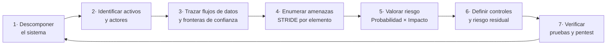
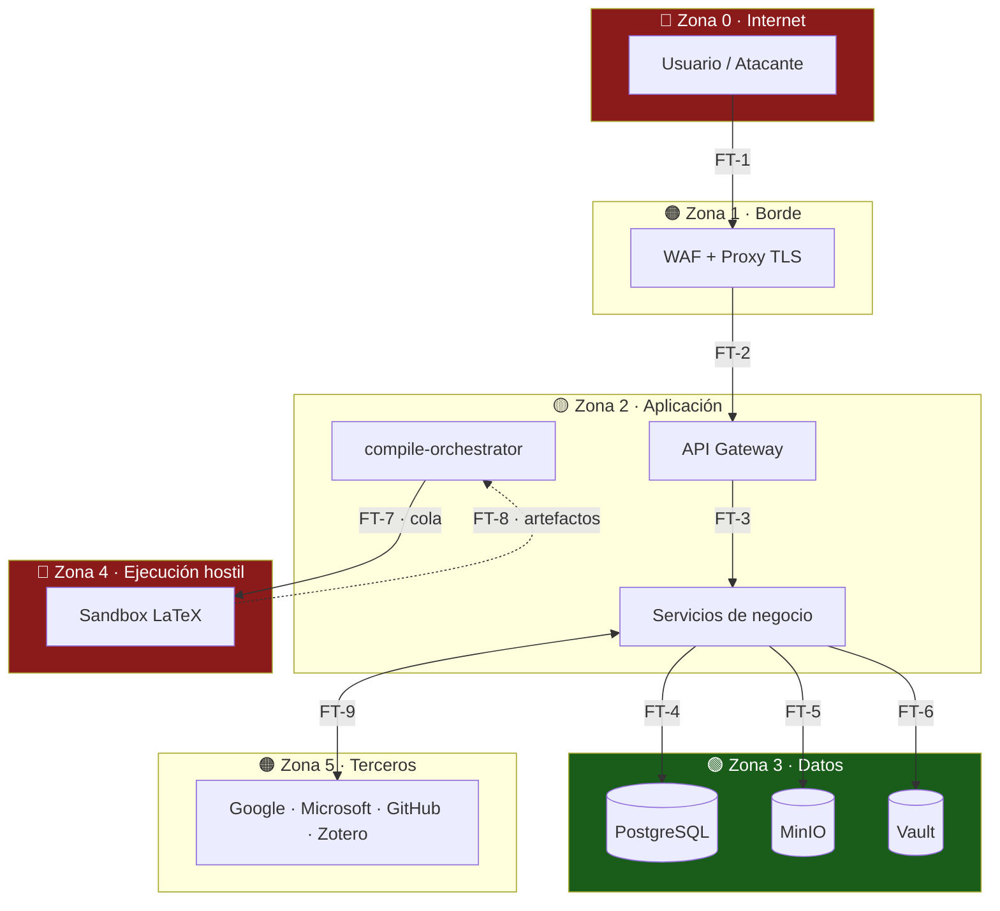
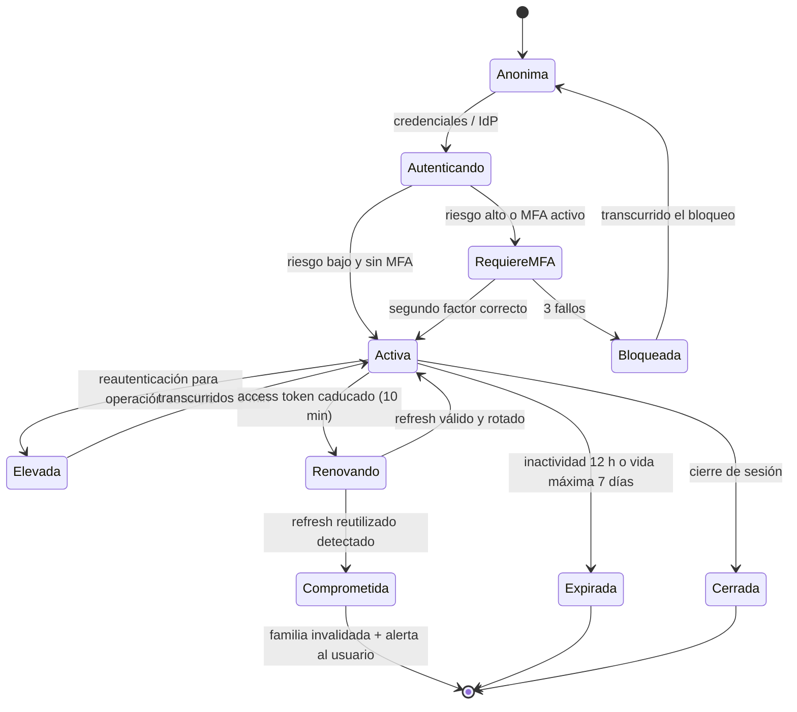
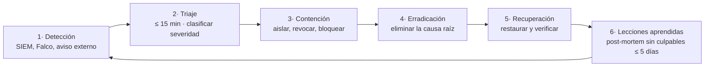

# 05 — Arquitectura de Seguridad, Modelo de Amenazas y Controles

> **Proyecto:** SecurTex — Editor LaTeX Colaborativo Seguro
> **Marcos aplicados:** STRIDE · OWASP Top 10 (2021) · OWASP ASVS 5.0 · OWASP SAMM · NIST SSDF (SP 800-218) · ISO/IEC 27001 Anexo A · MITRE ATT&CK
> **Versión:** 1.0
> **Este es el documento central de la asignatura.**

---

## 1. Resumen ejecutivo

SecurTex ejecuta, por diseño, **código arbitrario suministrado por usuarios anónimos**: LaTeX es un lenguaje Turing-completo con acceso al sistema de ficheros y capacidad de invocar procesos externos. Cualquier plataforma de este tipo es, en esencia, un servicio de ejecución remota de código voluntaria. La arquitectura de seguridad se organiza en torno a ese hecho.

**Las cinco amenazas de mayor riesgo residual y su tratamiento:**

| # | Amenaza | Riesgo inicial | Control principal | Riesgo residual |
|---|---|---|---|---|
| 1 | Escape del sandbox de compilación → RCE en el anfitrión | **Crítico (25)** | gVisor + sin red + sin privilegios + seccomp + efímero + Falco | Bajo (6) |
| 2 | Lectura de ficheros del servidor vía `\input` (LFI) | **Crítico (20)** | `openin_any=p` + análisis estático + FS efímero aislado | Bajo (4) |
| 3 | Acceso no autorizado a proyectos ajenos (IDOR) | **Alto (16)** | Autorización en servicio + RLS en PostgreSQL + UUIDv7 | Bajo (4) |
| 4 | Secuestro de cuenta (phishing / credential stuffing) | **Alto (16)** | Passkeys + TOTP + HIBP + motor de riesgo + rate limiting | Bajo (5) |
| 5 | SSRF vía "crear archivo desde URL" | **Alto (15)** | Proxy dedicado con lista blanca y resolución DNS controlada | Bajo (4) |

---

## 2. Metodología



**Escala de valoración** (DREAD simplificado a matriz 5×5):

| | Impacto 1 | 2 | 3 | 4 | 5 |
|---|---|---|---|---|---|
| **Prob. 5** | 5 | 10 | 15 | 20 | **25** |
| **4** | 4 | 8 | 12 | **16** | **20** |
| **3** | 3 | 6 | 9 | 12 | **15** |
| **2** | 2 | 4 | 6 | 8 | 10 |
| **1** | 1 | 2 | 3 | 4 | 5 |

| Rango | Nivel | Acción |
|---|---|---|
| 20–25 | Crítico | Bloquea el despliegue |
| 12–19 | Alto | Debe mitigarse antes de la entrega |
| 6–11 | Medio | Mitigar o aceptar con justificación firmada |
| 1–5 | Bajo | Aceptable |

---

## 3. Inventario de activos

| ID | Activo | Confidencialidad | Integridad | Disponibilidad | Notas |
|---|---|---|---|---|---|
| A-01 | Contenido de los documentos (`.tex`, `.bib`) | **Alta** | **Alta** | Media | Puede contener investigación no publicada, datos de tesis |
| A-02 | Credenciales y secretos de MFA | **Crítica** | **Crítica** | Alta | — |
| A-03 | Tokens OAuth de terceros (GitHub, Zotero) | **Crítica** | Alta | Media | Dan acceso a sistemas externos del usuario |
| A-04 | Datos personales (nombre, correos, afiliación, IP) | Alta | Alta | Media | Sujetos a RGPD y LOPDP |
| A-05 | Claves de cifrado (KEK, DEK, clave maestra) | **Crítica** | **Crítica** | **Crítica** | Su pérdida implica pérdida irreversible de datos |
| A-06 | Registro de auditoría | Alta | **Crítica** | Alta | Valor probatorio |
| A-07 | Infraestructura de compilación | Media | **Crítica** | Alta | Objetivo de minería de criptomonedas y pivote |
| A-08 | Código fuente y pipeline de CI/CD | Alta | **Crítica** | Alta | Ataque a la cadena de suministro |
| A-09 | Plantillas públicas | Baja | **Alta** | Media | Vector de distribución de LaTeX malicioso |
| A-10 | Disponibilidad del servicio | — | — | **Alta** | — |

---

## 4. Diagrama de flujo de datos con fronteras de confianza



| Flujo | Descripción | Controles en el cruce |
|---|---|---|
| FT-1 | Navegador → Borde | TLS 1.3, HSTS, WAF, rate limiting, anti-DDoS |
| FT-2 | Borde → Gateway | mTLS, validación de cabeceras, tamaño máximo de cuerpo |
| FT-3 | Gateway → Servicios | mTLS, contexto de identidad firmado, autorización por política |
| FT-4 | Servicio → PostgreSQL | TLS, credenciales dinámicas, RLS, consultas parametrizadas |
| FT-5 | Servicio → MinIO | TLS, IAM mínima, cifrado del objeto antes de subirlo |
| FT-6 | Servicio → Vault | mTLS, AppRole, políticas por ruta, auditoría |
| FT-7 | Orquestador → Sandbox | Solo por cola; entrada validada y analizada estáticamente |
| FT-8 | Sandbox → Orquestador | **Validación estricta de la salida**: tipo, tamaño, estructura; saneado de logs |
| FT-9 | Servicio ↔ Terceros | TLS con verificación de certificado, tokens cifrados, tiempos límite, circuit breaker |

---

## 5. Análisis STRIDE por componente

### 5.1 Leyenda

**S**poofing (suplantación) · **T**ampering (manipulación) · **R**epudiation (repudio) · **I**nformation disclosure (divulgación) · **D**enial of service (denegación) · **E**levation of privilege (elevación)

---

### 5.2 Componente: Autenticación y sesión

| ID | STRIDE | Amenaza | P | I | Riesgo | Controles |
|---|---|---|---|---|---|---|
| T-A01 | S | Credential stuffing con contraseñas filtradas | 5 | 4 | **20** | RS-001 Argon2id · RS-010 HIBP k-anonimato · rate limit por cuenta e IP · CAPTCHA adaptativo · alerta de acceso desde nueva ubicación |
| T-A02 | S | Phishing de credenciales | 4 | 4 | **16** | **Passkeys/WebAuthn** (resistente a phishing por vinculación al origen) · TOTP · aviso de dominio en correos |
| T-A03 | S | Robo de sesión por XSS | 3 | 5 | **15** | Cookie `HttpOnly` + `__Host-` · CSP estricta con nonce · escapado automático de React · sin tokens en `localStorage` |
| T-A04 | S | Fijación de sesión | 2 | 4 | 8 | Regeneración del identificador de sesión tras autenticar y tras elevar privilegio |
| T-A05 | T | Manipulación del `state` en OAuth (CSRF de login) | 3 | 4 | 12 | `state` de 256 bits ligado a cookie de un solo uso · PKCE S256 · validación de `nonce` |
| T-A06 | T | *Signature wrapping* en SAML | 2 | 5 | 10 | Delegado en Keycloak · firma obligatoria · validación de `Audience`, `NotOnOrAfter`, `InResponseTo` |
| T-A07 | S | IdP mix-up / confusión de `aud` | 2 | 5 | 10 | Un `client_id` por IdP · validación estricta de `iss` y `aud` · endpoints de redirección exactos, sin comodines |
| T-A08 | R | Usuario niega haber realizado una acción | 3 | 3 | 9 | RS-051 auditoría encadenada por hash · registro de IP, agente y `traceId` |
| T-A09 | I | Enumeración de usuarios en registro/recuperación | 4 | 2 | 8 | Respuestas y tiempos idénticos existan o no · sin diferencia de código de estado |
| T-A10 | D | Agotamiento por Argon2id (DoS por coste de hashing) | 3 | 3 | 9 | Rate limit **antes** del hashing · CAPTCHA · parámetros calibrados (~250 ms) · cola con límite de concurrencia |
| T-A11 | E | Escalada por asignación masiva del campo `role` | 3 | 5 | **15** | DTO con `whitelist` y `forbidNonWhitelisted` · el rol nunca se acepta desde el cliente · pruebas específicas |
| T-A12 | T | Reutilización de *refresh token* robado | 3 | 4 | 12 | Rotación con detección de reutilización → invalidación de toda la familia + alerta |

---

### 5.3 Componente: **Motor de compilación LaTeX** ⚠️ *el componente más crítico*

| ID | STRIDE | Amenaza | P | I | Riesgo | Controles |
|---|---|---|---|---|---|---|
| T-C01 | E | **RCE mediante `\write18` / shell-escape** | 5 | 5 | **25** | `shell_escape=f` en `texmf.cnf` de la imagen (no modificable) · `-no-shell-escape` explícito · análisis estático que bloquea el documento · `shellesc` bloqueado |
| T-C02 | I | **LFI: `\input{/etc/passwd}`, `\include`, `\lstinputlisting`** | 5 | 4 | **20** | `openin_any=p` · sistema de ficheros del contenedor sin nada sensible · montaje efímero exclusivo del proyecto · análisis estático de rutas absolutas y `..` |
| T-C03 | E | Escape del contenedor por vulnerabilidad del kernel | 2 | 5 | 10 | **gVisor**: kernel en espacio de usuario · seccomp · sin capabilities · namespace de red vacío · nodos de compilación físicamente separados |
| T-C04 | D | Bomba de compilación (`\def\x{\x\x}`, bucles infinitos, `\loop`) | 5 | 3 | **15** | Timeout duro de 60 s · límite de memoria 1 GiB · límite de PIDs · `main_memory` acotado · terminación forzada del contenedor |
| T-C05 | D | Bomba de descompresión (zip bomb en la importación) | 4 | 3 | 12 | Límite de ratio de compresión, de tamaño descomprimido y de número de entradas |
| T-C06 | T | Escritura fuera del directorio con `\openout` | 4 | 4 | **16** | `openout_any=p` · FS raíz de solo lectura · única ruta escribible es `/work/out` en `tmpfs` |
| T-C07 | E | RCE vía LuaTeX (`\directlua{os.execute(...)}`) | 4 | 5 | **20** | LuaTeX ejecutado en modo restringido (`--safer`) · `os`, `io`, `package`, `ffi` neutralizados · análisis estático |
| T-C08 | I | Exfiltración de datos por red desde el compilador | 4 | 4 | **16** | `--network=none` · NetworkPolicy de egress denegado en el namespace · sin resolutor DNS |
| T-C09 | I | Fuga de información del anfitrión en los logs | 3 | 3 | 9 | Saneado del log: eliminación de rutas absolutas, variables de entorno y nombres de host |
| T-C10 | D | Minería de criptomonedas usando la CPU de compilación | 4 | 3 | 12 | Cuotas por usuario y plan · límite de CPU · detección de anomalías de duración · Falco |
| T-C11 | T | PDF de salida manipulado con JavaScript embebido | 3 | 3 | 9 | Validación de la estructura del PDF · PDF.js con scripting deshabilitado · `Content-Disposition: attachment` |
| T-C12 | E | Plantilla pública maliciosa que ataca a quien la usa | 3 | 4 | 12 | Moderación · análisis estático obligatorio antes de publicar · aislamiento igual para todos |
| T-C13 | I | Uso de `\usepackage` para cargar un `.sty` malicioso del proyecto | 4 | 4 | **16** | El `.sty` del usuario se ejecuta dentro del mismo sandbox: el impacto queda contenido en la Zona 4 |

#### Árbol de ataque: obtener ejecución de código en el anfitrión

```mermaid
graph TD
    G["🎯 OBJETIVO<br/>Ejecutar código en el anfitrión"]
    G --> A1["A· Shell escape de LaTeX"]
    G --> A2["B· Escapar del contenedor"]
    G --> A3["C· Atacar el orquestador"]
    G --> A4["D· Comprometer la cadena de suministro"]

    A1 --> A11["\\write18<br/>❌ shell_escape=f"]
    A1 --> A12["\\directlua os.execute<br/>❌ modo --safer"]
    A1 --> A13["paquete shellesc<br/>❌ bloqueado por analizador"]
    A1 --> A14["-shell-escape en args<br/>❌ argumentos fijos en el orquestador"]

    A2 --> A21["CVE del kernel de Linux<br/>❌ gVisor: kernel en espacio de usuario"]
    A2 --> A22["Fuga de capability<br/>❌ cap-drop=ALL"]
    A2 --> A23["Montaje del socket de Docker<br/>❌ nunca montado"]
    A2 --> A24["Abuso de /proc y /sys<br/>❌ enmascarados + seccomp"]

    A3 --> A31["Path traversal en nombres de fichero<br/>❌ tipo SafeFilePath en Rust"]
    A3 --> A32["Desbordamiento al parsear el log<br/>❌ Rust: seguridad de memoria"]
    A3 --> A33["Inyección de comandos en los argumentos<br/>❌ exec sin shell, argv fijo"]

    A4 --> A41["Paquete npm/cargo comprometido<br/>❌ lockfile + SCA + revisión"]
    A4 --> A42["Imagen base manipulada<br/>❌ cosign + digest fijo"]
    A4 --> A43["Acción de CI comprometida<br/>❌ fijada por SHA"]

    style G fill:#8b1a1a,color:#fff
    style A11 fill:#1a5c1a,color:#fff
    style A21 fill:#1a5c1a,color:#fff
    style A31 fill:#1a5c1a,color:#fff
    style A41 fill:#1a5c1a,color:#fff
```



---

### 5.4 Componente: Gestión de proyectos y control de acceso

| ID | STRIDE | Amenaza | P | I | Riesgo | Controles |
|---|---|---|---|---|---|---|
| T-P01 | E | **IDOR**: acceder a `/api/v1/projects/{id}` de otro usuario | 5 | 4 | **20** | Autorización en el caso de uso + **RLS en PostgreSQL** + UUIDv7 no adivinable + pruebas automatizadas de acceso cruzado |
| T-P02 | E | Escalada horizontal por enlace de compartición adivinado | 3 | 4 | 12 | Token de 256 bits · almacenado hasheado · revocable · no aparece en logs ni en `Referer` |
| T-P03 | E | Un lector escribe manipulando el cliente | 4 | 4 | **16** | Autorización en el servidor en REST **y en WebSocket**; el rol nunca se toma del cliente |
| T-P04 | T | Un revocado sigue editando por el socket abierto | 4 | 4 | **16** | Revalidación de permisos cada 60 s + evento de revocación que cierra la conexión |
| T-P05 | I | Fuga de contenido a través del historial tras revocar el acceso | 3 | 4 | 12 | El historial aplica el mismo control de acceso que el proyecto |
| T-P06 | R | Disputa sobre quién eliminó un proyecto | 3 | 3 | 9 | Auditoría inmutable · papelera de 30 días |
| T-P07 | I | Enumeración de proyectos por respuestas diferenciadas | 3 | 2 | 6 | 404 uniforme para "no existe" y "no autorizado" |

---

### 5.5 Componente: Archivos y subidas

| ID | STRIDE | Amenaza | P | I | Riesgo | Controles |
|---|---|---|---|---|---|---|
| T-F01 | T | **Path traversal** en el nombre (`../../etc/cron.d/x`) | 4 | 5 | **20** | Tipo `SafeFilePath` con normalización NFC, rechazo de `..`, `/`, `\`, control chars y nombres reservados; almacenamiento por UUID, nunca por nombre de usuario |
| T-F02 | T | **Zip-slip** al importar un `.zip` | 4 | 5 | **20** | Validación de cada entrada tras normalizar la ruta; rechazo de rutas absolutas, `..` y enlaces simbólicos |
| T-F03 | E | Subida de un `.sty`/`.cls` malicioso | 4 | 3 | 12 | Impacto contenido en el sandbox · análisis estático |
| T-F04 | I | XSS almacenado sirviendo un `.svg`/`.html` subido | 4 | 4 | **16** | Servido desde **origen distinto** · `Content-Disposition: attachment` · `nosniff` · CSP `sandbox` · SVG saneado antes de previsualizar |
| T-F05 | T | Distribución de malware entre colaboradores | 3 | 4 | 12 | **ClamAV** en cada subida · cuarentena · notificación |
| T-F06 | D | Agotamiento de almacenamiento | 4 | 3 | 12 | Cuota por archivo (50 MB), por proyecto (1 GB) y por usuario · rate limit de subidas |
| T-F07 | I | **SSRF** en "crear archivo desde URL" | 4 | 4 | **16** | `url-fetcher` dedicado: solo `http`/`https` · **bloqueo de IP privadas, loopback, link-local, IPv6 mapeadas y metadatos de nube (169.254.169.254)** · resolución DNS previa y conexión a la **IP ya resuelta** (anti DNS-rebinding) · máximo 3 redirecciones revalidadas · timeout 10 s · límite de 50 MB |
| T-F08 | D | Bomba XML / *billion laughs* en `.svg` o `.xml` | 3 | 3 | 9 | Parser con entidades externas deshabilitadas y límites de expansión |

---

### 5.6 Componente: Colaboración en tiempo real

| ID | STRIDE | Amenaza | P | I | Riesgo | Controles |
|---|---|---|---|---|---|---|
| T-R01 | S | WebSocket sin autenticar → lectura de documentos ajenos | 4 | 5 | **20** | `onAuthenticate` obligatorio con token de vida corta específico del documento · validación de `Origin` |
| T-R02 | T | Envío de operaciones que corrompen el documento | 3 | 4 | 12 | CRDT: las actualizaciones son conmutativas e idempotentes; no existe estado que "romper" |
| T-R03 | D | Inundación de operaciones | 4 | 3 | 12 | Rate limit por conexión (ops/s y bytes/s) · tamaño máximo de mensaje · desconexión progresiva |
| T-R04 | I | Fuga de presencia/metadatos a no colaboradores | 3 | 2 | 6 | Awareness limitado a la sala autorizada |
| T-R05 | S | *Cross-site WebSocket hijacking* | 3 | 5 | **15** | Validación estricta de `Origin` + token en el subprotocolo, no en cookie ambiental |
| T-R06 | T | XSS almacenado a través del chat o del nombre de usuario | 3 | 4 | 12 | Escapado en render · sin `innerHTML` · nombre de usuario validado por esquema |

---

### 5.7 Componentes restantes (resumen)

| ID | Componente | STRIDE | Amenaza | Riesgo | Control principal |
|---|---|---|---|---|---|
| T-B01 | Bibliografía | D | ReDoS en el parser `.bib` | 12 | Parser sin retroceso catastrófico + timeout + límite de tamaño |
| T-B02 | Bibliografía | I | Token de Zotero robado de la base | 12 | Cifrado con la KEK del usuario · *scopes* mínimos · revocable |
| T-I01 | Integraciones | E | Token de GitHub con permisos excesivos | **15** | GitHub App con permisos mínimos y selección de repositorios · nunca `repo` completo |
| T-I02 | Integraciones | T | Webhook falsificado | 12 | Verificación de firma HMAC con comparación en tiempo constante |
| T-D01 | Base de datos | I | Volcado de la base tras una brecha | **16** | Cifrado de contenido con envelope encryption: el volcado no revela documentos |
| T-D02 | Base de datos | T | Inyección SQL | 10 | ORM parametrizado · prohibición de SQL crudo sin parámetros · SAST |
| T-S01 | Cadena de suministro | T | Dependencia comprometida | **16** | Lockfile · SCA en CI · SBOM · Renovate con revisión · política de dependencias nuevas |
| T-S02 | CI/CD | E | Secreto de CI filtrado | **15** | OIDC sin secretos de larga vida · entornos protegidos · revisión obligatoria de workflows |
| T-O01 | Operación | I | Acceso de administrador abusivo | 12 | MFA obligatoria · lista de IP · auditoría reforzada · principio de cuatro ojos para acciones críticas |
| T-O02 | Operación | D | DDoS volumétrico | 12 | CDN con anti-DDoS · rate limit en el borde · autoescalado con techo |
| T-N01 | Notificaciones | S | Suplantación en correos salientes | 9 | SPF + DKIM + DMARC en modo `reject` |

---

## 6. Cobertura de OWASP Top 10 (2021)

| Categoría | Amenazas relacionadas | Controles implementados | Verificación |
|---|---|---|---|
| **A01 · Pérdida de control de acceso** | T-P01…T-P05, T-R01 | Autorización en el caso de uso, RLS, denegar por defecto, UUIDv7, revalidación en WS | Pruebas automatizadas de acceso cruzado por cada endpoint |
| **A02 · Fallos criptográficos** | T-D01, T-A03 | TLS 1.3, mTLS interno, Argon2id, AES-256-GCM, envelope encryption con Vault, cifrado por columna | Revisión criptográfica + `testssl.sh` en CI |
| **A03 · Inyección** | T-C01, T-C02, T-D02, T-F01 | Zod/DTO en el borde, ORM parametrizado, `execve` sin shell, análisis estático de LaTeX, escapado de salida | Semgrep + CodeQL + pruebas de inyección |
| **A04 · Diseño inseguro** | Todo el documento | Modelado de amenazas antes de codificar, ADR, fronteras de confianza, límites por diseño | Revisión de arquitectura por sprint |
| **A05 · Configuración de seguridad defectuosa** | T-C03, T-O01 | Endurecimiento por defecto, IaC analizada, Pod Security restricted, cabeceras completas, sin credenciales por defecto | Checkov, kube-linter, ZAP baseline |
| **A06 · Componentes vulnerables** | T-S01 | SCA en CI, SBOM, Renovate, política de parches (7/30 días) | OSV-Scanner, Trivy, Grype |
| **A07 · Fallos de identificación y autenticación** | T-A01…T-A12 | Keycloak, Passkeys, TOTP, HIBP, rate limiting, rotación de refresh con detección de reutilización | Pruebas E2E de autenticación + pentest |
| **A08 · Fallos de integridad de software y datos** | T-S01, T-S02, T-C11 | Firma con cosign, verificación en admisión, acciones fijadas por SHA, auditoría encadenada por hash | Verificación de firma en el despliegue |
| **A09 · Fallos de registro y monitorización** | T-A08, T-P06 | Logs estructurados sin PII, auditoría inmutable, SIEM, alertas, `traceId` correlacionado | Ejercicio forense simulado |
| **A10 · SSRF** | T-F07 | `url-fetcher` con lista blanca, bloqueo de rangos privados, conexión a IP resuelta, límite de redirecciones | Suite de pruebas SSRF con 30+ vectores |

---

## 7. Controles de seguridad por capa

### 7.1 Capa de red y borde

| Control | Implementación |
|---|---|
| TLS 1.3 obligatorio | Caddy; TLS 1.2 solo con suites AEAD; sin renegociación |
| HSTS con preload | `max-age=63072000; includeSubDomains; preload` |
| Certificate Transparency y OCSP stapling | Activados |
| WAF | Coraza + CRS 4, modo bloqueo tras calibración |
| Rate limiting escalonado | Global → por IP → por cuenta → por endpoint sensible |
| Anti-DDoS | CDN en el borde |
| Segmentación | NetworkPolicy de denegar todo; egress bloqueado en el namespace de compilación |
| mTLS interno | PKI de Vault con rotación automática cada 24 h |

### 7.2 Capa de aplicación

| Control | Implementación |
|---|---|
| Validación de entrada | Zod + DTO con `whitelist` y `forbidNonWhitelisted`, en el borde de cada servicio |
| Codificación de salida | React por defecto; DOMPurify donde sea inevitable el HTML |
| CSP con nonce | Nonce por petición, `strict-dynamic`, sin `unsafe-inline` |
| CSRF | Cookies `SameSite=Lax` + token sincronizador en operaciones que cambian estado + validación de `Origin` |
| Cabeceras de seguridad | Conjunto completo (ver [04-Stack-Tecnologico.md §8.1](04-Stack-Tecnologico.md)) |
| Gestión de errores | Mensajes genéricos al cliente, detalle solo en el log con `traceId` |
| Autorización | Guard global de denegación por defecto; política declarativa por caso de uso |
| Límites de recurso | Tamaño de cuerpo, profundidad de JSON, número de campos, tiempo de petición |

### 7.3 Capa de datos

| Control | Implementación |
|---|---|
| Cifrado en reposo | AES-256-GCM con DEK por archivo, KEK por proyecto, clave maestra en Vault |
| Cifrado en tránsito | TLS en todas las conexiones a almacenes |
| RLS | Activo y **forzado** (`FORCE ROW LEVEL SECURITY`) en toda tabla con datos de usuario |
| Credenciales | Dinámicas y rotadas por Vault; ningún servicio comparte usuario de base de datos |
| Copias de seguridad | Cifradas, almacenamiento inmutable (Object Lock), restauración probada mensualmente |
| Retención y borrado | Política automatizada; borrado definitivo por destrucción de clave |
| Minimización | No se almacena lo que no se necesita; IP truncada tras 90 días |

### 7.4 Criptografía — especificación

> **Ampliación:** el diseño criptográfico completo, con **cinco capas y seis familias de algoritmos distintas** desde `Ctrl+S` hasta el descifrado de vuelta en el navegador, está en **[14-Criptografia-Multicapa.md](14-Criptografia-Multicapa.md)** (ADR-0010). La tabla siguiente es el resumen de las primitivas aprobadas.
>
> | Capa | Momento | Algoritmo | Amenaza que cubre |
> |---|---|---|---|
> | C1 | `Ctrl+S`, compilar, autoguardar | AES-256-GCM | El contenido sale del navegador en claro |
> | C2 | Envío al backend | X25519 + HKDF-SHA-256 + ChaCha20-Poly1305 | TLS termina en un intermediario |
> | C3 | Reposo | AES-256-KW + AES-256-GCM + AES-256-CBC/HMAC | Volcado de base de datos o de copias |
> | C4 | Recuperación | HMAC-SHA-256 + Ed25519 | Manipulación silenciosa del dato en reposo |
> | C5 | Descifrado en el navegador | AES-256-GCM con verificación de etiqueta y AAD | Cierra el ciclo sin mostrar nada no autenticado |

| Uso | Algoritmo | Parámetros |
|---|---|---|
| Hash de contraseñas | **Argon2id** | m=64 MiB, t=3, p=4, sal de 16 B, salida de 32 B |
| Hash de tokens de API | Argon2id | Mismos parámetros |
| Cifrado de contenido | **AES-256-GCM** | Nonce de 96 bits aleatorio, único por operación; AAD = `projectId ‖ fileId ‖ version` |
| Envoltura de claves | AES-256-GCM vía Vault Transit | Rotación de la clave maestra cada 90 días |
| Firma de tokens internos | **EdDSA (Ed25519)** | Rotación de claves cada 30 días, JWKS publicado |
| TLS | TLS 1.3 | `TLS_AES_256_GCM_SHA384`, `TLS_CHACHA20_POLY1305_SHA256` |
| Aleatoriedad | CSPRNG del sistema | `crypto.randomBytes` / `getrandom(2)`; prohibido `Math.random` para cualquier uso de seguridad |
| Integridad del log de auditoría | SHA-256 encadenado | `h(n) = SHA256(h(n-1) ‖ evento(n))` |
| Comparación de secretos | Tiempo constante | `crypto.timingSafeEqual` |

**Prohibiciones explícitas:** MD5, SHA-1 (salvo el prefijo del protocolo k-anonimato de HIBP, donde no cumple función de seguridad), DES/3DES, RC4, ECB, `alg: none` en JWT, JWT en `localStorage`, criptografía "propia".

### 7.5 Capa de ejecución (sandbox)

Ver [04-Stack-Tecnologico.md §7.2](04-Stack-Tecnologico.md) para los nueve niveles de aislamiento. Configuración operativa:

```yaml
# Especificación efectiva de cada pod de compilación
runtimeClassName: gvisor
automountServiceAccountToken: false
hostNetwork: false
hostPID: false
hostIPC: false
securityContext:
  runAsNonRoot: true
  runAsUser: 65534
  runAsGroup: 65534
  readOnlyRootFilesystem: true
  allowPrivilegeEscalation: false
  privileged: false
  capabilities: { drop: ["ALL"] }
  seccompProfile: { type: Localhost, localhostProfile: texlive-seccomp.json }
resources:
  limits:   { cpu: "1", memory: "1Gi", ephemeral-storage: "2Gi" }
  requests: { cpu: "500m", memory: "512Mi" }
volumes:
  - name: work
    emptyDir: { medium: Memory, sizeLimit: 512Mi }
activeDeadlineSeconds: 90
# NetworkPolicy asociada: egress e ingress totalmente denegados
```

---

## 8. Gestión de identidad y acceso

### 8.1 Matriz de permisos (RBAC)

| Acción | Visitante | Usuario | Lector | Revisor | Editor | Propietario | Admin sistema |
|---|:---:|:---:|:---:|:---:|:---:|:---:|:---:|
| Ver galería de plantillas | ✅ | ✅ | ✅ | ✅ | ✅ | ✅ | ✅ |
| Crear proyecto | ❌ | ✅ | — | — | — | — | ✅ |
| Ver contenido del proyecto | ❌ | ❌ | ✅ | ✅ | ✅ | ✅ | ⚠️ auditado |
| Compilar | ❌ | ❌ | ✅ | ✅ | ✅ | ✅ | ⚠️ |
| Editar archivos | ❌ | ❌ | ❌ | ❌ | ✅ | ✅ | ❌ |
| Sugerir cambios | ❌ | ❌ | ❌ | ✅ | ✅ | ✅ | ❌ |
| Comentar | ❌ | ❌ | ❌ | ✅ | ✅ | ✅ | ❌ |
| Aceptar/rechazar cambios | ❌ | ❌ | ❌ | ❌ | ✅ | ✅ | ❌ |
| Subir archivos | ❌ | ❌ | ❌ | ❌ | ✅ | ✅ | ❌ |
| Ver historial | ❌ | ❌ | ✅ | ✅ | ✅ | ✅ | ⚠️ |
| Restaurar versión | ❌ | ❌ | ❌ | ❌ | ✅ | ✅ | ❌ |
| Invitar colaboradores | ❌ | ❌ | ❌ | ❌ | ❌ | ✅ | ❌ |
| Cambiar roles | ❌ | ❌ | ❌ | ❌ | ❌ | ✅ | ❌ |
| Gestionar enlaces de compartición | ❌ | ❌ | ❌ | ❌ | ❌ | ✅ | ❌ |
| Renombrar / archivar | ❌ | ❌ | ❌ | ❌ | ❌ | ✅ | ❌ |
| Eliminar definitivamente | ❌ | ❌ | ❌ | ❌ | ❌ | ✅ | ⚠️ |
| Transferir propiedad | ❌ | ❌ | ❌ | ❌ | ❌ | ✅ | ❌ |
| Publicar plantilla | ❌ | ❌ | ❌ | ❌ | ❌ | ✅ | ✅ |
| Bloquear cuentas | ❌ | ❌ | ❌ | ❌ | ❌ | ❌ | ✅ |
| Ver auditoría global | ❌ | ❌ | ❌ | ❌ | ❌ | ❌ | ✅ + Auditor |

> ⚠️ = permitido solo con justificación registrada, notificación al propietario y entrada reforzada en el registro de auditoría. **El administrador del sistema no puede leer el contenido de los documentos de forma silenciosa.**

### 8.2 Ciclo de vida de la sesión



---

## 9. Privacidad y cumplimiento

### 9.1 Datos personales tratados

| Dato | Finalidad | Base legal (RGPD) | Retención |
|---|---|---|---|
| Correo electrónico | Identificación y comunicación | Ejecución del contrato | Hasta el borrado de la cuenta |
| Nombre y apellidos | Identificación en la colaboración | Ejecución del contrato | Ídem |
| Hash de contraseña | Autenticación | Ejecución del contrato | Ídem |
| Afiliación institucional | Licencias y plantillas institucionales | Consentimiento | Ídem |
| Dirección IP | Seguridad y prevención del fraude | Interés legítimo | 90 días (truncada después) |
| Registro de auditoría | Seguridad y obligación legal | Obligación legal / interés legítimo | 2 años |
| Contenido de los documentos | Prestación del servicio | Ejecución del contrato | Hasta el borrado del proyecto + 30 días de papelera |
| Tokens de terceros | Integraciones solicitadas | Consentimiento | Hasta la revocación |

### 9.2 Derechos del interesado

| Derecho | Implementación | Plazo |
|---|---|---|
| Acceso | Panel "Mis datos" + exportación completa | Inmediato |
| Rectificación | Ajustes de cuenta | Inmediato |
| Supresión | "Eliminar cuenta" con purga en cascada y destrucción de claves | ≤ 30 días |
| Portabilidad | Exportación en `.zip` con JSON y ficheros originales | Inmediato |
| Oposición / limitación | Preferencias y solicitud al responsable | ≤ 30 días |
| Información sobre brechas | Notificación a la autoridad y a los afectados | ≤ 72 h |

### 9.3 Otras normas

- **LOPDP (Ecuador)** — registro de actividades de tratamiento, delegado de protección de datos designado, notificación de brechas en 72 h, evaluación de impacto para el tratamiento de contenido académico.
- **OWASP ASVS 5.0** — nivel 2 general, nivel 3 en V2 (autenticación), V6 (criptografía), V12 (ficheros) y V14 (configuración).
- **NIST SSDF (SP 800-218)** — prácticas PO, PS, PW y RV mapeadas en [12-DevSecOps-y-Testing.md](12-DevSecOps-y-Testing.md).

---

## 10. Registro, monitorización y detección

### 10.1 Eventos que se registran obligatoriamente

| Categoría | Eventos |
|---|---|
| Autenticación | Login correcto y fallido, cierre de sesión, MFA superada o fallida, cambio de contraseña, recuperación, vinculación de IdP |
| Autorización | Toda denegación (403), intento de acceso a recurso ajeno |
| Gestión de acceso | Invitación, cambio de rol, revocación, creación y revocación de enlaces de compartición, transferencia de propiedad |
| Datos | Creación, borrado y restauración de proyecto; exportación de datos; descarga masiva |
| Compilación | Veredicto del análisis estático, compilaciones bloqueadas, timeouts, terminaciones anómalas |
| Administración | Toda acción de administrador, sin excepción |
| Seguridad | Detección de reutilización de refresh token, bloqueo por fuerza bruta, malware detectado, alerta de Falco |

**Formato del evento:**

```json
{
  "ts": "2026-08-14T10:32:11.482Z",
  "eventId": "01J9X2K7…",
  "traceId": "4bf92f3577b34da6a3ce929d0e0e4736",
  "type": "authz.denied",
  "severity": "warning",
  "actor": { "userId": "01J9…", "ip": "203.0.113.0/24", "ua": "sha256:…" },
  "target": { "type": "project", "id": "01J9…" },
  "action": "project.file.write",
  "outcome": "denied",
  "reason": "role_insufficient",
  "prevHash": "sha256:…",
  "hash": "sha256:…"
}
```

> La IP se guarda anonimizada por red /24 y el agente de usuario como hash: se conserva la utilidad forense sin acumular datos personales innecesarios.

### 10.2 Reglas de detección y alerta

| Regla | Umbral | Acción |
|---|---|---|
| Fuerza bruta de credenciales | > 10 fallos / 5 min / cuenta | Bloqueo temporal + correo al titular |
| Rociado de contraseñas (*password spraying*) | > 50 cuentas distintas / 10 min / IP | Bloqueo de IP + alerta al equipo |
| Escalada horizontal | > 5 respuestas 403 / min / usuario | Alerta e investigación |
| Exfiltración masiva | > 20 descargas de proyecto / hora / usuario | Rate limit + alerta |
| Abuso del compilador | > 100 compilaciones / hora, o duración media > 45 s | Degradación de prioridad + alerta |
| Escape del sandbox (Falco) | Cualquier syscall fuera del perfil | Terminación inmediata + aislamiento del nodo + incidente |
| Manipulación del log de auditoría | Ruptura de la cadena de hashes | **Incidente crítico automático** |
| Nueva ubicación de acceso | Geovelocidad imposible | Exigir MFA + notificar |

---

## 11. Respuesta a incidentes



| Severidad | Definición | Tiempo de respuesta | Escalado |
|---|---|---|---|
| **SEV-1** | Escape del sandbox, brecha de datos confirmada, compromiso de la clave maestra | ≤ 15 min | Todo el equipo + responsable + posible notificación legal |
| **SEV-2** | Toma de control de cuenta, vulnerabilidad crítica explotable, caída total | ≤ 1 h | Responsable de seguridad + ingeniería |
| **SEV-3** | Vulnerabilidad alta sin explotación conocida, degradación parcial | ≤ 8 h | Ingeniería de guardia |
| **SEV-4** | Vulnerabilidad media o baja | ≤ 5 días laborables | Backlog priorizado |

**Acciones de contención disponibles:** revocación global de sesiones, desactivación del servicio de compilación, modo de solo lectura de la plataforma, rotación de la clave maestra, bloqueo de cuenta, aislamiento de nodo, activación del modo mantenimiento.

**Divulgación responsable:** archivo `SECURITY.md` en el repositorio y `/.well-known/security.txt` publicado, con canal de contacto, plazo de respuesta de 72 h y compromiso de no emprender acciones legales contra investigación de buena fe.

---

## 12. Verificación de la seguridad

| Actividad | Frecuencia | Responsable | Evidencia |
|---|---|---|---|
| Modelado de amenazas | Por cada épica nueva | Equipo completo | Actualización de este documento |
| Revisión de código con enfoque de seguridad | Cada PR | Revisor asignado ≠ autor | Checklist en la plantilla de PR |
| SAST, SCA, escaneo de secretos e imágenes | Cada push | CI | Informes en el pipeline |
| DAST (ZAP baseline) | Cada PR | CI | Informe |
| DAST completo | Semanal sobre staging | CI | Informe |
| Pruebas de seguridad automatizadas | Cada push | CI | Suite `security/*.spec.ts` |
| **Ejercicio de escape del sandbox** | Por sprint | Equipo de seguridad | Bitácora de intentos y resultados |
| Prueba de penetración interna | Antes de la entrega final | Dos miembros ajenos al desarrollo del módulo | Informe con hallazgos y remediación |
| Revisión de configuración de infraestructura | Mensual | Responsable de infraestructura | Checklist CIS |
| Prueba de restauración de copias | Mensual | Responsable de infraestructura | Registro de la prueba |
| Simulacro de respuesta a incidentes | Una vez en el proyecto | Equipo completo | Post-mortem del simulacro |

### 12.1 Casos de abuso obligatorios en la suite automatizada

```
security/
├── authz/
│   ├── idor-cross-project.spec.ts       Un usuario B no accede a recursos de A (todos los endpoints)
│   ├── role-escalation.spec.ts          Lector no escribe; revisor no acepta cambios
│   ├── revoked-socket.spec.ts           Colaborador revocado se desconecta en < 5 s
│   └── mass-assignment.spec.ts          Enviar "role":"owner" no cambia nada
├── injection/
│   ├── sql-injection.spec.ts            Payloads en todos los parámetros
│   ├── xss-stored.spec.ts               Nombres de proyecto, chat, comentarios, nombres de fichero
│   └── path-traversal.spec.ts           60+ codificaciones de "../"
├── upload/
│   ├── zip-slip.spec.ts                 Archivos con rutas maliciosas
│   ├── zip-bomb.spec.ts                 Ratio de compresión extremo
│   ├── eicar.spec.ts                    Fichero de prueba antivirus → cuarentena
│   └── svg-xss.spec.ts                  SVG con script embebido
├── ssrf/
│   └── url-fetcher.spec.ts              localhost, 127.0.0.1, 0.0.0.0, [::1], 169.254.169.254,
│                                        10.x, 192.168.x, decimal, octal, DNS-rebinding, redirecciones
├── compile/
│   ├── shell-escape.spec.ts             \write18, \immediate\write18, shellesc → BLOQUEADO
│   ├── lfi.spec.ts                      \input{/etc/passwd} → BLOQUEADO
│   ├── luatex-escape.spec.ts            \directlua{os.execute} → BLOQUEADO
│   ├── fork-bomb.spec.ts                Bucle infinito → timeout limpio
│   ├── network-egress.spec.ts           Intento de conexión desde el sandbox → falla
│   └── output-validation.spec.ts        PDF malformado o gigante → rechazado
├── auth/
│   ├── brute-force.spec.ts              Bloqueo tras N intentos
│   ├── refresh-reuse.spec.ts            Reutilización invalida la familia
│   ├── session-fixation.spec.ts         El id de sesión cambia tras autenticar
│   └── oauth-state.spec.ts              state manipulado → rechazado
└── headers/
    └── security-headers.spec.ts         Presencia y valor de todas las cabeceras
```

---

## 13. Riesgo residual aceptado

| Riesgo | Nivel residual | Justificación de la aceptación |
|---|---|---|
| Vulnerabilidad de día cero en gVisor | Bajo (6) | Aislamiento adicional por namespace y nodo; monitorización con Falco; sin datos sensibles en la Zona 4 |
| Colaborador legítimo malicioso que copia el contenido | Medio (9) | Inherente a la colaboración; se mitiga con auditoría y con el modo "proyecto confidencial" |
| Compromiso del proveedor de identidad externo (Google/Microsoft) | Bajo (5) | Fuera del control del sistema; MFA propia adicional disponible |
| Denegación de servicio volumétrica sostenida | Medio (8) | Se dispone de CDN y límites; una defensa completa excede el ámbito académico |
| Análisis estático de LaTeX evadible con ofuscación extrema | Bajo (6) | Es una capa **adicional**, no la principal: el sandbox sigue conteniendo el impacto |

---

## 14. Trazabilidad seguridad ↔ requisitos ↔ pruebas

| Amenaza | Requisito | Control | Prueba |
|---|---|---|---|
| T-C01 | RS-033 | `shell_escape=f` + analizador | `compile/shell-escape.spec.ts` |
| T-C02 | RS-037 | `openin_any=p` | `compile/lfi.spec.ts` |
| T-C03 | RS-032 | gVisor | Ejercicio de escape por sprint |
| T-P01 | RS-010, RS-012 | Autorización + RLS | `authz/idor-cross-project.spec.ts` |
| T-F01 | RS-020 | Tipo `SafeFilePath` | `injection/path-traversal.spec.ts` |
| T-F02 | RF-020 | Validación de entradas del zip | `upload/zip-slip.spec.ts` |
| T-F07 | RF-032 | `url-fetcher` | `ssrf/url-fetcher.spec.ts` |
| T-A01 | RS-001, RF-010 | Argon2id + HIBP | `auth/brute-force.spec.ts` |
| T-A12 | RS-003 | Rotación con detección | `auth/refresh-reuse.spec.ts` |
| T-D01 | RS-040 | Envelope encryption | Revisión criptográfica |
| T-R01 | RF-073 | AuthN por conexión | `authz/revoked-socket.spec.ts` |

---

## 15. Documentos relacionados

- [02-Requisitos.md](02-Requisitos.md) — requisitos `RS-*` enunciados formalmente
- [03-Arquitectura.md](03-Arquitectura.md) — fronteras de confianza y despliegue
- [04-Stack-Tecnologico.md](04-Stack-Tecnologico.md) — justificación de cada tecnología
- [12-DevSecOps-y-Testing.md](12-DevSecOps-y-Testing.md) — pipeline y estrategia de pruebas
- [`../SECURITY.md`](../SECURITY.md) — política de divulgación responsable
