# 06 — Modelo de Datos

> **Proyecto:** TeXGuard — Editor LaTeX Colaborativo Seguro
> **Motor:** PostgreSQL 17 con Row Level Security
> **Versión:** 1.0

---

## 1. Principios del modelo

| # | Principio | Aplicación |
|---|---|---|
| 1 | **Identificadores no adivinables** | Toda clave primaria expuesta es `UUIDv7` (ordenable temporalmente y no enumerable). Nunca enteros secuenciales. |
| 2 | **Clasificación explícita** | Cada columna se etiqueta: `PUBLIC`, `INTERNAL`, `PII`, `SECRET`, `ENCRYPTED`. |
| 3 | **Borrado lógico + destrucción criptográfica** | `deleted_at` para papelera; borrado definitivo destruye la KEK. |
| 4 | **Auditoría no destructiva** | Ninguna tabla de auditoría admite `UPDATE` ni `DELETE`. |
| 5 | **RLS en todas las tablas de usuario** | `ENABLE` + `FORCE ROW LEVEL SECURITY`. |
| 6 | **Integridad referencial estricta** | Sin claves foráneas huérfanas; `ON DELETE` explícito y razonado en cada relación. |
| 7 | **Separación de contenido y metadatos** | El contenido va cifrado en MinIO o en columnas `bytea` cifradas; la base guarda referencias. |

---

## 2. Diagrama entidad-relación global

```mermaid
erDiagram
    USERS ||--o{ USER_IDENTITIES : "tiene"
    USERS ||--o{ USER_EMAILS : "posee"
    USERS ||--o{ SESSIONS : "abre"
    USERS ||--o{ MFA_METHODS : "registra"
    USERS ||--o{ API_TOKENS : "emite"
    USERS ||--o{ PROJECTS : "es propietario de"
    USERS ||--o{ PROJECT_MEMBERS : "colabora en"
    USERS ||--o{ TAGS : "crea"
    USERS ||--o{ NOTIFICATIONS : "recibe"
    USERS ||--o{ EDITOR_PREFERENCES : "configura"
    USERS }o--o{ GROUPS : "pertenece a"
    USERS ||--o{ EXTERNAL_INTEGRATIONS : "vincula"
    USERS ||--o{ PERSONAL_DICTIONARY : "amplía"

    GROUPS ||--o{ GROUP_MEMBERS : "agrupa"
    INSTITUTIONS ||--o{ GROUPS : "contiene"
    INSTITUTIONS ||--o{ SSO_CONFIGS : "configura"
    INSTITUTIONS ||--o{ EMAIL_DOMAINS : "reclama"

    PROJECTS ||--o{ PROJECT_MEMBERS : "comparte con"
    PROJECTS ||--o{ PROJECT_FILES : "contiene"
    PROJECTS ||--o{ PROJECT_FOLDERS : "organiza"
    PROJECTS ||--o{ SHARE_LINKS : "expone"
    PROJECTS ||--o{ INVITATIONS : "envía"
    PROJECTS ||--o{ COMPILATIONS : "genera"
    PROJECTS ||--o{ HISTORY_VERSIONS : "registra"
    PROJECTS ||--o{ CHAT_MESSAGES : "aloja"
    PROJECTS ||--o{ PROJECT_SETTINGS : "define"
    PROJECTS ||--o{ PROJECT_KEYS : "protege con"
    PROJECTS }o--o{ TAGS : "etiquetado por"
    PROJECTS ||--o| TEMPLATES : "publicado como"

    PROJECT_FOLDERS ||--o{ PROJECT_FILES : "agrupa"
    PROJECT_FOLDERS ||--o{ PROJECT_FOLDERS : "anida"

    PROJECT_FILES ||--o{ FILE_VERSIONS : "versiona"
    PROJECT_FILES ||--o{ COMMENTS : "anota"
    PROJECT_FILES ||--o{ TRACKED_CHANGES : "sugiere"
    PROJECT_FILES ||--o{ YJS_UPDATES : "sincroniza"

    COMMENTS ||--o{ COMMENT_REPLIES : "responde"

    HISTORY_VERSIONS ||--o{ HISTORY_LABELS : "etiqueta"
    HISTORY_VERSIONS ||--o{ HISTORY_CHANGES : "detalla"

    COMPILATIONS ||--o{ COMPILATION_ARTIFACTS : "produce"
    COMPILATIONS ||--o{ COMPILATION_LOGS : "reporta"

    TEMPLATES ||--o{ TEMPLATE_CATEGORIES : "clasificado en"

    USERS ||--o{ AUDIT_EVENTS : "origina"
    USERS ||--o| SUBSCRIPTIONS : "contrata"
    PLANS ||--o{ SUBSCRIPTIONS : "define"
```



---

## 3. Diccionario de datos

### 3.1 Identidad

#### `users`

| Columna | Tipo | Restricciones | Clasificación | Notas |
|---|---|---|---|---|
| `id` | `uuid` | PK, default `uuidv7()` | INTERNAL | |
| `primary_email` | `citext` | UNIQUE, NOT NULL | **PII** | Insensible a mayúsculas |
| `email_verified_at` | `timestamptz` | NULL | INTERNAL | |
| `password_hash` | `text` | NULL | **SECRET** | Argon2id; NULL si solo usa IdP externo |
| `password_updated_at` | `timestamptz` | | INTERNAL | |
| `first_name` | `text` | | **PII** | |
| `last_name` | `text` | | **PII** | |
| `institution_id` | `uuid` | FK → `institutions` | INTERNAL | |
| `role_title` | `text` | | PII | Estudiante, docente, investigador |
| `country_code` | `char(2)` | | PII | ISO 3166-1 |
| `locale` | `text` | default `'es'` | PUBLIC | |
| `timezone` | `text` | default `'UTC'` | PII | |
| `mfa_required` | `boolean` | default `false` | INTERNAL | |
| `status` | `user_status` | default `'pending'` | INTERNAL | `pending`, `active`, `suspended`, `deleted` |
| `failed_login_count` | `smallint` | default 0 | INTERNAL | |
| `locked_until` | `timestamptz` | NULL | INTERNAL | |
| `last_login_at` | `timestamptz` | | INTERNAL | |
| `is_system_admin` | `boolean` | default `false` | INTERNAL | |
| `created_at` / `updated_at` | `timestamptz` | NOT NULL | INTERNAL | |
| `deleted_at` | `timestamptz` | NULL | INTERNAL | Borrado lógico |

Índices: `UNIQUE(primary_email) WHERE deleted_at IS NULL`, `INDEX(institution_id)`, `INDEX(status)`.

#### `user_identities` — vinculación con IdP externos (F-004…F-008)

| Columna | Tipo | Notas |
|---|---|---|
| `id` | `uuid` PK | |
| `user_id` | `uuid` FK → `users` ON DELETE CASCADE | |
| `provider` | `idp_provider` | `google`, `microsoft`, `orcid`, `saml`, `local` |
| `provider_subject` | `text` | El `sub` del IdP; **UNIQUE(provider, provider_subject)** |
| `provider_email` | `citext` | PII |
| `linked_at` | `timestamptz` | |
| `last_used_at` | `timestamptz` | |

> Restricción de integridad: un usuario no puede quedarse sin ningún método de acceso. Se garantiza mediante un *trigger* que impide borrar la última identidad si `password_hash IS NULL`.

#### `sessions`

| Columna | Tipo | Notas |
|---|---|---|
| `id` | `uuid` PK | |
| `user_id` | `uuid` FK ON DELETE CASCADE | |
| `refresh_token_hash` | `text` | **SECRET** — Argon2id; el token nunca se almacena en claro |
| `family_id` | `uuid` | Agrupa la cadena de rotación; la reutilización invalida toda la familia |
| `ip_prefix` | `inet` | PII anonimizada (/24 en IPv4, /48 en IPv6) |
| `user_agent_hash` | `text` | PII pseudonimizada |
| `device_label` | `text` | "Chrome en Windows" |
| `created_at`, `last_seen_at`, `expires_at` | `timestamptz` | |
| `revoked_at` | `timestamptz` | |
| `revoked_reason` | `text` | `logout`, `rotation_reuse`, `admin`, `password_change` |

#### `mfa_methods`

| Columna | Tipo | Notas |
|---|---|---|
| `id` | `uuid` PK | |
| `user_id` | `uuid` FK | |
| `type` | `mfa_type` | `totp`, `webauthn`, `recovery_code` |
| `secret_encrypted` | `bytea` | **ENCRYPTED** — cifrado con la KEK del usuario |
| `credential_id` | `bytea` | WebAuthn |
| `public_key` | `bytea` | WebAuthn |
| `sign_count` | `bigint` | WebAuthn: detección de clonado del autenticador |
| `label` | `text` | |
| `confirmed_at`, `last_used_at` | `timestamptz` | |

#### `api_tokens` (F-025, F-027)

| Columna | Tipo | Notas |
|---|---|---|
| `id` | `uuid` PK | |
| `user_id` | `uuid` FK | |
| `name` | `text` | |
| `token_hash` | `text` | **SECRET** — Argon2id |
| `token_prefix` | `char(8)` | Mostrado al usuario para identificar el token |
| `scopes` | `text[]` | Mínimo privilegio: `git:read`, `git:write`, `api:read`… |
| `expires_at`, `last_used_at`, `revoked_at` | `timestamptz` | |

---

### 3.2 Proyectos y colaboración

#### `projects`

| Columna | Tipo | Notas |
|---|---|---|
| `id` | `uuid` PK | UUIDv7 |
| `name` | `text` NOT NULL | Validado: 1–200 caracteres, sin control chars |
| `owner_id` | `uuid` FK → `users` ON DELETE RESTRICT | No se borra un usuario con proyectos sin transferir |
| `main_file_id` | `uuid` FK → `project_files` | Documento principal (F-072) |
| `compiler` | `compiler_engine` | `pdflatex`, `xelatex`, `lualatex`, `latex_dvipdf` |
| `texlive_version` | `text` | `2023`, `2024`, `2025` |
| `spell_check_language` | `text` | |
| `confidential_mode` | `boolean` default `false` | F-268 |
| `storage_bytes` | `bigint` default 0 | Cuota |
| `archived_at`, `trashed_at`, `deleted_at` | `timestamptz` | Estados F-043…F-045 |
| `created_at`, `updated_at`, `last_activity_at` | `timestamptz` | |

#### `project_members` — control de acceso (F-051)

| Columna | Tipo | Notas |
|---|---|---|
| `project_id` | `uuid` FK ON DELETE CASCADE | PK compuesta |
| `user_id` | `uuid` FK ON DELETE CASCADE | PK compuesta |
| `role` | `project_role` | `owner`, `editor`, `reviewer`, `viewer` |
| `granted_by` | `uuid` FK → `users` | Trazabilidad |
| `granted_at` | `timestamptz` | |
| `revoked_at` | `timestamptz` | Revocación lógica, para conservar el historial |

> **Esta es la tabla más crítica del modelo.** Toda política RLS deriva de ella. Cambios en ella generan siempre un evento de auditoría mediante *trigger*.

#### `share_links` (F-054, F-055)

| Columna | Tipo | Notas |
|---|---|---|
| `id` | `uuid` PK | |
| `project_id` | `uuid` FK ON DELETE CASCADE | |
| `token_hash` | `text` | **SECRET** — el token de 256 bits solo se muestra una vez |
| `access_level` | `share_access` | `edit`, `view`, `pdf_only` |
| `created_by` | `uuid` FK | |
| `expires_at` | `timestamptz` NULL | |
| `max_uses`, `use_count` | `integer` | Opcional |
| `revoked_at` | `timestamptz` | |

#### `invitations` (F-050, F-056)

| Columna | Tipo | Notas |
|---|---|---|
| `id` | `uuid` PK | |
| `project_id` | `uuid` FK | |
| `email` | `citext` | PII |
| `role` | `project_role` | |
| `token_hash` | `text` | SECRET |
| `invited_by` | `uuid` FK | |
| `status` | `invitation_status` | `pending`, `accepted`, `declined`, `expired`, `revoked` |
| `expires_at` | `timestamptz` | 7 días |

---

### 3.3 Archivos

#### `project_folders`

| Columna | Tipo | Notas |
|---|---|---|
| `id` | `uuid` PK | |
| `project_id` | `uuid` FK ON DELETE CASCADE | |
| `parent_id` | `uuid` FK → `project_folders` | NULL = raíz |
| `name` | `text` | Validado por `SafeFileName` |
| `path` | `ltree` | Ruta materializada para consultas de subárbol |
| `created_at`, `deleted_at` | `timestamptz` | |

Restricción: `UNIQUE(project_id, parent_id, name) WHERE deleted_at IS NULL`. Profundidad máxima: 20 niveles (comprobada por *trigger*).

#### `project_files`

| Columna | Tipo | Notas |
|---|---|---|
| `id` | `uuid` PK | |
| `project_id` | `uuid` FK ON DELETE CASCADE | |
| `folder_id` | `uuid` FK NULL | |
| `name` | `text` | `SafeFileName` |
| `kind` | `file_kind` | `tex`, `bib`, `cls`, `sty`, `image`, `pdf`, `binary`, `other` |
| `mime_type` | `text` | Detectado por contenido (*magic bytes*), no por extensión |
| `size_bytes` | `bigint` | |
| `content_hash` | `bytea` | SHA-256 del contenido en claro, para deduplicar y para la caché de compilación |
| `storage_key` | `text` | Clave del objeto en MinIO; **es un UUID, nunca el nombre del usuario** |
| `dek_wrapped` | `bytea` | **ENCRYPTED** — DEK envuelta por la KEK del proyecto |
| `encryption_nonce` | `bytea` | 96 bits |
| `is_binary` | `boolean` | |
| `av_status` | `av_status` | `pending`, `clean`, `infected`, `error` |
| `av_scanned_at` | `timestamptz` | |
| `created_by`, `updated_by` | `uuid` FK | |
| `created_at`, `updated_at`, `deleted_at` | `timestamptz` | |

> Un archivo con `av_status <> 'clean'` **no es descargable ni compilable**; se aplica en la política RLS y en el servicio.

#### `project_keys` — envelope encryption (RS-040)

| Columna | Tipo | Notas |
|---|---|---|
| `project_id` | `uuid` PK FK | |
| `kek_wrapped` | `bytea` | KEK del proyecto envuelta por la clave maestra de Vault |
| `vault_key_name` | `text` | Referencia a la clave de Vault Transit |
| `key_version` | `integer` | Para rotación |
| `created_at`, `rotated_at`, `destroyed_at` | `timestamptz` | `destroyed_at` = *crypto-shredding* ejecutado |

---

### 3.4 Edición, revisión e historial

#### `yjs_updates` — estado CRDT

| Columna | Tipo | Notas |
|---|---|---|
| `id` | `bigserial` PK | Interno, no expuesto |
| `file_id` | `uuid` FK ON DELETE CASCADE | |
| `update_data` | `bytea` | Actualización binaria de Yjs |
| `created_at` | `timestamptz` | |

Compactación periódica: las actualizaciones se colapsan en un `yjs_snapshots.state` y se purgan.

#### `comments` (F-165…F-169)

| Columna | Tipo | Notas |
|---|---|---|
| `id` | `uuid` PK | |
| `file_id` | `uuid` FK | |
| `author_id` | `uuid` FK | |
| `anchor_relative_position` | `bytea` | Posición relativa de Yjs: sobrevive a ediciones concurrentes |
| `quoted_text` | `text` | Copia del texto anclado, para mostrarlo si el ancla se pierde |
| `body` | `text` | Escapado en render; nunca HTML |
| `resolved_at`, `resolved_by` | | |
| `created_at`, `updated_at`, `deleted_at` | | |

#### `tracked_changes` (F-170…F-174)

| Columna | Tipo | Notas |
|---|---|---|
| `id` | `uuid` PK | |
| `file_id` | `uuid` FK | |
| `author_id` | `uuid` FK | |
| `change_type` | `change_type` | `insertion`, `deletion` |
| `anchor_from`, `anchor_to` | `bytea` | Posiciones relativas de Yjs |
| `content` | `text` | |
| `status` | `change_status` | `pending`, `accepted`, `rejected` |
| `resolved_by`, `resolved_at` | | |

#### `history_versions` (F-180…F-189)

| Columna | Tipo | Notas |
|---|---|---|
| `id` | `uuid` PK | |
| `project_id` | `uuid` FK | |
| `version_number` | `bigint` | Monótono por proyecto |
| `snapshot_key` | `text` | Objeto comprimido y cifrado en MinIO |
| `snapshot_hash` | `bytea` | Integridad |
| `authors` | `uuid[]` | Autores que participaron en el intervalo |
| `started_at`, `ended_at` | `timestamptz` | Agrupación por sesión de edición |
| `created_at` | `timestamptz` | |

#### `history_labels` (F-185)

| Columna | Tipo |
|---|---|
| `id` | `uuid` PK |
| `version_id` | `uuid` FK |
| `label` | `text` |
| `created_by` | `uuid` FK |
| `created_at` | `timestamptz` |

---

### 3.5 Compilación

#### `compilations`

| Columna | Tipo | Notas |
|---|---|---|
| `id` | `uuid` PK | |
| `project_id` | `uuid` FK | |
| `requested_by` | `uuid` FK | |
| `source_tree_hash` | `bytea` | Clave de la caché (F-129) |
| `compiler`, `texlive_version` | | |
| `draft_mode`, `stop_on_first_error` | `boolean` | |
| `status` | `compile_status` | `queued`, `analyzing`, `running`, `success`, `failed`, `timeout`, `blocked`, `cancelled` |
| `security_verdict` | `security_verdict` | `clean`, `suspicious`, `blocked` |
| `security_findings` | `jsonb` | Detalle del análisis estático |
| `queued_at`, `started_at`, `finished_at` | `timestamptz` | |
| `duration_ms` | `integer` | |
| `cpu_ms`, `peak_memory_bytes` | `bigint` | Detección de abuso |
| `exit_code` | `integer` | |
| `runner_node` | `text` | Trazabilidad forense |

#### `compilation_artifacts`

| Columna | Tipo | Notas |
|---|---|---|
| `id` | `uuid` PK | |
| `compilation_id` | `uuid` FK ON DELETE CASCADE | |
| `type` | `artifact_type` | `pdf`, `log`, `synctex`, `aux`, `bbl`, `blg`, `out` |
| `storage_key` | `text` | |
| `size_bytes` | `bigint` | |
| `content_hash` | `bytea` | |
| `expires_at` | `timestamptz` | TTL de la caché |

#### `compilation_logs` — errores estructurados (F-131)

| Columna | Tipo | Notas |
|---|---|---|
| `id` | `bigserial` PK | |
| `compilation_id` | `uuid` FK | |
| `severity` | `log_severity` | `error`, `warning`, `typesetting`, `info` |
| `file_path` | `text` | Relativo al proyecto; **saneado** |
| `line`, `column` | `integer` | |
| `message` | `text` | Saneado (contiene entrada de usuario) |
| `raw_excerpt` | `text` | |

---

### 3.6 Plantillas, integraciones y administración

#### `templates` (F-205…F-214)

| Columna | Tipo | Notas |
|---|---|---|
| `id` | `uuid` PK | |
| `source_project_id` | `uuid` FK | |
| `title`, `description` | `text` | |
| `author_id` | `uuid` FK | |
| `license` | `text` | |
| `visibility` | `template_visibility` | `public`, `institution`, `group`, `private` |
| `institution_id` | `uuid` FK NULL | |
| `preview_pdf_key` | `text` | |
| `security_scan_status` | `security_verdict` | Obligatorio antes de publicar |
| `moderation_status` | `moderation_status` | `pending`, `approved`, `rejected` |
| `moderated_by`, `moderated_at` | | |
| `usage_count` | `integer` | |
| `published_at`, `unpublished_at` | | |

#### `external_integrations` (F-198…F-200, F-220)

| Columna | Tipo | Notas |
|---|---|---|
| `id` | `uuid` PK | |
| `user_id` | `uuid` FK | |
| `project_id` | `uuid` FK NULL | |
| `provider` | `integration_provider` | `github`, `zotero`, `mendeley`, `dropbox` |
| `access_token_encrypted` | `bytea` | **ENCRYPTED** con la KEK del usuario |
| `refresh_token_encrypted` | `bytea` | **ENCRYPTED** |
| `token_expires_at` | `timestamptz` | |
| `scopes` | `text[]` | Mínimo privilegio |
| `external_ref` | `text` | Repositorio, biblioteca… |
| `last_sync_at`, `last_sync_status` | | |
| `revoked_at` | `timestamptz` | |

#### `audit_events` (RS-050, RS-051)

| Columna | Tipo | Notas |
|---|---|---|
| `seq` | `bigserial` PK | Orden de encadenamiento |
| `id` | `uuid` UNIQUE | |
| `occurred_at` | `timestamptz` NOT NULL | |
| `trace_id` | `text` | Correlación con OpenTelemetry |
| `event_type` | `text` | `auth.login.success`, `authz.denied`, … |
| `severity` | `text` | |
| `actor_user_id` | `uuid` NULL | |
| `actor_ip_prefix` | `inet` | Anonimizada |
| `actor_ua_hash` | `text` | |
| `target_type`, `target_id` | | |
| `action`, `outcome`, `reason` | `text` | |
| `metadata` | `jsonb` | **Nunca contenido de documentos ni secretos** |
| `prev_hash` | `bytea` | Hash del evento anterior |
| `hash` | `bytea` | `SHA256(prev_hash ‖ campos canónicos)` |

```sql
-- La tabla es estrictamente append-only
REVOKE UPDATE, DELETE ON audit_events FROM PUBLIC;
CREATE RULE audit_no_update AS ON UPDATE TO audit_events DO INSTEAD NOTHING;
CREATE RULE audit_no_delete AS ON DELETE TO audit_events DO INSTEAD NOTHING;
```

#### Otras tablas

`tags`, `project_tags`, `notifications`, `chat_messages`, `editor_preferences`, `personal_dictionary`, `institutions`, `email_domains`, `sso_configs`, `groups`, `group_members`, `plans`, `subscriptions`, `usage_counters`, `rate_limit_buckets`.

---

## 4. Enumeraciones

```sql
CREATE TYPE user_status         AS ENUM ('pending','active','suspended','deleted');
CREATE TYPE idp_provider        AS ENUM ('local','google','microsoft','orcid','saml');
CREATE TYPE mfa_type            AS ENUM ('totp','webauthn','recovery_code');
CREATE TYPE project_role        AS ENUM ('owner','editor','reviewer','viewer');
CREATE TYPE share_access        AS ENUM ('edit','view','pdf_only');
CREATE TYPE invitation_status   AS ENUM ('pending','accepted','declined','expired','revoked');
CREATE TYPE file_kind           AS ENUM ('tex','bib','cls','sty','image','pdf','binary','other');
CREATE TYPE av_status           AS ENUM ('pending','clean','infected','error');
CREATE TYPE compiler_engine     AS ENUM ('pdflatex','xelatex','lualatex','latex_dvipdf');
CREATE TYPE compile_status      AS ENUM ('queued','analyzing','running','success','failed','timeout','blocked','cancelled');
CREATE TYPE security_verdict    AS ENUM ('clean','suspicious','blocked');
CREATE TYPE artifact_type       AS ENUM ('pdf','log','synctex','aux','bbl','blg','out');
CREATE TYPE log_severity        AS ENUM ('error','warning','typesetting','info');
CREATE TYPE change_type         AS ENUM ('insertion','deletion');
CREATE TYPE change_status       AS ENUM ('pending','accepted','rejected');
CREATE TYPE template_visibility AS ENUM ('public','institution','group','private');
CREATE TYPE moderation_status   AS ENUM ('pending','approved','rejected');
CREATE TYPE integration_provider AS ENUM ('github','zotero','mendeley','dropbox');
```

---

## 5. Estrategia de Row Level Security

### 5.1 Contexto de sesión

Cada transacción establece el usuario efectivo antes de cualquier consulta:

```sql
SET LOCAL app.user_id = '01J9X…';
SET LOCAL app.role    = 'user';   -- o 'system_admin', 'service'
```

El cliente de Prisma lo hace en un middleware que envuelve toda operación. Un servicio que olvide establecerlo no verá **ninguna** fila: el fallo es seguro (*fail closed*).

### 5.2 Función auxiliar

```sql
CREATE OR REPLACE FUNCTION app_current_user() RETURNS uuid
LANGUAGE sql STABLE AS $$
  SELECT NULLIF(current_setting('app.user_id', true), '')::uuid
$$;

CREATE OR REPLACE FUNCTION app_has_project_role(p_project uuid, p_roles project_role[])
RETURNS boolean LANGUAGE sql STABLE SECURITY DEFINER AS $$
  SELECT EXISTS (
    SELECT 1 FROM project_members m
    WHERE m.project_id = p_project
      AND m.user_id    = app_current_user()
      AND m.role       = ANY(p_roles)
      AND m.revoked_at IS NULL
  )
$$;
```

### 5.3 Políticas representativas

```sql
-- Proyectos: se ven los que se posee o en los que se colabora
ALTER TABLE projects ENABLE ROW LEVEL SECURITY;
ALTER TABLE projects FORCE  ROW LEVEL SECURITY;

CREATE POLICY projects_select ON projects FOR SELECT USING (
  deleted_at IS NULL AND (
    owner_id = app_current_user()
    OR app_has_project_role(id, ARRAY['owner','editor','reviewer','viewer']::project_role[])
  )
);

CREATE POLICY projects_update ON projects FOR UPDATE USING (
  owner_id = app_current_user()
);

-- Archivos: lectura para cualquier miembro; escritura solo editor/propietario
ALTER TABLE project_files ENABLE ROW LEVEL SECURITY;
ALTER TABLE project_files FORCE  ROW LEVEL SECURITY;

CREATE POLICY files_select ON project_files FOR SELECT USING (
  deleted_at IS NULL
  AND app_has_project_role(project_id, ARRAY['owner','editor','reviewer','viewer']::project_role[])
);

CREATE POLICY files_write ON project_files FOR INSERT WITH CHECK (
  app_has_project_role(project_id, ARRAY['owner','editor']::project_role[])
);

CREATE POLICY files_modify ON project_files FOR UPDATE USING (
  app_has_project_role(project_id, ARRAY['owner','editor']::project_role[])
);

-- Comentarios: los revisores pueden crear, pero solo el autor edita el suyo
CREATE POLICY comments_insert ON comments FOR INSERT WITH CHECK (
  author_id = app_current_user()
  AND app_has_project_role(
        (SELECT project_id FROM project_files f WHERE f.id = file_id),
        ARRAY['owner','editor','reviewer']::project_role[])
);
```

> **Prueba obligatoria:** por cada tabla con RLS existe un test que se conecta como usuario B e intenta leer y escribir filas de A. Debe devolver 0 filas y error de política.

---

## 6. Índices y rendimiento

| Tabla | Índice | Justificación |
|---|---|---|
| `projects` | `(owner_id, last_activity_at DESC) WHERE deleted_at IS NULL` | Listado del panel |
| `projects` | GIN sobre `to_tsvector('simple', name)` | Búsqueda por título (F-036) |
| `project_members` | `(user_id, project_id) WHERE revoked_at IS NULL` | Evaluación de RLS: **índice más caliente del sistema** |
| `project_files` | `(project_id, folder_id) WHERE deleted_at IS NULL` | Árbol de archivos |
| `project_files` | `(content_hash)` | Deduplicación |
| `yjs_updates` | `(file_id, id)` | Reconstrucción del documento |
| `compilations` | `(project_id, queued_at DESC)` | Historial de compilaciones |
| `compilations` | `(source_tree_hash) WHERE status='success'` | Caché (F-129) |
| `audit_events` | `(occurred_at DESC)`, `(actor_user_id, occurred_at DESC)`, `(event_type)` | Consulta forense |
| `history_versions` | `(project_id, version_number DESC)` | Línea de tiempo |
| `templates` | GIN sobre título y descripción; `(visibility, moderation_status)` | Galería |

**Particionado:** `audit_events`, `compilations` y `yjs_updates` se particionan por rango mensual sobre la columna temporal, con política de retención automatizada.

---

## 7. Migraciones y evolución

| Regla | Detalle |
|---|---|
| Migraciones versionadas | Prisma Migrate; nunca cambios manuales en producción |
| Reversibles | Toda migración incluye su `down` o un plan documentado de reversión |
| Compatibilidad hacia atrás | Despliegue *expand → migrate → contract*: se añade, se migra, se elimina en releases distintas |
| Sin bloqueos largos | `CREATE INDEX CONCURRENTLY`; `ALTER TABLE` con valores por defecto no volátiles |
| Revisión obligatoria | Toda migración exige aprobación de otro miembro |
| Datos de prueba | Semillas sintéticas; **jamás datos reales en entornos no productivos** |

---

## 8. Retención y borrado

| Dato | Retención | Mecanismo |
|---|---|---|
| Proyecto en papelera | 30 días | Job diario → borrado definitivo |
| Borrado definitivo de proyecto | Inmediato | Borrado de filas + objetos + **destrucción de la KEK** |
| Cuenta eliminada | 30 días de gracia | Anonimización de auditoría + purga en cascada |
| Artefactos de compilación | 7 días | TTL en MinIO |
| Historial de versiones | Según plan (24 h o completo) | Job de compactación |
| `audit_events` | 2 años | Particiones antiguas archivadas en almacenamiento WORM |
| IP en sesiones y auditoría | 90 días | Truncado a /24 y /48 |
| Notificaciones leídas | 180 días | Job de limpieza |

---

## 9. Volumetría estimada (año 1)

| Entidad | Estimación | Crecimiento |
|---|---|---|
| Usuarios | 5 000 | +500/mes |
| Proyectos | 25 000 | 5 por usuario |
| Archivos | 500 000 | 20 por proyecto |
| Almacenamiento de objetos | ~800 GB | Incluye historial y PDFs |
| Compilaciones | 1,5 M/año | ~4 000/día |
| `yjs_updates` | 200 M/año | Compactado semanalmente |
| `audit_events` | 30 M/año | Particionado mensual |

---

## 10. Documentos relacionados

- [03-Arquitectura.md](03-Arquitectura.md) — estrategia de almacenamiento y cifrado
- [05-Seguridad.md](05-Seguridad.md) — clasificación de datos y amenazas asociadas
- [10-API-y-Endpoints.md](10-API-y-Endpoints.md) — representación de estas entidades en la API
- [14-Criptografia-Multicapa.md](14-Criptografia-Multicapa.md) — jerarquía de claves y cifrado de columnas
