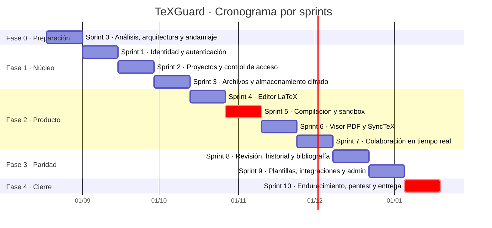

# 11 — Plan de Proyecto

> **Proyecto:** TeXGuard — Editor LaTeX Colaborativo Seguro
> **Marco de trabajo:** Scrum adaptado + **Microsoft SDL** / **OWASP SAMM** integrados en cada sprint
> **Versión:** 1.1

---

## ⚠️ Aviso de vigencia

**El calendario de 20 semanas de la sección 3 y el detalle de sprints de la sección 4 están obsoletos.** El proyecto dispone de **10 semanas**, y el alcance se ha recortado en consecuencia.

| Qué sigue vigente en este documento | Qué está sustituido |
|---|---|
| §1 Objetivos | §3 Cronograma → [16 §20.2](16-Priorizacion-y-Alcance.md) |
| §2 Equipo, roles y reglas de trabajo | §4 Detalle de los sprints → [16 §20.2](16-Priorizacion-y-Alcance.md) |
| §6 Registro de riesgos del proyecto | §5 Hitos → [16 §20.2](16-Priorizacion-y-Alcance.md) |
| §7 Ceremonias y ritmo | — |
| §8 **Definición de Terminado** | — |
| §9 Métricas de seguimiento | — |
| §10 Entregables finales | — |

👉 **El documento que gobierna qué se construye es [16-Priorizacion-y-Alcance.md](16-Priorizacion-y-Alcance.md).**

Resumen del calendario vigente:

| Sprint | Semanas | Entregable demostrable |
|---|---|---|
| S1 | 1–2 | Registro, login con Google y Microsoft, MFA, sesiones seguras, auditoría |
| S2 | 3–4 | Proyectos con roles reales, archivos, **cifrado multicapa C1–C5 funcionando** |
| S3 | 5–6 | **Escribir LaTeX y obtener un PDF compilado en el sandbox aislado** |
| S4 | 7–8 | Visor con SyncTeX, **dos personas editando a la vez**, historial |
| S5 | 9–10 | Plantillas, comentarios, endurecimiento, pentest interno, entrega |

---

## 1. Objetivos

### 1.1 Objetivo general

Diseñar, construir y verificar una plataforma web de edición colaborativa de documentos LaTeX con paridad funcional respecto a Overleaf, aplicando prácticas de desarrollo seguro de forma demostrable y medible en todo el ciclo de vida.

### 1.2 Objetivos específicos

| # | Objetivo | Indicador de logro |
|---|---|---|
| O-1 | Inventariar y especificar la totalidad de las funcionalidades de Overleaf | 222 funcionalidades y 251 requisitos trazados |
| O-2 | Diseñar una arquitectura donde el código no confiable quede contenido | Documento de arquitectura con fronteras de confianza + ADR |
| O-3 | Construir el núcleo funcional: cuentas, proyectos, editor, compilación, colaboración | Todos los requisitos **Must** implementados y probados |
| O-4 | Ejecutar un modelado de amenazas completo y mitigarlo | 61 amenazas STRIDE con control y riesgo residual documentados |
| O-5 | Automatizar la verificación de seguridad en el pipeline | SAST, SCA, DAST, secretos, imágenes e IaC bloqueando el merge |
| O-6 | Demostrar el aislamiento del compilador frente a ataques reales | Ejercicio de escape por sprint, con bitácora de intentos fallidos |
| O-7 | Entregar una prueba de penetración interna con hallazgos remediados | Informe con 0 hallazgos críticos o altos abiertos |

---

## 2. Equipo y roles

> Los roles son **responsabilidades**, no personas exclusivas: en un equipo de 4–5 se solapan. Lo que no se solapa es la regla de revisión.

| Rol | Responsabilidad | Entregables propios |
|---|---|---|
| **Líder técnico / Arquitecto** | Arquitectura, ADR, coherencia entre repositorios | Documentos 03, 04, ADR |
| **Responsable de seguridad** *(Security Champion)* | Modelado de amenazas, revisión de controles, pipeline de seguridad, pentest | Documentos 05, 12; informe de pentest |
| **Desarrollador de backend** | Servicios, API, base de datos, orquestador de compilación | `texguard-backend` |
| **Desarrollador de frontend** | SPA, editor, visor, accesibilidad | `texguard-frontend` |
| **Responsable de infraestructura** | Contenedores, Kubernetes, IaC, observabilidad, copias | `texguard-infra`, documento 13 |
| **Responsable de calidad** | Estrategia de pruebas, cobertura, pruebas de abuso | Suite de pruebas, documento 12 |

**Reglas de trabajo innegociables**

1. **Nadie aprueba su propio pull request.**
2. Todo PR que toque autenticación, autorización, criptografía o el sandbox requiere la revisión del **responsable de seguridad**.
3. Todo cambio de arquitectura o de API actualiza su documento **en el mismo PR**.
4. Los commits van **firmados**.
5. Ningún secreto entra en el repositorio; el *hook* de pre-commit lo impide.

---

## 3. Cronograma general

**Duración:** 20 semanas · 10 sprints de 2 semanas.

---

## 4. Detalle de los sprints

### Sprint 0 · Análisis, arquitectura y andamiaje

**Meta:** que nadie escriba una línea de lógica de negocio antes de que exista arquitectura, modelo de amenazas y pipeline.

| Tarea | Entregable | Requisitos |
|---|---|---|
| Análisis funcional de Overleaf | Documento 01 | — |
| Especificación de requisitos | Documento 02 | Todos |
| Arquitectura C4 y ADR | Documentos 03, 04, ADR 1–9 | CO-01…CO-06 |
| **Modelado de amenazas inicial** | Documento 05 | RS-* |
| Modelo de datos | Documento 06 | — |
| Casos de uso y de abuso | Documento 07 | — |
| Diagramas UML | Documento 08 | — |
| Mockups de todas las pantallas | `texguard-frontend/Docs` | RF-14x |
| Organización de GitHub, 3 repos, equipos, protección de ramas | Repositorios operativos | — |
| Monorepo por repositorio, linters, hooks, Docker Compose | `pnpm dev` levanta el entorno | RNF-021 |
| **Pipeline de CI con todos los escáneres** | Workflows en verde | RS-061 |
| `AGENTS.md` en cada repositorio | Estándares para personas y agentes de IA | — |

**Definición de terminado del sprint:** un desarrollador nuevo clona, ejecuta un comando y tiene el entorno completo funcionando.

---

### Sprint 1 · Identidad y autenticación

| Historia | Requisitos | Riesgo |
|---|---|---|
| Registro con correo, verificación y política de contraseñas (Argon2id + HIBP) | RF-001, RF-010, RS-001 | Alto |
| Inicio de sesión local con rate limiting y CAPTCHA adaptativo | RF-009 | Alto |
| **Login con Google y Microsoft** vía Keycloak (OIDC + PKCE) | RF-002, RF-003 | Alto |
| Gestión de sesiones: cookie `__Host-`, refresh rotativo con detección de reutilización | RS-002, RS-003 | **Crítico** |
| MFA: TOTP y WebAuthn/Passkeys | RF-006 | Alto |
| Recuperación de contraseña sin enumeración | RF-007 | Medio |
| Panel de sesiones activas y revocación | RF-008 | Medio |
| Servicio de auditoría encadenado por hash | RS-050, RS-051 | Alto |

**Verificación:** `auth/*.spec.ts` completo · pruebas de fuerza bruta, fijación de sesión, reutilización de refresh y manipulación de `state`.

---

### Sprint 2 · Proyectos y control de acceso

| Historia | Requisitos |
|---|---|
| CRUD de proyectos, etiquetas, archivar, papelera, clonar, descargar | RF-020…RF-023 |
| **Modelo de roles y política de autorización central** | RF-025 |
| **Row Level Security en PostgreSQL** | RS-012 |
| Invitaciones por correo y respuesta | RF-026 |
| Enlaces de compartición con token, revocación y regeneración | RF-027 |
| Transferencia de propiedad y abandono de proyecto | RF-024 |

**Verificación obligatoria:** `authz/idor-cross-project.spec.ts` recorre **todos** los endpoints existentes con un usuario sin permiso. Este test crece con cada endpoint nuevo del proyecto.

---

### Sprint 3 · Archivos y almacenamiento cifrado

| Historia | Requisitos |
|---|---|
| Árbol de carpetas y archivos con `SafeFileName` | RF-030 |
| Subida por arrastre, carpetas completas, cuotas | RF-031, RF-036 |
| Importación de `.zip` con protección *zip-slip* y *zip-bomb* | RF-020 |
| `url-fetcher` en Rust con protección anti-SSRF | RF-032 |
| Análisis antimalware con ClamAV y cuarentena | RF-033 |
| **Envelope encryption**: Vault Transit, KEK por proyecto, DEK por archivo | RS-040 |
| Servido de contenido desde origen separado | RS-025 |

---

### Sprint 4 · Editor LaTeX

| Historia | Requisitos |
|---|---|
| Integración de CodeMirror 6 con gramática LaTeX y BibTeX | RF-040 |
| Autocompletado de comandos, entornos, `\ref`, `\cite` y rutas | RF-041 |
| Buscar y reemplazar con regex y ámbito de proyecto | RF-042 |
| Keybindings Vim y Emacs, atajos y hoja de referencia | RF-043 |
| Corrector ortográfico multiidioma y diccionario personal | RF-044 |
| Preferencias del editor persistidas | RF-045 |
| Paleta de símbolos, generador de tablas, insertor de figuras | RF-047 |
| Avisos de `chktex` en el margen | RF-048 |

---

### Sprint 5 · Compilación y sandbox ⚠️ *sprint crítico*

| Historia | Requisitos | Riesgo |
|---|---|---|
| Imágenes TeX Live full (2023/2024/2025) firmadas con cosign | RF-051 | Alto |
| **Endurecimiento de `texmf.cnf`**: `shell_escape=f`, `openin/openout_any=p` | RS-033, RS-037 | **Crítico** |
| `compile-orchestrator` en Rust: cola, cuotas, límites, cancelación | RF-050, RF-054, RF-056 | **Crítico** |
| **`latex-static-analyzer`**: detección de construcciones peligrosas | RS-041 | **Crítico** |
| Ejecución en **gVisor** sin red, sin privilegios, efímera | RS-030…RS-035 | **Crítico** |
| Validación de la salida y saneado de logs | RS-036 | Alto |
| Errores estructurados con enlace a la línea | RF-053 | Medio |
| Caché por hash del árbol de fuentes | RF-055 | Bajo |
| Falco vigilando el namespace de compilación | RS-053 | Alto |

**Puerta de calidad del sprint:** la suite `security/compile/*` debe pasar al 100 %, y el **ejercicio de escape del sandbox** debe documentar que todos los vectores del árbol de ataque fallan. *Sin esto, el sprint no se cierra.*

---

### Sprint 6 · Visor PDF y SyncTeX

| Historia | Requisitos |
|---|---|
| PDF.js endurecido: sin scripting, sin `eval`, en Web Worker | RF-060 |
| Zoom, navegación, búsqueda de texto y descarga | RF-060 |
| SyncTeX bidireccional | RF-061 |
| Conservación de la posición entre compilaciones | RF-062 |
| Modos de panel: editor, dividido, solo PDF | RF-045 |

---

### Sprint 7 · Colaboración en tiempo real

| Historia | Requisitos |
|---|---|
| `collab-service` con Hocuspocus y Yjs | RF-070 |
| **Token de colaboración de vida corta por documento** | RF-073 |
| Cursores, selecciones y presencia | RF-071 |
| Escalado horizontal con Redis Pub/Sub | RNF-010 |
| Persistencia con debounce y recuperación tras desconexión | RF-072 |
| Revalidación de permisos y desconexión en caliente | RF-073 |
| Chat del proyecto | RF-074 |
| Modo solo lectura impuesto en el servidor | RF-025 |

**Verificación:** prueba de convergencia con 10 clientes y 5 000 operaciones aleatorias; prueba de desconexión de 60 s sin pérdida de trabajo.

---

### Sprint 8 · Revisión, historial y bibliografía

| Historia | Requisitos |
|---|---|
| Comentarios anclados por posición relativa, hilos y resolución | RF-080 |
| Control de cambios: sugerir, aceptar, rechazar, filtrar por autor | RF-081 |
| Rol Revisor impuesto en el servidor | RF-082 |
| Historial: línea de tiempo, diff coloreado, restauración, etiquetas | RF-090…RF-093 |
| Parseo de `.bib` y autocompletado de citas | RF-100 |
| Integración con Zotero y Mendeley | RF-101 |

---

### Sprint 9 · Plantillas, integraciones y administración

| Historia | Requisitos |
|---|---|
| Galería de plantillas con categorías, búsqueda y vista previa | RF-110 |
| Crear proyecto desde plantilla | RF-111 |
| Publicar plantilla con análisis de seguridad y moderación | RF-112 |
| Plantillas de institución y de grupo | RF-113 |
| GitHub App: vincular, push, pull, conflictos | RF-120 |
| Puente Git con token de aplicación | RF-121 |
| API pública documentada | RF-122 |
| Panel de administración, métricas, bloqueos, modo mantenimiento | RF-133 |
| Planes, límites y grupos | RF-130, RF-131 |
| Centro de notificaciones y correo | RF-140 |
| i18n español/inglés y accesibilidad WCAG 2.2 AA | RF-141, RF-142 |

---

### Sprint 10 · Endurecimiento, pentest y entrega

| Actividad | Entregable |
|---|---|
| **Prueba de penetración interna** por miembros ajenos a cada módulo | Informe con hallazgos clasificados |
| Remediación de todo hallazgo crítico y alto | Cero abiertos |
| DAST completo con OWASP ZAP sobre staging | Informe |
| Revisión de configuración contra CIS Benchmarks | Checklist |
| Pruebas de carga con k6 y validación de los RNF | Informe de rendimiento |
| Prueba de restauración de copias de seguridad | Registro |
| Simulacro de respuesta a incidentes | Post-mortem del simulacro |
| Verificación de accesibilidad con axe-core y lector de pantalla | Informe |
| Actualización final de toda la documentación | Documentos 01–14 |
| Vídeo de demostración y presentación | Material de defensa |

---

## 5. Hitos

| Hito | Sprint | Criterio de aceptación |
|---|---|---|
| **H1 · Planificación aprobada** | 0 | Documentación revisada y aceptada; repositorios operativos |
| **H2 · Autenticación completa** | 1 | Login con Google y Microsoft, MFA y sesiones seguras funcionando |
| **H3 · Gestión de proyectos con RLS** | 2 | Cero hallazgos en las pruebas de acceso cruzado |
| **H4 · Primer PDF compilado en sandbox** | 5 | Compilación real con todos los controles activos |
| **H5 · Colaboración simultánea** | 7 | Tres usuarios editando el mismo documento sin pérdida de cambios |
| **H6 · Paridad funcional** | 9 | Todos los requisitos **Must** y **Should** implementados |
| **H7 · Entrega final** | 10 | Pentest cerrado, documentación completa, despliegue reproducible |

---

## 6. Registro de riesgos del proyecto

| ID | Riesgo | P | I | Exp. | Mitigación | Responsable |
|---|---|---|---|---|---|---|
| R-01 | Subestimación del esfuerzo: el alcance es enorme | 5 | 4 | **20** | Priorización MoSCoW estricta; los **Must** primero; los **Could** son recorte aceptable y **se comunica al docente**, no se ocultan | Líder técnico |
| R-02 | Complejidad de Kubernetes bloquea el desarrollo | 4 | 3 | 12 | Docker Compose completo para desarrollo; Kubernetes solo en el sprint 10 | Infraestructura |
| R-03 | Curva de aprendizaje de Rust | 3 | 3 | 9 | Uso acotado a dos componentes; especificación previa detallada; sesión de formación en el sprint 4 | Backend |
| R-04 | El sandbox resulta más difícil de lo previsto | 3 | 5 | **15** | Prototipo de gVisor ya en el sprint 0; plan B documentado: contenedor endurecido + nodo dedicado | Seguridad |
| R-05 | Imagen de TeX Live completa (~4 GB) ralentiza el CI | 4 | 2 | 8 | Caché de capas; imagen ligera para desarrollo; build nocturno de la completa | Infraestructura |
| R-06 | Disponibilidad desigual del equipo (exámenes, otras asignaturas) | 5 | 3 | **15** | Sprints con holgura del 20 %; propiedad compartida del código; nada con un único responsable | Todos |
| R-07 | La documentación se desincroniza del código | 4 | 3 | 12 | Actualización obligatoria en el mismo PR; CI que valida enlaces y contratos | Todos |
| R-08 | Dependencia con vulnerabilidad crítica sin parche | 2 | 4 | 8 | SCA en CI; mitigación documentada o sustitución de la dependencia | Seguridad |
| R-09 | Integraciones externas (GitHub, Zotero) consumen más tiempo del previsto | 3 | 2 | 6 | Están en prioridad **Could**; se recortan antes que cualquier **Must** | Backend |
| R-10 | Fuga accidental de un secreto en el repositorio | 2 | 5 | 10 | Gitleaks en pre-commit y en CI; rotación inmediata; procedimiento escrito | Seguridad |

> **Sobre R-01, con honestidad:** replicar Overleaf al 100 % es imposible en 20 semanas, y mucho más en las **10 semanas** reales del proyecto. Este plan no finge lo contrario: por eso existe [16-Priorizacion-y-Alcance.md](16-Priorizacion-y-Alcance.md), donde cada una de las 222 funcionalidades está clasificada y donde se recomienda explícitamente **sacar del backlog el 38 %** del inventario (niveles N3 y N4).
>
> Lo que **sí** se compromete: (a) toda la especificación de las 222 funcionalidades, (b) la implementación completa de las **N0** y de **todo lo marcado 🛡️ SEC**, (c) las **N1** en la medida que permita el calendario, y (d) una declaración explícita de qué quedó fuera y por qué. Ocultar el recorte sería peor ingeniería que planificarlo.

---

## 7. Ceremonias y ritmo

| Ceremonia | Frecuencia | Duración | Contenido |
|---|---|---|---|
| Planificación del sprint | Inicio de sprint | 2 h | Selección de historias; **cada historia se etiqueta con su riesgo de seguridad** |
| Sincronización | Lunes, miércoles, viernes | 15 min | Avance, bloqueos |
| **Revisión de seguridad del sprint** | Mitad del sprint | 1 h | Modelado de amenazas de lo nuevo; revisión de hallazgos del pipeline |
| Revisión del sprint | Fin de sprint | 1 h | Demostración de lo terminado |
| Retrospectiva | Fin de sprint | 45 min | Mejora del proceso |
| **Ejercicio de escape del sandbox** | Fin de sprint | 1 h | Intentos de romper el aislamiento; bitácora |

---

## 8. Definición de Terminado (DoD)

Una historia está terminada cuando **todo** lo siguiente se cumple:

- [ ] Implementada según su criterio de aceptación
- [ ] **Autorización aplicada en el servidor** y probada con acceso cruzado
- [ ] Entradas validadas con esquema declarativo
- [ ] Salidas codificadas según su contexto
- [ ] Si maneja contenido del usuario: pasa por las capas criptográficas correspondientes (C1–C5) y tiene su prueba de manipulación de bit
- [ ] Eventos de seguridad registrados en auditoría
- [ ] Pruebas unitarias ≥ 80 % (100 % si toca autorización o criptografía)
- [ ] Prueba de integración o E2E del flujo principal
- [ ] **Caso de abuso probado** si la historia tiene riesgo medio o superior
- [ ] Sin hallazgos críticos ni altos en SAST, SCA y escaneo de secretos
- [ ] Documentación y contrato de API actualizados **en el mismo PR**
- [ ] Accesible por teclado y con lector de pantalla (si tiene interfaz)
- [ ] Revisada y aprobada por otra persona
- [ ] Revisada por el responsable de seguridad si toca auth, cripto o sandbox

---

## 9. Métricas de seguimiento

| Métrica | Objetivo | Frecuencia |
|---|---|---|
| Requisitos **Must** completados | 100 % al sprint 9 | Semanal |
| Cobertura de pruebas | ≥ 80 % global, 100 % en seguridad | Cada push |
| Vulnerabilidades críticas o altas abiertas | 0 | Cada push |
| Tiempo medio de remediación (crítica) | ≤ 7 días | Mensual |
| Amenazas STRIDE con control verificado | 100 % antes de la entrega | Por sprint |
| Deuda técnica declarada | Registrada y priorizada | Por sprint |
| Enlaces rotos en la documentación | 0 | Cada push |
| Vectores de escape del sandbox probados | Creciente y todos fallidos | Por sprint |

---

## 10. Entregables finales

| # | Entregable | Formato |
|---|---|---|
| E-1 | Documentación completa de planificación | 14 documentos + ADR, en `texguard-docs` |
| E-2 | Código fuente del backend | Repositorio `texguard-backend` |
| E-3 | Código fuente del frontend | Repositorio `texguard-frontend` |
| E-4 | Documentación de la API | OpenAPI 3.1 + AsyncAPI 3.0 + portal navegable |
| E-5 | Mockups de todas las pantallas | Documento + prototipo HTML navegable |
| E-6 | Informe de modelado de amenazas | Documento 05 |
| E-7 | Informe de prueba de penetración interna | PDF con hallazgos y remediación |
| E-8 | Informes del pipeline de seguridad | Artefactos del CI |
| E-9 | SBOM firmado | CycloneDX |
| E-10 | Despliegue reproducible | `docker compose up` y manifiestos de Kubernetes |
| E-11 | Vídeo de demostración | 10–15 min |
| E-12 | Presentación de defensa | Diapositivas |

---

## 11. Documentos relacionados

- [00-Publicacion-de-la-Documentacion.md](00-Publicacion-de-la-Documentacion.md) — tablero del proyecto y organización de repositorios
- [02-Requisitos.md](02-Requisitos.md) — requisitos referenciados en cada sprint
- [05-Seguridad.md](05-Seguridad.md) — amenazas que los sprints mitigan
- [12-DevSecOps-y-Testing.md](12-DevSecOps-y-Testing.md) — cómo se verifica cada Definición de Terminado
