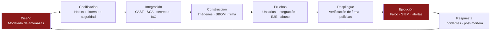
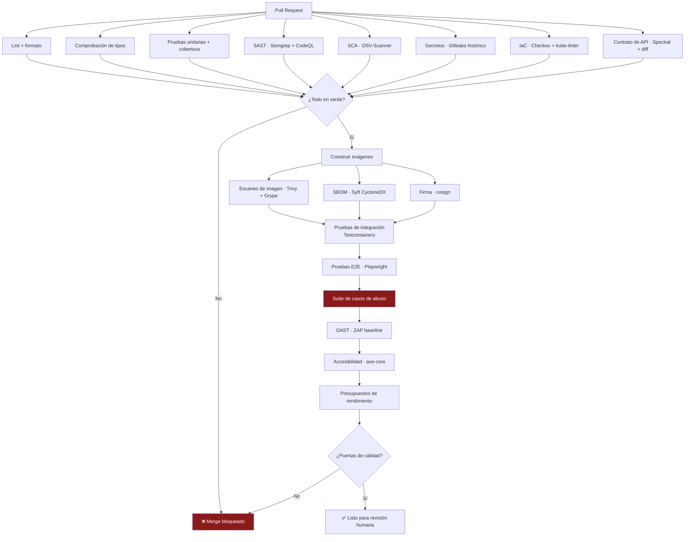
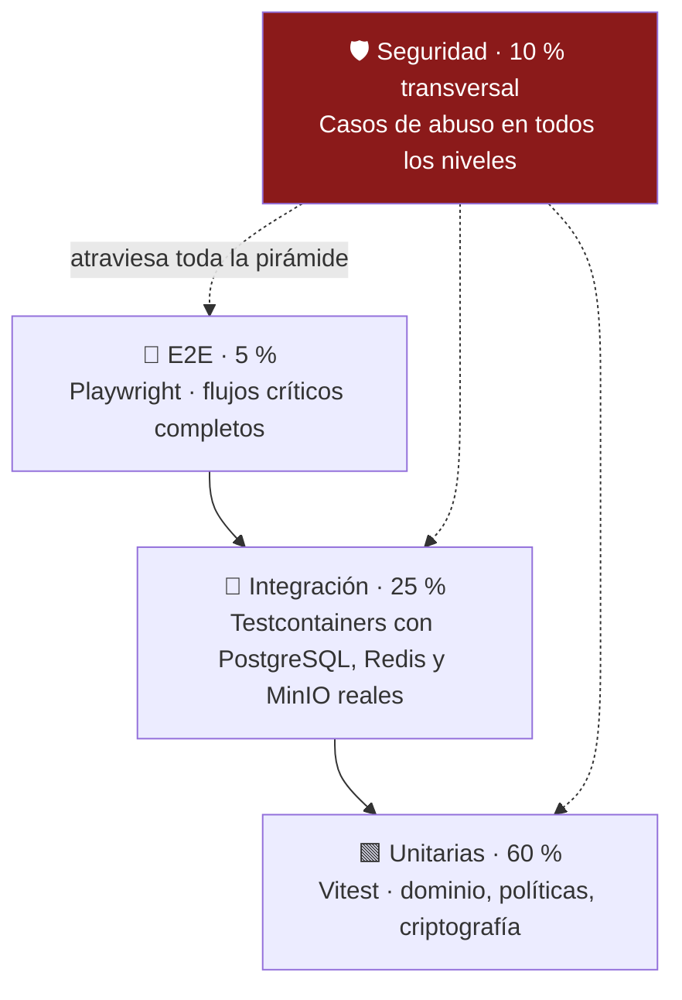
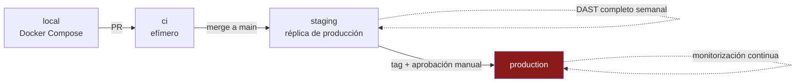

# 12 — DevSecOps y Estrategia de Pruebas

> **Proyecto:** TeXGuard — Editor LaTeX Colaborativo Seguro
> **Marcos aplicados:** NIST SSDF (SP 800-218) · OWASP SAMM · Microsoft SDL · SLSA nivel 3
> **Versión:** 1.0

---

## 1. Principio: *shift left*, pero también *shift right*

La seguridad no es una fase al final; tampoco es solo análisis estático al principio. Se distribuye a lo largo del ciclo:



---

## 2. Controles por fase

### 2.1 Antes de escribir código

| Control | Herramienta / práctica | Obligatoriedad |
|---|---|---|
| Modelado de amenazas de la épica | STRIDE sobre el diagrama de flujo de datos | Toda épica nueva |
| Registro de la decisión | ADR en `texguard-docs/docs/adr/` | Toda decisión estructural |
| Etiquetado de riesgo de la historia | Campo del tablero del proyecto | Toda historia |
| Requisitos de seguridad de la historia | Checklist derivado de OWASP ASVS | Toda historia con riesgo ≥ medio |

### 2.2 En el equipo del desarrollador (pre-commit)

```yaml
# .pre-commit-config.yaml — idéntico en los tres repositorios
repos:
  - repo: local
    hooks:
      - id: gitleaks
        name: Detección de secretos
        entry: gitleaks protect --staged --redact --verbose
        language: system
        pass_filenames: false

      - id: lint
        name: ESLint / Clippy con reglas de seguridad
        entry: pnpm lint:staged
        language: system

      - id: typecheck
        name: TypeScript en modo strict
        entry: pnpm typecheck
        language: system

      - id: commit-sign
        name: Verificación de firma del commit
        entry: scripts/verify-signed-commit.sh
        language: system
        stages: [commit-msg]

      - id: forbidden-patterns
        name: Patrones prohibidos
        entry: scripts/forbidden-patterns.sh
        language: system
```

**Patrones prohibidos que bloquean el commit:**

| Patrón | Motivo |
|---|---|
| `dangerouslySetInnerHTML` sin `DOMPurify` | XSS |
| `$queryRawUnsafe`, concatenación en SQL | Inyección SQL |
| `eval(`, `new Function(`, `child_process.exec(` con interpolación | Inyección de comandos |
| `Math.random()` en contexto de seguridad | Aleatoriedad predecible |
| `md5`, `sha1`, `createCipher` (obsoleto) | Criptografía débil |
| `-shell-escape`, `shell_escape=t` | **Escape del sandbox** |
| `verify: false`, `rejectUnauthorized: false` | TLS sin validar |
| `// eslint-disable` sin comentario justificativo | Supresión silenciosa |
| `TODO(security)` sin *issue* asociado | Deuda de seguridad no rastreada |

### 2.3 En la integración continua



### 2.4 Puertas de calidad — qué bloquea el merge

| Control | Umbral que bloquea |
|---|---|
| Lint / formato | Cualquier error |
| Tipos | Cualquier error; `any` implícito |
| Cobertura | < 80 % global; < 100 % en `authz/`, `crypto/`, `compile/` |
| SAST | Cualquier hallazgo crítico o alto |
| SCA | Cualquier CVE crítico o alto sin excepción documentada y con fecha de caducidad |
| Secretos | Cualquier hallazgo |
| Escaneo de imagen | Crítico o alto en el sistema operativo o en dependencias |
| IaC | Cualquier hallazgo crítico |
| Contrato de API | Diferencia no regenerada; errores de Spectral |
| Casos de abuso | **Cualquier fallo** |
| DAST baseline | Riesgo alto |
| Accesibilidad | Violación crítica o seria |
| Rendimiento | Bundle inicial > 250 KB; LCP > 2,5 s |

**Excepciones:** solo mediante un archivo `.security-exceptions.yaml` versionado, con justificación, responsable y **fecha de caducidad obligatoria**. El CI falla cuando una excepción caduca. No existen supresiones permanentes.

---

## 3. Cadena de suministro (SLSA nivel 3)

| Requisito SLSA | Implementación |
|---|---|
| Origen verificable | Todo artefacto se construye solo desde GitHub Actions sobre `main` |
| Construcción aislada | *Runners* efímeros; sin estado compartido entre builds |
| Procedencia firmada | `cosign attest` genera la atestación de procedencia (in-toto) |
| Dependencias fijadas | `pnpm-lock.yaml`, `Cargo.lock`, imágenes por **digest** (nunca por etiqueta) |
| Acciones de terceros fijadas | Por SHA de commit, jamás por `@v4` |
| SBOM | CycloneDX generado y firmado por release |
| Verificación en el despliegue | Kyverno rechaza toda imagen sin firma válida y sin atestación |
| Secretos del CI | OIDC hacia el proveedor; sin credenciales de larga vida |
| Permisos del workflow | `permissions: {contents: read}` por defecto; se amplía por trabajo |

```yaml
# Ejemplo de endurecimiento de un workflow
permissions:
  contents: read          # denegar por defecto

jobs:
  build:
    permissions:
      contents: read
      id-token: write     # solo para firmar con OIDC
      packages: write
    steps:
      - uses: actions/checkout@11bd71901bbe5b1630ceea73d27597364c9af683  # v4.2.2
        with: { persist-credentials: false }
```

---

## 4. Estrategia de pruebas

### 4.1 Pirámide adaptada



### 4.2 Tipos de prueba y su propósito

| Tipo | Herramienta | Qué verifica | Cuándo |
|---|---|---|---|
| Unitarias | Vitest · `cargo test` | Lógica de dominio, objetos de valor, políticas | Cada push |
| **Basadas en propiedades** | fast-check · proptest | Convergencia del CRDT; que `SafeFileName` rechace **todo** lo peligroso; idempotencia de la conversión visual↔fuente | Cada push |
| Integración | Testcontainers | Repositorios, **políticas RLS**, colas, almacén de objetos | Cada push |
| Contrato | Schemathesis · Pact | Que la implementación cumpla OpenAPI; que frontend y backend no se rompan mutuamente | Cada push |
| E2E | Playwright | Registro, login federado, crear proyecto, compilar, colaborar | Cada push |
| **Casos de abuso** | Suite propia | Que el atacante **falle** | Cada push |
| Carga | k6 | RNF de rendimiento y concurrencia | Semanal y antes de release |
| Caos | Toxiproxy · kill de pods | Recuperación ante desconexión y caída de nodo | Por sprint |
| DAST | OWASP ZAP | Vulnerabilidades en ejecución | PR (baseline) · semanal (completo) |
| Accesibilidad | axe-core · lector de pantalla | WCAG 2.2 AA | Cada push + manual por sprint |
| Penetración | Manual | Lo que la automatización no ve | Sprint 10 |

### 4.3 Pruebas de las políticas RLS — ejemplo

Las políticas de base de datos son código de seguridad y se prueban como tal:

```ts
describe('RLS · project_files', () => {
  it('un usuario ajeno no ve archivos del proyecto', async () => {
    const { userA, userB, projectA, fileA } = await seedScenario();

    const asB = await dbAs(userB.id);
    const rows = await asB.$queryRaw`SELECT id FROM project_files WHERE id = ${fileA.id}`;

    expect(rows).toHaveLength(0);           // no "403": simplemente no existe para B
  });

  it('un lector no puede escribir aunque la capa de aplicación fallara', async () => {
    const { viewer, fileA } = await seedScenario();
    const asViewer = await dbAs(viewer.id);

    await expect(
      asViewer.$executeRaw`UPDATE project_files SET name = 'hack' WHERE id = ${fileA.id}`
    ).rejects.toThrow(/row-level security/);
  });

  it('sin app.user_id establecido no se ve absolutamente nada (fail closed)', async () => {
    const raw = await dbWithoutContext();
    const rows = await raw.$queryRaw`SELECT id FROM project_files`;
    expect(rows).toHaveLength(0);
  });
});
```

### 4.4 Pruebas del sandbox de compilación

```ts
describe('Sandbox de compilación · vectores de escape', () => {
  const vectores = [
    { nombre: 'write18 directo',      tex: String.raw`\immediate\write18{id}` },
    { nombre: 'write18 diferido',     tex: String.raw`\write18{curl http://x}` },
    { nombre: 'paquete shellesc',     tex: String.raw`\usepackage{shellesc}\ShellEscape{id}` },
    { nombre: 'LFI /etc/passwd',      tex: String.raw`\input{/etc/passwd}` },
    { nombre: 'LFI relativo',         tex: String.raw`\input{../../../etc/hosts}` },
    { nombre: 'lstinputlisting',      tex: String.raw`\lstinputlisting{/proc/self/environ}` },
    { nombre: 'Lua os.execute',       tex: String.raw`\directlua{os.execute("id")}` },
    { nombre: 'Lua io.open',          tex: String.raw`\directlua{io.open("/etc/passwd")}` },
    { nombre: 'openout fuera',        tex: String.raw`\openout1=/tmp/evil.txt` },
    { nombre: 'catcode ofuscado',     tex: String.raw`\catcode`\@=11 \@@input|"id"` },
  ];

  test.each(vectores)('$nombre es bloqueado o inocuo', async ({ tex }) => {
    const r = await compilar(tex);
    expect(['blocked', 'failed']).toContain(r.status);
    expect(r.sideEffects).toEqual([]);           // ningún fichero fuera del árbol
    expect(r.networkAttempts).toBe(0);           // ninguna conexión saliente
  });

  it('una bomba de expansión termina por timeout limpio', async () => {
    const r = await compilar(String.raw`\def\x{\x\x}\x`);
    expect(r.status).toBe('timeout');
    expect(r.durationMs).toBeLessThan(65_000);
    expect(await contenedoresVivos()).toBe(0);   // sin fugas de contenedores
  });

  it('el sandbox no tiene salida de red', async () => {
    const r = await ejecutarEnSandbox('curl -m 3 https://example.com');
    expect(r.exitCode).not.toBe(0);
  });
});
```

### 4.5 Datos de prueba

| Regla | Motivo |
|---|---|
| **Jamás** datos reales en entornos no productivos | Protección de datos |
| Semillas sintéticas deterministas (`faker` con semilla fija) | Reproducibilidad |
| Escenario canónico compartido: 4 usuarios, 3 proyectos, los 4 roles | Todas las pruebas de autorización parten de él |
| Fichero EICAR para probar el antivirus | Estándar seguro |
| Corpus de LaTeX malicioso versionado en `testkit/malicious-tex/` | Crece con cada vector nuevo descubierto |

---

## 5. Entornos y promoción



| Entorno | Datos | Despliegue | Acceso humano |
|---|---|---|---|
| `local` | Sintéticos | Manual | Total |
| `ci` | Sintéticos | Automático, efímero | Ninguno |
| `staging` | Anonimizados | Automático desde `main` | Equipo, con MFA |
| `production` | Reales | Manual con aprobación de dos personas | **Ninguno salvo procedimiento *break-glass* auditado** |

---

## 6. Observabilidad como control de seguridad

| Señal | Qué se instrumenta |
|---|---|
| Trazas | Toda petición extremo a extremo con `traceId` propagado, incluidos los trabajos de la cola |
| Métricas | Latencia, errores, saturación por servicio; **compilaciones bloqueadas**, **403 por usuario**, intentos de login fallidos |
| Logs | JSON estructurado, **sin PII, sin secretos, sin contenido de documentos** |
| Auditoría | Cadena de eventos encadenada por hash |
| Runtime | Falco en los nodos; Wazuh correlacionando |

**Alertas conectadas a la respuesta a incidentes** — ver [05-Seguridad.md §10.2](05-Seguridad.md).

---

## 7. Gestión de dependencias

| Regla | Detalle |
|---|---|
| Toda dependencia nueva requiere justificación en el PR | Alternativas consideradas, mantenimiento, número de dependencias transitivas |
| Prohibidas las dependencias sin release en 24 meses | Salvo excepción documentada |
| Renovate agrupa actualizaciones y abre PR semanales | Con revisión humana obligatoria |
| Parches de seguridad | Crítico ≤ 7 días · Alto ≤ 30 días |
| `pnpm` con `--frozen-lockfile` en CI | Instalación reproducible |
| Auditoría de licencias | Bloqueo de licencias incompatibles |

---

## 8. Trazabilidad NIST SSDF

| Práctica SSDF | Implementación en TeXGuard |
|---|---|
| **PO.1** Definir requisitos de seguridad | Documento 02 (`RS-*`), OWASP ASVS como línea base |
| **PO.2** Roles y responsabilidades | Documento 11 §2; *Security Champion* designado |
| **PO.3** Cadena de herramientas | Documento 04 §9; pipeline del §2 de este documento |
| **PO.5** Entornos seguros | §5 de este documento; documento 13 |
| **PS.1** Proteger el código | Ramas protegidas, commits firmados, revisión obligatoria |
| **PS.2** Verificar la integridad de los releases | cosign + SBOM + atestación de procedencia |
| **PS.3** Archivar y proteger cada release | Registro inmutable de imágenes |
| **PW.1** Diseñar con seguridad | Modelado de amenazas por épica (documento 05) |
| **PW.4** Reutilizar componentes seguros | Keycloak, Vault, gVisor en lugar de implementaciones propias |
| **PW.5** Código seguro | Estándares en `AGENTS.md` de cada repositorio; lenguajes con seguridad de memoria |
| **PW.7** Revisión de código | Dos ojos mínimo; cuatro para auth, cripto y sandbox |
| **PW.8** Pruebas | §4 de este documento |
| **PW.9** Configuración segura por defecto | Denegar por defecto en toda la arquitectura |
| **RV.1** Identificar vulnerabilidades | SAST, SCA, DAST, pentest, `SECURITY.md` |
| **RV.2** Evaluar y remediar | SLA de remediación; matriz de riesgo |
| **RV.3** Analizar causas raíz | Post-mortem sin culpables tras cada incidente |

---

## 9. Documentos relacionados

- [05-Seguridad.md](05-Seguridad.md) — amenazas que estas pruebas verifican
- [11-Plan-de-Proyecto.md](11-Plan-de-Proyecto.md) — Definición de Terminado
- [13-Infraestructura-y-Despliegue.md](13-Infraestructura-y-Despliegue.md) — entornos y operación
