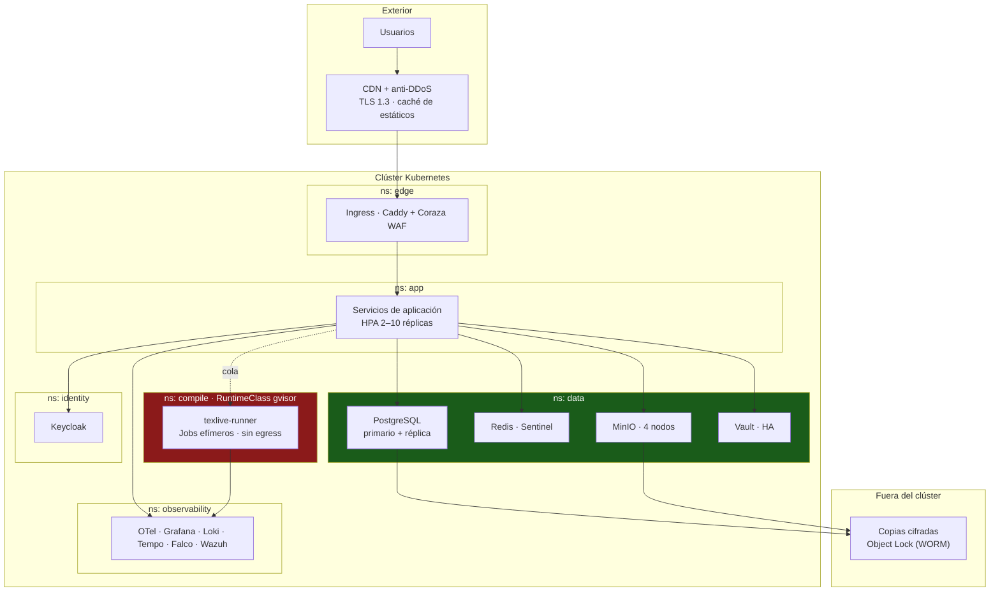
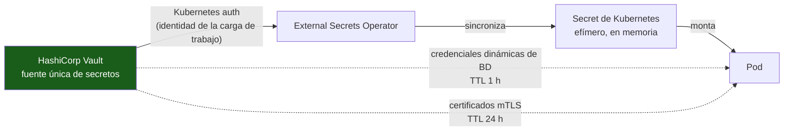
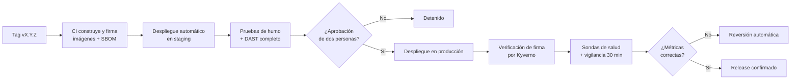

# 13 — Infraestructura y Despliegue

> **Proyecto:** SecurTex — Editor LaTeX Colaborativo Seguro
> **Versión:** 1.0

---

## 1. Topología



---

## 2. Entornos

| Entorno | Infraestructura | Datos | Escala |
|---|---|---|---|
| `local` | Docker Compose en el equipo del desarrollador | Sintéticos | 1 réplica de todo; TeX Live ligero |
| `ci` | Contenedores efímeros en el runner | Sintéticos | Se destruye tras cada ejecución |
| `staging` | Kubernetes, misma topología que producción | Anonimizados | Mínima |
| `production` | Kubernetes con nodos separados por función | Reales | HPA + nodos de compilación dedicados |

### 2.1 Entorno local — un solo comando

```bash
git clone https://github.com/SecurTex-Devs/securtex-backend.git
cd securtex-backend
cp .env.example .env        # sin secretos reales; se generan al arrancar
pnpm install
pnpm dev                    # levanta todo el stack y siembra datos
```

`docker-compose.yml` levanta: PostgreSQL, Redis, MinIO, Vault (modo dev), Keycloak con el realm preconfigurado, ClamAV, MailHog, y el runner de TeX Live ligero. **Ningún secreto real; ninguna configuración de desarrollo puede llegar a producción** (se verifica en el CI).

---

## 3. Infraestructura como código

| Capa | Herramienta | Contenido |
|---|---|---|
| Recursos base | **Terraform** | Red, clúster, nodos, almacenamiento, DNS, registro de imágenes |
| Configuración de nodos | **Ansible** | Endurecimiento CIS, instalación de gVisor, agentes de Falco |
| Cargas de trabajo | **Helm + Kustomize** | Manifiestos por entorno mediante *overlays* |
| Políticas | **Kyverno** | Admisión: firmas, seguridad de pods, etiquetas obligatorias |
| Secretos | **Vault** + External Secrets Operator | Inyección en tiempo de ejecución; nunca en manifiestos |

**Análisis obligatorio de la IaC:** `tfsec`, `checkov`, `kube-linter`, `conftest`. Todo hallazgo crítico bloquea el merge.

### 3.1 Estado de Terraform

Backend remoto cifrado, con bloqueo y versionado. Acceso restringido al pipeline mediante OIDC; ningún desarrollador aplica cambios desde su equipo.

---

## 4. Endurecimiento del clúster

### 4.1 Nodos

| Control | Detalle |
|---|---|
| Sistema operativo | Distribución mínima, actualizaciones automáticas de seguridad |
| Perfil CIS | Kubernetes Benchmark aplicado y verificado con `kube-bench` |
| Nodos por función | `app`, `data`, **`compile` (aislados y etiquetados)** |
| `compile` | Con `taint` dedicado; solo aceptan pods con `RuntimeClass=gvisor` |
| Acceso SSH | Deshabilitado; operación exclusivamente por API con auditoría |
| Kernel | `unprivileged_userns_clone=0`, módulos innecesarios en lista negra |

### 4.2 Pod Security Standards — perfil `restricted` obligatorio

```yaml
apiVersion: v1
kind: Namespace
metadata:
  name: app
  labels:
    pod-security.kubernetes.io/enforce: restricted
    pod-security.kubernetes.io/enforce-version: latest
    pod-security.kubernetes.io/audit: restricted
    pod-security.kubernetes.io/warn: restricted
```

### 4.3 Políticas Kyverno

| Política | Efecto |
|---|---|
| `verify-image-signature` | Rechaza imágenes sin firma cosign válida |
| `require-digest` | Prohíbe etiquetas mutables (`:latest`, `:v1`) |
| `disallow-privileged` | Rechaza `privileged`, `hostPID`, `hostNetwork`, `hostPath` |
| `require-readonly-rootfs` | Sistema de archivos raíz de solo lectura |
| `require-resource-limits` | Todo contenedor declara `limits` |
| `require-runtime-class-compile` | En `ns: compile`, solo `RuntimeClass=gvisor` |
| `disallow-default-sa-token` | `automountServiceAccountToken: false` por defecto |
| `require-network-policy` | Todo namespace debe tener NetworkPolicy |

### 4.4 NetworkPolicy — denegar por defecto

```yaml
# Base aplicada a todos los namespaces
apiVersion: networking.k8s.io/v1
kind: NetworkPolicy
metadata: { name: default-deny-all, namespace: app }
spec:
  podSelector: {}
  policyTypes: [Ingress, Egress]
---
# El namespace de compilación NO tiene ninguna regla de egress.
# Sin excepciones. Ni DNS.
apiVersion: networking.k8s.io/v1
kind: NetworkPolicy
metadata: { name: compile-total-isolation, namespace: compile }
spec:
  podSelector: {}
  policyTypes: [Ingress, Egress]
  ingress: []
  egress: []
```

---

## 5. Gestión de secretos



| Regla | Detalle |
|---|---|
| Ningún secreto en git | Gitleaks en pre-commit y en CI, incluido el histórico |
| Ningún secreto en manifiestos | Solo referencias a `ExternalSecret` |
| Credenciales de base de datos | Dinámicas, TTL 1 h, rotación automática |
| Certificados internos | Emitidos por la PKI de Vault, TTL 24 h |
| Rotación de la clave maestra | Cada 90 días, sin recifrar los datos (envelope encryption) |
| Auditoría | Todo acceso a un secreto queda registrado en Vault |
| Procedimiento de compromiso | Documentado: rotar, revocar, invalidar sesiones, notificar |

---

## 6. Despliegue

### 6.1 Estrategia

| Componente | Estrategia | Motivo |
|---|---|---|
| Servicios sin estado | *Rolling update* con `maxUnavailable: 0` | Sin corte |
| `collab-service` | *Rolling* con drenaje de conexiones y reconexión del cliente | Los WebSockets deben migrar sin pérdida |
| Migraciones de base de datos | *Expand → migrate → contract* en releases distintas | Compatibilidad hacia atrás |
| Imágenes de TeX Live | Precargadas en los nodos de compilación | 4 GB no se descargan en caliente |
| Reversión | `helm rollback` + manifiestos versionados | ≤ 5 minutos |

### 6.2 Flujo de release



### 6.3 Sondas

| Sonda | Ruta | Comprueba |
|---|---|---|
| `liveness` | `/health` | El proceso responde |
| `readiness` | `/health/ready` | Base de datos, Redis, Vault accesibles |
| `startup` | `/health/startup` | Migraciones aplicadas |

---

## 7. Escalado y capacidad

| Componente | Métrica de escalado | Mínimo | Máximo |
|---|---|---|---|
| `gateway` | CPU 70 % | 2 | 10 |
| `collab-service` | Conexiones WebSocket activas | 2 | 8 |
| `compile-orchestrator` | Longitud de la cola | 2 | 6 |
| `texlive-runner` | Jobs; uno por compilación | 0 | 32 simultáneos |
| PostgreSQL | Vertical + réplica de lectura | 1+1 | — |
| MinIO | 4 nodos con codificación de borrado | 4 | — |

**Protección frente a la saturación:** cuota de compilaciones por usuario y plan; cola con prioridad; techo absoluto de compilaciones simultáneas; degradación elegante (la edición sigue funcionando aunque la compilación esté encolada).

---

## 8. Copias de seguridad y recuperación

| Dato | Método | Frecuencia | Retención | RPO |
|---|---|---|---|---|
| PostgreSQL | Base completa + WAL continuo (pgBackRest) | Completa diaria; WAL continuo | 30 días | ≤ 5 min |
| MinIO | Replicación a bucket con Object Lock | Continua | 30 días | ≤ 15 min |
| Vault | Snapshot cifrado del backend Raft | Diaria | 30 días | 24 h |
| Keycloak | Export del realm + su base de datos | Diaria | 30 días | 24 h |
| Configuración | Todo está en git | Cada commit | Ilimitada | 0 |

| Escenario | RTO | Procedimiento |
|---|---|---|
| Caída de un pod | Automático | Kubernetes reprograma |
| Caída de un nodo | < 5 min | Reprogramación en otro nodo |
| Corrupción de la base de datos | < 1 h | PITR al instante anterior |
| Pérdida del clúster | < 4 h | Terraform recrea + restauración |
| Ransomware | < 4 h | Restauración desde copia inmutable (WORM) |
| Pérdida de la clave maestra | **Irrecuperable** | Por eso Vault está en HA con snapshots cifrados y custodia repartida |

**Prueba de restauración mensual obligatoria**, con registro firmado del resultado. Una copia sin restauración probada no es una copia.

---

## 9. Observabilidad y operación

| Necesidad | Herramienta | Retención |
|---|---|---|
| Métricas | Prometheus / Mimir | 15 días alta resolución, 1 año agregadas |
| Logs | Loki | 30 días |
| Trazas | Tempo (muestreo 10 %, 100 % en errores) | 7 días |
| Auditoría | PostgreSQL + réplica WORM | 2 años |
| Runtime | Falco → Wazuh | 90 días |

### 9.1 Alertas principales

| Alerta | Umbral | Severidad |
|---|---|---|
| Falco: syscall fuera del perfil en `ns: compile` | Cualquiera | **SEV-1** |
| Ruptura de la cadena de hashes de auditoría | Cualquiera | **SEV-1** |
| Tasa de error 5xx | > 1 % durante 5 min | SEV-2 |
| Latencia p95 del API | > 1 s durante 10 min | SEV-3 |
| Cola de compilación | > 100 trabajos durante 5 min | SEV-3 |
| Certificado próximo a caducar | < 14 días | SEV-3 |
| Espacio de almacenamiento | > 85 % | SEV-3 |
| Fallo de la copia de seguridad | Cualquiera | SEV-2 |

---

## 10. Costes estimados (referencia académica)

| Escenario | Infraestructura | Coste mensual aproximado |
|---|---|---|
| Desarrollo | Equipos del equipo, Docker Compose | 0 € |
| Demostración | 1 VPS de 8 vCPU / 16 GB / 200 GB | 40–60 € |
| Producción pequeña | 3 nodos + almacenamiento gestionado + CDN | 250–400 € |

Para la asignatura basta el escenario de demostración: un único VPS con k3s ejecuta la topología completa, incluido gVisor.

---

## 11. Lista de verificación previa a producción

- [ ] Ningún secreto en el repositorio (histórico incluido)
- [ ] TLS 1.3 con calificación A+ en el análisis externo
- [ ] Todas las cabeceras de seguridad presentes y verificadas
- [ ] Documentación de la API **deshabilitada** en producción
- [ ] Pod Security `restricted` aplicado en todos los namespaces
- [ ] NetworkPolicy de denegar todo; `ns: compile` sin egress
- [ ] Todas las imágenes firmadas y verificadas por Kyverno
- [ ] RLS activo y **forzado** en todas las tablas de usuario
- [ ] Copias de seguridad probadas con restauración real
- [ ] Alertas conectadas al canal de guardia
- [ ] Ejercicio de escape del sandbox documentado y fallido en todos sus vectores
- [ ] Pentest interno cerrado sin hallazgos críticos ni altos
- [ ] Plan de respuesta a incidentes ensayado
- [ ] `security.txt` publicado y `SECURITY.md` en los tres repositorios

---

## 12. Documentos relacionados

- [03-Arquitectura.md](03-Arquitectura.md) — vista de despliegue
- [05-Seguridad.md](05-Seguridad.md) — controles de infraestructura
- [12-DevSecOps-y-Testing.md](12-DevSecOps-y-Testing.md) — pipeline que produce estos despliegues
