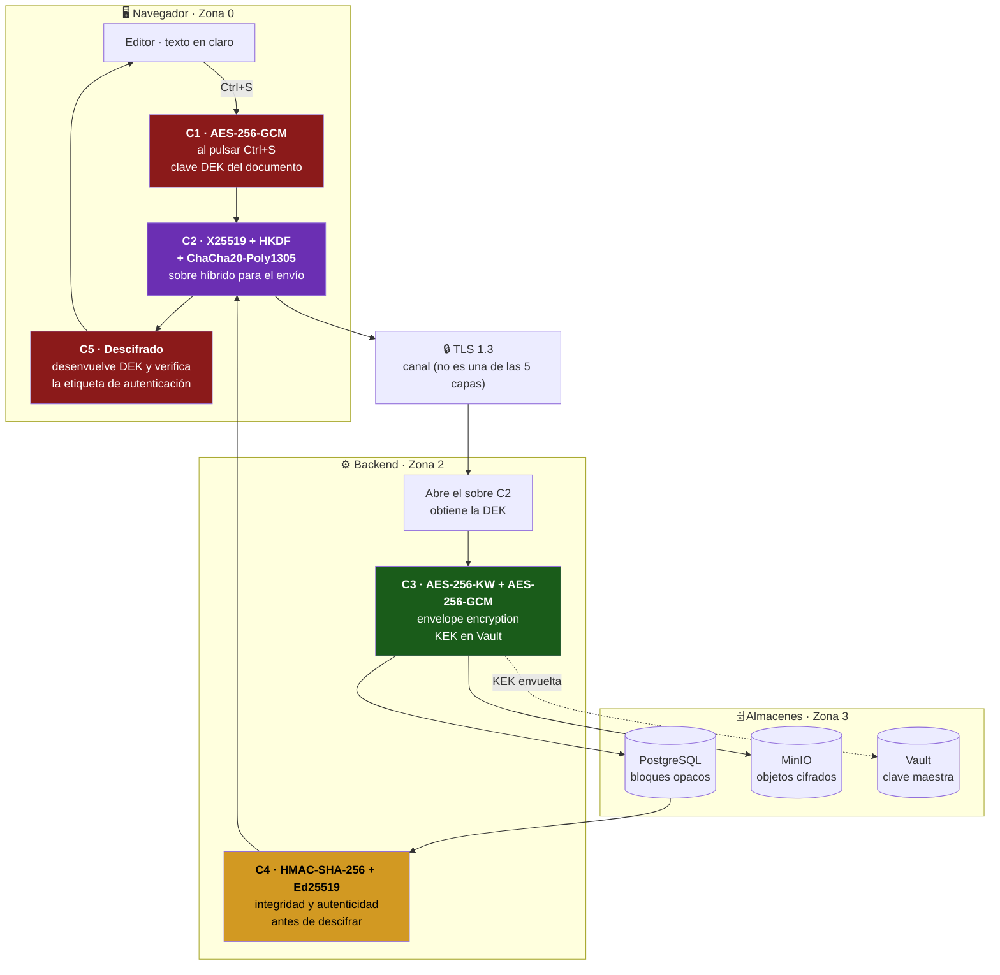
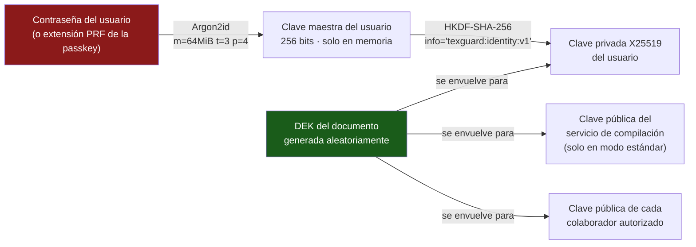
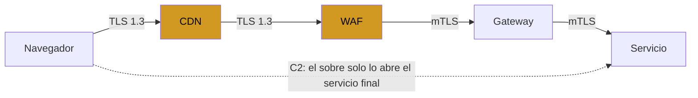
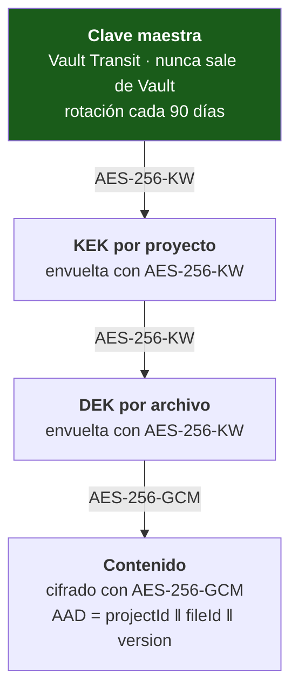
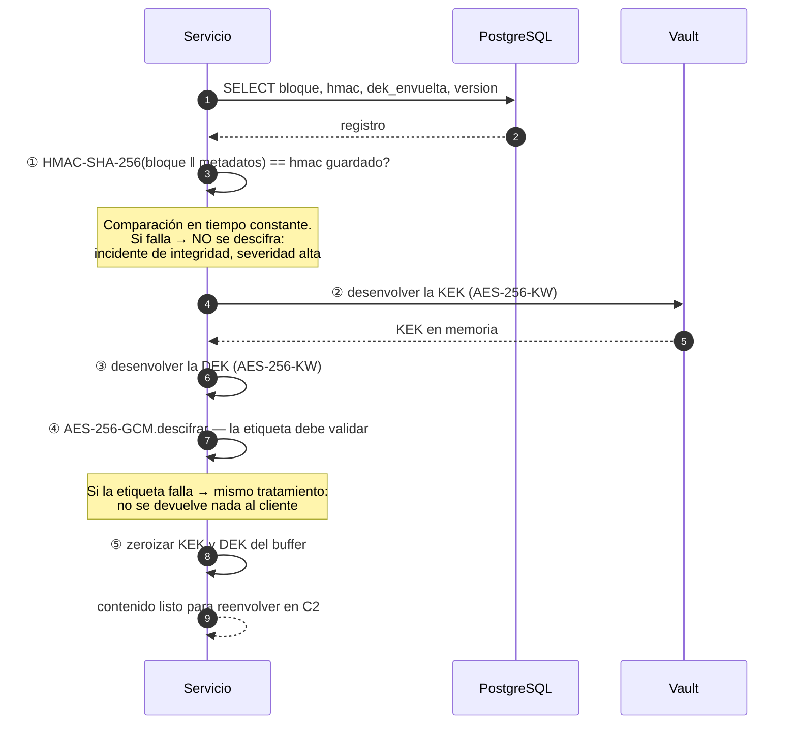
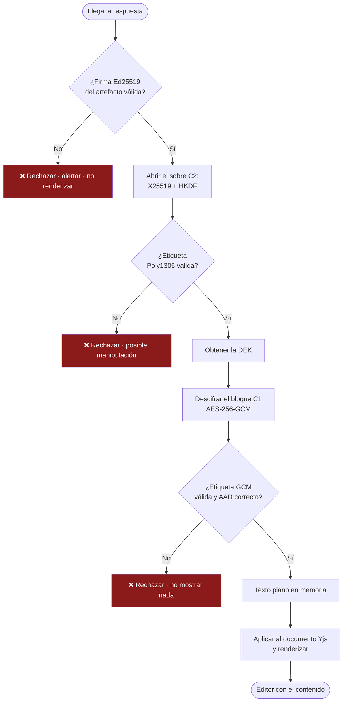
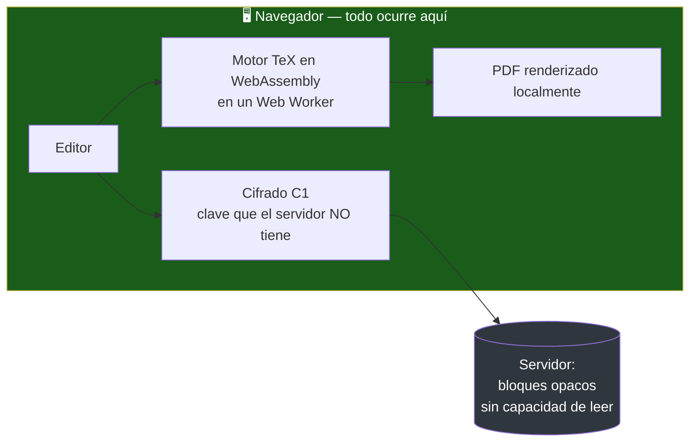

# 14 — Criptografía Multicapa

> **Proyecto:** TeXGuard — Editor LaTeX Colaborativo Seguro
> **Alcance:** cinco capas de cifrado con **algoritmos distintos**, desde la pulsación de `Ctrl+S` hasta el descifrado de vuelta en el navegador
> **Versión:** 1.0

---

## 1. La regla que gobierna este documento

**Cifrar dos veces con el mismo algoritmo y la misma clave no aporta seguridad: aporta latencia.** Una capa criptográfica solo se justifica si protege frente a una **amenaza distinta** de la que ya protege la capa anterior.

Por eso este diseño no apila cifrados «por si acaso». Cada capa responde a una pregunta concreta:

| Capa | Pregunta que responde | Adversario del que protege |
|---|---|---|
| **C1 · Cliente (`Ctrl+S`)** | ¿Y si el contenido sale del navegador en claro? | Proxy corporativo, extensión maliciosa, terminación TLS intermedia |
| **C2 · Transporte aplicativo** | ¿Y si TLS termina antes del servicio final? | Balanceador, CDN, WAF, red interna comprometida |
| **C3 · Reposo** | ¿Y si alguien vuelca la base de datos o el almacén de objetos? | Copia de seguridad robada, disco extraído, SQLi masiva |
| **C4 · Recuperación** | ¿Y si alguien **modifica** el dato cifrado en reposo? | Manipulación silenciosa, sustitución de bloques |
| **C5 · Descifrado en el cliente** | ¿Cómo vuelve a ser legible sin exponer la clave? | Cierra el ciclo y verifica autenticidad |

> Si borras una capa y el modelo de amenazas no cambia, esa capa era teatro criptográfico. Ninguna de las cinco de aquí lo es: cada una se justifica contra su fila de la tabla.

---

## 2. Vista general del recorrido de un documento



---

## 3. Los algoritmos, uno por uno

| Capa | Algoritmo | Familia | Por qué **este** y no otro |
|---|---|---|---|
| **C1** | **AES-256-GCM** | Cifrado por bloques · AEAD | Único AEAD disponible de forma nativa y universal en WebCrypto; acelerado por hardware (AES-NI) en todo equipo moderno; la etiqueta de 128 bits detecta cualquier alteración |
| **C2a** | **X25519 (ECDH sobre Curve25519)** | Asimétrico · intercambio de claves | Permite envolver la DEK para un destinatario sin compartir secretos previos. Claves de 32 bytes frente a los 512 de RSA-4096; sin parámetros que se puedan elegir mal |
| **C2b** | **HKDF-SHA-256** | Derivación de claves | Convierte el secreto compartido de X25519 en una clave de envoltura con contexto (`info` = proyecto + versión), evitando reutilizar el secreto crudo |
| **C2c** | **ChaCha20-Poly1305** | Cifrado de flujo ARX · AEAD | **Deliberadamente distinto de AES**: no depende de AES-NI, es constante en tiempo por construcción y no es vulnerable a ataques de caché en dispositivos sin aceleración. Si apareciera una debilidad estructural en AES, la capa C2 seguiría en pie |
| **C3a** | **AES-256-KW** (RFC 3394) | Envoltura de claves | Algoritmo **específico** para envolver claves, no datos. Determinista y sin nonce, lo que elimina el riesgo de reutilización de nonce al envolver miles de DEK |
| **C3b** | **AES-256-GCM** | AEAD | Cifra el contenido en reposo, con AAD que ata el bloque a su `projectId ‖ fileId ‖ version` |
| **C3c** | **AES-256-CBC + HMAC-SHA-256** (encrypt-then-MAC, `pgcrypto`) | Cifrado por columna | Para columnas PII concretas dentro de PostgreSQL, donde GCM no está disponible de forma nativa |
| **C4a** | **HMAC-SHA-256** | Código de autenticación | Verifica la integridad del registro **antes** de intentar descifrarlo |
| **C4b** | **Ed25519** | Firma digital | El compilador firma el PDF y los artefactos; el navegador verifica que provienen del sandbox legítimo |
| **C5** | **AES-256-GCM** + verificación de etiqueta | AEAD | Cierra el ciclo; si la etiqueta no valida, **no se muestra nada** |
| Claves de usuario | **Argon2id** | Derivación desde contraseña | m=64 MiB, t=3, p=4. Deriva la clave privada del usuario sin almacenarla |
| Índices de búsqueda | **HMAC-SHA-256 truncado** (*blind index*) | Índice ciego | Permite buscar sin cifrado determinista, que filtraría patrones |

**Recuento de familias criptográficas distintas: seis.** Cifrado por bloques (AES en tres modos: GCM, KW, CBC), cifrado de flujo (ChaCha20), curva elíptica de acuerdo de claves (X25519), firma sobre curva elíptica (Ed25519), función de derivación (HKDF, Argon2id) y código de autenticación (HMAC-SHA-256, Poly1305).

> **Ninguno es un cifrado clásico por sustitución.** César, Vigenère, ROT13 y similares no aparecen en ninguna capa: no ofrecen ninguna garantía frente a un adversario con capacidad de cómputo, y su presencia en un sistema real sería un defecto, no una característica.

---

## 4. Capa C1 · Cifrado en el cliente al guardar (`Ctrl+S`)

### 4.1 Cuándo se dispara

| Disparador | Comportamiento |
|---|---|
| `Ctrl+S` / `Cmd+S` | Cifra el estado actual del documento y lo envía |
| Compilación (manual o automática) | Cifra antes de enviar las fuentes al orquestador |
| Autoguardado (2 s de inactividad) | Cifra la actualización CRDT incremental, no el documento entero |
| Cierre de pestaña | Cifra y envía lo pendiente con `sendBeacon` |

### 4.2 Procedimiento

```
1. DEK ← se recupera del llavero en memoria (o se genera si el documento es nuevo)
       crypto.getRandomValues(new Uint8Array(32))          // 256 bits
2. nonce ← crypto.getRandomValues(new Uint8Array(12))      // 96 bits, único por operación
3. AAD ← utf8(projectId ‖ ":" ‖ fileId ‖ ":" ‖ version)
4. (cifrado, etiqueta) ← AES-256-GCM(DEK, nonce, textoPlano, AAD)
5. Se descarta el texto plano del buffer de envío
```

```ts
// src/shared/crypto/layer1.ts
export async function cifrarDocumento(
  dek: CryptoKey,
  contenido: Uint8Array,
  aad: DocumentAad,
): Promise<BloqueCifrado> {
  const nonce = crypto.getRandomValues(new Uint8Array(12));   // NUNCA se reutiliza
  const cifrado = await crypto.subtle.encrypt(
    { name: 'AES-GCM', iv: nonce, additionalData: codificarAad(aad), tagLength: 128 },
    dek,
    contenido,
  );
  return { version: 1, alg: 'AES-256-GCM', nonce, cifrado: new Uint8Array(cifrado), aad };
}
```

### 4.3 Reglas críticas

| Regla | Consecuencia de incumplirla |
|---|---|
| El nonce **nunca** se repite con la misma clave | Reutilizar un nonce en GCM permite recuperar el texto plano de ambos mensajes y falsificar etiquetas. Es el fallo más común y más grave |
| Se usa un contador monotónico + aleatorio, verificado antes de cifrar | Evita colisiones tras restaurar una pestaña o duplicar una sesión |
| La DEK vive **solo en memoria**, como `CryptoKey` no exportable | Un XSS no puede exfiltrar el material de la clave |
| El AAD ata el bloque a su ubicación | Impide reubicar un bloque cifrado en otro documento o versión |
| Si la etiqueta no valida al descifrar, se descarta **todo** el bloque | Nunca se muestra texto parcialmente autenticado |

### 4.4 De dónde sale la DEK



Compartir un documento con un colaborador = **envolver la DEK para su clave pública**. Revocarle el acceso = **rotar la DEK** y volver a envolverla solo para quienes siguen autorizados. Los bloques antiguos que ya descargó no se pueden «desleer»: eso es una limitación honesta de cualquier sistema de este tipo, y está registrada como riesgo residual.

---

## 5. Capa C2 · Cifrado al enviar al backend

### 5.1 Por qué existe si ya hay TLS

TLS protege el **canal**, y el canal termina donde termina TLS: en el CDN, en el balanceador o en el WAF. A partir de ahí, la petición viaja por la red interna. C2 protege la **carga útil** de extremo a extremo, independientemente de cuántas veces se termine y se reestablezca el canal.



En ámbar, los puntos donde el tráfico está **en claro dentro de la memoria de un intermediario** si solo hubiera TLS. Con C2, ahí solo hay bytes opacos.

### 5.2 Construcción del sobre híbrido (HPKE simplificado)

```
1. (epk_priv, epk_pub) ← X25519.generarParEfimero()
2. secretoCompartido    ← X25519(epk_priv, clavePublicaDelServicio)
3. claveEnvoltura       ← HKDF-SHA-256(
                             ikm  = secretoCompartido,
                             salt = epk_pub ‖ clavePublicaDelServicio,
                             info = "texguard:c2:v1:" ‖ projectId,
                             len  = 32)
4. (dekEnvuelta, tag1)  ← ChaCha20-Poly1305(claveEnvoltura, nonce1, DEK, aad = contexto)
5. (payload, tag2)      ← ChaCha20-Poly1305(claveEnvoltura, nonce2, bloqueC1, aad = contexto)
6. Se envía: { epk_pub, nonce1, dekEnvuelta, tag1, nonce2, payload, tag2 }
7. epk_priv se destruye inmediatamente  →  secreto hacia adelante por mensaje
```

**Propiedad clave:** la clave efímera se destruye tras cada envío. Si mañana se compromete la clave privada del servicio, **los mensajes ya enviados no se pueden descifrar** (*forward secrecy* a nivel de aplicación, no solo de canal).

### 5.3 Por qué ChaCha20-Poly1305 y no AES otra vez

| Motivo | Detalle |
|---|---|
| **Diversidad algorítmica real** | AES y ChaCha20 tienen diseños matemáticamente independientes (red de sustitución-permutación frente a ARX). Un avance criptoanalítico contra uno no afecta al otro |
| Sin dependencia de hardware | En un móvil o un portátil antiguo sin AES-NI, AES por software es vulnerable a ataques de caché por tiempo; ChaCha20 es constante en tiempo por construcción |
| Rendimiento | Más rápido que AES por software en la mayoría de dispositivos móviles |
| Es lo que ya hace la industria | TLS 1.3, WireGuard y SSH lo incluyen exactamente por esta razón |

---

## 6. Capa C3 · Cifrado en reposo

### 6.1 Jerarquía de claves



### 6.2 Por qué AES-KW para envolver y AES-GCM para los datos

| | AES-256-GCM | AES-256-KW |
|---|---|---|
| Diseñado para | Datos de longitud arbitraria | **Material de clave** |
| Nonce | Obligatorio, y reutilizarlo es catastrófico | **No lleva nonce** |
| Riesgo al envolver miles de claves | Alto: gestionar nonces únicos para 500 000 DEK es una fuente de error | Nulo: es determinista por diseño |
| Integridad | Etiqueta de 128 bits | Comprobación de integridad incorporada (RFC 3394) |

Usar el algoritmo correcto para cada tarea **elimina una clase entera de error operativo**.

### 6.3 Columnas PII en PostgreSQL

Para datos personales concretos (nombre, afiliación, correos secundarios) se cifra a nivel de columna con `pgcrypto`, en modo **encrypt-then-MAC**:

```sql
-- Cifrado: AES-256-CBC, e integridad con HMAC-SHA-256 sobre el criptograma
UPDATE users
SET    full_name_enc = pgp_sym_encrypt(:nombre, :clave_columna, 'cipher-algo=aes256'),
       full_name_mac = encode(hmac(full_name_enc, :clave_mac, 'sha256'), 'hex')
WHERE  id = :id;
```

**Nunca `pgp_sym_encrypt` sin MAC**, y **nunca cifrado determinista** para permitir búsquedas: filtraría qué usuarios comparten el mismo valor. Para buscar se usa un **índice ciego**:

```sql
-- HMAC-SHA-256 truncado a 64 bits: permite igualdad exacta sin revelar el valor
email_blind_index = left(encode(hmac(lower(email), :clave_indice, 'sha256'), 'hex'), 16)
```

---

## 7. Capa C4 · Verificación al recuperar de la base de datos

**Regla de oro: verificar antes de descifrar.** Descifrar un dato manipulado y después comprobar si «parece válido» ya ha ejecutado el descifrado sobre entrada del atacante.



### 7.1 Firma de los artefactos de compilación

El PDF que produce el sandbox se firma con **Ed25519** antes de salir de la Zona 4. El navegador verifica la firma antes de renderizarlo: garantiza que el PDF procede del compilador legítimo y no fue sustituido en el almacén de objetos o en el trayecto.

```
firma = Ed25519.firmar(clavePrivadaDelCompilador,
                       SHA-256(pdf) ‖ compilationId ‖ sourceTreeHash)
```

---

## 8. Capa C5 · Descifrado en el navegador



**Tres verificaciones independientes antes de mostrar un solo carácter.** Cualquiera que falle detiene el proceso: no existe una ruta que muestre contenido parcialmente autenticado.

### 8.1 Higiene de las claves en el cliente

| Regla | Implementación |
|---|---|
| Las claves son `CryptoKey` **no exportables** | `crypto.subtle.importKey(..., extractable: false, ...)` — el material nunca es accesible desde JavaScript |
| Ninguna clave se persiste | Ni `localStorage`, ni `sessionStorage`, ni IndexedDB |
| Al cerrar sesión se descartan todas | Y se destruye la base de IndexedDB del origen |
| Al bloquear la pestaña 15 min se purga la clave maestra | Se vuelve a derivar con Argon2id o con la passkey |
| El texto plano vive el mínimo tiempo posible | Los buffers intermedios se sobrescriben tras usarse |

---

## 9. El problema que esto plantea, y cómo se resuelve

Hay una tensión real que este diseño **no puede ignorar**:

> Si el navegador cifra con una clave que el servidor nunca tiene, **el servidor no puede compilar el LaTeX**, porque compilar exige leer el texto en claro.

Lo mismo aplica a la búsqueda en el servidor, a las vistas previas de la galería y a las integraciones con GitHub o Zotero. Cualquier propuesta que afirme lo contrario está pasando algo por alto.

La respuesta son **dos modos**, y el usuario elige por proyecto:

### 9.1 Modo Estándar (por defecto)

La DEK se envuelve **también** para la clave pública del servicio de compilación. El sandbox la desenvuelve dentro de la Zona 4, compila, devuelve el PDF y se destruye junto con la clave.

| Se protege frente a | **No** se protege frente a |
|---|---|
| Volcado de la base de datos | Un servidor comprometido **en tiempo de ejecución** |
| Copia de seguridad robada | Un administrador con acceso al proceso de compilación en vivo |
| Disco extraído del centro de datos | — |
| Intermediario que termina TLS | — |
| Acceso directo al almacén de objetos | — |

Es el modelo que usan los servicios comparables de la industria, y el que permite tener todas las funcionalidades.

### 9.2 Modo Confidencial (cifrado extremo a extremo real)

La DEK **nunca** se envuelve para el servidor. Para que esto sea posible sin perder la función principal del producto, **la compilación ocurre en el navegador**: se embarca un motor TeX compilado a **WebAssembly** (pdfTeX y XeTeX portados a WASM, más un subconjunto de TeX Live servido bajo demanda).



| Se gana | Se pierde |
|---|---|
| El operador **no puede leer el documento**, ni siquiera bajo requerimiento legal | Búsqueda en el servidor (solo local) |
| Un compromiso total del servidor no expone contenido | Vista previa en la galería de plantillas |
| Cumplimiento reforzado para investigación sensible | Integraciones con GitHub, Zotero y Dropbox |
| El sandbox del servidor deja de ser superficie de ataque para ese proyecto | Compilación más lenta y limitada a un subconjunto de paquetes |
| — | Descarga inicial de ~30 MB del motor WASM |

**Se activa por proyecto** en los ajustes (pantalla P-49) y **no se puede desactivar** una vez activado: hacerlo implicaría entregar retroactivamente la clave al servidor.

---

## 10. Resumen: dónde actúa cada algoritmo

| Momento | Capa | Algoritmo | Clave |
|---|---|---|---|
| El usuario pulsa `Ctrl+S` | C1 | **AES-256-GCM** | DEK del documento (en memoria) |
| Se prepara el envío | C2a | **X25519 (ECDH)** | Par efímero + clave pública del servicio |
| Se deriva la clave del sobre | C2b | **HKDF-SHA-256** | Secreto compartido |
| Se sella el sobre | C2c | **ChaCha20-Poly1305** | Clave de envoltura derivada |
| El canal | — | TLS 1.3 | (no es una de las cinco capas) |
| Se guarda la DEK | C3a | **AES-256-KW** | KEK del proyecto |
| Se guarda el contenido | C3b | **AES-256-GCM** | DEK |
| Se guarda una columna PII | C3c | **AES-256-CBC + HMAC-SHA-256** | Clave de columna |
| Se busca sin descifrar | — | **HMAC-SHA-256** truncado | Clave de índice ciego |
| Se recupera de la base | C4a | **HMAC-SHA-256** | Clave de integridad |
| Se entrega el PDF | C4b | **Ed25519** | Clave del compilador |
| Vuelve al navegador | C5 | **AES-256-GCM** + verificación | DEK |
| Se derivan las claves del usuario | — | **Argon2id** + **HKDF-SHA-256** | Contraseña o passkey |

---

## 11. Prohibiciones criptográficas

| Prohibido | Motivo |
|---|---|
| **César, Vigenère, ROT13, XOR con clave fija** | No ofrecen ninguna garantía frente a un adversario con capacidad de cómputo |
| Criptografía propia o «modificada» | Un algoritmo que no ha sido criptoanalizado públicamente durante años no es seguro |
| MD5, SHA-1, DES, 3DES, RC4 | Rotos o en desuso |
| Modo **ECB** | Preserva patrones del texto plano |
| CBC **sin MAC** | Vulnerable a *padding oracle* |
| Cifrado determinista para permitir búsqueda | Filtra qué registros comparten valor |
| Reutilizar un nonce en GCM o ChaCha20 | Recuperación del texto plano y falsificación de etiquetas |
| `Math.random()` para cualquier material criptográfico | Predecible |
| Comparar etiquetas o tokens con `==` | Ataque por tiempo |
| Registrar claves, nonces o texto plano | Fuga por observabilidad |
| `alg: none` o algoritmo tomado del propio token | Falsificación trivial |

---

## 12. Requisitos y verificación

| Requisito | Descripción | Prueba |
|---|---|---|
| **RS-070** | C1 DEBE cifrar el contenido con AES-256-GCM antes de salir del navegador | `crypto/layer1-encrypt.spec.ts` |
| **RS-071** | Un nonce NUNCA DEBE repetirse con la misma clave | Prueba de propiedades sobre 10⁶ operaciones |
| **RS-072** | C2 DEBE usar un par X25519 efímero por mensaje y destruirlo tras el envío | `crypto/layer2-forward-secrecy.spec.ts` |
| **RS-073** | C2 DEBE usar ChaCha20-Poly1305, algoritmo distinto del de C1 | Revisión + prueba de contrato |
| **RS-074** | C3 DEBE envolver claves con AES-256-KW y datos con AES-256-GCM | `crypto/layer3-envelope.spec.ts` |
| **RS-075** | C4 DEBE verificar el HMAC **antes** de descifrar | `crypto/layer4-verify-before-decrypt.spec.ts` |
| **RS-076** | C4 DEBE firmar los artefactos con Ed25519 y el cliente verificarlos | `crypto/artifact-signature.spec.ts` |
| **RS-077** | C5 DEBE rechazar todo bloque cuya etiqueta o AAD no valide, sin mostrar contenido parcial | `crypto/layer5-tamper.spec.ts` |
| **RS-078** | Las claves en el cliente DEBEN ser `CryptoKey` no exportables y no persistirse | `e2e/security/key-leakage.spec.ts` |
| **RS-079** | El modo Confidencial DEBE compilar en el navegador y NO envolver la DEK para el servidor | `e2e/security/e2ee-mode.spec.ts` |
| **RS-080** | Rotar la DEK al revocar a un colaborador | `crypto/dek-rotation.spec.ts` |

### 12.1 Pruebas de manipulación obligatorias

Por cada capa existe una prueba que **altera un bit** del criptograma, del nonce, de la etiqueta y del AAD, y comprueba que el sistema rechaza el dato y registra el evento. Un descifrado que «funciona» con un bit alterado es un fallo crítico.

---

## 13. Coste y decisiones asumidas

| Coste | Magnitud | Mitigación |
|---|---|---|
| Latencia añadida por operación | ~2–6 ms en cliente, ~1–3 ms en servidor | Despreciable frente a los segundos de compilación |
| Argon2id al iniciar sesión | ~250 ms | Una vez por sesión; se ejecuta en un Web Worker |
| Tamaño de los metadatos | +120 bytes por bloque | Irrelevante frente al tamaño de un `.tex` |
| Motor WASM en modo Confidencial | ~30 MB de descarga inicial | Cacheado; solo en proyectos que activan el modo |
| Complejidad de la gestión de claves | **Alta — es el coste real** | Módulo criptográfico único, con cobertura del 100 % y revisión obligatoria de dos personas |
| Pérdida de la contraseña en modo Confidencial | **Pérdida irrecuperable del contenido** | Se advierte de forma explícita al activarlo; códigos de recuperación obligatorios |

> **La advertencia honesta:** en modo Confidencial no existe «recuperar mi cuenta». Si el usuario pierde su contraseña y sus códigos de recuperación, sus documentos son bytes aleatorios para siempre. Eso es exactamente lo que significa el cifrado extremo a extremo, y la interfaz lo dice con esas palabras antes de activarlo.

---

## 14. Documentos relacionados

- [05-Seguridad.md](05-Seguridad.md) — modelo de amenazas que estas capas mitigan
- [06-Modelo-de-Datos.md](06-Modelo-de-Datos.md) — columnas cifradas y jerarquía de claves
- [ADR-0005](adr/ADR-0005-cifrado-sobre-envolvente-con-vault.md) — decisión original de envelope encryption
- [ADR-0010](adr/ADR-0010-criptografia-multicapa-y-modo-e2ee.md) — decisión que amplía la anterior a cinco capas
- [`texguard-frontend` · 08-Criptografia-en-el-Cliente](https://github.com/SecurTex-Devs/securtex-frontend/blob/main/Docs/08-Criptografia-en-el-Cliente.md)
