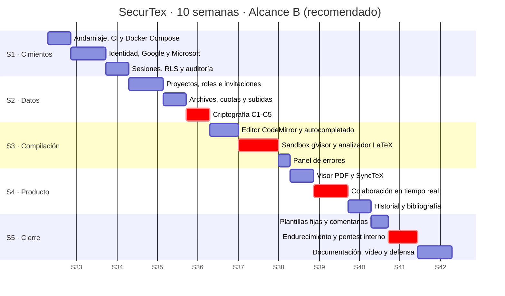

# 16 — Priorización y Alcance para 10 Semanas

> **Propósito:** clasificar **las 222 funcionalidades** de [01-Analisis-Funcional-Overleaf.md](01-Analisis-Funcional-Overleaf.md) para que el equipo decida, con criterio y no por intuición, **qué se construye y qué se saca de la planificación**.
> **Este documento sustituye a la priorización MoSCoW del documento 01 y al calendario de 20 semanas del documento 11.**
> **Versión:** 1.0

---

## 1. El punto de partida, sin adornos

| | |
|---|---|
| Funcionalidades inventariadas | 222 |
| Tiempo disponible | **10 semanas** (5 sprints de 2) |
| Equipo | 4–5 personas a tiempo parcial, con otras asignaturas |
| Capacidad realista estimada | ~35–45 puntos de historia por sprint |
| Coste estimado del alcance completo | ~480 puntos |

**Conclusión:** cabe entre el **25 % y el 30 %** del inventario. La pregunta no es *si* hay que recortar, sino **qué recortar sin que deje de ser Overleaf**.

Este documento no toma esa decisión por el equipo: la prepara. Cada funcionalidad lleva un nivel, una justificación de una línea y, cuando procede, una advertencia sobre lo que se pierde al quitarla.

---

## 2. Escala de clasificación

| Marca | Nivel | Significado | Regla de decisión |
|---|---|---|---|
| 🟥 | **N0 · NÚCLEO** | «Si no tiene esto, **no es Overleaf**» | **No se toca.** Sacar una N0 invalida el producto |
| 🟧 | **N1 · ESENCIAL** | Paridad creíble; un usuario real lo echa en falta el primer día | Se construye salvo que el calendario obligue |
| 🟨 | **N2 · DESEABLE** | Mejora clara, pero se sobrevive sin ello en la entrega | Primer sitio donde recortar |
| ⬜ | **N3 · PRESCINDIBLE** | Poco usado en la práctica, o coste desproporcionado | **Recortar por defecto**; construir solo si sobra tiempo |
| ⛔ | **N4 · FUERA** | Recomendación explícita de sacarlo **ya** de la planificación | Se elimina del backlog |
| 🛡️ | **SEC** | Exigido por la asignatura de Seguridad de Software | **No negociable**, sea cual sea su nivel funcional |

> Una funcionalidad puede ser 🟨 N2 y 🛡️ SEC a la vez: funcionalmente prescindible, académicamente obligatoria. Esas **se hacen**.

---

## 3. Resumen del recuento

| Nivel | Nº | % | Esfuerzo estimado |
|---|---|---|---|
| 🟥 N0 · Núcleo | **48** | 22 % | ~165 puntos |
| 🟧 N1 · Esencial | **46** | 21 % | ~120 puntos |
| 🟨 N2 · Deseable | **42** | 19 % | ~95 puntos |
| ⬜ N3 · Prescindible | **56** | 25 % | ~70 puntos |
| ⛔ N4 · Fuera | **30** | 13 % | ~30 puntos |
| 🛡️ SEC (transversal) | 24 | — | ~55 puntos |

| Alcance | Contenido | Esfuerzo | Cabe en 10 semanas |
|---|---|---|---|
| **A · Mínimo defendible** | N0 + SEC | ~220 pts | ✅ Sí, con holgura |
| **B · Recomendado** ⭐ | N0 + SEC + N1 | ~340 pts | ⚠️ Justo — **es la apuesta** |
| **C · Ambicioso** | + N2 | ~435 pts | ❌ No |

---

## 4. M1 · Identidad y cuentas

| ID | Funcionalidad | Nivel | Nota |
|---|---|---|---|
| F-001 | Registro con correo y contraseña | 🟥 N0 | — |
| F-002 | Verificación de correo | 🟥 N0 🛡️ | Sin ella, cualquiera crea cuentas con correos ajenos |
| F-003 | Inicio de sesión local | 🟥 N0 | — |
| F-004 | **Login con Google** | 🟥 N0 | Requisito explícito del enunciado |
| F-005 | **Login con Microsoft** | 🟥 N0 | Requisito explícito del enunciado |
| F-006 | Login con ORCID | ⬜ N3 | Uso marginal; el mismo esfuerzo que Google para mucho menos valor |
| F-007 | SSO institucional SAML 2.0 | ⛔ N4 | **Sácalo.** SAML bien hecho es 2–3 semanas por sí solo, y solo aplica a licencias institucionales que este proyecto no tendrá |
| F-008 | Vincular/desvincular proveedores | 🟨 N2 | Con dos proveedores, el conflicto de cuentas ya aparece |
| F-009 | Recuperar contraseña | 🟥 N0 | — |
| F-010 | Cambiar contraseña | 🟧 N1 | — |
| F-011 | Segundo factor TOTP | 🟧 N1 🛡️ | El caso de estudio de MFA de la asignatura |
| F-012 | Cerrar sesión | 🟥 N0 | — |
| F-013 | Panel de sesiones activas | 🟨 N2 🛡️ | Barato una vez existe el modelo de sesión; muy vistoso en la defensa |
| F-014 | Rate limiting de login | 🟥 N0 🛡️ | — |
| F-015 | CAPTCHA | ⬜ N3 🛡️ | El rate limiting cubre el 90 %. Si se hace, usar un CAPTCHA existente, no propio |
| F-016 | Editar nombre y apellidos | 🟧 N1 | — |
| F-017 | Correos secundarios | ⬜ N3 | Complica la verificación y la recuperación para un caso poco frecuente |
| F-018 | Afiliación institucional | ⬜ N3 | Solo tiene sentido con F-234, que está fuera |
| F-019 | País y zona horaria | ⬜ N3 | Usar la del navegador |
| F-020 | Preferencias de newsletter | ⛔ N4 | No hay newsletter |
| F-021 | Preferencias del editor persistidas | 🟧 N1 | Se nota mucho su ausencia al usar el producto |
| F-022 | Exportar mis datos (RGPD) | 🟨 N2 🛡️ | Reutiliza la descarga en `.zip` (F-047): coste bajo |
| F-023 | Eliminar cuenta | 🟧 N1 🛡️ | Es donde se demuestra el *crypto-shredding* |
| F-024 | Registro de actividad visible | 🟨 N2 🛡️ | Vista de solo lectura sobre la auditoría que ya existe |
| F-025 | Token para el puente Git | ⬜ N3 | Solo útil si se hace F-221, que está fuera |
| F-026 | Revocación de tokens | ⬜ N3 | Va con F-025 |
| F-027 | Claves de API personales | ⬜ N3 | Va con F-224 |

---

## 5. M2 · Gestión de proyectos

| ID | Funcionalidad | Nivel | Nota |
|---|---|---|---|
| F-030 | Crear proyecto en blanco | 🟥 N0 | — |
| F-031 | Crear desde plantilla | 🟧 N1 | Sin plantillas, empezar un documento es hostil |
| F-032 | Crear desde `.zip` | 🟧 N1 🛡️ | Es el caso de estudio de *zip-slip* y *zip-bomb* |
| F-033 | Importar desde GitHub | ⬜ N3 | GitHub App + resolución de conflictos: mucho coste |
| F-034 | Proyecto de ejemplo | ⬜ N3 | Se resuelve con una plantilla |
| F-035 | Listado de proyectos | 🟥 N0 | — |
| F-036 | Búsqueda por título | 🟧 N1 | Con 20 proyectos ya se echa en falta |
| F-037 | Ordenación por columna | 🟨 N2 | — |
| F-038 | Etiquetas de usuario | 🟨 N2 | Bonito, no imprescindible |
| F-039 | Filtros del panel lateral | 🟧 N1 | Necesario en cuanto existan archivados y papelera |
| F-040 | Selección múltiple y acciones en lote | ⬜ N3 | Interacción costosa para poco valor |
| F-041 | Renombrar proyecto | 🟥 N0 | — |
| F-042 | Copiar / clonar | 🟨 N2 | Reutiliza la lógica de plantillas |
| F-043 | Archivar / desarchivar | 🟨 N2 | Con papelera ya hay un mecanismo de retirada |
| F-044 | Papelera y restaurar | 🟧 N1 | Evita la pérdida accidental de datos |
| F-045 | Eliminar definitivamente | 🟥 N0 🛡️ | Es donde se demuestra la destrucción de claves |
| F-046 | Abandonar proyecto compartido | 🟨 N2 | — |
| F-047 | Descargar proyecto como `.zip` | 🟧 N1 | Garantiza que el usuario nunca queda atrapado |
| F-048 | Transferir propiedad | ⬜ N3 | Flujo de doble confirmación caro para un caso raro |
| F-049 | Contador de palabras del proyecto | ⬜ N3 | Duplica F-136 |
| F-050 | Invitar colaborador por correo | 🟥 N0 | Sin esto no hay colaboración |
| F-051 | Roles: propietario / editor / lector | 🟥 N0 🛡️ | El **revisor** puede posponerse (ver F-175) |
| F-052 | Cambiar el rol de un colaborador | 🟧 N1 | — |
| F-053 | Revocar acceso | 🟥 N0 🛡️ | Y la revocación en caliente del WebSocket es el caso estrella |
| F-054 | Enlace de compartición | 🟧 N1 🛡️ | Vector de estudio de tokens |
| F-055 | Revocar y regenerar enlaces | 🟧 N1 🛡️ | Va con F-054 |
| F-056 | Aceptar / rechazar invitación | 🟥 N0 | — |
| F-057 | Enlace público del PDF | ⬜ N3 | Origen separado y flujo público: coste alto |
| F-058 | Límite de colaboradores por plan | ⛔ N4 | No hay planes (ver M13) |

---

## 6. M3 · Archivos

| ID | Funcionalidad | Nivel | Nota |
|---|---|---|---|
| F-060 | Árbol de archivos y carpetas | 🟥 N0 | — |
| F-061 | Crear archivo | 🟥 N0 | — |
| F-062 | Crear carpeta | 🟧 N1 | Una tesis sin carpetas es inmanejable |
| F-063 | Subir archivos (arrastrar y soltar) | 🟥 N0 | Sin imágenes no hay documento real |
| F-064 | Subir carpeta completa | ⬜ N3 | — |
| F-065 | Crear archivo desde una URL | ⬜ N3 🛡️ | **Ojo:** es el único caso de estudio de **SSRF**. Si se quita, se pierde esa demostración. Alternativa barata: implementarlo solo para `.bib` |
| F-066 | Insertar desde otro proyecto | ⬜ N3 | — |
| F-067 | Renombrar archivo o carpeta | 🟥 N0 | — |
| F-068 | Mover arrastrando | 🟨 N2 | Alternativa: «mover a…» desde el menú |
| F-069 | Eliminar archivo o carpeta | 🟥 N0 | — |
| F-070 | Descargar un archivo | 🟧 N1 | — |
| F-071 | Previsualización de imágenes y PDF | 🟧 N1 | Se usa constantemente al insertar figuras |
| F-072 | Marcar documento principal | 🟥 N0 | Sin esto el compilador no sabe qué compilar |
| F-073 | Detección de binarios | 🟧 N1 🛡️ | Detección por *magic bytes*, no por extensión |
| F-074 | Cuotas por archivo y proyecto | 🟧 N1 🛡️ | — |
| F-075 | Refrescar archivo modificado externamente | ⛔ N4 | Solo aplica con Dropbox y Git, ambos fuera |

---

## 7. M4 · Editor

> **El recorte más rentable de todo el proyecto está en este módulo:** el **modo visual** (F-105 a F-110) cuesta aproximadamente **2 sprints completos** y en Overleaf lo usa una minoría. Sacarlo entero libera el 20 % del calendario.

| ID | Funcionalidad | Nivel | Nota |
|---|---|---|---|
| F-080 | Resaltado de sintaxis LaTeX | 🟥 N0 | — |
| F-081 | Resaltado de BibTeX | 🟧 N1 | — |
| F-082 | Numeración de líneas | 🟥 N0 | Los errores de compilación referencian líneas |
| F-083 | Plegado de código | 🟨 N2 | Casi gratis con CodeMirror 6 |
| F-084 | Autocierre de llaves y entornos | 🟧 N1 | — |
| F-085 | Autocompletado de comandos | 🟥 N0 | Es **la** razón de usar un editor LaTeX especializado |
| F-086 | Autocompletado de entornos | 🟥 N0 | — |
| F-087 | Autocompletado de `\ref` | 🟧 N1 | — |
| F-088 | Autocompletado de `\cite` | 🟧 N1 | — |
| F-089 | Autocompletado de rutas | 🟨 N2 | — |
| F-090 | Buscar y reemplazar | 🟥 N0 | — |
| F-091 | Deshacer / rehacer | 🟥 N0 | — |
| F-092 | Comentar / descomentar selección | 🟨 N2 | Casi gratis |
| F-093 | Indentación automática | 🟨 N2 | — |
| F-094 | Ir a línea | 🟨 N2 | — |
| F-095 | Cursores múltiples | ⬜ N3 | — |
| F-096 | Atajos documentados | 🟨 N2 | Media jornada; mejora mucho la percepción |
| F-097 | Keybindings Vim y Emacs | ⬜ N3 | Público reducido; extensiones ya existentes, pero hay que probarlas |
| F-098 | Corrector ortográfico multiidioma | 🟨 N2 | Un solo idioma reduce mucho el coste |
| F-099 | Diccionario personal | ⬜ N3 | Va con F-098 |
| F-100 | Ajuste de línea | 🟧 N1 | — |
| F-101 | Temas del editor | 🟨 N2 | Claro y oscuro basta; no hacen falta 12 temas |
| F-102 | Tipografía y tamaño configurables | 🟨 N2 | — |
| F-103 | Distribución de paneles | 🟧 N1 | Alternar código / dividido / PDF |
| F-105 | **Modo visual (Rich Text)** | ⬜ N3 | 🔻 **Recorte recomendado.** ~2 sprints. Un editor LaTeX sin modo visual sigue siendo un editor LaTeX |
| F-106 | Matemáticas renderizadas en línea | ⬜ N3 | Va con F-105 |
| F-107 | Barra de formato enriquecido | ⬜ N3 | Va con F-105 |
| F-108 | Insertar enlaces | ⬜ N3 | Va con F-105 |
| F-109 | Figuras en línea en modo visual | ⬜ N3 | Va con F-105 |
| F-110 | Tablas en modo visual | ⬜ N3 | Va con F-105 |
| F-112 | Paleta de símbolos | 🟨 N2 | Barato y muy visible en la demostración |
| F-113 | Generador de tablas | ⬜ N3 | — |
| F-114 | Insertar figura | 🟨 N2 | Versión mínima: insertar `\includegraphics` del archivo seleccionado |
| F-115 | Fragmentos (snippets) | ⬜ N3 | — |
| F-116 | Avisos de `chktex` | ⬜ N3 | Requiere ejecutar otro binario y parsear su salida |

---

## 8. M5 · Compilación

| ID | Funcionalidad | Nivel | Nota |
|---|---|---|---|
| F-120 | Compilar bajo demanda | 🟥 N0 | — |
| F-121 | Autocompilación | 🟧 N1 | — |
| F-122 | Motores pdfLaTeX / XeLaTeX / LuaLaTeX / dvipdf | 🟧 N1 | **pdfLaTeX es N0**; los otros tres son N2 |
| F-123 | Varias versiones de TeX Live | ⬜ N3 | Una imagen de 4 GB por versión; con una basta |
| F-124 | Modo borrador | ⬜ N3 | — |
| F-125 | Detener en el primer error | 🟨 N2 | Una bandera del comando |
| F-126 | Detener compilación en curso | 🟨 N2 🛡️ | Demuestra el control del ciclo de vida del contenedor |
| F-127 | Encadenado `latex → bibtex → latex ×2` | 🟥 N0 | Sin esto, las referencias nunca resuelven |
| F-128 | `makeindex`, glosarios, nomenclatura | ⬜ N3 | `latexmk` lo resuelve casi solo si se activa |
| F-129 | Caché de compilación | 🟨 N2 | Mejora mucho el rendimiento percibido |
| F-130 | Timeout de compilación | 🟥 N0 🛡️ | Sin esto, una bomba de expansión tumba el servidor |
| F-131 | Panel de errores estructurado | 🟥 N0 | Un log crudo no es un producto |
| F-132 | Acceso al registro crudo | 🟧 N1 🛡️ | Y se demuestra el saneado del log |
| F-133 | Descargar archivos auxiliares | ⬜ N3 | — |
| F-134 | `.cls` / `.sty` propios del proyecto | 🟧 N1 | Toda plantilla de tesis los usa |
| F-135 | Paquetes de CTAN completos | 🟥 N0 | Es lo que cubre «todos los comandos de LaTeX» |
| F-136 | Contador de palabras (`texcount`) | ⬜ N3 | — |
| F-137 | Errores explicados en lenguaje natural | 🟨 N2 | Un diccionario de los 20 errores más comunes es barato y muy vistoso |

---

## 9. M6 · Visor PDF

| ID | Funcionalidad | Nivel | Nota |
|---|---|---|---|
| F-140 | Renderizado del PDF | 🟥 N0 🛡️ | Con PDF.js endurecido |
| F-141 | Zoom | 🟥 N0 | — |
| F-142 | Navegación por páginas | 🟥 N0 | — |
| F-143 | Búsqueda de texto en el PDF | 🟨 N2 | Incluida en PDF.js |
| F-144 | Descargar el PDF | 🟥 N0 | — |
| F-145 | SyncTeX código → PDF | 🟧 N1 | Diferenciador claro frente a un editor genérico |
| F-146 | SyncTeX PDF → código | 🟧 N1 | Va con F-145; el parser ya está hecho |
| F-147 | Conservar la posición de lectura | 🟧 N1 | Su ausencia es exasperante al compilar cada 30 s |
| F-148 | PDF en ventana aparte | ⬜ N3 | — |
| F-149 | Modo solo PDF | 🟨 N2 | Cubierto por F-103 |

---

## 10. M7 · Colaboración en tiempo real

> **Ningún recorte aquí.** Si la edición simultánea no funciona, el proyecto no ha demostrado su tesis central.

| ID | Funcionalidad | Nivel | Nota |
|---|---|---|---|
| F-150 | Edición simultánea | 🟥 N0 | — |
| F-151 | Resolución de conflictos (CRDT) | 🟥 N0 | Yjs lo resuelve; el trabajo está en integrarlo |
| F-152 | Cursores remotos | 🟥 N0 | Sin esto, la colaboración es invisible |
| F-153 | Selecciones remotas | 🟨 N2 | Va casi gratis con *awareness* |
| F-154 | Presencia (avatares) | 🟧 N1 | — |
| F-155 | Indicador de conexión | 🟧 N1 | — |
| F-156 | Recuperación tras desconexión | 🟧 N1 | Nativo con `y-indexeddb` |
| F-157 | Autoguardado continuo | 🟥 N0 | — |
| F-158 | Chat del proyecto | ⬜ N3 | Los equipos ya usan WhatsApp o Teams |
| F-159 | Notificación de mensajes | ⛔ N4 | Va con F-158 |
| F-160 | Bloqueo de edición para solo lectura | 🟥 N0 🛡️ | Impuesto en el servidor, no en la interfaz |

---

## 11. M8 · Revisión

| ID | Funcionalidad | Nivel | Nota |
|---|---|---|---|
| F-165 | Comentarios anclados | 🟨 N2 | Lo más usado del módulo con diferencia |
| F-166 | Hilos de respuesta | ⬜ N3 | — |
| F-167 | Resolver comentario | ⬜ N3 | Barato si existe F-165 |
| F-168 | Eliminar comentario propio | ⬜ N3 | — |
| F-169 | Panel lateral de comentarios | ⬜ N3 | — |
| F-170 | Control de cambios | 🟨 N2 | Caro: requiere decorar el CRDT con metadatos de autoría |
| F-171 | Visualización de inserciones y borrados | 🟨 N2 | Va con F-170 |
| F-172 | Aceptar / rechazar cambio | 🟨 N2 | Va con F-170 |
| F-173 | Aceptar / rechazar todos | ⬜ N3 | — |
| F-174 | Filtrar cambios por autor | ⛔ N4 | — |
| F-175 | Rol Revisor | 🟨 N2 🛡️ | Excelente caso de autorización en servidor, pero solo tiene sentido si existe F-170 |

**Recomendación:** hacer **solo F-165 + F-167** (comentar y resolver) y sacar el control de cambios completo. Ahorro: ~1 sprint.

---

## 12. M9 · Historial

| ID | Funcionalidad | Nivel | Nota |
|---|---|---|---|
| F-180 | Línea de tiempo de versiones | 🟧 N1 | La red de seguridad psicológica de quien escribe una tesis |
| F-181 | Agrupación por sesión y autor | 🟨 N2 | — |
| F-182 | Vista de diferencias | 🟧 N1 | Un historial sin *diff* casi no se usa |
| F-183 | Rango de fechas arbitrario | ⬜ N3 | — |
| F-184 | Restaurar una versión | 🟧 N1 | — |
| F-185 | Etiquetar versiones | ⬜ N3 | — |
| F-186 | Filtrar por etiqueta | ⛔ N4 | — |
| F-187 | Descargar una versión concreta | ⬜ N3 | — |
| F-188 | Restaurar archivos eliminados | 🟨 N2 | — |
| F-189 | Retención diferenciada por plan | ⛔ N4 | No hay planes |

---

## 13. M10 · Bibliografía

| ID | Funcionalidad | Nivel | Nota |
|---|---|---|---|
| F-195 | Archivos `.bib` en el proyecto | 🟧 N1 | Un editor académico sin bibliografía no es académico |
| F-196 | Parseo para autocompletar `\cite` | 🟧 N1 | Va con F-088 |
| F-197 | Compatibilidad `bibtex` / `biber` | 🟧 N1 | Va con F-127 |
| F-198 | Importar desde Zotero | ⬜ N3 | OAuth + sincronización: ~1 semana |
| F-199 | Importar desde Mendeley | ⛔ N4 | Duplica F-198 con menos usuarios |
| F-200 | Sincronizar la biblioteca | ⛔ N4 | Va con F-198 y F-199 |
| F-201 | Importar `.bib` desde URL | ⬜ N3 🛡️ | Versión mínima del caso SSRF (ver F-065) |
| F-202 | Visor formateado de entradas | ⛔ N4 | — |

---

## 14. M11 · Plantillas

| ID | Funcionalidad | Nivel | Nota |
|---|---|---|---|
| F-205 | Galería de plantillas | 🟨 N2 | 6–8 plantillas fijas sirven perfectamente para la demostración |
| F-206 | Categorías | 🟨 N2 | — |
| F-207 | Búsqueda de plantillas | ⬜ N3 | Con 8 plantillas no hace falta buscador |
| F-208 | Ficha con vista previa en PDF | 🟨 N2 | La vista previa se puede generar una vez y guardarla |
| F-209 | Abrir como plantilla | 🟧 N1 | Es lo único que el usuario realmente necesita del módulo |
| F-210 | Publicar un proyecto como plantilla | ⬜ N3 🛡️ | Interesante por el análisis de LaTeX peligroso, pero costoso |
| F-211 | Actualizar / despublicar | ⛔ N4 | Va con F-210 |
| F-212 | Plantillas de institución o grupo | ⛔ N4 | Requiere M13, que está fuera |
| F-213 | Portales de editorial | ⛔ N4 | Requiere acuerdos comerciales inexistentes |
| F-214 | Moderación de plantillas | ⬜ N3 🛡️ | Solo si existe F-210 |

**Recomendación:** plantillas **precargadas por el equipo** (F-209 con un catálogo fijo). Se conserva el 90 % del valor con el 10 % del coste.

---

## 15. M12 · Integraciones — **el módulo entero se recomienda fuera**

| ID | Funcionalidad | Nivel | Nota |
|---|---|---|---|
| F-220 | Sincronización con GitHub | ⬜ N3 | GitHub App + `push`/`pull` + conflictos: ~1,5 sprints |
| F-221 | Puente Git (`git clone`) | ⛔ N4 | Servidor Git propio con autenticación por token |
| F-222 | Sincronización con Dropbox | ⛔ N4 | — |
| F-223 | Envío a editorial | ⛔ N4 | No existen los acuerdos |
| F-224 | API pública y webhooks | ⬜ N3 | La API ya existe; publicarla y documentarla es el coste |
| F-225 | Corrección gramatical asistida | ⛔ N4 | Depende de un servicio de pago |
| F-226 | Exportación del proyecto | 🟧 N1 | Ya cubierto por F-047 |
| F-227 | Gestores de referencias | ⛔ N4 | Duplica M10 |

**Ahorro total al sacar M12 completo: ~2,5 sprints.** Es, con diferencia, el recorte más grande disponible.

---

## 16. M13 · Administración y planes — **casi todo fuera**

| ID | Funcionalidad | Nivel | Nota |
|---|---|---|---|
| F-230 | Planes de suscripción | ⛔ N4 | Un proyecto académico no factura |
| F-231 | Facturación y método de pago | ⛔ N4 | — |
| F-232 | Cupones y descuentos | ⛔ N4 | — |
| F-233 | Licencias de grupo | ⛔ N4 | — |
| F-234 | Panel de institución | ⛔ N4 | Va con F-007, que está fuera |
| F-235 | Métricas de uso | ⬜ N3 | Grafana ya las muestra; no hace falta interfaz propia |
| F-236 | Panel de administración del sistema | 🟨 N2 🛡️ | **Versión mínima:** suspender cuenta, ver auditoría, modo mantenimiento |
| F-237 | Límites por plan | ⬜ N3 | Los **límites de compilación** sí son N0 🛡️ (F-130); atarlos a un «plan» no |
| F-238 | Página de estado del servicio | ⛔ N4 | — |

---

## 17. M14 · Transversales

| ID | Funcionalidad | Nivel | Nota |
|---|---|---|---|
| F-240 | Centro de notificaciones en la aplicación | ⬜ N3 | Las invitaciones pueden ir solo por correo |
| F-241 | Notificaciones por correo configurables | ⬜ N3 | El correo transaccional (verificación, invitación) sí es N0 |
| F-242 | Interfaz multiidioma | ⬜ N3 | **Preparar la infraestructura de i18n desde el día 1** (coste casi nulo) y traducir solo al español. Traducir al inglés al final si sobra tiempo |
| F-243 | Accesibilidad WCAG 2.2 AA | 🟨 N2 | Mantener los criterios básicos (teclado, foco, etiquetas, contraste); la auditoría completa es N3 |
| F-244 | Diseño responsive | 🟨 N2 | Que no se rompa por debajo de 1024 px; el editor completo en móvil es N3 |
| F-245 | Ayuda contextual y documentación | ⬜ N3 | — |
| F-246 | Paleta de comandos global | ⛔ N4 | — |

---

## 18. Distribución LaTeX

| ID | Funcionalidad | Nivel | Nota |
|---|---|---|---|
| F-250 | TeX Live completo | 🟥 N0 | Es lo que hace verdadera la frase «todos los comandos de LaTeX» |
| F-251 | Motores `pdftex`, `xetex`, `luatex` | 🟧 N1 | `pdftex` es N0 |
| F-252 | `bibtex`, `biber`, `latexmk` | 🟧 N1 | `makeindex` y `xindy` son N3 |
| F-253 | Fuentes del sistema para XeLaTeX | 🟨 N2 | — |
| F-254 | Índice de comandos para autocompletar | 🟧 N1 | Se puede empezar con una lista fija de los ~500 comandos más usados |
| F-255 | `babel`, UTF-8, idiomas | 🟧 N1 | Español con acentos es innegociable en este contexto |
| F-256 | **Shell-escape deshabilitado** | 🟥 N0 🛡️ | Es el control central de todo el proyecto |

---

## 19. Seguridad añadida — **todo se mantiene**

> Este bloque es el que justifica la asignatura. **No se recorta.** Si algo tiene que caer, cae funcionalidad de Overleaf, nunca esto.

| ID | Funcionalidad | Nivel | Nota |
|---|---|---|---|
| F-260 | Passkeys / WebAuthn | 🟨 N2 🛡️ | Si el calendario aprieta, TOTP (F-011) cubre el requisito de MFA |
| F-261 | **Cifrado multicapa por proyecto** | 🟥 N0 🛡️ | Requisito explícito; desarrollado en [14-Criptografia-Multicapa.md](14-Criptografia-Multicapa.md) |
| F-262 | Auditoría encadenada por hash | 🟧 N1 🛡️ | Coste bajo, valor demostrativo muy alto |
| F-263 | Antimalware en las subidas | 🟨 N2 🛡️ | ClamAV en contenedor: ~1 día |
| F-264 | Detección de LaTeX peligroso | 🟥 N0 🛡️ | Junto con el sandbox, es el corazón del proyecto |
| F-265 | Contraseñas contra listas filtradas (HIBP) | 🟨 N2 🛡️ | Una llamada HTTP: ~medio día |
| F-266 | Panel de seguridad del usuario | ⬜ N3 🛡️ | Cubierto en gran parte por F-013 y F-024 |
| F-267 | Firma de imágenes y SBOM | 🟨 N2 🛡️ | Configuración del pipeline, no desarrollo |
| F-268 | **Modo confidencial (E2EE + compilación WASM)** | 🟨 N2 🛡️ | 🔻 **Aviso honesto:** el motor TeX en WebAssembly es un riesgo real de calendario. Recomendación: implementarlo **solo si los sprints 1–4 van en plazo**; si no, dejarlo documentado como trabajo futuro y entregar el modo Estándar completo |

---

## 20. Alcance recomendado para 10 semanas

### 20.1 Qué entra

**Todo N0 + todo SEC + los N1 marcados.** Resultado: un editor LaTeX colaborativo **completo y usable de verdad**, con criptografía multicapa y compilación aislada, sin integraciones externas, sin modo visual, sin planes y con revisión reducida a comentarios.

### 20.2 Calendario

| Sprint | Semanas | Entregable demostrable |
|---|---|---|
| **S1** | 1–2 | Registro, login con Google y Microsoft, MFA, sesiones seguras, auditoría |
| **S2** | 3–4 | Crear y compartir proyectos con roles reales, subir archivos, **cifrado multicapa funcionando extremo a extremo** |
| **S3** | 5–6 | **Escribir LaTeX y obtener un PDF compilado en el sandbox aislado** ← el hito que valida el proyecto |
| **S4** | 7–8 | Visor con SyncTeX, **dos personas editando el mismo documento a la vez**, historial |
| **S5** | 9–10 | Plantillas, comentarios, endurecimiento, prueba de penetración interna, entrega |

### 20.3 Recortes que hacen posible el calendario

| Recorte | Ahorro | Qué se pierde |
|---|---|---|
| Módulo M12 completo (integraciones) | ~2,5 sprints | GitHub, Dropbox, Zotero, puente Git |
| Modo visual (F-105 … F-110) | ~2 sprints | Editar sin ver el código fuente |
| Módulo M13 salvo panel mínimo | ~1,5 sprints | Planes, facturación, grupos, instituciones |
| Control de cambios (F-170 … F-175) | ~1 sprint | Sugerir, aceptar y rechazar cambios |
| SSO SAML (F-007) | ~0,7 sprints | Acceso institucional federado |
| Publicación de plantillas por usuarios (F-210 … F-214) | ~0,7 sprints | Galería alimentada por la comunidad |
| Chat, notificaciones y refinamientos varios | ~0,6 sprints | Comodidades menores |
| **Total** | **≈ 9 sprints** | — |

---

## 21. Hoja de decisión del equipo

Para la reunión de cierre de alcance. Marcad una casilla por fila; lo que quede sin marcar se considera **fuera**.

| Módulo / bloque | Entra completo | Versión mínima | **Fuera** | Decisión |
|---|:---:|:---:|:---:|---|
| Identidad + Google/Microsoft | ☐ | ☐ | ☐ | |
| SSO institucional SAML | ☐ | ☐ | ☑ *(recomendado)* | |
| MFA (TOTP) | ☐ | ☐ | ☐ | |
| Passkeys / WebAuthn | ☐ | ☐ | ☐ | |
| Proyectos, roles e invitaciones | ☐ | ☐ | ☐ | |
| Enlaces de compartición | ☐ | ☐ | ☐ | |
| Etiquetas y archivado | ☐ | ☐ | ☐ | |
| Archivos y subidas | ☐ | ☐ | ☐ | |
| Crear archivo desde URL (caso SSRF) | ☐ | ☐ | ☐ | |
| Editor + autocompletado | ☐ | ☐ | ☐ | |
| **Modo visual** | ☐ | ☐ | ☑ *(recomendado)* | |
| Corrector ortográfico | ☐ | ☐ | ☐ | |
| Vim / Emacs | ☐ | ☐ | ☑ *(recomendado)* | |
| Compilación + sandbox | ☐ | ☐ | ☐ | |
| Motores XeLaTeX y LuaLaTeX | ☐ | ☐ | ☐ | |
| Visor PDF + SyncTeX | ☐ | ☐ | ☐ | |
| Colaboración en tiempo real | ☐ | ☐ | ☐ | |
| Chat del proyecto | ☐ | ☐ | ☑ *(recomendado)* | |
| Comentarios | ☐ | ☐ | ☐ | |
| **Control de cambios** | ☐ | ☐ | ☑ *(recomendado)* | |
| Historial + diff | ☐ | ☐ | ☐ | |
| Bibliografía `.bib` | ☐ | ☐ | ☐ | |
| Zotero / Mendeley | ☐ | ☐ | ☑ *(recomendado)* | |
| Plantillas (catálogo fijo) | ☐ | ☐ | ☐ | |
| Publicación de plantillas | ☐ | ☐ | ☑ *(recomendado)* | |
| **Integraciones (GitHub, Dropbox, Git)** | ☐ | ☐ | ☑ *(recomendado)* | |
| Planes y facturación | ☐ | ☐ | ☑ *(recomendado)* | |
| Panel de administración | ☐ | ☐ | ☐ | |
| i18n (español + inglés) | ☐ | ☐ | ☐ | |
| **Criptografía multicapa C1–C5** | ☑ *(obligatorio)* | ☐ | ☐ | |
| **Modo confidencial E2EE + WASM** | ☐ | ☐ | ☐ | ⚠️ decidir en S3 |
| **Sandbox + analizador LaTeX** | ☑ *(obligatorio)* | ☐ | ☐ | |
| **Auditoría encadenada** | ☐ | ☐ | ☐ | |
| Antimalware (ClamAV) | ☐ | ☐ | ☐ | |
| HIBP | ☐ | ☐ | ☐ | |

---

## 22. Qué NO se puede recortar, pase lo que pase

Si el calendario se rompe, se recorta funcionalidad de Overleaf. **Nunca esto**:

1. **Compilación en sandbox aislado** con `shell-escape` deshabilitado y analizador estático (F-256, F-264).
2. **Autorización en el servidor + Row Level Security** (F-051, F-053, F-160).
3. **Criptografía multicapa C1–C5** (F-261).
4. **Auditoría de eventos de seguridad** (F-262).
5. **Gestión de sesiones robusta**: cookies `HttpOnly`, rotación de *refresh* con detección de reutilización (F-003, F-014).
6. **Pipeline de DevSecOps** con SAST, SCA, escaneo de secretos e imágenes.
7. **Prueba de penetración interna** documentada con sus hallazgos remediados.

Sin estos siete, el proyecto puede ser un editor LaTeX aceptable, pero **no es un proyecto de Seguridad de Software**.

---

## 23. Advertencia final honesta

Incluso el **Alcance B** es exigente para 10 semanas con un equipo a tiempo parcial. Los tres puntos donde el calendario se puede romper son, por orden de probabilidad:

| Riesgo | Probabilidad | Plan de contingencia |
|---|---|---|
| El sandbox con gVisor da más guerra de la prevista (S3) | Media-alta | Plan B ya documentado: contenedor endurecido con seccomp en nodo dedicado, y gVisor como mejora posterior |
| La colaboración en tiempo real con CRDT se atasca (S4) | Media | Entregar edición con bloqueo por archivo como escalón intermedio, y CRDT después |
| El motor TeX en WebAssembly (F-268) consume el sprint 5 | **Alta** | **Decidir en S3**: si S1–S2 se han desviado, se documenta como trabajo futuro y se entrega solo el modo Estándar |

**Recomendación:** cerrar el alcance en la reunión de la hoja de decisión (§21), fijarlo por escrito, y **no ampliarlo a mitad de proyecto**. Añadir alcance en el sprint 4 es la forma más habitual de no entregar nada.

---

## 24. Documentos relacionados

- [01-Analisis-Funcional-Overleaf.md](01-Analisis-Funcional-Overleaf.md) — inventario completo de las 222 funcionalidades
- [11-Plan-de-Proyecto.md](11-Plan-de-Proyecto.md) — plan de sprints (calendario sustituido por §20.2 de este documento)
- [14-Criptografia-Multicapa.md](14-Criptografia-Multicapa.md) — el bloque criptográfico que no se recorta
- [05-Seguridad.md](05-Seguridad.md) — los controles que no se recortan
