# 03 — Arquitectura del Sistema

> **Proyecto:** SecurTex — Editor LaTeX Colaborativo Seguro
> **Modelo de documentación:** C4 (Contexto → Contenedores → Componentes → Código) + vistas 4+1
> **Versión:** 1.0

---

## 1. Principios arquitectónicos

Toda decisión de este documento se justifica contra estos siete principios. Cuando dos principios entran en conflicto, gana el que esté más arriba.

| # | Principio | Implicación concreta |
|---|---|---|
| 1 | **Aislamiento del código no confiable** | El LaTeX del usuario es código ejecutable arbitrario. Vive en su propia frontera de confianza, con su propio kernel, sin red y sin persistencia. |
| 2 | **Defensa en profundidad** | Ningún control es único punto de fallo: la autorización se aplica en la pasarela, en el servicio y en la base de datos (RLS). |
| 3 | **Denegación por defecto** | Rutas, puertos, políticas de red, *capabilities* y *scopes*: todo cerrado salvo lo explícitamente abierto. |
| 4 | **Mínimo privilegio** | Cada servicio tiene su propio usuario de base de datos, su propio rol, su propio conjunto de secretos. |
| 5 | **Frontera de confianza explícita** | Cada cruce de frontera valida, autentica y registra. Nada se "hereda". |
| 6 | **Estado en el borde, cómputo sin estado** | Los servicios de aplicación son reemplazables; el estado vive en almacenes endurecidos. |
| 7 | **Observabilidad como control de seguridad** | Si un ataque no deja rastro, la arquitectura está incompleta. |

---

## 2. Nivel 1 · Diagrama de Contexto (C4-L1)

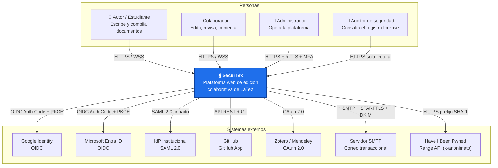

### 2.1 Fronteras de confianza

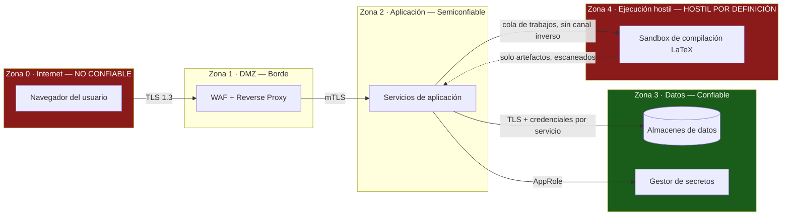

> **Clave de diseño:** la Zona 4 se trata como *más* hostil que Internet. Recibe trabajos por una cola, no tiene ruta de red hacia dentro y devuelve únicamente ficheros que son validados antes de entrar de nuevo en la Zona 2.

---

## 3. Nivel 2 · Diagrama de Contenedores (C4-L2)

```mermaid
graph TB
    NAV["🌐 <b>SPA / PWA</b><br/>Next.js 15 + React 19 + TypeScript<br/>CodeMirror 6, PDF.js, Yjs"]

    subgraph EDGE["Borde · Zona 1"]
        CDN["CDN + Anti-DDoS"]
        PROXY["<b>Caddy / Traefik</b><br/>TLS 1.3, HSTS, mTLS interno"]
        WAF["<b>Coraza WAF</b><br/>OWASP CRS 4"]
    end

    subgraph APP["Aplicación · Zona 2"]
        GW["<b>API Gateway / BFF</b><br/>NestJS + Fastify<br/>AuthN, rate limit, CSRF, CSP"]
        AUTH["<b>auth-service</b><br/>NestJS · sesiones, MFA, tokens"]
        KC["<b>Keycloak</b><br/>IdP: OIDC, SAML, social login, WebAuthn"]
        PRJ["<b>project-service</b><br/>NestJS · proyectos, permisos, invitaciones"]
        FILE["<b>file-service</b><br/>NestJS · árbol de ficheros, cifrado, cuotas"]
        AV["<b>av-scanner</b><br/>ClamAV"]
        COLL["<b>collab-service</b><br/>Node + Hocuspocus (Yjs CRDT)<br/>presencia, cursores, chat"]
        REV["<b>review-service</b><br/>comentarios, control de cambios"]
        HIST["<b>history-service</b><br/>versiones, diffs, etiquetas"]
        COMP["<b>compile-orchestrator</b><br/><b>Rust + Axum</b> · cola, límites, veredicto"]
        BIB["<b>bib-service</b><br/>parseo .bib, Zotero, Mendeley"]
        TPL["<b>template-service</b><br/>galería, moderación"]
        INTG["<b>integration-service</b><br/>GitHub, Git bridge, webhooks"]
        NOTIF["<b>notification-service</b><br/>correo, centro de notificaciones"]
        ADMIN["<b>admin-service</b><br/>panel, métricas, bloqueos"]
        AUDIT["<b>audit-service</b><br/>log encadenado por hash"]
        FETCH["<b>url-fetcher</b><br/>proxy anti-SSRF"]
    end

    subgraph SBX["Ejecución · Zona 4 (hostil)"]
        RUN["<b>texlive-runner</b><br/>gVisor · TeX Live full<br/>sin red · FS efímero · seccomp"]
    end

    subgraph DATA["Datos · Zona 3"]
        PG[("<b>PostgreSQL 17</b><br/>RLS, TLS, pgcrypto, pgAudit")]
        RD[("<b>Redis 7</b><br/>TLS, ACL · sesiones, colas, presencia")]
        S3[("<b>MinIO / S3</b><br/>SSE-KMS, versionado, Object Lock")]
        VAULT[("<b>HashiCorp Vault</b><br/>KMS, secretos dinámicos")]
    end

    subgraph OBS["Observabilidad"]
        OTEL["OpenTelemetry Collector"]
        LGTM["Grafana · Loki · Tempo · Mimir"]
        SIEM["Wazuh SIEM + Falco"]
    end

    NAV --> CDN --> PROXY --> WAF --> GW
    NAV -.->|WSS| PROXY

    GW --> AUTH
    GW --> PRJ
    GW --> FILE
    GW --> REV
    GW --> HIST
    GW --> COMP
    GW --> BIB
    GW --> TPL
    GW --> INTG
    GW --> ADMIN
    GW --> COLL

    AUTH <--> KC
    FILE --> AV
    FILE --> S3
    BIB --> FETCH
    FILE --> FETCH

    COMP -->|cola BullMQ| RUN
    RUN -.->|PDF, logs, synctex| COMP
    COMP --> S3

    AUTH --> PG
    PRJ --> PG
    FILE --> PG
    REV --> PG
    HIST --> PG
    TPL --> PG
    ADMIN --> PG
    AUDIT --> PG

    COLL --> RD
    AUTH --> RD
    COMP --> RD

    AUTH --> VAULT
    FILE --> VAULT
    COMP --> VAULT

    PRJ --> NOTIF
    REV --> NOTIF

    APP --> OTEL --> LGTM
    OTEL --> SIEM

    style RUN fill:#8b1a1a,color:#fff,stroke-width:3px
    style KC fill:#d29922,color:#000
    style VAULT fill:#1a5c1a,color:#fff
```

### 3.1 Catálogo de contenedores

| Contenedor | Tecnología | Responsabilidad | Datos que maneja | Zona |
|---|---|---|---|---|
| **SPA / PWA** | Next.js 15, React 19, TS strict | Interfaz completa, editor, visor PDF | Contenido en memoria | 0 |
| **Reverse proxy** | Caddy 2 (o Traefik 3) | Terminación TLS 1.3, HSTS, cabeceras, mTLS hacia arriba | Metadatos de tráfico | 1 |
| **WAF** | Coraza + OWASP CRS 4 | Filtrado L7, anomalías, virtual patching | Peticiones HTTP | 1 |
| **API Gateway / BFF** | NestJS 11 + Fastify | Punto único de entrada, autenticación, autorización gruesa, *rate limiting*, CSRF, agregación | Tokens de sesión | 2 |
| **auth-service** | NestJS + Keycloak Admin API | Registro, login, MFA, sesiones, tokens de app | Credenciales (hash), secretos TOTP cifrados | 2 |
| **Keycloak 26** | Java (imagen endurecida) | IdP: OIDC, SAML, Google, Microsoft, WebAuthn, políticas de contraseña, *brute force detection* | Identidades | 2 |
| **project-service** | NestJS | CRUD de proyectos, roles, invitaciones, enlaces de compartición, etiquetas | Metadatos, ACL | 2 |
| **file-service** | NestJS | Árbol de ficheros, subidas, cuotas, cifrado de contenido | Contenido de documentos | 2 |
| **av-scanner** | ClamAV | Análisis antimalware de subidas | Ficheros en cuarentena | 2 |
| **collab-service** | Node 22 + Hocuspocus (Yjs) | Sincronización CRDT, presencia, cursores, chat | Documentos en vivo | 2 |
| **review-service** | NestJS | Comentarios anclados, control de cambios | Anotaciones | 2 |
| **history-service** | NestJS + almacén de *chunks* | Versionado, diffs, etiquetas, restauración | Historial completo | 2 |
| **compile-orchestrator** | **Rust + Axum + Tokio** | Encolar, aplicar límites, lanzar sandbox, validar salida, cachear | Fuentes y PDFs | 2 |
| **texlive-runner** | gVisor + TeX Live full | Ejecutar `latexmk` sobre entrada no confiable | Fuentes (efímero) | **4** |
| **bib-service** | NestJS | Parseo `.bib`, integración Zotero/Mendeley | Bibliografías, tokens OAuth cifrados | 2 |
| **template-service** | NestJS | Galería, publicación, moderación | Plantillas | 2 |
| **integration-service** | NestJS + isomorphic-git | GitHub App, Git bridge, webhooks | Tokens de instalación | 2 |
| **url-fetcher** | Rust | Descarga de URLs con política anti-SSRF | Contenido remoto | 2 |
| **notification-service** | NestJS + BullMQ | Correo transaccional, centro de notificaciones | Direcciones | 2 |
| **admin-service** | NestJS | Panel de administración, métricas, bloqueos | Todo (con auditoría reforzada) | 2 |
| **audit-service** | NestJS | Registro append-only encadenado por hash | Eventos de seguridad | 2 |
| **PostgreSQL 17** | Postgres + pgcrypto + pgAudit | Persistencia relacional con RLS | Todo lo estructurado | 3 |
| **Redis 7** | Redis con TLS y ACL | Sesiones, colas, presencia, rate limit | Efímero | 3 |
| **MinIO / S3** | MinIO con SSE-KMS | Objetos: adjuntos, PDFs, snapshots | Blobs cifrados | 3 |
| **Vault** | HashiCorp Vault | KMS, secretos dinámicos de BD, PKI interna | Claves | 3 |

---

## 4. Estilo arquitectónico y justificación

### 4.1 Por qué **microservicios orientados a fronteras de seguridad** y no un monolito

La descomposición **no** se hace por moda ni por escalabilidad: se hace porque **las fronteras de servicio coinciden con las fronteras de confianza**.

| Alternativa | Ventaja | Por qué se descarta |
|---|---|---|
| Monolito único | Simplicidad, menos latencia | Una RCE en el compilador comprometería toda la aplicación y su acceso a la base de datos |
| Microservicios "por entidad" (20+ servicios) | Independencia máxima | Complejidad operativa desproporcionada para un equipo académico; más superficie de red interna |
| **Microservicios por frontera de confianza** ✅ | El radio de explosión de un compromiso queda contenido | Requiere disciplina en contratos e mTLS — asumible |

**Decisión (ADR-0001):** se agrupan servicios que comparten nivel de confianza y datos, y se separan estrictamente los que no: el compilador, el IdP y el almacén de secretos son fronteras duras.

### 4.2 Arquitectura interna de cada servicio: **Hexagonal (Puertos y Adaptadores)**

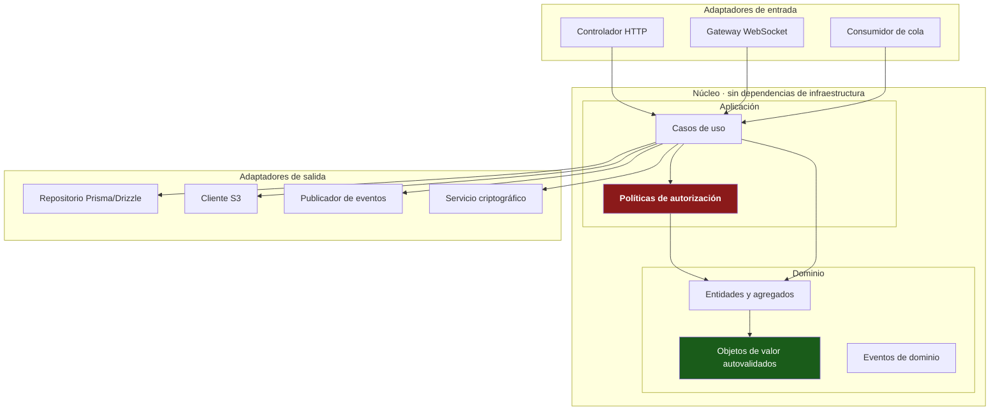

**Beneficio de seguridad:** los **objetos de valor autovalidados** (`Email`, `ProjectId`, `FilePath`, `Role`) hacen que un dato inválido sea *inconstruible*. Si el tipo `SafeFilePath` existe, es porque ya pasó la validación anti-traversal. La política de autorización vive en el núcleo, no en el controlador, así que es imposible exponer un caso de uso sin ella.

---

## 5. Nivel 3 · Componentes de los servicios críticos

### 5.1 `compile-orchestrator` + `texlive-runner`

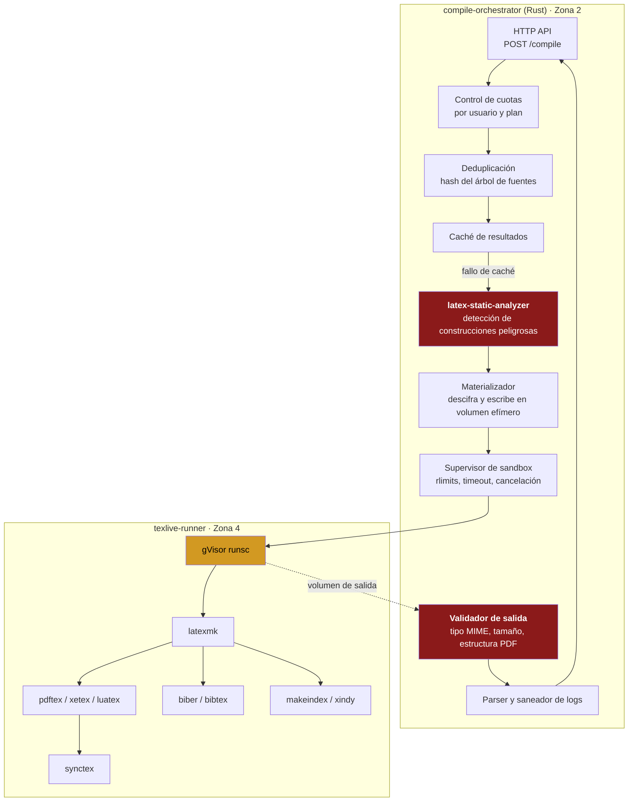

**Por qué Rust en el orquestador:** es el componente que manipula rutas, límites de recursos y salidas de un proceso hostil. La ausencia de *use-after-free*, desbordamientos y condiciones de carrera de datos elimina por construcción clases enteras de vulnerabilidad justo en el punto de mayor riesgo. Además, `tokio` permite supervisar miles de procesos con coste bajo.

**Flujo de una compilación (con puntos de control de seguridad):**

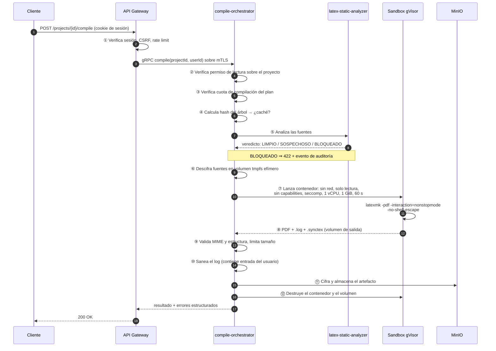

### 5.2 `collab-service` — colaboración en tiempo real

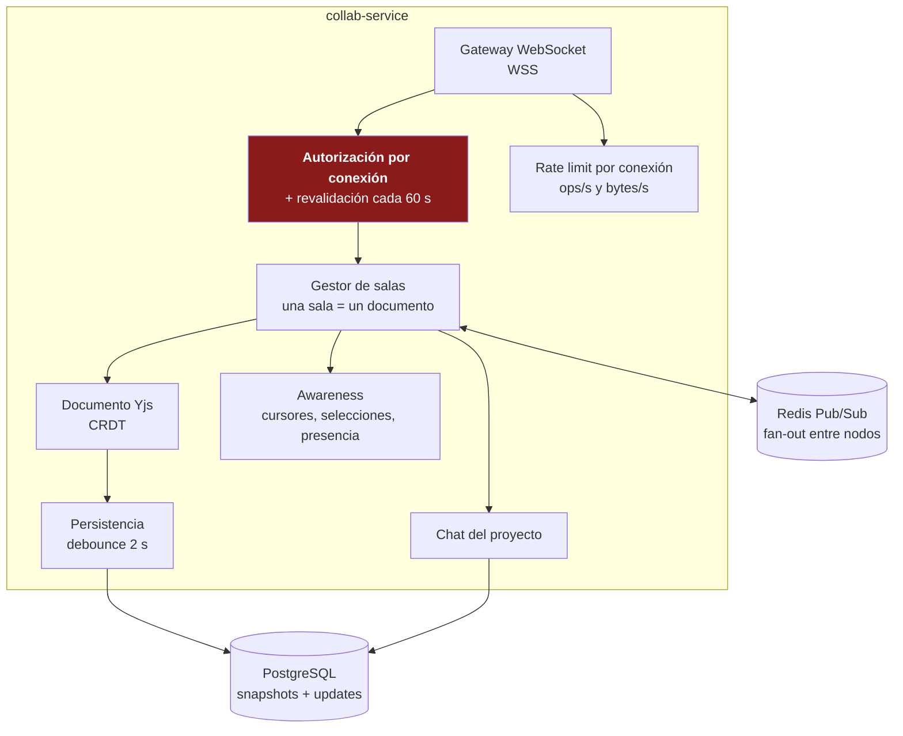

**Por qué CRDT (Yjs) y no Transformación Operacional:**

| Criterio | OT (ShareJS, como Overleaf clásico) | **CRDT (Yjs)** ✅ |
|---|---|---|
| Corrección | Requiere un servidor central que ordene; los algoritmos de transformación son notoriamente propensos a errores sutiles | Convergencia demostrada matemáticamente, independiente del orden |
| Superficie de ataque | Un cliente malicioso puede enviar operaciones con versiones falseadas y romper el estado | Las actualizaciones son idempotentes y conmutativas: una actualización maliciosa no puede desincronizar a los demás |
| Trabajo sin conexión | Difícil | Nativo |
| Coste | Menor uso de memoria | Metadatos adicionales, mitigados por la codificación binaria de Yjs |

**Decisión (ADR-0004):** Yjs, por la propiedad de seguridad: **ningún mensaje del cliente puede corromper el estado compartido**, solo añadir contenido que la autorización ya permite.

### 5.3 `auth-service` + Keycloak

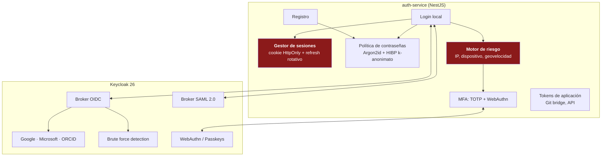

**Por qué delegar en Keycloak y no implementar OAuth a mano:** implementar correctamente OIDC, PKCE, validación de firmas JWKS con rotación, SAML con canonicalización XML (y sus ataques de *signature wrapping*) es una de las tareas más propensas a error en seguridad aplicada. Keycloak es software maduro, auditado, con soporte nativo de Google, Microsoft, ORCID, SAML, WebAuthn, detección de fuerza bruta y políticas de contraseña. **Reimplementarlo sería una decisión insegura.**

### 5.4 Flujo de inicio de sesión con Google/Microsoft

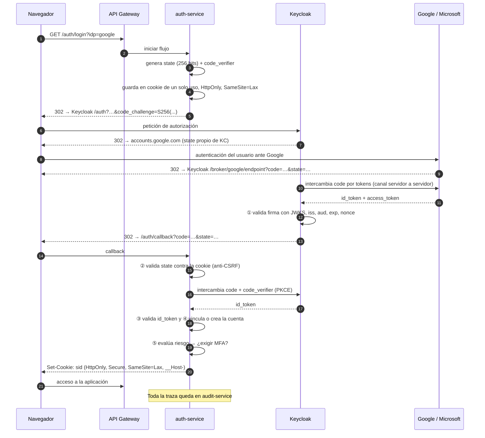

---

## 6. Vista de datos

Modelo detallado en [06-Modelo-de-Datos.md](06-Modelo-de-Datos.md). Aquí, la **estrategia de almacenamiento**:

| Tipo de dato | Almacén | Justificación |
|---|---|---|
| Identidades, proyectos, permisos, metadatos | PostgreSQL (con RLS) | Integridad referencial y control de acceso en la propia base |
| Contenido de documentos `.tex` en vivo | Yjs en memoria + snapshots comprimidos en PostgreSQL | Baja latencia, durabilidad cada 2 s |
| Historial de versiones | *Chunks* comprimidos en MinIO + índice en PostgreSQL | Volumen alto, acceso poco frecuente |
| Adjuntos binarios (imágenes, PDFs) | MinIO con SSE-KMS | Objetos grandes fuera de la base |
| PDFs compilados | MinIO con TTL y versionado | Regenerables, no críticos |
| Sesiones, colas, presencia, rate limit | Redis (TLS + ACL) | Efímero por naturaleza |
| Claves de cifrado | Vault Transit | Nunca tocan disco de la aplicación |
| Registro de auditoría | Tabla PostgreSQL append-only + réplica WORM en MinIO Object Lock | Inmutabilidad |

### 6.1 Cifrado de contenido: envelope encryption

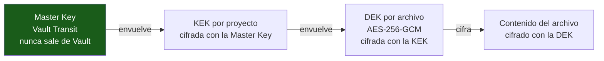

Consecuencias:
- Un volcado de la base de datos **no** revela el contenido de los documentos.
- El borrado definitivo destruye la KEK del proyecto: *crypto-shredding* instantáneo e irreversible (RS-045).
- La rotación de la clave maestra no obliga a recifrar los archivos, solo las KEK.

---

## 7. Vista de despliegue

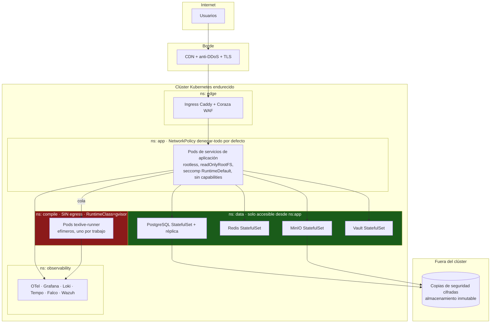

### 7.1 Políticas de red (denegar por defecto)

| Origen | Destino | Puerto | Permitido |
|---|---|---|---|
| Internet | `edge/ingress` | 443 | ✅ |
| `edge` | `app/gateway` | 8443 (mTLS) | ✅ |
| `app` | `data/postgres` | 5432 (TLS) | ✅ solo servicios con credencial |
| `app` | `data/redis` | 6379 (TLS) | ✅ |
| `app` | `data/minio` | 9000 (TLS) | ✅ |
| `app` | `data/vault` | 8200 (TLS) | ✅ |
| `app` | `compile/runner` | — | ❌ (solo por cola) |
| `compile` | **cualquier destino** | — | ❌ **egress totalmente bloqueado** |
| `data` | cualquier destino | — | ❌ salvo réplica y copias |

### 7.2 Entornos

| Entorno | Propósito | Datos | Acceso |
|---|---|---|---|
| `local` | Desarrollo (Docker Compose) | Sintéticos | Desarrollador |
| `ci` | Pruebas automatizadas efímeras | Sintéticos | Pipeline |
| `staging` | Preproducción, réplica de producción | Anonimizados | Equipo |
| `production` | Servicio real | Reales | Solo despliegue automatizado; sin acceso manual salvo *break-glass* auditado |

---

## 8. Vista de procesos: comunicación entre servicios

| Patrón | Uso | Tecnología |
|---|---|---|
| Petición/respuesta síncrona | Gateway → servicios | gRPC sobre mTLS (contratos en Protobuf) |
| Tiempo real bidireccional | Cliente ↔ collab | WebSocket seguro (WSS) con Yjs binario |
| Trabajos asíncronos | Compilación, correo, indexación, escaneo AV | BullMQ sobre Redis, con reintentos y *dead-letter* |
| Eventos de dominio | Auditoría, notificaciones, métricas | Publicación/suscripción sobre Redis Streams |
| Cliente → servidor | Todo el tráfico público | REST + JSON sobre HTTP/3, contrato OpenAPI 3.1 |

**Regla:** ningún servicio accede a la base de datos de otro. La única vía es el contrato público del servicio propietario.

---

## 9. Decisiones arquitectónicas registradas (ADR)

| ADR | Decisión | Estado |
|---|---|---|
| [ADR-0001](adr/ADR-0001-microservicios-por-frontera-de-confianza.md) | Microservicios delimitados por frontera de confianza | Aceptada |
| [ADR-0002](adr/ADR-0002-sandbox-de-compilacion-con-gvisor.md) | gVisor para el aislamiento del compilador LaTeX | Aceptada |
| [ADR-0003](adr/ADR-0003-keycloak-como-proveedor-de-identidad.md) | Keycloak como IdP en lugar de implementación propia | Aceptada |
| [ADR-0004](adr/ADR-0004-crdt-yjs-frente-a-ot.md) | Yjs (CRDT) en lugar de Transformación Operacional | Aceptada |
| [ADR-0005](adr/ADR-0005-cifrado-sobre-envolvente-con-vault.md) | Envelope encryption con Vault Transit | Aceptada |
| [ADR-0006](adr/ADR-0006-rust-para-el-orquestador-de-compilacion.md) | Rust en los componentes que tocan entrada hostil | Aceptada |
| [ADR-0007](adr/ADR-0007-postgresql-con-row-level-security.md) | RLS como segunda barrera de autorización | Aceptada |

---

## 10. Atributos de calidad y sus tácticas

| Atributo | Táctica arquitectónica | Verificación |
|---|---|---|
| **Confidencialidad** | Envelope encryption, mTLS, RLS, origen separado para contenido de usuario | Revisión + pruebas de acceso cruzado |
| **Integridad** | CRDT convergente, auditoría encadenada por hash, firma de imágenes | Pruebas de convergencia y de manipulación del log |
| **Disponibilidad** | Sin estado + HPA, colas con reintentos, límites por usuario, circuit breakers | Pruebas de carga y de caos |
| **Contención de fallos** | Sandbox con kernel independiente, namespaces separados, egress bloqueado | Ejercicio de *escape* documentado |
| **Trazabilidad** | OpenTelemetry extremo a extremo + `traceId` en cada evento de auditoría | Revisión forense simulada |
| **Rendimiento** | Caché de compilación por hash, CDN, carga diferida del editor, HTTP/3 | Presupuestos de rendimiento en CI |
| **Evolutividad** | Hexagonal, contratos versionados, ADR | Revisión de arquitectura por sprint |

---

## 11. Riesgos arquitectónicos conocidos

| Riesgo | Impacto | Probabilidad | Mitigación |
|---|---|---|---|
| Escape del sandbox de compilación | Crítico | Baja | gVisor + seccomp + sin red + sin privilegios + namespace aislado + monitorización con Falco |
| Agotamiento de recursos por compilaciones abusivas | Alto | Media | Cuotas por plan, cola con prioridad, límites duros, detección de patrones |
| Complejidad operativa excesiva para el equipo | Alto | **Media-alta** | Docker Compose completo para desarrollo; Kubernetes solo en despliegue final; automatización total |
| Curva de aprendizaje de Rust | Medio | Media | Su uso se limita a dos componentes acotados y bien especificados |
| Deriva entre documentación y código | Medio | Media | OpenAPI y diagramas generados desde el código; revisión de documentación obligatoria en cada PR |
| Dependencia de TeX Live completo (~4 GB) | Medio | Alta | Imagen base cacheada y firmada; variante ligera para desarrollo |

---

## 12. Documentos relacionados

- [04-Stack-Tecnologico.md](04-Stack-Tecnologico.md) — elección de cada tecnología y su justificación de seguridad
- [05-Seguridad.md](05-Seguridad.md) — modelo de amenazas STRIDE y catálogo de controles
- [06-Modelo-de-Datos.md](06-Modelo-de-Datos.md) — modelo entidad-relación y esquema
- [08-Diagramas-UML.md](08-Diagramas-UML.md) — clases, secuencia, actividad, estados, componentes
- [13-Infraestructura-y-Despliegue.md](13-Infraestructura-y-Despliegue.md) — infraestructura como código y operación
