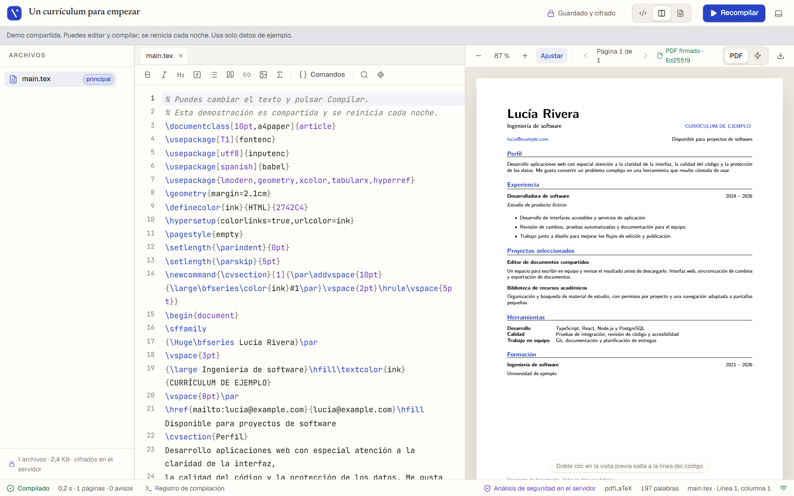

# SecureTex

Editor LaTeX para escribir en equipo y revisar el PDF mientras se trabaja. La demo abre un currículum de ejemplo editable sin registro ni contraseña.

**[Abrir la aplicación](https://securetex.dayle.dev) · [Ver el código](https://github.com/SecurTex-Devs/securetex) · [Cómo se despliega](../DEPLOY.md)**

## Qué permite hacer

Las cuentas normales pueden registrarse y verificar el correo, iniciar sesión, recuperar el acceso, crear proyectos, gestionar archivos, compartir con distintos roles, editar simultáneamente y compilar con pdfLaTeX, XeLaTeX o LuaLaTeX. El editor incluye vista rápida, visor del PDF, SyncTeX y tema oscuro.

Las capturas contienen únicamente datos sintéticos y corresponden a `1ba0fb6`, publicada el 27 de noviembre de 2026. La demo permite editar y compilar un documento compartido; el registro real está habilitado con correo externo. La sesión de demo dura 30 minutos y el documento se restaura cada medianoche de `America/Guayaquil`. Se conservaron las variables locales y se comprobaron las redirecciones de Google y Microsoft con PKCE. La entrega SMTP de prueba y el acceso completo con Google fueron confirmados por el responsable. Microsoft llega a la sesión pendiente, pero la entrega de su verificación está en revisión; véase la [validación de proveedores](../OAUTH.md). El estado de publicación de Google no equivale a una aprobación de marca observada.

## Stack de esta entrega

Versiones de los manifiestos de `1ba0fb6ed1c2fdae73bc953d8ff6088bd191c908`. Los ejecutables base se comprobaron durante la publicación del 26 y 27 de noviembre de 2026; las cuatro imágenes propias se construyeron para ARM64 con el SHA de la entrega.

| Área | Componentes reales |
|---|---|
| Aplicación web | Next.js **15.5.29**, React **19.2.9**, TypeScript **5.9.3**, Tailwind CSS **4.3.3**, Radix UI **1.8.1** |
| Edición y estado | `@codemirror/view` **6.43.14**, `y-codemirror.next` **0.3.6**, Yjs **13.6.33**, `y-protocols` **1.0.7**, Zustand **5.0.15**, TanStack React Query **5.104.3** |
| Vista de documentos | PDF.js (`pdfjs-dist`) **4.10.38**, KaTeX **0.18.11**, DOMPurify **3.4.17** |
| API | Node.js **22.23.5**, NestJS **11.2.7**, Fastify **5.12.8**, Prisma **6.19.3**, WebSocket `ws` **8.22.0**, Zod **4.6.7** |
| Identidad | `jose` **6.2.12**, Argon2 **0.44.0**, `otplib` **12.0.1**, `openid-client` **6.8.8**, Nodemailer **10.1.4** |
| Criptografía | `node:crypto` en el servidor; `@noble/ciphers`, `@noble/curves` y `@noble/hashes` **2.4.0** en el navegador |
| Datos | PostgreSQL **17.12**, roles separados de identidad, aplicación y auditoría; RLS forzada |
| Compilación | Trabajador Node.js, **TeX Live 2022/Debian**, pdfTeX **1.40.24**, kpathsea **6.3.4** |
| Producción | Oracle **ARM64, 4 núcleos**; Docker **26.1.3**, gVisor **release-20261123.1** con `systrap`, nginx **1.30.8**, cloudflared **2026.11.2** |
| Verificación | pnpm **12.8.1**, Vitest **4.1.12**, ESLint **10.15.0**, Playwright **1.65.1**, axe **4.14.1**, Gitleaks **8.30.1**, MkDocs **1.6.1** |

Las versiones completas y sus dependencias transitivas quedan fijadas en los manifiestos y lockfiles de [backend](../../backend/apps/api/package.json), [frontend](../../frontend/package.json) y [herramientas de CI](../../tools/ci/package.json). Las fuentes Newsreader, Roboto y Roboto Mono se sirven desde la aplicación con sus licencias.

## Arquitectura de la versión capturada

```mermaid
flowchart LR
    browser["Navegador: editor, Yjs y verificación del PDF"]
    edge["Cloudflare HTTPS"]
    tunnel["cloudflared: túnel propio"]
    gateway["nginx: gateway privado"]
    web["Next.js: interfaz y BFF"]
    api["API modular NestJS"]
    db[("PostgreSQL: datos cifrados y RLS")]
    jobs["Buzón tmpfs de compilación"]
    controller["Controlador de trabajos Node.js"]
    launcher["Comando SSH restringido del host"]
    compiler["TeX Live: gVisor efímero, sin red"]
    reset["Restauración nocturna de la demo"]
    browser <-->|"HTTPS, C1 y C2"| edge
    edge <--> tunnel
    tunnel <--> gateway
    gateway <--> web
    web <-->|"REST interno"| api
    gateway <-->|"WebSocket"| api
    api <--> db
    api <--> jobs
    jobs <--> controller
    controller -->|"SSH: SHA y UUID validados"| launcher
    launcher -->|"Crea y destruye un contenedor por trabajo"| compiler
    compiler <-->|"Solo el subdirectorio del trabajo"| jobs
    reset --> db
    classDef central fill:#1f6feb,color:#fff
    classDef protected fill:#1a5c1a,color:#fff
    classDef boundary fill:#d29922,color:#000
    classDef hostile fill:#8b1a1a,color:#fff
    class api,web,controller central
    class db protected
    class tunnel,gateway,jobs,launcher boundary
    class compiler hostile
```

La API concentra los casos de uso y separa dominio, aplicación, infraestructura y presentación. REST pasa por el BFF de Next.js; la colaboración WebSocket llega a la misma API a través del gateway. PostgreSQL guarda documentos, estado colaborativo e historial cifrados. Un controlador prepara el trabajo en el buzón y solicita por SSH restringido su ejecución. El host monta exclusivamente ese subdirectorio en un contenedor gVisor sin red y lo destruye antes de entregar el resultado. La API y el controlador no reciben el socket de Docker.

Los siete contenedores persistentes de SecureTex y los trabajos efímeros tienen límites de CPU, memoria y procesos. Ninguno publica puertos del host. Se usan tres redes propias: aplicación interna, túnel/controlador y salida de autenticación/correo. Cada compilación usa `network=none`, con una ejecución concurrente. La producción conserva los servicios que ya existían en Oracle.

## Seguridad implementada y alcance

| Control | Implementación comprobable |
|---|---|
| Cifrado del contenido desde el cliente | C1 con AES-256-GCM; sobre C2 con X25519, HKDF-SHA-256 y ChaCha20-Poly1305; verificación de etiquetas antes de entregar contenido |
| Archivos en reposo | AES-256-GCM con AAD de proyecto, archivo y versión; claves envueltas con AES-256-KW y HMAC-SHA-256 comprobado antes de descifrar |
| Columnas personales | Cifrado autenticado por construcción AES-256-CBC + HMAC-SHA-256 e índices ciegos para búsquedas; claves por propósito |
| Identidad y autorización | Argon2id, cookies HttpOnly, comprobación de Origin/CSRF, revocación y rotación de sesiones, TOTP, políticas de endpoint y autorización por proyecto |
| Base de datos | RLS habilitada y forzada; roles distintos; la API no recibe las credenciales del propietario de la base |
| Ejecución de LaTeX | gVisor, sin red, raíz de solo lectura, usuario sin privilegios, capacidades eliminadas, tmpfs y límites de CPU/memoria/PID; `shell_escape=f`, `openin_any=p`, `openout_any=p`; plazo de 30 s |
| Integridad del PDF | Firma Ed25519 del artefacto y verificación en el navegador antes de mostrarlo o descargarlo; PDF.js no ejecuta acciones del documento |
| Demo pública | Endpoint dedicado, identidades sin contraseña ni administración, alcance a un solo proyecto, sesión de 30 min, cuotas y restauración nocturna exclusiva de los datos sintéticos |
| Límites de abuso | 10 entradas/IP/h y 100 globales/h; 3 compilaciones/IP/min y 60 globales/h; 120 peticiones/IP/min y 1200 globales/min |
| Entrega | Main protegida incluso para administradores, check obligatorio, imágenes ARM64 por SHA, clave SSH de comando forzado, copia previa, comprobaciones de salud y reversión automática |

**Límites actuales:** la API puede descifrar para compilar; esta entrega no ofrece confidencialidad frente al operador. La firma es de aplicación: el PDF descargado no lleva una firma PAdES incrustada. La clave maestra vive en el `.env` del servidor con permisos 600. Las diferencias entre la arquitectura objetivo y la implementación están en la [revisión local](../docs/18-Revision-Local.md).

La ampliación para cuentas privadas incorpora [un contenedor efímero por compilación](../docs/adr/ADR-0012-sandbox-efimero-por-compilacion.md), activado en producción. Se probó en Oracle con tres trabajos reales: buzón ajeno inaccesible, ausencia de restos y destrucción tras un bucle infinito. La entrega ejecutó además una compilación aislada antes del cambio de gateway y se recompiló desde la demo pública. Esto no acredita el consentimiento completo de Google o Microsoft.

## Resultados medidos

La tabla corresponde a la [validación de `1ba0fb6`](https://github.com/SecurTex-Devs/securetex/actions/runs/46012784630), con sus informes descargados. El primer intento de entrega se bloqueó por un permiso de lectura del manifiesto público de migraciones, antes de cambiar la aplicación; tras corregirlo se reintentó el despliegue y pasó. Cada captura identifica su revisión en las [métricas y procedencia](metrics.json).

| Comprobación | Resultado observado |
|---|---|
| Unitarias de la API | **142 aprobadas**, 8 archivos |
| Casos de abuso contra servicios reales | **82 aprobados**, 10 archivos, **0 omitidos** |
| Reinicio de demo | 2 escenarios aprobados: restaura e invalida sesiones de demo; recupera una noche pendiente conservando datos y sesiones normales |
| Navegadores | 11 comprobaciones de flujo con Chromium **159.0.8154.6** y Firefox **159.0**, incluida colaboración bidireccional, PDF y vuelta a cuenta normal |
| Accesibilidad | **0 infracciones axe** en 12 variantes: portada, privacidad y condiciones; cada una en escritorio/móvil, claro/oscuro |
| Lint y tipos | ESLint sin errores; TypeScript de backend y frontend aprobados |
| Dependencias | **0 avisos** en `pnpm audit` de backend y frontend y `npm audit` de herramientas de CI |
| Secretos | **0 detecciones de Gitleaks** en el historial analizado |
| Contratos y documentación | OpenAPI regenerado sin diferencias; MkDocs `--strict` aprobado |
| Buzón y configuración | **3 pruebas Linux** del controlador y **9** de carga de credenciales/configuración aprobadas |
| Cobertura unitaria: líneas API | **451/2609 = 17,28 %** |
| Cobertura unitaria: sentencias API | **537/3077 = 17,45 %** |
| Cobertura unitaria: funciones API | **104/680 = 15,29 %** |
| Cobertura unitaria: ramas API | **303/1539 = 19,68 %** |
| Apertura de demo en producción, escritorio | **6545 ms** desde el clic hasta el PDF visible, una ejecución |
| Recompilación en producción, escritorio | **3147 ms** hasta volver a mostrar el PDF verificado, una ejecución |
| Apertura y recompilación, móvil | **5504 ms** y **2979 ms**, una ejecución; las tres solicitudes de compilación respondieron 200 |
| Descarga de ejemplo | **110345 bytes**, cabecera PDF válida y firma verificada por la aplicación |
| Aislamiento del despliegue | 20 contenedores previamente activos y un inicializador ya detenido conservaron ID, arranque, reinicios, redes y puertos |

La cobertura corresponde a las unitarias de `backend/apps/api/src/**/*.ts`. Las pruebas de integración se ejecutan contra contenedores sin instrumentación de cobertura; no se suman a ese porcentaje. Los objetivos de 80 % global y 100 % en áreas críticas de la planificación **no están alcanzados**. Los tiempos anteriores son observaciones individuales desde el equipo de revisión, no medias ni garantías de latencia. La comprobación de accesibilidad corresponde a las tres páginas públicas indicadas, no certifica toda la aplicación.

La [revisión con OWASP ZAP](../docs/22-Revision-ZAP.md) conserva el resultado bruto y sus límites: 20 115 peticiones, 13 tipos de alerta y 68 de 75 reglas completas. Se revisaron las evidencias y se endurecieron las cabeceras, el optimizador de imágenes y OPTIONS sin modificar cookies, cifrado ni permisos para ocultar alertas. No se declara un resultado de cero vulnerabilidades ni se borran los informativos. Una prueba directa adicional confirmó acceso válido 200, cookie alterada 401 y CSRF incorrecto/ausente 403/403.

La pasada pasiva posterior en producción registra cero tipos altos, uno medio, cinco bajos y seis informativos (230 instancias). Todos los medios y bajos de ese recorrido pertenecen a `/cdn-cgi/`, gestionado por Cloudflare. El informe conserva esas observaciones y delimita el alcance; no equivale a una repetición del escaneo activo.

### Entrega automática probada

El [PR documental #6](https://github.com/SecurTex-Devs/securetex/pull/6) cambió únicamente una frase. Tras fusionarlo, la [ejecución 45860202752](https://github.com/SecurTex-Devs/securetex/actions/runs/45860202752) publicó imágenes por SHA y actualizó producción de `5770f55` a `9030558` sin ejecutar un despliegue manual.

Después, el [PR de prueba #7](https://github.com/SecurTex-Devs/securetex/pull/7) añadió una expectativa falsa en una rama aislada. Su [ejecución final](https://github.com/SecurTex-Devs/securetex/actions/runs/45862774509) registró 118 unitarias aprobadas y la única falla intencional; omitió imágenes y despliegue. Producción mantuvo `9030558`. El PR se cerró sin fusionarlo. La prueba descubrió además una limpieza prematura de CI, corregida y publicada en [#8](https://github.com/SecurTex-Devs/securetex/pull/8).

También se provocaron fallos de salud después de cambiar el gateway, uno interno y otro en la sonda HTTPS pública. Ambos restauraron la versión anterior y conservaron los contenedores ajenos. Se verificó la retención efectiva de **3 versiones** y **3 imágenes por componente**. La operativa breve está en [DEPLOY.md](../DEPLOY.md).

## Reto de la publicación

El reto fue ejecutar LaTeX no confiable en ARM64, sin red y junto a los servicios que ya estaban usando Oracle. El servidor no tenía KVM: se instaló gVisor ARM64 con `systrap`, comprobando el checksum de la distribución y recargando Docker sin reiniciarlo ni cambiar su runtime predeterminado. Se verificó una compilación real dentro de ese aislamiento. Las imágenes posteriores se construyen en runners ARM nativos de GitHub.

El cambio de versión también debía conservar el estado colaborativo. La API anterior vacía sus cambios de Yjs antes de detenerse; si falla la candidata, se detiene y vacía esta antes de reactivar la anterior. Las reversiones controladas comprobaron el comportamiento. El registro previo y posterior de contenedores permitió acreditar que los otros servicios mantuvieron sus procesos, redes y puertos.

## Autoría y colaboración

El repositorio pertenece a **SecurTex-Devs**. El 26 de noviembre de 2026, la API de GitHub devolvió estos cinco miembros: `DaGeus15`, `Jhanina03`, `PabloAML1`, `seby10` y `T1Angel4220`.

La revisión de autoría se cerró en `1ba0fb6ed1c2fdae73bc953d8ff6088bd191c908`: **164 commits en main**, todos asociados por la API de GitHub a **[@DaGeus15](https://github.com/DaGeus15)**. Git muestra dos nombres de esa cuenta: `Dayle Garcia` (155) y `Daylé García Fernández` (9). Los **107 commits** anteriores a esta revisión, hasta `3aa2f52`, también pertenecen a ese historial.

Hay asistencia registrada: **89 commits** iniciales incluyen una línea `Co-Authored-By: Claude Opus 5.5` (conteo sin distinguir mayúsculas). La revisión, demo y publicación de esta entrega también se realizaron con asistencia de Codex. La atribución principal de Git no acredita una escritura exclusivamente manual.

| Aportación | Evidencia disponible |
|---|---|
| Código de frontend, API, compilador, seguridad y documentación versionada | Historial atribuido a la cuenta de Dayle, con las coautorías de asistencia indicadas |
| Revisión de dependencias, pruebas, demo, despliegue y CI de esta entrega | Commits y PR enlazados de la misma cuenta, realizados con asistencia de Codex |
| Trabajo de los otros cuatro miembros | No se encontraron commits ni coautorías a sus nombres en el historial revisado; el plan describe responsabilidades genéricas y `site_author: Equipo SecurTex` no demuestra una ejecución individual |

**Pregunta pendiente para Dayle:** ¿qué aportaciones del equipo se hicieron fuera de Git —diseño, pruebas manuales, decisiones, presentación u otras tareas— y cómo deben acreditarse? La ausencia de commits no permite concluir que no existieron.

## Capturas reales de producción

Capturadas desde `https://securetex.dayle.dev`, con identidades y texto de demostración. Escritorio: viewport **1440 × 900**, escala **1,5**, PNG **2160 × 1350**. Móvil: viewport **390 × 844**, escala **2**, PNG **780 × 1688**. Los PNG conservan el viewport completo, sin composiciones ni cambios del DOM para simular estados.

| Estado | Escritorio | Móvil | Qué muestra |
|---|---|---|---|
| Portada | [PNG](screenshots/landing-escritorio.png) | [PNG](screenshots/landing-movil.png) | Producto, recorrido real del editor y botón de demo; referencia académica al código en el pie |
| Editor | [PNG](screenshots/editor-escritorio.png) | [PNG](screenshots/editor-movil.png) | Documento de ejemplo abierto sin login, código editable y controles reales |
| Colaboración | [PNG](screenshots/colaboracion-escritorio.png) | [PNG](screenshots/colaboracion-movil.png) | Cambios enviados desde Firefox y respondidos desde Chromium, con dos usuarios sintéticos distintos |
| Compilación | [PNG](screenshots/compilacion-escritorio.png) | [PNG](screenshots/compilacion-movil.png) | Análisis previo de una compilación real en curso; estado ocupado y último resultado conservado |
| PDF verificado | [PNG](screenshots/pdf-firmado-escritorio.png) | [PNG](screenshots/pdf-firmado-movil.png) | PDF renderizado tras verificar Ed25519 y descarga comprobada; el sello textual se oculta en el diseño móvil |
| Tema oscuro | [PNG](screenshots/editor-oscuro-escritorio.png) | — | Editor real en Firefox con el tema oscuro de la aplicación |
